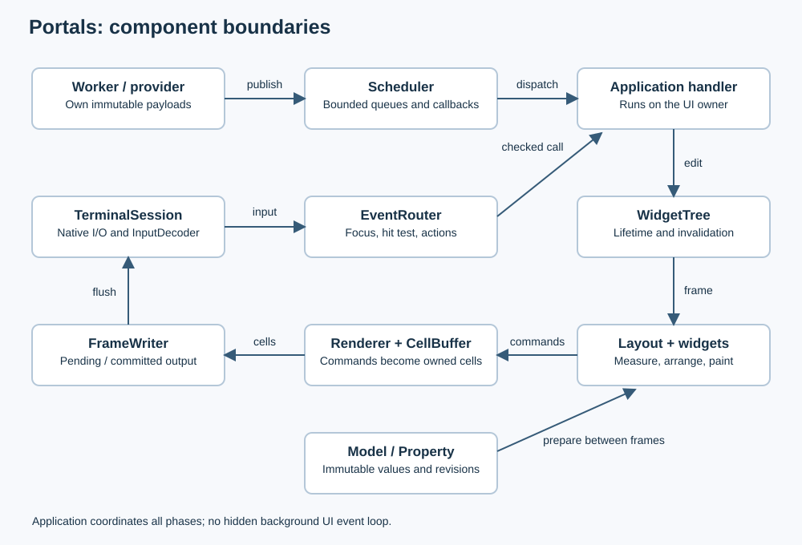
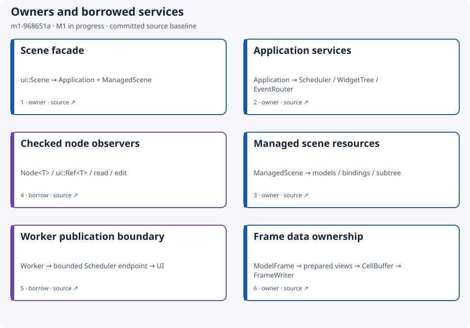
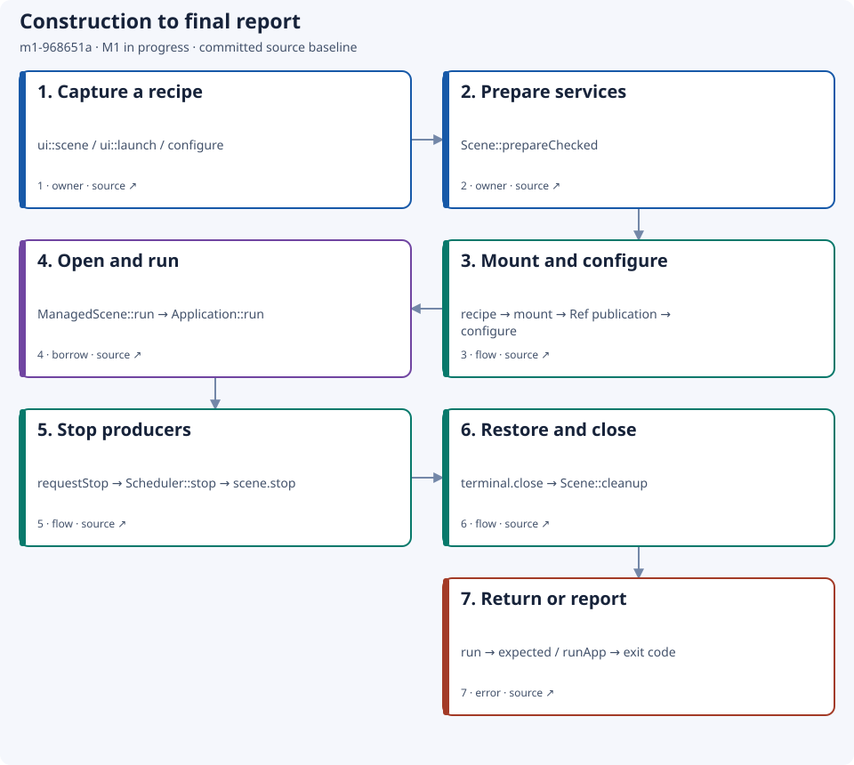
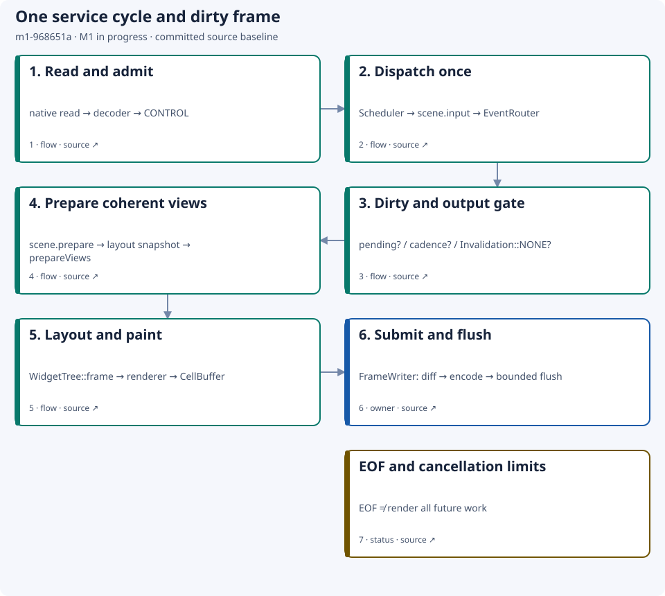
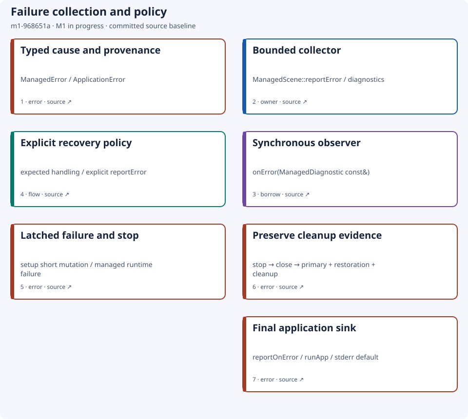
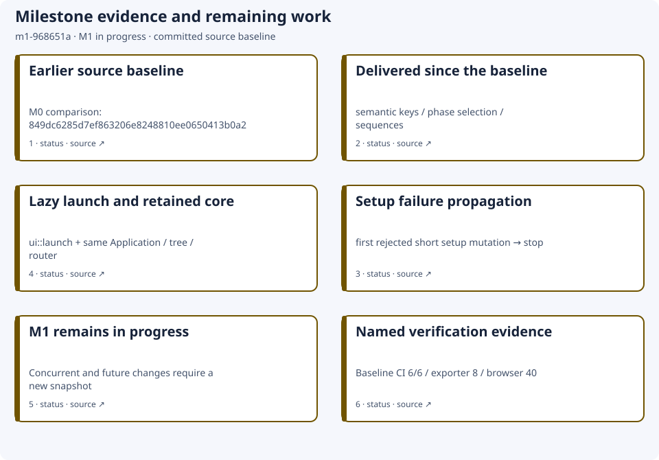
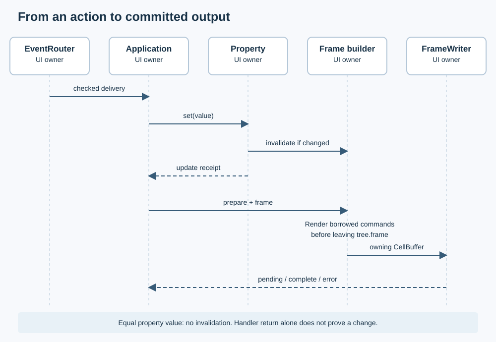
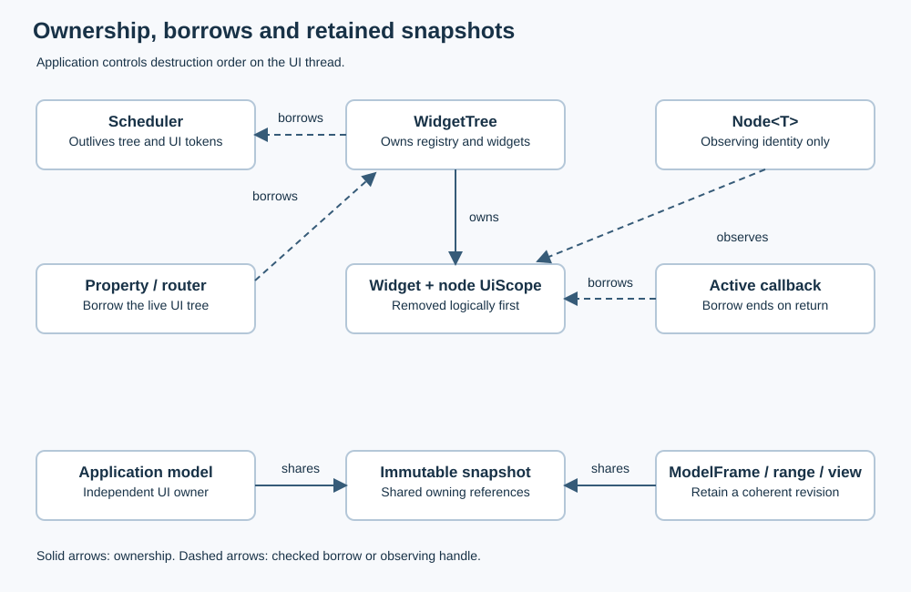

# Architecture {#architecture}

[Русская версия](ru/architecture.md)

Portals is a C++23 retained terminal UI library. Start with the
[complete application](application.md) for the fluent `ui::Scene` entry point:
the facade owns the application and managed scene, builds the controls lazily,
and runs the same scheduler/tree/router described here. [`Application`](../include/portals/application.hpp) owns one UI
runtime and services its terminal synchronously on the creating thread. The
scene owns application models, scoped bindings and providers. Workers may
publish immutable data through bounded scheduler endpoints; they cannot edit
the widget tree. [Getting started](getting-started.md) links a simple main and
the runnable examples; [limitations](limitations.md) defines release boundaries.

## Components and boundaries

[Planned multiline editor contracts](editor-contracts.md) describe a future
document/view extension and its language-provider boundaries. They do not change
the implemented components below.

| Component | Implemented responsibility |
|---|---|
| `Application` | Own scheduler/tree/router; coordinate bounded input, dispatch, preparation, frames, output and orderly cleanup |
| `ApplicationScene` | Borrow UI services; own domain models/bindings/providers; synchronize and prepare views; stop owned producers |
| `TerminalSession` / `InputDecoder` | Native bounded I/O and semantic input; Windows events are not decoded twice |
| `Scheduler` | Separate CONTROL/DATA capacities and dispatch budgets; timers, publication and scoped cancellation |
| `EventRouter` | Focus, hit testing, action resolution and checked delivery through the existing dispatcher |
| `WidgetTree` | Own widget storage, identities, geometry and invalidation; expose checked callback borrows |
| `Property<T>` / `Model<T>` | Immutable value/revision and snapshots; explicit observers, scoped ranges and request receipts |
| Layout, controls, virtual views, `Chart<T>` | Measure/arrange/paint; prepare coherent bounded presentation before frames |
| Typed themes / PSS v0 | Resolve styles and apply validated atomic theme updates; no second rendering path |
| Renderer / `CellBuffer` | Consume clipped borrowed commands into owning desired cells inside the frame |
| `FrameWriter` | Encode/diff, retain pending output, advance committed state only after consistent acceptance |
| `Diagnostics` | Optional bounded causal metadata; owning snapshot and export chosen by the application |

The core uses standard-library and native OS interfaces. Grapheme processing
uses the private vendored utf8proc dependency. Doxygen, fuzzers and test oracles
are build tools, not runtime dependencies. See [text](text.md), [render](render.md),
[terminal](terminal.md), [styles](styles.md) and [chart](chart.md).

## Versioned architecture maps

The [offline architecture viewer](architecture/snapshots/m1-968651a/index.html)
contains ownership, lifecycle, frame, errors and milestone maps. All data is
embedded; it needs no server, CDN or additional installation. Choose English or
Russian, a map and a node to inspect its contract and pinned source. Tab and
Enter operate the controls. Each map exports an independent SVG. Source links
open GitHub and require a connection.

This snapshot describes source revision
`968651a90b6a1542fd3ab2cec159b457e548681f`. **M1 remains in progress.**
It excludes later uncommitted work and does not assert milestone acceptance.
An updated architecture map for the current M1 working tree is pending source
revision pinning and publication; this historical snapshot remains unchanged.
The comparison baseline is `849dc6285d7ef863206e8248810ee0650413b0a2`.
Baseline integration was published as [PR #36](https://github.com/ttldtor/portals/pull/36),
whose [CI run](https://github.com/ttldtor/portals/actions/runs/38799649714)
completed six checks successfully for PR head `28723ed04810c597c2fe31f0d75cd9416c5916ac`,
then merged as the pinned source revision. Snapshot authoring separately passed
eight exporter/source/help tests and 40 offline browser combinations across maps,
languages, themes and widths (1440/390 px), including real SVG downloads.
These authoring checks do not run the C++ runtime suite. The complete generated
documentation and delivered artifact for this new foundation are **NOT_VERIFIED**
at this snapshot's authoring boundary; integration checks remain required.
The prose after the maps describes the current checkout and can evolve after
this pinned snapshot.

Blue cards describe owners, purple cards observers or borrowed services, green
cards work coordination, red cards error boundaries, and ochre cards status and
limits. Text also names each role. Lifecycle and frame arrows show the normal
successful path; the error map explains failure exits. Other card order is a
reading path; ownership relations are explicit in each node's details.

### Maintaining snapshots

The readable [maps.json](architecture/snapshots/m1-968651a/maps.json) generates
the checked-in SVG and HTML. SVG exports work without JavaScript in repository
Markdown and generated documentation. SDK users need no Python, Node.js or diagram
renderer. Authors use the existing Python developer-tool environment and the
standard-library-only [exporter](developer-tools-build.md#tool-architecture).

For an integrated milestone, create a new directory named
`<milestone>-<source-revision-prefix>` under `docs/architecture/snapshots`.
Copy the manifest, set a unique `id`, full `revision`, comparison revision and
accurate bilingual status. Update every node and source reference against that
revision; describe new behavior, changed guarantees and retained invariants.
Intermediate snapshots use an in-progress status; closure requires the project's
verification and review evidence. Future targets have no fabricated revision or
generated snapshot.

Generate and check with `--source <directory>/maps.json`. Verify pinned links,
exact regeneration, EN/RU parity, SVG text and connectors, desktop and narrow
screens, both themes, keyboard navigation and export. Obtain bounded independent
fact review and check the delivered documentation artifact. Add the snapshot to
this page and its translation; register its directory in the documentation asset
copy step. Keep previous snapshots unchanged; corrections get a new snapshot ID.
The publishing commit records the exporter/template version and verification
evidence. The manifest `revision` identifies runtime source and can precede the
commit that publishes its documentation.

## One event loop, explicit service bounds

`Application::run` coordinates the loop; `Scheduler::dispatch` performs one
bounded dispatch and starts no thread. Each service cycle admits bounded input,
dispatches once, prepares/renders a ready dirty frame at most once, and services
pending output at most once. One native batch/raw suffix and one rejected CONTROL
owner survive admission pressure. Input is retained rather than silently dropped.
Windows supplies decoded events; POSIX bytes retain arrival timestamps for
streaming decoder deadlines.

The native terminal read is the wait primitive. Positive `inputSlice` deadlines
also bound when worker publications are serviced; scheduler `waitFor` is not a
universal wait covering native terminal I/O. Pending output prevents another
submission, leaving dirty state in the tree. Frame cadence is measured from actual
submission/completion; late work causes no catch-up burst. Idle samples input and
resize, but emits no periodic frame without invalidation.

CONTROL and DATA have separate capacities and budgets. `REPLACE_LATEST` can
coalesce a complete display snapshot for the same sender. Lossless domain
aggregation must happen first: dropping a display snapshot is different from
dropping a financial tick. The dashboard aggregates each generated tick into
OHLC before publication; its provider runs on the UI thread. Queue bounds limit
retained owners, not arbitrary payload bytes or callback duration.
See [scheduler](scheduler.md) and [Application](application.md).

## From input and models to output

1. Admission creates a diagnostic input token when tracing is enabled, then
   publishes an owning CONTROL payload. The queued token survives dispatch.
2. `scene.input` may handle a global command; otherwise EventRouter resolves
   focus/hit target and action, then invokes the checked handler.
3. Property assignment compares immutable values. An equal value creates no
   new invalidation; a changed value invalidates and queues observers. A successful
   property receipt can still report notification rejections.
4. When a dirty frame can be submitted, `scene.prepare` synchronizes bindings
   and takes one pin per model. Sibling table/chart views prepare from that pin
   at their final extents. Provider request receipts are handled outside painting.
5. Inside `WidgetTree::frame`, Application lays out and paints visible nodes,
   translating local commands through arranged surfaces and clips. The renderer
   consumes every borrowed text command into an owning CellBuffer before returning.
6. FrameWriter receives that buffer and the actual frame token. Diff/encoding and
   bounded flush happen outside layout/paint. Partial output stays owned; committed
   state advances only on complete consistent acceptance.

A paint/preparation/render failure ends the run with its original component
cause; Application does not replace failed widgets with an implicit placeholder.
The tree alone does not roll back earlier paint submissions. No partially built
frame is submitted by the runner on failure.

The causal chain records queue admission/dispatch, target/action, handler and
Property evidence, invalidation/frame ID, and actual diff/output outcomes.
Coalesced causes can share a frame; the frame token identifies its first recorded
cause rather than an unbounded cause list. Handler return proves neither a domain
change nor a displayed frame. A real update can produce an empty diff.
Transport acceptance proves no physical display. Ring losses and incomplete
chains remain explicit. [Diagnostics](diagnostics.md) defines these distinctions;
export snapshots after terminal restoration.

## Ownership and shutdown

When using `Application` directly, construct it first and the
`ApplicationScene`/bindings/models afterward; destroy them before Application.
With `ui::Scene`, the facade enforces its internal owner order; release external
services borrowing the application through `scene.onStop` before managed teardown. The runner borrows the scene for one single-use run.
Callbacks must not destroy/reenter either owner. Application releases router/tree
before scheduler; retained immutable snapshots have their own payload lifetimes.

`Node<T>` observes session/slot/generation and owns no widget. Checked
`read/edit` lend a reference only during the callback. Removal closes node scopes
and invalidates handles immediately; an active borrow defers physical reclamation
until its outer boundary. Cancellation prevents new callbacks but does not unwind
one already running or join a provider. [Widget tree](widget-tree.md) and
[model](model.md) explain those guarantees.

Stop closes the scheduler, calls `scene.stop` to cancel/join scene-owned
producers, then closes the terminal. The same cleanup is attempted after errors
and pre-requested cancellation. `ApplicationError` retains the first phase/cause
and a separate restoration error. Diagnostics/error printing belongs after run.

EOF finishes decoding, delivers admitted CONTROL and flushes submitted output.
It does not wait for future frames/timers/DATA. A delivered edit may stay dirty
and never appear in the final frame.
Cancellation can stop earlier. A retryable output transaction stays with
FrameWriter; any transport error, including Windows `OUTPUT_UNCERTAIN`, ends
the run without reopening or replaying uncertain bytes. Native close depends on
host/driver progress and has no hard shutdown deadline.

Managed geometry observation uses that same loop. `Ref::geometry()` reads an
owning snapshot from the last successful final layout and returns a typed error
while geometry is invalid; the read does not arrange or render. Scene-owned
`onLayout` observers receive initial and changed snapshots on a later dispatch,
outside `WidgetTree::frame`. Queue pressure retains the latest pending snapshot
for bounded recovery through the existing scheduler. At EOF, the runner drains
only pending layout observations owned by that scene; it does not wait for
unrelated DATA or create a final frame outside the configured frame cadence.

The style-layer benchmark records paired legacy/layered workloads, ordinary
allocation counts and requested bytes inside the measured update and frame
phases, plus work counters and raw samples. Its quality adapter retains the raw
JSON with provenance. These observations exclude aligned allocations, `malloc`,
live/peak memory and work outside those phases, so they describe the stated
workload rather than universal runtime cost.

Scene resources use the existing lazy scene recipe and mount transaction.
The recipe copies a string source when it is built; it reads an explicitly
typed file source during scene preparation. Before any resource node is mounted, the loader parses and
validates the full bounded grammar, builtin or explicitly registered type and
property schema, duplicate IDs, and resolved text. It then builds recipes that own their widget descriptions and mounts them
through the enclosing transaction.
Localization uses the supplied `TextResolver`; PSS remains its own existing
style stage. The defaults cap input at 1 MiB, node count at 4096, depth at 64,
each decoded string or resolved text at 64 KiB, and properties per node at 16.
The hard depth ceiling is 64 because parsing uses the native stack. Typed
resource failures retain the source text or file path and byte position,
with the file system cause preserved for file errors. See the [scene loading guide](scene-loading-guide.md)
for syntax and the public calls.

## Coherent views and customization

`ModelFrame<T>` pins one immutable revision. Sibling virtual lists/tables/charts
use independent scoped ranges of the same pin, retaining bounded visible
presentation plus overscan. Tables read one range for all columns. Stable
`RowId`/`ColumnId` identities preserve meaning across reorder; an index cannot.
Readiness, errors and cancellation remain explicit. Preparation starts no hidden
provider worker. See [virtual list](virtual-list.md), [virtual table](virtual-table.md),
[scroll](scroll.md) and [chart](chart.md).

Extend ApplicationScene for global input and model preparation, public widget
hooks for custom presentation, typed formatters for columns, and options for
resource bounds, width policy and cadence. Retain owning prepared data through
rendering; paint must not perform I/O, mutate models or dispatch the scheduler.
Typed themes/PSS change presentation within the same tree/frame path.

The runnable [examples](examples.md) include owning declarative scenes and custom
widgets. The experimental [UI coroutine adapter](ui-coroutines.md) runs bounded
timer and receive waits on the existing scheduler. Application-wide Undo/Redo,
system clipboard adapters and Drag-and-Drop remain planned work; see
[planned features](planned-features.md) for status and milestones.
