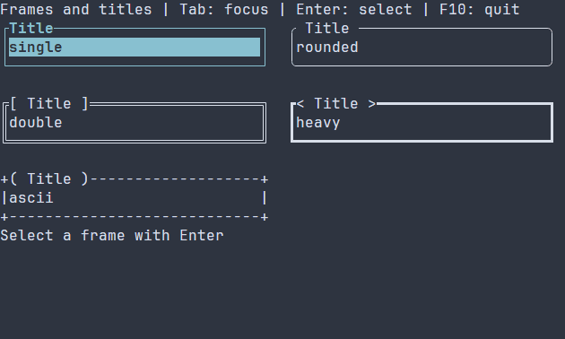

# Borders and frames {#border-guide}

[Русская версия](ru/border.md) · [Compact primitives](compact-primitives.md) · [Layout](layout.md)

Use `ui::border(child)` or its `ui::frame` alias to place one child inside a decorated boundary. The frame owns the child recipe as part of the scene and clips the child's paint and input to the inner area. Use a plain layout when no boundary is needed.

## A complete application

This gallery is a larger example: it puts plain buttons in five frame patterns and title decorations. Tab moves focus, Enter activates a choice and updates the caption, and F10 exits. `runApp` reports errors and restores the terminal.



\include guide_frame_styles.cpp

Build `guide_frame_styles` in the [standalone guide project](examples.md), or `portals_docs_frame_styles` with `PORTALS_BUILD_TESTS=ON`, then run the executable in a terminal. See [package setup](package.md) for an installed SDK.

## Configure the frame

The example uses `.framed("rounded", "Title").titleDecoration("spaced")` on a button; `.framed(...)` wraps the control, so its action still belongs to the button. `FrameOptions` defaults to `FramePattern::SINGLE`, all four sides, an empty title, START title alignment and `TitleDecoration::NONE`. Supported built-in patterns are single, rounded, double, heavy and ASCII; title decorations are none, spaced, square, angle, round and profile. Custom frame glyphs and title ends are configured through owning `FrameOptions`, not ordinary PSS. The title does not increase intrinsic width; only a whole-grapheme prefix fitting the top edge is shown.

`BorderOptions::glyphs` defaults to Unicode with ASCII fallback when a glyph is not one cell under the receiving width policy; ASCII can be requested explicitly. `maxPaintCells` defaults to 16384 and must be positive. A cap exceeded by the allocated perimeter returns `WOULD_BLOCK` even when partially clipped. `maxTitleBytes` defaults to 4096; invalid title or decoration text is rejected. A frame with empty allocation paints nothing; very small allocations collapse edges and may have no inner content. The frame does not fill the inner content.

The scene owns the `Border`; an observing `ui::Ref<Border>` can be published with `.reference(ref)`. The frame has no independent action: contained controls keep their own focus, keyboard and mouse behavior. Loaded scenes register `Border` as a container with ordinary children; use a named `scene.get<Border>(...)` for an observing reference. See [scene resources](scene-loading-guide.md) and [frame configuration](controls.md#control-frames).

## Styling reference {#border-styling-reference}

The natural selector is `Border`. It paints normal, focused and disabled, with disabled first. A rule without state applies to all variants; `:selected`, `:header` and `:caret` are not painted. Constructor `ControlStyle` is the manual base: terminal colors, normal text, bold focus and italic disabled; theme and PSS override individual fields. The frame does not pass its style to its child.

Common `foreground`/`background` use `#RRGGBB`; `bold`, `italic`, `underline` use `true` or `false`. For independent line, title and title-end appearance, combine each of these five names with `frame-line-`, `frame-title-` or `frame-ends-`; omitted part attributes fall back to the resolved common style. `glyph-profile` defaults to `default` and `glyph-fallback` to `unicode`; explicit custom glyphs take precedence. PSS does not set the pattern, sides or title text. Accepted profiles, fallback rules and all part properties are in [the frame styling reference](compact-primitives.md#primitives-styling-reference).

```pss
Border { frame-line-foreground: #7d8797; frame-title-foreground: #f2c879; }
Border:focused { frame-ends-bold: true; }
```

Runtime PSS also accepts `width` and `height` as nonnegative cells, `auto`, `fit-content` or `flex(positive weight)`, and `min-width`, `max-width`, `min-height`, `max-height` as nonnegative cell bounds. Size selectors cannot include state or `:read-only`; conflicting bounds reject the update. Compile-time PSS supports `min-width` among these size properties. See [layout](layout.md) and [cascade](styling-guide.md).

See `portals::Border`, `BorderOptions`, `FrameOptions`, `ui::border`, and `ui::frame` for exact signatures.
