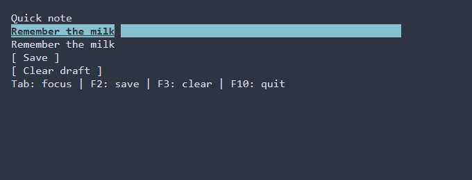

# Buttons {#button-guide}

[Русская версия](ru/button.md) · [Widget gallery](widget-gallery.md) · [Shared actions](actions.md)

Use `ui::button` to invoke an action with Enter, Space or the left mouse button.
Use a checkbox or switch for a persistent Boolean value. A disabled button does
not activate. An ordinary button caption has a bracket outline; `ui::plainButton`
keeps the same behavior with caption-only drawing.

## A complete application

The button appends one undoable edit to the text field. F10 closes the scene.
The runner reports failures and restores the terminal; the example defines no
CLI parser or terminal replay harness.

\include click_handlers/main.cpp

Build `portals_click_handlers` with `PORTALS_BUILD_EXAMPLES=ON`. For an application
using the installed SDK, see [package setup](package.md). A button in the
[quick-note form](first-application.md) looks like this; this image shows that
larger form, rather than the minimal program above:



## Events and text

Keep a `ui::Ref<Button>` to add a later `ui::onClick` handler or change its text.
`button.text() = "Save"` updates the caption through the scene's diagnostic
boundary. `ui::onClick(ref, handler)` accepts a nullary handler or click parameters;
multiple handlers run in registration order until explicitly stopped with
`params.stop()`. See [click handlers](declarative-ui.md#pipe-click-handlers).
For a command shared with menus and keys, use [actions](actions.md).

## Styling reference {#button-styling-reference}

The natural type is `Button`; `.id("save")` or a class narrows a selector.
Normal, focused and disabled are painted, with disabled taking priority.
Checked action metadata does not introduce a button `:selected` paint role;
there is no `:hover` pseudo-state. Manual `ControlStyle` defaults are terminal
colors, bold focus and italic disabled text before themes. Theme and application
rules override individual fields; omitted fields retain lower-layer values.

| Property | Values / effect |
|---|---|
| `foreground`, `background` | `#RRGGBB`; caption, outline and allocated surface share the resolved style |
| `bold`, `italic`, `underline` | `true` or `false`; explicit false clears the lower-layer attribute |
| `width`, `height` | Cells, `auto`, `fit-content`, `flex(positive weight)` in runtime PSS |
| `min-width`, `max-width`, `min-height`, `max-height` | Nonnegative hard bounds in cells; runtime PSS, with compile-time support for min-width only |

Size selectors cannot depend on state or read-only. An exact width inconsistent
with hard bounds rejects the update and preserves the last valid style/geometry;
see [size policy](layout.md). A wider button centers its caption between the
brackets at its allocated edges; height does not vertically center the one-line
caption. There are no separate PSS properties for bracket strings, rounding or
outline/caption colors. Use `ui::plainButton` inside a [styled frame](compact-primitives.md#primitives-styling-reference)
for another contour. Frame decoration is independent from button chrome.

```pss
Button#save { width: fit-content; min-width: 12; bold: true; }
Button#save:focused { foreground: #ffffff; background: #245070; }
Button#save:disabled { foreground: #7d828c; italic: false; }
```

Apply these rules with `ui::style(...)` or `ui::styleFile(...)`; name the button
`save` in the recipe or loaded scene. [The cascade](styling-guide.md) explains
theme/layer/selector precedence; [basic controls](controls.md#basic-controls-styling-reference)
cover shared low-level defaults. PSS appearance does not change activation or
make the button read-only.

## API reference

See `portals::Button`, `portals::ButtonChrome` and `portals::ui::Ref` for exact
signatures. The scene owns the mounted control; a Ref is an observing handle.
