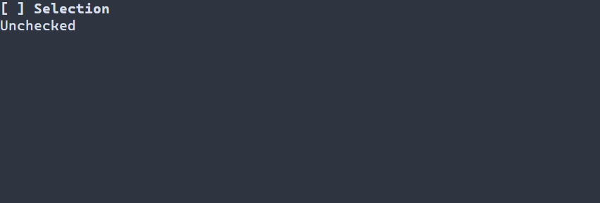

# Checkboxes {#check-box-guide}

[Русская версия](ru/check-box.md) · [Three states](three-state.md) · [Switch](switch.md)

Use `ui::checkbox` for an independent on/off choice, such as opting into notifications. A [Switch](switch.md) can present a setting such as network on/off; both can bind a Boolean value, and an accepted user change updates that bound value, while the application controls side effects and persistence. Use `ui::threeState` when a mixed value is part of the interaction, or a radio group for one choice among alternatives.

## A complete application

This complete program uses a `CheckBox` with its optional three-state cycle and reports each user change in a label. Space or Enter changes it, and F10 or Ctrl+C exits; `runApp` reports errors and restores the terminal.



\include guide_check_change.cpp

Build `portals_docs_check_change` with `PORTALS_BUILD_TESTS=ON` and run it in a terminal. For a Boolean checkbox, the supported recipe is `ui::checkbox("Alerts", true)`; omitting the initial value uses the context default, otherwise unchecked. See [build setup](getting-started.md) and [package setup](package.md).

## State, input and resources

A Boolean model toggles unchecked and checked. `CheckState` additionally represents `MIXED`; `CheckBoxOptions::cycle` defaults to `TWO_STATE`, where mixed advances to checked. `.threeState()` selects unchecked → checked → mixed → unchecked. Unmodified Enter, Space and left mouse press activate; release, motion, paste and modified gestures do not. Hidden or disabled ancestry prevents activation. There is no separate read-only checkbox mode.

`ui::Ref<CheckBox>` observes the mounted widget; `ui::onChange(ref, handler)` receives successful user changes as in the example. External model updates do not invoke that business callback. A commit is not rolled back when observer notifications are rejected. The scene owns the binding and widget; the Ref does not extend their lifetime. For typed receipts and shared model behavior see [binding policy](controls.md) and [three-state details](controls.md#check-box-with-three-states).

Resources support `CheckBox#enabled { "Enabled"; checked = true }`; retrieve it with `scene.get<CheckBox>("enabled")`. See [scene resources](scene-loading-guide.md).

## Styling reference {#check-box-styling-reference}

The natural selector is `CheckBox`. Normal, focused and disabled paint the entire caption and marker, with disabled first. Checked and mixed values select `[x] ` and `[-] `; unchecked uses `[ ] `. They do not select `:selected`; header and caret are not painted. Marker strings are fixed and have no separate PSS glyph or color property.

| Property | Values and effect |
|---|---|
| `foreground`, `background` | `#RRGGBB`; foreground and fill |
| `bold`, `italic`, `underline` | `true` or `false`; explicit false overrides a lower layer |
| `width`, `height` | Nonnegative cells, `auto`, `fit-content`, `flex(positive weight)` in runtime PSS |
| `min-width`, `max-width`, `min-height`, `max-height` | Nonnegative cell bounds; only `min-width` also works in compile-time PSS |

Size declarations cannot depend on a state or `:read-only`; conflicting bounds reject the update and retain the last valid style and geometry. See [layout](layout.md). Manual `ControlStyle` uses terminal-default colors, normal text, bold focus and italic disabled text. Theme and PSS rules override individual fields; unspecified fields retain lower-layer values. See [the cascade](styling-guide.md).

```pss
CheckBox { min-width: 12; }
CheckBox:focused { foreground: #ffffff; background: #245070; }
CheckBox:disabled { italic: true; }
```

See `portals::CheckBox`, `CheckState`, `CheckBoxOptions`, `ui::checkbox` and [basic styling](controls.md#basic-controls-styling-reference).
