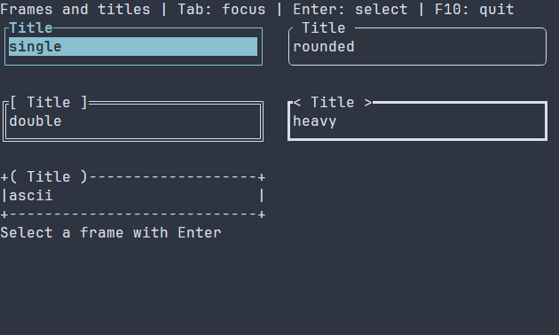

# Compact frames, gauges and sizing

[Русская версия](ru/compact-primitives.md)

Build a small retained scene with standard widgets. The button uses the existing
Button/action/router path with caption-only chrome; Enter, Space and a left press
activate it. F10 also exits. No client widget subclass or polling loop is needed.

## Frame patterns and title decorations

Frame patterns are independent of title decoration. The built-in patterns are
`single`, `rounded`, `double`, `heavy` and `ascii`; title decoration can be
`none`, `spaced`, `square`, `angle` or `round`. A `plainButton` body can be used
inside a frame.


[Static PNG frame](images/frame-styles.png)

In the recording, Tab moves focus, Enter selects a frame and updates the
caption below, and F10 quits. Build `guide_frame_styles` with the
[standalone guide project](examples.md). The
[complete source](examples/guide_frame_styles.cpp) is included below.

\include guide_frame_styles.cpp

## Ordinary composition

```cpp
#include <portals/ui.hpp>

int main() {
  using namespace portals;

  auto content = ui::vbox(ui::label("Transfer"),
    ui::gauge(.65).width(24),
    ui::plainButton("Exit", [] {
      ui::quit();
    }));
  auto scene = ui::scene(ui::hbox(
    ui::border(std::move(content)).width(30).height(7)));

  scene.onKey(key::F10, ui::quit);

  return scene.runApp();
}
```

## Pipe composition

```cpp
#include <portals/ui.hpp>

int main() {
  using namespace portals;

  auto scene = ui::scene(ui::hbox(
    ui::vbox(
      ui::label("Transfer"),
      ui::gauge(.65).width(24),
      ui::plainButton("Exit", [] {
        ui::quit();
      }))
      | ui::border()
      | ui::width(30)
      | ui::height(7)));

  return scene
    | ui::onKey(key::F10, ui::quit)
    | ui::runApp();
}
```

## Size and flex policy

`width(cells)` and `height(cells)` replace only the selected axis with fixed
nonnegative bounds. `flexX(weight)`, `flexY(weight)` and `flex(weight)` select the
existing flex mode with a positive weight and a zero preferred basis, preserving
minimum/maximum bounds. This shares the available space by weight even when a
child measures its entire offered viewport. Modifiers run in
order at mount: `width(10).flexX()` still has a ten-cell cap; `flex().height(3)`
keeps horizontal flex and fixes height. Negative dimensions and zero weights
produce `ManagedError` with `TreeError::INVALID_ARGUMENT`; the failed subtree
is removed and references remain unpublished. The same operations are available
as consuming methods and pipe stages. Parent layouts apply these policies;
the application root itself receives the viewport extent.

`fitWidth()` and `fitHeight()` select `SizeMode::CONTENT`: the widget prefers
its intrinsic extent, can shrink to its hard minimum when space is scarce, and
does not grow to consume spare cells. `minWidth(cells)`, `maxWidth(cells)`,
`minHeight(cells)` and `maxHeight(cells)` change only the corresponding leaf
bound; the same operations are available as `ui::fitWidth()`, `ui::fitHeight()`,
`ui::minWidth(cells)`, `ui::maxWidth(cells)`, `ui::minHeight(cells)` and
`ui::maxHeight(cells)` pipe stages. These constraints are applied after the
recipe's ordinary setup. Thus `.width(20).fitWidth()` remains exactly 20 cells,
while `.fitWidth().minWidth(8)` prefers intrinsic width but never allocates less
than eight. A framed sized widget keeps its content/flex preference; these
modifiers constrain the outer frame. Numeric inner bounds are not copied to it.

Menus default to content sizing on both axes. Other widget families keep their
existing defaults. Content sizing prefers intrinsic dimensions without using
spare space and can shrink only as far as its hard minimum.
Hard minima remain in force when a viewport is clipped. A minimum above a
configured maximum is invalid; dialog or toast caps that conflict with a hard
minimum fail typed layout. Their default small-viewport clamp remains in place.

## Frame and gauge contracts

### Update a retained gauge {#gauge-ref-commands}

Use `ui::gauge(progress, .25)` with `ui::Ref<Gauge> progress` to observe the
mounted gauge. In a button callback or scene configuration after mounting,
`progress.value(.5)` replaces its value and `progress.adjust(.125)` adds to it.
Both return `std::expected<void, ManagedError>` and also collect failures once
through the existing scene error path. Ignoring a failure in a void action
callback records diagnostics but does not end the run. Return the checked result
from the callback to propagate failure through the action adapter: the default
`runApp` policy then reports it and ends the run without collecting it twice.
During scene configuration, ignored short-command failures stop preparation
through the existing setup scope. Check a successful result before publishing
related client state.

The complete [progress workbench](../examples/progress_workbench/main.cpp)
combines a named work item, fractional steps, reset/complete buttons, a status
label and a bounded event log. Build `portals_progress_workbench` with examples
enabled and run it in a terminal; F10 exits through the ordinary runner cleanup.
The gauge owns its value; the example does not maintain a second numeric model.

Commands require a live mounted reference on its construction UI thread, between
frames. A missing/destroyed scene yields `CLOSED`, a removed node `STALE_NODE`, a
foreign thread `WRONG_THREAD`, and a frame/lease conflict `WOULD_BLOCK`. Gauge is
presentation-only; disabled state still permits these programmatic writes. NaN/infinity,
addition overflow and any result outside the inclusive range yield
`INVALID_ARGUMENT` without mutation or invalidation; adjustments never clamp.
Equal replacements and unchanged sums, including zero deltas, request no redraw.
There is no new property subscription, timer or owner. Existing resource-created
Gauge nodes use the same commands after resolving a typed `Ref<Gauge>`.

### Rendering and low-level operations

`border(child, options, style)` and its `frame` alias own one consuming child
recipe. They mount within the same transaction, including nested refs and child
errors. A one-cell inset is measured and placed by the existing LinearLayout.
The inner clip also constrains fixed/minimum-size overflow for painting and hit
testing. Empty allocations paint nothing. One-cell rows/columns collapse to
corners and the remaining edge; two-by-two frames contain four corners and no
content. Frame painting never clears or paints the inner content.

`gauge(value, options, style, policy)` is strictly determinate. Defaults are a
range of `[0, 1]`, ten-cell intrinsic width and one-cell intrinsic height. Bounds
must be finite with `minimum < maximum` and a finite representable span; values
must be finite and inside the inclusive range. Invalid values, NaN/infinity,
negative preferred widths and zero paint caps fail with `INVALID_ARGUMENT`.
The fill covers `floor(width * fraction)` columns across the allocated height.

Use `setGaugeValue(tree, node, value)` or `adjustGaugeValue(tree, node, delta)`
between frames: each validates before changing
state, requests only paint, and requests no redraw for an equal value. Inside an
already dirty `onPrepare` callback, `Gauge::display(value)` updates the snapshot
without requesting another frame. Neither operation creates a timer or animation.

`BorderOptions` and `GaugeOptions` select Unicode or ASCII glyphs and a positive
`maxPaintCells` cap (default 16384). Each decoration owns its GraphemeText with
the complete receiving WidthPolicy, including revision/emoji/ambiguous policy.
A Unicode decoration measuring more than one cell falls back to ASCII. A frame
checks its allocated perimeter, and a gauge its allocated area, before submitting
commands. Over-cap paint returns `WOULD_BLOCK`, even for a partially clipped
allocation; raise the explicit cap only when the surrounding render budgets also
permit it. Fully clipped nodes follow the existing tree skip behavior. The widget's
paint implementation allocates no heap storage. Submitted text stays widget-owned
through the enclosing tree frame; the renderer consumes it before that frame ends.

`ControlStyle` passed to these factories owns foreground/background and other
normal/focused/disabled values. These are manual defaults beneath theme rules,
not explicit theme overrides. For Border/Gauge these defaults are construction-only;
dynamic colors use the existing style resolver, including exact-Ref application
styles, so cached computed styles and theme precedence stay coherent. Border/Gauge participate in the existing style
resolver and disabled-ancestor synchronization. `plainButton` returns the same
`Button` as `button`, so existing refs, bindings, keyboard and pointer routing work;
only mandatory brackets are removed. Existing `button` defaults keep their brackets. Both factories map caption resource
limits to `NODE_LIMIT`, malformed UTF-8 to `INVALID_ARGUMENT`, and preserve the
original `TextError` payload and transactional cleanup.

## Scoped application style

This complete example gives the button owning constructor defaults and an exact-Ref
application style. `ui::style(ref, pss)` copies its source before deferred mounting;
its application layer overrides theme declarations and survives theme replacement.
The `*` selector still matches only the referenced node because the layer has an
exact node scope. Scoping does not change selector matching: a managed Button
automatically has type `Button` and also matches `Control` selectors. Explicit
metadata follows the [style target contract](styles.md).
An unsuccessful factory publishes neither its refs nor a partial scoped style;
the same Ref and owning style stage can be used in a fresh scene.

```cpp
#include <portals/ui_style.hpp>

int main() {
  using namespace portals;

  ui::Ref<Button> exit;
  ControlStyle defaults;
  defaults.normal.foreground = RgbColor{180, 180, 180};

  auto scene =
    ui::scene(ui::border(ui::vbox(ui::gauge(.65).width(24),
      ui::plainButton(
        "Exit",
        [] {
          ui::quit();
        },
        defaults)
        .reference(exit))));

  scene
    | ui::style(exit,
      "* { foreground: #ffffff; background: #203040; }");

  return scene
    | ui::onKey(key::F10, ui::quit)
    | ui::runApp();
}
```

## Low-level extension and compatibility

Existing three-argument `WidgetTree::arrange` semantics are unchanged. The additive
four-argument overload intersects an extra surface `contentClip` into the node's
ordinary inherited/root clip; descendants inherit the resulting geometry clip.
`Layout::childClip` defaults to the full allocation, so existing Row/Column/Grid,
Overlay and custom layouts keep their allocation and clipping behavior. Border
uses the hook for its inner clip. Invalid custom clips and overflowing transforms
return typed geometry errors, and the caller discards the failed pass.

The added virtual hook and Button storage require rebuilding the SDK and consumers.
Source compatibility is preserved; compatibility with old object files is not promised.
See [declarative composition](declarative-ui.md) and [layout policies](layout.md).
