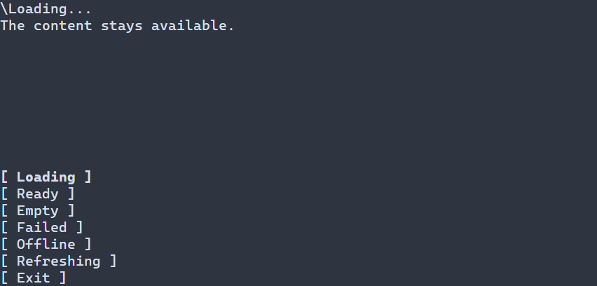

# Present data loading states {#data-presentation}

[Русская версия](ru/data-presentation.md)

A results screen may need to show loading, then ready content or an empty result,
and explain a failure with an explicit retry. `ui::dataStateView` presents those
states around an existing content subtree: the application or supported virtual
view supplies the state, and an optional callback performs retry. Pending work can
show an animated indicator. The wrapper does not fetch data or virtualize content.
For content that is always available and has no changing data status, use the
ordinary content directly. This is the common loading/empty/error presentation
pattern, without requiring a particular data source.



Loading presentation with content kept available.

## Run an explicit presentation

This controlled demonstration changes presentation with buttons; it does not load
data or provide a retry operation. It starts ready,
keeps its label visible in every state and exits with **Exit** or F10. A button's
checked `display` result reaches the standard `runApp` diagnostics. The scene owns
the controls; `presentation` is an observing reference.

\include guide_data_state.cpp

To build this guide in the Portals source tree, enable `PORTALS_BUILD_TESTS`, then
build and run `portals_docs_data_state`. For your own application, link
`portals::core` as described in [using the installed package](package.md).

`ui::dataStateView(DataPresentation{...}, content)` owns its presentation value.
Only this mode accepts `ui::Ref<DataStateView>::display` or the explicit checked
`setDataStateView(tree, node, value)` operation. Use `DataContentPolicy::REPLACE`
in `DataStateConfig` when independently owned work permits hiding the body outside
`READY` and `REFRESHING`. The default `KEEP_BODY` keeps it live.

## Observe scene state

Pass a same-scene `ManagedState<DataPresentation>` or a read-only
`ManagedSource<DataPresentation>` instead of the initial value. For example, inside
a scene factory with a `ManagedScene &owner`:

```cpp
return owner.state(DataPresentation{DataPhase::LOADING})
  .transform([](auto state) {
    return ui::dataStateView(state, ui::label("Results"));
  });
```

The producer changes its state through its existing checked `set` operation.
`display` rejects both bound forms with `TreeError::INVALID_ARGUMENT`; binding a
writable state does not give the view a writable alias.

For explicit and bound values, `generation` must be nonzero. A value older than
the last accepted generation is ignored after thread, lifetime and frame checks.
An equal generation may change phase, including pending to terminal; an equal
value is a no-op. Advance the producer's generation when cancelling or superseding
work: presentation cannot distinguish competing completions with the same number.
The selected producer or binding remains fixed for the mounted view.

## Follow a virtual view

Use the overload with only a managed `VirtualList` or `VirtualTable` recipe to
follow its prepared viewport range. Given the `model` and formatter from
[the virtual list guide](virtual-list.md), replace its returned recipe with:

```cpp
return ui::dataStateView(
  ui::virtualList(model, [](const ModelRow<std::string> &row) {
    return displayText(row.value);
  }));
```

The wrapper reads owning status facts from the body's same successful preparation.
It does not pin or query the model again, maintain a second cache or install a query
subsystem. The body remains live in all phases so its existing provider callback
can receive and complete work. `REPLACE` and `display` are rejected in this mode.
The wrapper's fixed presentation generation of 1 is separate from model request
generations and revisions.

| Prepared range | Presentation |
| --- | --- |
| No preparation yet, pending rows, or an active request without ready rows | `LOADING` |
| Ready rows with an active request | `REFRESHING` |
| Failed range without an active request | `FAILED` |
| Successful zero logical row count | `EMPTY` |
| Ready nonempty rows without an active request | `READY` |

`OFFLINE` is explicit domain information; the wrapper never infers it from an
error message. Refreshing preserves only content the existing provider/view permits
to remain ready; it does not invent stale data. An explicit retry of a failed base
range retains its current request until completion or ordinary cancellation, even
when indicator frames prepare the view again.

## Labels, retry and failures

`DataStateConfig::labels` owns `TextValue` messages and the optional retry caption.
Literal UTF-8 and resource keys use the receiving scene's width policy. Supply
`resolver` for resource keys; resolution and text validation happen at mount, with
no automatic locale subscription. To change locale, construct a new composition
with the desired labels and resolver.

The standard theme applies to the status composition. `messageStyle` and
`retryStyle` supply manual styles beneath theme resolution. The semantic classes
are `data-status`, `data-spinner`, `data-message` and `data-retry`; see
[style layers](style-layers.md) for precedence.

`retry` is an optional owning callback returning `std::expected<void, TreeError>`.
The retry button appears for `FAILED` and `OFFLINE`; only explicit activation calls
it. For automatic views, use the body's existing `retryVirtualList` or
`retryVirtualTable` operation in that callback. Pending work suppresses repeated
activation. No request starts just because the strip appears, and no focus is
stolen when an error appears.

A domain `DataPhase::FAILED` is separate from a technical failure. Invalid options,
allocation failures, formatter/provider callbacks and text-resource errors retain
their original typed causes through existing managed diagnostics. A technical
failure does not become an offline or failed domain state. Initial mount is checked
and rolls back on refusal. In own-value mode, a refused `display` or
`setDataStateView` update publishes no partial status or text. This guarantee covers
presentation changes; removals by application callbacks and model updates retain
their own effects and existing typed error and stop policy.

The strip reserves `statusRows` terminal rows (default 1), including while ready.
It uses one scoped one-shot timer at `spinnerInterval` (default 100 ms), rearmed
only for visible, enabled pending content with a nonempty clip. Hidden, removed or
closed views stop animation; ready and static states do not poll. Set `showStatus`
to false to omit the strip, labels, retry button and timer. In that configuration,
`retry` must be empty; a configured retry callback makes mount return
`TreeError::INVALID_ARGUMENT`.

See the [public data presentation declarations](../include/portals/data_presentation.hpp)
for settings and the [declarative API](declarative-ui.md) for scene lifetime and
error handling.


## Styling reference {#data-presentation-styling-reference}

`DataStateView` is a Column composition, not a surface inheriting its colors into
children. Its status parts have stable style subjects:

| Subject | Appearance |
|---|---|
| `Row.data-status` | Status layout; does not paint a fill itself |
| `DataStateIndicator.data-spinner` | One-cell pending indicator, normal/disabled |
| `Label.data-message` | Status message, ordinary Label styles |
| `Button.data-retry` | Optional retry button, normal/focused/disabled |

The root and status parts also carry the current phase class: `ready`, `loading`,
`empty`, `error`, `offline`, `refreshing`. These are classes (`.error`), not new
pseudo-states. No child ID is assumed. `showStatus=false` creates none of these
status children. `messageStyle` supplies manual message/indicator defaults;
`retryStyle` supplies retry defaults before theme/PSS overrides.

The common paint properties are `foreground` and `background` (`#RRGGBB`),
`bold`, `italic`, and `underline` (`true` or `false`). Unspecified fields keep
their manual defaults or lower style-layer values; an explicit `false` is an
override. See [selectors and precedence](styling-guide.md). Runtime PSS sizing
accepts `width`, `height` (cells, `auto`, `fit-content`, `flex(weight)`) and
`min-width`, `max-width`, `min-height`, `max-height` (nonnegative cells).
Size rules require state-independent selectors; conflicting bounds reject the
update. Only `min-width` of these size declarations is supported by compile-time
PSS. See [size policy](layout.md).

The status strip reserves `statusRows` (default 1). `DataStateLabels` configures
messages; indicator frames are built in, and `spinnerInterval` defaults to 100 ms.
These are `DataStateConfig` settings, not `status-rows` or spinner PSS properties.
Styling does not change the phase, hide content, start requests or invoke retry.

```pss
Label.data-message.error { foreground: #e65a5a; }
DataStateIndicator.data-spinner { foreground: #62b4d7; }
Button.data-retry:focused { bold: true; }
```
