# Declarative composition {#declarative-ui}

`<portals/ui.hpp>` supplies owning, single-use descriptions in `portals::ui`.
They compose ordinary controls and custom widgets on the existing
[managed lifecycle](managed-controls.md). A description is a construction value;
it is not another widget tree or a reactive runtime. Mounted objects remain
owned by `WidgetTree`, while `ManagedScene` retains bindings and presentation work.

## Own a lazy scene

A standalone program can use the standard exit and reporting policy:

```cpp
#include <portals/ui_style.hpp>

/** @brief Run a minimal lazy scene with a late click handler and a runtime stylesheet.
 * @return Zero on success, one on a typed setup/runtime failure after library cleanup/reporting.
 * Click Add Hello to append one undoable text change; F10 quits. This minimal program defines no CLI options.
 * The standard runner owns terminal restoration. Automated checks compile this example;
 * headless consumer tests exercise the same registration and event semantics separately.
 */
int main() {
  using namespace portals;

  ui::Ref<LineEdit> message;
  ui::Ref<Button> add;

  auto scene = ui::scene(ui::vbox(ui::lineEdit(message, ""), ui::button(add, "Add Hello")));

  return scene | ui::style("Button { bold: true; }") |
         ui::onClick(add,
                     [message] {
                       message.text() += "Hello!";
                     }) |
         ui::onKey(ui::key(InputKey::F10), ui::quit(scene.ref())) | ui::runApp();
}
```

`Scene::runApp()`, `ui::runApp(scene)` and `scene | ui::runApp()` delegate to the
same existing `run()` boundary: zero on success, one on a typed failure. All forms
accept an optional stop token and a borrowed custom/replay `ApplicationTerminal`.
The final pipe stage borrows its lvalue or temporary scene for the synchronous
call; it does not move it. `scene.run()` and `scene | ui::run()` retain the owning
`expected<ApplicationStats, ManagedError>` result for embedding and explicit logs.
Typed run does not invoke the final report sink or impose stderr I/O.

The compact program constructs its recipe before entering the final `runApp`
boundary. Allocation or capture-copy exceptions during that construction can
still escape `main`; the exit-code policy does not retroactively catch them.
Use the factory-based `runApp(factory, setup)` form described below when the
application also needs the library to guard recipe construction.

For an exit button, the current callable command is
`ui::onClick(exitButton, ui::quit(scene.ref()))`. A no-argument imperative
`ui::quit()` inside a callback is planned with the current-scene context (U125);
it is not available in this version. The explicit `SceneRef` is an observing
handle and does not keep a destroyed scene alive.

`quit()` requests orderly cancellation through the existing `Application`.
It is UI-only and idempotent while the scene is live. Before preparation, or
inside its recipe/configuration, the intent waits until complete successful
mount and deferred configuration; bindings finish before cancellation. During
a prepared configuration or running callback, the current action finishes
before cleanup. Notification/close reentry returns sticky `WOULD_BLOCK`;
a closed/moved scene returns `CLOSED`, and a foreign thread returns `WRONG_THREAD`
without changing the owner. Pre-run quit preserves the native runner's
opening/restoration path; it does not promise to skip terminal acquisition.

`runApp` delivers one final report after terminal close/restoration was attempted
and the existing scene cleanup boundary returned. Primary, independent runner/restoration, and cleanup
causes returned by the existing lifecycle remain in the owning
`SceneReport::failure` envelope. A current lower-layer limitation remains:
`WidgetTree` catches `Widget::unmount` exceptions and sends them only to its
optional tree error sink; that path does not return them through managed cleanup.
`runApp` does not recover swallowed callback errors or claim that every unmount
hook succeeded. The default
`reportToStderr` formatter uses symbolic categories, source locations and native
error codes without C++ allocation. When restoration fails, ordinary stderr is a
best-effort fallback; a restoration failure is retained rather than declared
successful. Repeated final calls do not duplicate a report. Foreign-thread,
moved-from and nested calls return one quietly: only an admitted outer call can
establish the terminal restoration boundary. Use typed `run()`/`checked()` to
inspect rejected-call causes.

`onError` is the application reaction channel: its existing non-veto notification
timing is unchanged, and observer exceptions stay separate from the primary cause.
`reportOnError` independently selects diagnostic delivery; neither registration
order nor clearing an observer changes reporting priority:

```cpp
scene.onError([](const ManagedDiagnostic &diagnostic) {
  // React to the operation failure without terminal output during the live run.
}).reportOnError([](const ui::SceneReport &report) {
  // Forward the final structured report to an application logger after cleanup.
  ui::reportToStderr(report);
});
```

Both method and `ui::reportOnError(sink)` pipe modifier own a copyable callable
accepting `const SceneReport&` and returning void. Captures remain alive through
synchronous delivery; explicitly borrowed services must outlive `runApp`.
`reportOnError()` or `reportOnError({})` selects the default sink. Reporting is a
read-only final boundary: typed lifecycle reentry returns `WOULD_BLOCK` quietly,
fluent mutation/registration attempts do nothing, and the completed result stays
unchanged. Self-removal/replacement during delivery is rejected; the active sink
and captures remain alive until it returns. Sink exceptions invoke the default
formatter once with the original report, bypassing both the sink and `onError`;
they do not replace the typed primary or recursively generate diagnostics.
Success with recoverable diagnostics keeps exit zero and reports only bounded
retained/dropped counts. The sink does **not** deliver each recoverable record:
`diagnostics()` provides their detailed owning envelopes. Clean success is quiet.

Construction of recipes, captures, stages, and function arguments before final
stage evaluation remains outside `runApp`. It does not catch arbitrary exceptions
from that earlier work. Lazy recipe, configuration, and runtime callbacks execute
inside their documented checked boundaries and preserve typed failures. Use an
ordinary application `try`/`catch` around construction if its exceptions require
an exit-code policy. The existing ui::runApp(factory, setup) overload can place recipe construction inside its checked boundary; argument evaluation before entering that boundary is still outside it.

The complete program above captures observing Ref values and passes a weak SceneRef to quit. A user callback that explicitly borrows `&scene` must keep that facade stationary and alive; a move does not rewrite arbitrary C++ captures. Compose consuming modifiers before installing such self-referencing callbacks.

An ordinary form can also use `ui::scene` to own its existing `Application` and
`ManagedScene`. Preparation mounts the complete form and publishes its `Ref`s;
it performs no terminal I/O. Late Ref handlers can be registered directly in the pipe; they bind after successful mount, without a configure wrapper:

```cpp
ui::Ref<LineEdit> field;
ui::Ref<Button> apply;

auto form = ui::scene(ui::vbox(
  ui::lineEdit(field, "initial"),
  ui::button(apply, "Apply")));

form | ui::onClick(apply, [field] { field.text() += "!"; });

auto result = form.run();
```

`lineEdit(string_view)` copies initial bytes immediately. The `TextValue` overload
owns a literal, formatted value or resource expression and accepts an explicit
`TextResolver`. It resolves under the scene's width policy at mount, creates an
internal managed text state, and uses the existing editor binding. Confirmation
modes, validation, paste, clipboard and Undo retain their existing behavior.
The `lineEdit(ManagedState<string>, ...)` overload remains available for shared
models. Ref-first forms support both kinds of initialization.

A scene can consume a direct description or a factory receiving `ManagedScene&`.
The factory returns a description or `expected<Description<T>, ManagedError>`;
it runs once at preparation and can create the existing states and models.
Recipe and callable construction can throw before a checked boundary. Captures
are owned; explicitly borrowed services must outlive use. Scene construction
and operations are UI-affine. Move construction preserves the stable owner and
thread identity; move assignment is unavailable. Moving or destroying an active
owner, foreign-thread destruction, and destruction within a tree frame retain
the existing terminate contract.

`SceneOptions` forwards `ApplicationOptions`, `ManagedOptions` and an optional
borrowed `SchedulerClock`. `maxConfigurations` defaults to 64 and bounds pending
configure/key closures. Before prepare, theme and observer replacements retain
the latest setting. Configure and key registrations execute in registration
order after complete mount. Prepared key handlers use the existing managed
budget and newest matching chord consumes input. Direct `ManagedScene::onInput`
still replaces that whole composition. PRESS and REPEAT remain admitted.

The small pipe stages call the same methods:

```cpp
auto result = ui::scene(ui::lineEdit("initial"))
  | ui::theme(StyleSheet{})
  | ui::onKey(ui::key(InputKey::F2), [] { /* application action */ })
  | ui::run();
```

`ui::prepare()`, `ui::configure(...)` and `ui::onError(...)` and `ui::reportOnError(...)` are also stages.
`run(terminal, stop)` borrows an existing replay/custom terminal; moving a named
facade or method adapter into a pipe requires `std::move`. A pipe introduces no new runtime,
parser or control modifier system.

Repeated prepare on a prepared owner is a no-op. `prepareChecked()` and
`checked()` expose typed preparation/sticky failures; `managed()` only observes
an already prepared live owner. `diagnostics()` snapshots the existing bounded
collector. The first facade failure prevents further configuration actions.
`run()` returns that first cause with independent runner/restoration and cleanup
details. It closes the managed scene after every admitted attempt, including
native open failure. Partial prepare/configure failures also close the owner;
published refs then become stale/closed, rather than reusable empty slots.
Successful completion and explicit close never remount or reopen the terminal.
`close()` is idempotent and returns its own cleanup outcome.

Configure actions return `void` or exactly `expected<void, ManagedError>`.
An ignored low-level result inside a void action stays the caller's responsibility;
arbitrary `reportError` calls are nonfatal. An `expected` has no diagnostic receipt:
returning a failure adds a `scene.configure` boundary record even if the original
Ref/report operation already recorded its cause and call site. Equal causes from
different operations are preserved. Existing `EditorCommandResult` key/click
adapters retain their exact reporting receipt.

`onError` observes errors without vetoing operations. The first pre-owner failure
uses one owning fallback diagnostic with an empty node and no contexts; a late
observer receives an undelivered failure once. Run notification uses the exact
managed receipt of whether the observer was invoked for its returned primary;
finish-after-stop failures get a fallback notification, while already notified
failures are not repeated. Observer exceptions remain separate from the original
cause. Lifecycle/configuration reentry returns or stores WOULD_BLOCK and never
retires an active owner. Runtime theme/key mutation can delegate to the existing
managed boundary; failure is returned after run exits and cleanup completes.
Foreign-thread checked calls return WRONG_THREAD before mutable state access;
fluent calls there leave state untouched, and `checked()` on that thread exposes
WRONG_THREAD. Fluent chaining is not a concurrent thread-safe interface.

Internal theme and callback transfers belong to the checked facade boundary,
including rvalue methods and pipe dispatch. Allocation failures become sticky
typed errors and retire a prepared owner. Constructing caller arguments or a
pipe adapter before dispatch may still throw. Final teardown releases retained
state, runtime captures and owning option services while the complete facade
state remains guarded; lifecycle reentry is rejected before owner destruction.

## Pipe click handlers {#pipe-click-handlers}

`ui::onClick(ref, callback)` installs a scene-owned handler after the complete
recipe mounts. It accepts a `ui::Ref<Button>` belonging to that same scene; no
binding token or presentation synchronization is required. The observing ref
must name a button: stale, cross-scene and incomplete-mount references produce
existing typed setup errors. `ui::hbox` and `ui::vbox` are forwarding aliases for
`ui::row` and `ui::column`, including their reference and layout-options overloads.
They create the same retained layouts and add no runtime layer.

A handler can take no arguments or borrow `ui::ClickParams&`. Multiple handlers
run in registration order. For example, replace the single handler in the full
program above with these two stages:

```cpp
ui::onClick(add, [message](ui::ClickParams &params) {
  if (params.mods.has(key::SHIFT)) {
    message.text() += "HELLO!";
    params.stop();
  }
})
```

followed by:

```cpp
ui::onClick(add, [message] { message.text() += "Hello!"; })
```

Without Shift the first callback leaves the chain running and the second appends
`Hello!`. With an admitted Shift-modified activation, the first appends `HELLO!`
and skips the second. A terminal may reserve Shift+mouse for selection instead
of reporting it; the library cannot infer an event the terminal withheld.

| Member | Meaning and lifetime |
| --- | --- |
| `target` | Observing `Node<Button>` identity. Does not own the control; may become stale after removal. |
| `mods` | Original semantic modifiers; query `has(key::SHIFT)`, `has(key::ALT)` or `has(key::CTRL)`. No physical left/right distinction is claimed. |
| `source` | `ClickSource::KEYBOARD`, `MOUSE` or `PROGRAMMATIC`. Enter-to-action translation preserves keyboard origin. |
| `event` | Owning original routed activation. Translated actions carry their source, not a reconstructed raw keyboard record. |
| `stop()` | Stops remaining handlers of this synchronous activation. Alias: `stopPropagation()`. |
| `propagationStopped()` | Reads the stop flag of this particular context or saved copy. |

The public event metadata is read-only. Callbacks borrow the shared parameters only during delivery. Copy construction (for example, `auto snapshot = params`) retains
an owning event snapshot and observing identity; calling `stop()` on a saved copy
cannot affect the original chain. For an optional snapshot, use `snapshot.emplace(params)`; const metadata deliberately prevents whole-object assignment. Activation already returns `HANDLED` through
the existing button routing, so ancestor callbacks are suppressed even without
`stop()`. This is not a new DOM bubbling model.

### Where the handler lives

```mermaid
flowchart LR
  accTitle: Late click handler ownership and dispatch
  accDescr: A lazy pipe stage registers a scene-owned FIFO handler chain after mount. A shared callback record survives self-removal until the current invocation returns, while observing refs do not keep the scene alive.
  pipe["ui::onClick(ref, callback)"] --> queue["Scene deferred registration"]
  queue --> entry["ManagedScene Entry"]
  entry --> binding["One existing ActionBinding"]
  entry --> chain["Owning ClickChain"]
  chain --> records["Owning callback records · FIFO"]
  binding --> dispatch["Existing EventRouter"]
  dispatch --> active["Shared current record + owning ClickParams"]
  active --> eligible["Recheck lifetime / closed / input eligibility"]
  eligible --> records
  classDef facade fill:#dceeff,stroke:#2473a6,color:#132c40
  classDef owner fill:#e3f2e7,stroke:#34724d,color:#193825
  classDef runtime fill:#fff0d9,stroke:#a86b16,color:#453018
  class pipe,queue facade
  class entry,chain,records,active owner
  class binding,dispatch,eligible runtime
```



The binding retains the chain, but only observes the scene lifetime. The chain
owns callback records, never the scene or the binding. The active record stays
alive through self-removal. Cleanup retires the registry and releases its handler
budget before destroying inactive captures; dispatch stops before using a retired
identity. This ownership is the same for keyboard, mouse and programmatic input.

### Results, errors and mutation

Callbacks may return `void`, `expected<void, TreeError>` or the existing
`EditorCommandResult`. Return `field.undo()` or `field.redo()` directly to preserve
its exact already-reported provenance. The first returned failure or exception
stops the remaining handlers and reaches the existing typed diagnostics; an error
already reported by that exact editor command is not reported a second time.
Unrelated failures and observer failures remain distinct. Earlier external side
effects are not rolled back.

A short mutation such as `field.text() += "!"` in a `void` callback still uses the
normal text-property diagnostics. It does not implicitly return its failure or
abort the remaining C++ instructions. Choose an explicit checked return or `stop()`
when the next action depends on success; the unified setup error policy is a
separate extension. Successful text edits keep the editor's configured model,
validation and Undo behavior. A mutation is not a new revision-management API.

Removing, hiding or disabling the target or an ancestor, or closing the scene,
ends the chain before the next handler. The currently executing owning callback
survives cleanup until it returns; no callback retains a raw pointer to a removed
widget. Captured references to application objects remain the caller's lifetime
responsibility. These operations are UI-affine.

Appending to an existing chain during delivery takes effect on the next event;
the current event uses its original handler count. Creating a new action binding
while the router dispatches retains the existing `WOULD_BLOCK` result. Manual
per-handler disconnect handles are not part of this interface.

### Limits and low-level compatibility

`ManagedOptions::maxClickHandlers` defaults to 256 across the scene and
`maxClickHandlersPerNode` to 64. Both must be positive. Exceeding either returns
`TreeError::NODE_LIMIT` without replacing existing handlers; allocation failure
returns `NO_MEMORY`. `SceneOptions::maxConfigurations` independently defaults to
64 and bounds all deferred click/key/configure registrations before preparation.
Raise the appropriate budget explicitly for larger forms.

`Ref<Button>::onClick`, recipe `.onClick` and `ManagedScene::onClick` retain their
single-binding contract and reject duplicate bindings. Their old no-argument
form admits only unmodified activation; parameterized callbacks admit modifiers.
The new pipe chain intentionally allows both no-argument and parameterized
callbacks on a modified activation. Mixing a pre-existing single binding with a
new chain is rejected rather than silently replacing application behavior.

The [complete minimal source](../examples/click_handlers/main.cpp) is compiled
against the installed package. The headless click consumer separately checks
registration, composition, exact errors and cleanup without opening a terminal.
Short chord strings and current-scene `ui::quit()` are not required here:
`ui::key(InputKey::F10)` and `ui::quit(scene.ref())` are the existing supported forms.

## Store descriptions, then mount

A description owns its child descriptions and callback objects. Standard text
factories copy their input immediately, so a description can outlive the source
`std::string` or `std::string_view`. Creating a description does not mount widgets
or subscribe to events. Descriptions are movable and noncopyable; mounting
consumes them. Reusing a consumed or moved-from description returns
`TreeError::INVALID_ARGUMENT` through `ManagedError`.

Use `ui::vbox(...)` and `ui::hbox(...)` for nested composition. Their overloads
accept `LinearOptions` before the children when gaps, padding or alignment need
customization. Standard control factories are `label`, `button`, `checkbox` and
`lineEdit`; `virtualList`, `virtualTable` and `chart` compose managed virtual views.
Binding state and models belong to the same `ManagedScene` as before.
`custom<T>(args...)` constructs the concrete public `Widget` subtype, including
`final` classes. It does not introduce another base class.

Factories and fluent modifiers construct ordinary C++ values: allocation or
user-defined argument-copy exceptions can escape while assembling a description.
The `ui::mount(scene, std::move(description))` boundary returns typed managed
errors for mount, binding and initialization failures. A failed attempt removes
its new subtree and releases its managed registration budget. Existing siblings
and states remain intact. External side effects of user callbacks are not rolled
back. The original cause and an independent cleanup error remain distinguishable.

`ManagedScene::remove` retires identities immediately. Managed mutations reentering
that call return `WOULD_BLOCK`. If the caller holds an outer `tree.edit` or
`withScope` borrow, physical destruction and `unmount` wait for that borrow to
finish. Those deferred hooks follow the existing tree contract and can remove
other nodes; their external effects are not undone by description rollback.

## Observe without owning the widget

`ui::NodeRef<T>` is a copyable observing slot. Attach it with `.reference(ref)`
and obtain the existing checked `Node<T>` through `ref.node()`. References are
published after the entire description mounts successfully; before that they
are empty. Reusing a populated slot or binding it twice in one description is
rejected. Removing the mounted widget leaves a stale checked identity, not a
live owning pointer. `Application`, `ManagedScene` and mutable widget operations
keep their UI-thread contracts.

`ui::Ref<T>` shares the same publication transaction and low-level `node()`
observation. It adds [fluent text properties](text-property.md) for control
captions and LineEdit drafts, including owning read-only concatenation. The
existing `NodeRef<T>` interface remains available for other checked tree access.

## Explicit customization

Standard controls inherit their normal managed bindings, styles and LineEdit
semantics. A business result callback runs after standard behavior; it cannot
undo a committed edit or checkbox toggle. The existing LineEdit validator remains
the commit veto. No manual token storage or standard presentation sync is needed.

`ui::LineEditConfig` uses named fields for the editor result callback, editor
options, sizing, clipboard and validation. For example, `ui::lineEdit(name,
{.validate = nonempty})` does not require positional placeholder arguments.
Invalid factory text retains its original `TextError` in `ManagedError::text`;
construction conveniences do not discard diagnostic kind or byte offset.

Fluent `.style(target)`, `.onEvent(handler)` and `.onPrepare(handler)` attach
custom identity and behavior through the same managed APIs. `.setup(callback)`
is the explicit escape hatch for low-level initialization. Its callback receives
the scene and typed node and returns `expected<void, ManagedError>`. Existing
router, layout and tree operations remain available through the caller's
`Application`; the composition layer does not hide them behind a new runtime.

Custom constructor arguments and lambda captures still obey C++ ownership rules.
Owning a callback does not make objects captured by reference live longer. Explicit
borrowed pointers or reference wrappers must remain valid for the uses made by
the custom widget. Consult the `custom` factory reference for argument storage
and forwarding requirements; arbitrary user types are not deep-copied magically.

## Virtual views in the same composition

Create a model once with `scene.model<T>(snapshot)` and pass its observing handle
to any number of descriptions. The row type is deduced from that handle; arrays
and vectors of existing `TableColumn<T>` convert to the table's span parameter.
Each recipe opens its range only when mounted. There are no application-owned
binding tokens, per-view style registrations or `prepareViews` hooks to retain.

```cpp
auto model = take(scene.model<Ohlc>(snapshot));
auto columns = priceColumns();
ui::NodeRef<VirtualTable<Ohlc>> table;

auto description = ui::vbox(
  ui::label("Prices"),
  ui::hbox(
    ui::virtualTable(model, columns).reference(table),
    ui::chart(model, [](const Ohlc &value) { return std::optional{value}; })));

take(ui::mount(scene, std::move(description)));
```

Here `take`, `snapshot` and `priceColumns` are application setup helpers/data;
the complete programs below provide executable setup and error checks.

`virtualTable` copies its column descriptions immediately, including headers and
formatter objects. The source span may expire before mount. List formatters,
chart accessors, chart-origin callbacks and provider callbacks are owned values.
As elsewhere in C++, a reference inside a callback is still a borrow. The model
handle remains weak and UI-affine: the receiving scene must own that model.

Virtual factories retain their existing managed parameters. List/table settings
and `SizePolicy` remain available, and chart settings include its optional origin
callback. The final optional `prepared` callback receives the coherent borrowed
model frame and an optional owning provider request. It runs in composition
registration order, including layout retries. Resident snapshots need no provider
callback; pending work without one fails with `INVALID_ARGUMENT` during preparation.
Provider dispatch, request retention and cache policy remain application decisions.

All children share the existing description transaction. A failed factory or
later setup removes the newly mounted subtree, bindings, ranges and captures;
no `NodeRef` is published. The pre-existing scene model survives rollback.
An origin callback may observe published refs when preparation begins. Standard
list/table input bindings cannot be replaced with `.onEvent`; that conflicting
setup returns a typed error and rolls back, as for ordinary bound controls.
Hidden views cancel their pending range work; disabling affects input, not visibility.
Idle frames, theme changes, rejected notifications and removal use the same
[managed virtual-view lifecycle](virtual-preparation.md).

### Complete before/after form with virtual views

These two installed-package programs implement the same form: a committing name
editor, a self-removing button, a custom `final Badge`, a list, a table and an OHLC
chart. Both receive identical scripted input, resize and theme changes. The tests
check semantic outcomes and compare every emitted terminal byte. Their shared
fixture contains domain rendering, input and assertions, not hidden mounting code.

- [Before: explicit managed construction](../tests/package_consumer/composed_before.cpp)
- [After: one owning composition](../tests/package_consumer/composed_after.cpp)
- [Shared domain and replay assertions](../tests/package_consumer/composed_support.hpp)
- [Finite terminal and immutable price snapshot](../tests/package_consumer/virtual_support.hpp)

\include{lineno} composed_before.cpp

\include{lineno} composed_after.cpp

\include{lineno} composed_support.hpp

Run `portals_composed_before` or `portals_composed_after` from the installed-consumer
build directory (`.exe` on Windows). They accept no options, finish without a native
window, and print a semantic summary followed by hex-encoded terminal output.
Failures return a nonzero process status. Run `ctest -R consumer.composed` there
to execute both programs and the equivalence comparison.

The benefit is structural: parent handles and explicit binding calls disappear
from construction, and the whole form gains transactional mount and owning inputs.
Callbacks, error handling and test replay remain explicit. This is not a claim that
the full program is shorter: observing slots and equivalence assertions add code.
Typed columns and named view settings are available as additive conveniences below.
The description layer does not change the current delayed-range cache policy or
provide compile-time scene construction.

## Typed columns and named view settings

Include `<portals/table_column.hpp>` to compose a projection and a formatter into
the existing `TableColumn<T>`. The projection reads `const T&`; the formatter
receives its exact result category and returns owning `GraphemeText` by value.
Data members, const member functions and lambdas work through `std::invoke`.
`ColumnProjection` and `ColumnFormatter` constraints reject incompatible calls
at the factory, including formatters that return borrowed text or `std::string`.

For a fixed schema, prefer the identity-free recipes used by the current
[dashboard source](../examples/dashboard/dashboard.hpp):

```cpp
#include <portals/table_column.hpp>
#include <portals/text_format.hpp>

struct PriceRow {
  double close{};
};

auto closeColumns(portals::WidthPolicy policy = {}) {
  using namespace portals;

  return tableColumns(policy, tableColumn("Close", &PriceRow::close,
                                         cellFormat<double>("{:.0f}", policy), 9));
}
```

This helper returns `expected<array<TableColumn<PriceRow>, 1>, TextError>`:
header validation remains checked, and the caller chooses its error boundary.
`tableColumns` assigns table-local identities once in declaration order; clients
do not invent generations for a fixed schema. The formatter owns its format
string and converts its result to grapheme text with the same width policy.
This is a column-construction fragment, not a complete running application.

The explicit-ID low-level spelling below remains useful for dynamic schemas
whose column identity must survive replacement or reordering:

```cpp
const auto price = [](double value) {
  return GraphemeText::from(std::format("{:.0f}", value)).value();
};
const std::array columns{
  tableColumn<Ohlc>({.id = {1, 1},
                     .header = GraphemeText::from("Close").value(),
                     .width = 9},
                    &Ohlc::close, price)};

auto table = ui::virtualTable(model, columns,
  ui::VirtualTableConfig<Ohlc>{.policy = tablePolicy, .prepared = provider});
```

Here `model` is the scene's `ManagedModel<Ohlc>`, `tablePolicy` is a `SizePolicy`
and `provider` is a `ManagedViewHandler<Ohlc>`. The complete program below includes
their definitions. `std::format` requires `<format>`; it is ordinary C++23 formatting,
not a second text or reactive system. Select the same `WidthPolicy` for the header,
formatted text and table options when changing the default policy.

`TableColumnOptions` names the stable column ID, owning header and positive width
in terminal cells. IDs are not derived from field names or display order. Existing
column arrays remain valid, and the returned column can also be used by low-level
`VirtualTable` or `setVirtualTableColumns` callers. No sorting or model reads happen
at column construction. During preparation only visible ready cells are formatted.
The adapter adds one projection call per formatted cell, no row copies or scans;
callback cost remains application-defined.

Both callables must be copy constructible because `TableColumn` still uses
`std::function`. Their captures are owned, but captured references and projection
references remain borrowed. A temporary result lasts through the formatter call.
Do not retain row/result borrows, perform I/O or mutate the model/tree in either
callback. Construction can throw on allocation or capture copy/move; preparation
uses the existing typed callback/allocation errors. Direct `column.format(row)`
invocation propagates exceptions to its caller.

Named settings avoid positional placeholders:

| Recipe | Configuration | Fields |
| --- | --- | --- |
| `ui::virtualTable` | `ui::VirtualTableConfig<T>` | `options`, `policy`, `prepared` |
| `ui::virtualList` | `ui::VirtualListConfig<T>` | `options`, `policy`, `prepared` |
| `ui::chart` | `ui::ChartConfig<T>` | `options`, `first`, `prepared` |

All fields default to the corresponding positional factory defaults. For example,
`ui::chart(model, accessor, ui::ChartConfig<Ohlc>{.prepared = provider})` starts at
row zero without an explicit origin callback. Configurations own callbacks, copy
from lvalues and consume rvalues; the model handle remains weak and UI-affine.
Use the explicit configuration type with designated initializers. This keeps
existing calls such as `ui::chart(model, accessor, {})` unambiguous: bare `{}` still
means the old `ChartOptions`. Named overloads preserve mount rollback, input,
preparation order, pending-work requirements and typed errors.

[Complete named-settings form](../tests/package_consumer/composed_named.cpp)
runs exactly the same replay as the [positional form](../tests/package_consumer/composed_after.cpp)
and [managed form](../tests/package_consumer/composed_before.cpp). It accepts no
arguments, opens no window and returns nonzero on failure. Run
`portals_composed_named` (`.exe` on Windows) in the installed-consumer build directory,
or `ctest -R consumer.composed` to compare the full captured output. Explicit names
improve readability; this is not a promise of fewer total lines. The
[compact examples](compact-examples.md) show the migrated dashboard and additional
checked text and fixed-schema column conveniences.

\include{lineno} composed_named.cpp

## Complete installed consumer

The program below uses only the installed `portals::core` package. It retains the
same custom final `Meter`, domain behavior, palette and deterministic input as
the complete before/managed examples. Its full captured terminal output is
compared with the existing managed form. The shared fixture supplies domain
rendering and assertions; it contains no description mounting or binding setup.

[Open the complete consumer source](../tests/package_consumer/form_declarative.cpp).
The generated HTML reference embeds the same file below with line numbers.

\include{lineno} form_declarative.cpp

The executable is a finite, headless replay consumer, with no interactive window.
From its build output directory, run `./portals_form_declarative` to execute the
normal scenario and write its outcome summary and captured terminal bytes to
standard output. Run `./portals_form_declarative --failure` to exercise the
intentional `INVALID_GEOMETRY` callback error and verify its phase, node and
terminal cleanup. That verification returns success when the expected error is
preserved. These are the only supported invocation forms; Windows builds use
the same executable name with the `.exe` suffix.

The shared `form_support.hpp` and `form_replay.hpp` are included in full on the
[managed controls page](managed-controls.md).

### What became simpler

All three complete programs run the same replay, including validation, conflicting
edits, rejected notifications, hide/disable/remove, theme changes and cleanup.
The installed-package test compares both their outcome summaries and terminal
byte streams. The declarative program expresses the hierarchy in one `column`
and mounts it once; standard binding setup stays inside the control factories.

| Complete source | Lines | Nonempty lines |
| --- | ---: | ---: |
| Low-level `form_before.cpp` | 256 | 193 |
| Managed `form_after.cpp` | 218 | 160 |
| Declarative `form_declarative.cpp` | 236 | 165 |

These counts include the failure mode, business callbacks and replay assertions.
The declarative form needs six observing slots so the unchanged test can inspect
every control. It makes the hierarchy explicit and mount failure cleanup local,
but does not reduce the complete program's line count relative to the managed
version. Custom event and presentation logic remain explicit C++.

This layer does not implement reconciliation, dynamic tree replacement,
a new CSS cascade or SQLite integration. Descriptions
assemble a tree once. The [performance experiment](managed-performance.md)
compares retained lifecycle costs at several sizes; it does not measure
compilation performance. Shorter construction code is not a speed claim.

The interactive [gallery and custom-widget examples](examples.md) now use these
descriptions. The gallery preserves its former terminal output under the original
themes; additional palettes use the same style engine.

## Compact references, identities and actions

A `ui::Ref<T>` can be the first factory argument. It shares the same complete-mount
publication as `.reference(ref)`. Built-in controls, `custom`, row/column/grid and
virtual view factories support this form, including existing positional options
and named view configurations. References still observe objects owned by the
scene; they do not become owning widget pointers.

```cpp
ui::Ref<Label> status;
ui::Ref<LineEdit> name;
ui::Ref<Button> apply;
auto model = take(scene.state(std::string("Portals")));

auto form = ui::vbox(
  ui::label(status, "Ready").id("status"),
  ui::lineEdit(name, model),
  ui::button(apply, "Apply"));

take(ui::mount(scene, std::move(form)));
take(apply.onClick([status](const ClickEvent &click) {
  status.text() = click.modifiers.shift ? "Apply with Shift" : "Applied";
}));
take(scene.onKey(ui::key(InputKey::F2), [status] { status.text() = "F2"; }));
take(scene.onKey(ui::key(InputKey::F10), [&app] { app.requestStop(); }));
```

Callbacks can be supplied directly to `ui::button(ref, caption, callback)` or a
consuming recipe's `.onClick(callback)`. They return `void` by default; existing
`expected<void, TreeError>` and exact `EditorCommandResult` callbacks remain
supported. Returning `editor.undo()` or `editor.redo()` directly preserves the
command's receipt: a failure already reported to the same live collector is not
reported again. Extracting `.result()` deliberately loses that provenance.
Independent typed failures and thrown exceptions retain their own diagnostics.

A click callback optionally takes `const ClickEvent&`. The value owns its routed
activation and includes modifiers and the activated button's observing target.
This target names the button handling activation, including a mouse event that
bubbled from a descendant; it does not claim to be the router's original hit.
Keyboard Enter arrives as the existing semantic `ActionEvent`, while Space and
mouse press retain their routed event values. Parameterized callbacks admit
modified activation. No-argument callbacks and low-level `bindButton` retain
unmodified activation admission. Mouse release/motion and paste do not click.
Low-level `bindButtonClick` exposes the same parameters with a caller-owned token.

`Ref<Button>::onClick` registers one callback after successful mount, including
after `prepare` and before `run`. The scene owns its binding and captures; later
Ref destruction has no effect on registration. A duplicate binding returns
`INVALID_ARGUMENT`; it is not replaced. Unpublished/destroyed references return
`CLOSED`, retired widgets return `STALE_NODE`, and foreign-thread calls return
`WRONG_THREAD` before reading mutable target state. A live UI collector records
registration failures without stopping the scene. Allocation failure leaves an
unbound button available for retry. Captured references remain borrowed; an
admitted callback retains its captures through self-removal. A lazy description
that has not mounted cannot receive runtime handlers through its Ref.

`.id("status")` copies a case-sensitive selector identity and applies it in
modifier order. Later recipe `.style(target)` with an empty id preserves the
compact identity; a nonempty explicit id replaces it. Type and class metadata
retain their existing meaning. `scene.id(node, value)` changes only the id;
`scene.style(node, target)` retains its existing complete replacement semantics.
Metadata allocation failure preserves the old target and pending frame request.

`scene.onKey(ui::key(...), callback)` and `ui::character(scalar, modifiers)` match
raw key identity, scalar and exact modifiers before semantic routing. Press and
repeat match; release does not. Callbacks accept no arguments or `const KeyEvent&`
and use the same void/typed/command result forms. Each registration composes an
owning closure in the existing single `onInput` slot. The newest matching handler
wins and consumes input on success; nonmatches delegate to the previous
interceptor, then standard routing. Errors use the existing input failure path.
Direct `onInput` replaces the whole chain. `ManagedOptions::maxKeyHandlers`
(default 64, positive) bounds this composition; limit or allocation failure
preserves the previous chain. There is no separate hotkey registry or event loop.
