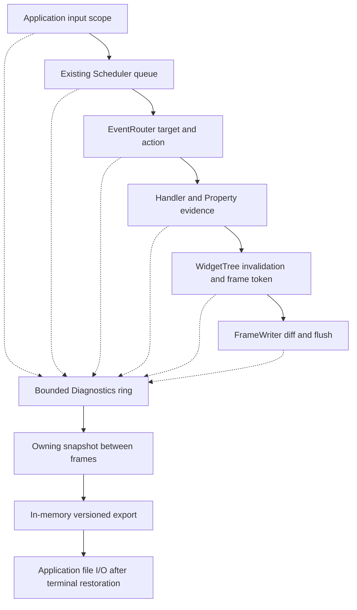

# Diagnostics {#diagnostics}

[Русская версия](ru/diagnostics.md)

Start with the default: end a fluent scene with `| ui::runApp()`. It checks
scene setup/run failures, attempts cleanup and terminal restoration, then prints
an error to stderr and returns 1. Managed recoverable action errors are retained;
a successful run can report a bounded error summary and still return 0.

## Report errors to stderr

Use `| ui::reportOnError()` to select the standard final report sink explicitly:

```cpp
#include <portals/ui.hpp>

int main() {
  using namespace portals;

  ui::Ref<Button> exit;

  return ui::scene(ui::button(exit, "Exit"))
    | ui::reportOnError()
    | ui::onClick(exit, ui::quit)
    | ui::onKey("F10", ui::quit)
    | ui::runApp();
}
```

The sink is called after terminal restoration and cleanup were attempted.
A clean run with no retained errors does not call it. `ui::runApp()` uses this
sink by default, so the explicit stage is optional. With a custom sink installed,
`ui::reportOnError()` restores standard stderr reporting.

<a id="diagnostic-symptoms"></a>
## Find the cause by symptom

The [first application](first-application.md) already uses default error handling
through `ui::runApp()`. You do not need to install a separate handler to start.

| What happened | What to check | Next action |
|---|---|---|
| The scene did not open and the application returned 1 | Read the final stderr report: the operation, source and error cause | Fix the reported configuration or file. Connect a [final report sink](#diagnostic-final-report) for your own log |
| A button does not invoke its action | Can Tab focus it, is it enabled, and is its reference passed to `ui::onClick`? | Compare the registration with [step 2 of the first application](first-application.md). Try Enter on the focused button; see [focus and routing](focus.md) for dispatch order |
| The handler ran but the display did not change | Does the value change, and are you updating the intended control? Assigning an equal value again may require no frame | Check the value and assignment target. If needed, enable [causal diagnostics](#diagnostic-action-trace) to follow the action |
| A shortcut or key release does not arrive | Does the terminal intercept the shortcut, and does the input path provide the requested phase? | First try an ordinary F2 press. Choose a supported key or phase using the [input guide](input.md); see the [terminal table](terminal-probe.md#terminal-observations) for observed conditions |
| Styling does not change a control | Does the selector match the type, ID and state? Does a higher-priority layer override the rule? | Check [PSS selectors and properties](styling-guide.md), then [layer precedence](style-layers.md). For `styleFile`, check the path relative to the process working directory |
| Access through a `Ref` returns `CLOSED`, `STALE_NODE` or `WRONG_THREAD` | Are the scene and target control alive, and does the operation run on the UI thread? | Use a reference to a live control on its scene thread. Check the returned `expected` for explicit reads; see [control references](text-property.md) |
| An error did not appear in the log file | Is a custom sink connected, and was there an error? A clean run does not call `reportOnError` | Add file output to the [final report sink](#diagnostic-final-report). Use [onError](#diagnostic-live-errors) for live observation; defer terminal output until the UI ends |
| Terminal modes remain changed after exit | Did the runner report a restoration failure, or was the process terminated forcibly? | Keep the report and open a new terminal session for further inspection. Compare [mode restoration](terminal-probe.md#terminal-observation-checklist) on a normal repeat run |

Run `portals_terminal_probe` separately, after closing the application.
It checks the environment and DA/CPR replies; it does not test delivery of every key.
See [how to read probe results](terminal-probe.md#terminal-probe-result).

<a id="diagnostic-final-report"></a>
## Supply your own final report sink

`ui::reportOnError(sink)` accepts a function receiving
[`const ui::SceneReport &`](../include/portals/ui_scene.hpp). Write to your file
or logger directly in this callback. Calling `ui::reportToStderr(report)` there
is also safe: terminal restoration and cleanup have already been attempted.
You can pass that function directly:

```cpp
    | ui::reportOnError(ui::reportToStderr)
```

`ui::reportOnError(sink)` replaces the final sink; an empty sink restores stderr.
Delivery happens once after restoration and cleanup were attempted. A throwing
sink falls back to stderr with the original report. The callback borrows the report
only for its call: copy it to retain it. Do not reenter or mutate the scene there.

<a id="diagnostic-live-errors"></a>
## Observe errors while the UI runs

`ui::onError([](const ManagedDiagnostic &error) { ... })` installs a UI-thread
observer for individual typed errors. It does not replace the final sink or veto
an error. Store bounded application data or update your own state there; avoid
stdout/stderr while the terminal is active. Nested reports suppress recursive
notification, and observer exceptions are recorded separately from the original cause.
`ManagedScene::diagnostics()` returns an owning history snapshot;
`drainErrors()` transfers the retained history. See
[`managed_diagnostics.hpp`](../include/portals/managed_diagnostics.hpp) for error fields and limits.

Low-level APIs returning `expected` still require explicit checks. Exceptions
inside documented runner/managed callback boundaries become typed errors.
Arguments, captures and coroutine frame construction can throw before entering
those boundaries. For a checked description-factory entry, use the callable
`ui::runApp(factory, ...)` overload in [`ui.hpp`](../include/portals/ui.hpp).

There is no automatic persistent log, log rotation or background logging service.
That integration is **TBD**, with no assigned milestone in the current
[feature plan](planned-features.md). The final sink is the available extension point.

<a id="diagnostic-action-trace"></a>
## Trace why an action did not change the display

[`Diagnostics`](../include/portals/diagnostics.hpp) records bounded causal metadata;
it is opt-in and disabled by default. It is separate from managed error history
and your logger. Share one recorder through `SchedulerOptions::diagnostics` (or
`ui::SceneOptions::application.scheduler.diagnostics` when using a scene), enable
it with a checked `enable` call, then disable/snapshot/export after the run.
`exportDiagnostics` returns text in memory; your application owns file I/O and its errors.

<details>
<summary>Causal recorder reference: propagation, bounds and export</summary>

Portals records bounded metadata to explain an input action, including an action that
returns without requesting a frame. It does not record input characters, paste or
clipboard contents, property values, exception messages, object addresses, or VT
bytes. This metadata is **not** the `PORTALS-TRACE 1` replay format.

**Connect one recorder**

Diagnostics is disabled by default. A null recorder costs a pointer check at a
hook; a configured but disabled recorder adds an enabled-state check. Disabled
hooks do not allocate ring memory, format text, read clocks, increment diagnostic
counters, or inspect input/model payloads. Queue entries have fixed-size token
storage even while recording is disabled. Enabling reserves the ring; recording
never allocates. There is no diagnostic clock: sequence numbers order retained
observations, rather than claiming wall-clock latency. Scheduler's existing clock
and queue metrics retain their original semantics.

The scheduler shares ownership with its endpoints. The tree borrows the scheduler;
the writer shares the recorder. `DiagnosticScope` only borrows it, must remain on
its constructing thread, and must end before the recorder. Scopes restore nested
contexts on normal and exceptional exits. There is no process-wide recorder or
second executor.

**Follow actual input and frames**

Create the input token at the application's **decoded input boundary**, before
attempting publication, including an input subsequently rejected by a full queue. Install
`trace->beginInput(DiagnosticInput::KEY)` in a `DiagnosticScope` around publication.

The scheduler retains a token with the publication and installs it around the UI
callback. Router target selection, focus changes, semantic action resolution,
handler entry/return, Property equality/commit, and tree invalidation use this same
context. Direct router dispatch/invoke creates its own input scope when none exists.
An application continuation on another thread can install a copied token with
`DiagnosticScope`; a new `beginInput` inside a scope explicitly records its parent.
The context contains no UI pointer and never grants access to a widget.

After bounded scheduler dispatch, consume the ordinary frame request, render the
actual tree, then submit the result with `tree->diagnosticFrame()` as its token.

Multiple invalidations coalesce into one frame ID. Each cause writes its own ring
record referring to that frame; no growing list is attached to the tree. The frame
token identifies the first recorded cause, not every cause. Layout's paint-dirty
mark inside an active tree frame belongs to that frame and does not invent another
diagnostic frame request. The output records describe actual `FrameWriter` diff,
submission and flush results. `output_accepted` means complete, consistent transport
acceptance; it is not proof that a physical terminal displayed the frame.

**Interpret evidence conservatively**

A synthetic Enter on a focused Button whose callback calls `Property::set` with
an equal value produces these stages (numeric IDs omitted):

```text
input input=key
queue_accepted queue=control
queue_dispatch queue=control
action action=1
target stableNodeId=<tree-session>:<slot>:<generation>
handler_started
property reason=value_unchanged
handler_returned reason=value_unchanged
frame_not_requested reason=frame_not_requested
completed reason=value_unchanged
queue_returned reason=outcome_unknown queue=control
```

`value_unchanged` describes the observed Property operation. It does not assert
that arbitrary external state was unchanged. A user callback without Property
evidence remains `outcome_unknown`, even when it returns normally and requests no
frame. A later `handler_failed` cannot undo an earlier `value_changed` observation.
`frame_not_requested` means that this routing scope observed no new tree frame
request, not that the application had no previously pending frame.

Known reasons include `queue_full`, `replaced`, `cancelled`, `no_target`,
`target_disabled`, `stale_target`, `unbound_action`, `unhandled`, `handler_failed`,
`value_unchanged`, `outcome_unknown`, `frame_not_requested`, `diff_empty` and
`output_failed`. An empty explicit target differs from an ineligible explicit
target. Keyboard focus recovery can select another eligible target; diagnostics
reports what the router actually selected. Node session, slot and generation are
exported together, without addresses. IDs are local to the recorder/tree lifetime,
not portable identities across application runs.

A replaced publication records both the old publication's cancellation and a
fixed-size link from the new publication. Queue metrics are unchanged. The export
cannot establish why input never reached an instrumented application boundary.

**Bounds, periods and incomplete chains**

`enable` starts a fresh interval and clears its ring/loss counters. Sequence and
identity counters never reset or wrap. `disable` preserves the retained interval
and its final sequence. A context carried across either boundary is incomplete.
Identity exhaustion permanently stops admission with `identity_exhausted`.

The ring overwrites its oldest record when full (`dropped_overflow`). Producers
try the record lock once and count contention losses (`dropped_contention`) rather
than blocking the UI or changing delivery. Snapshot copying holds the lock; format
and I/O do not. Snapshot memory is bounded by configured capacity. Snapshot analysis
uses bounded scans of retained records; reserve large capacities with care because
completeness analysis is quadratic in capacity in the worst case. Capture between
frames, not in measure/layout/paint.

The snapshot exports interval boundaries, retained sequence range, both loss
counters, saturation, state and `incomplete`. Any known loss conservatively taints
all retained chains. Missing input/completion, outstanding publication/output and
cross-period tokens are also incomplete. Each accepted publication needs its own
`queue_returned` or `queue_cancelled`; entering its callback or finishing another
publication with the same correlation ID does not complete it. A failed callback
records `queue_returned reason=handler_failed` at the scheduler boundary.
This is deliberately conservative: an
absent record is never proof that an action did not happen. No accounting is
performed for disabled hooks.

**Export without damaging a TUI**

`exportDiagnostics(snapshot)` returns schema-versioned text in memory; it performs
no file, stream, or terminal I/O. The application chooses a file and owns error
handling. Capture/serialize between frames, or after the terminal has been restored.
Never send the text to stdout/stderr while a native TUI is active.

Snapshot construction and return preserve `std::bad_alloc` propagation, including
Debug iterator-proxy allocations. The return uses a bounded copy outside the lock
to avoid a potentially allocating `noexcept` container move.
Allocation/formatting errors remain visible to the caller; file open, write and
close errors must all be checked. `validateDiagnosticVersion` rejects unsupported
version headers before an application's reader interprets fields; it is a version
check, not a replay parser. Applications choose their own export presentation and file-error policy.

**Implemented flow**



</details>
