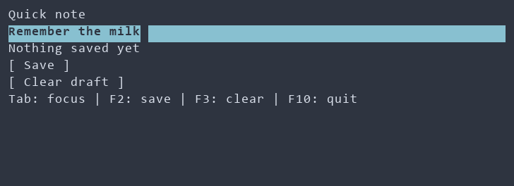

# First application: a quick note {#first-application}

[Русская версия](ru/first-application.md) · [User guides](guides.md) · [Glossary](glossary.md)

This tutorial develops a small note form in four steps. The finished application
has an editor, **Save** and **Clear draft** buttons, keyboard shortcuts and a theme.
**Save** copies the current editor text to a line below it; **Clear draft** clears
the editor while leaving that saved line unchanged. The note lasts until the
application exits, because this example does not write a file.

The animation shows the finished application: F2 saves the initial text, F3
clears the editor, a new note is entered, and F2 saves it. We will start with
a form containing an editor, then add button actions, shortcuts and styling.



## 1. A form you can run

You need Git, CMake 3.24+, Ninja and a toolchain supporting C99 and C++23,
including `<expected>` and `<format>`. On Windows, an x64 Developer PowerShell
for Visual Studio is required. Integration details are in the [short guide](index.md).

For the first version, you can create a `quick-note` directory and save this
code as `main.cpp`:

<details open>
<summary>Complete main.cpp after step 1</summary>

```cpp
#include <portals/ui.hpp>

int main() {
  using namespace portals;

  ui::Ref<LineEdit> draft;

  auto scene = ui::scene(ui::vbox(
    ui::label("Quick note"),
    ui::lineEdit(draft, "Remember the milk"),
    ui::label("Tab: focus | F10: quit")));

  return scene
    | ui::onKey("F10", ui::quit)
    | ui::runApp();
}
```

</details>

Here, `ui::vbox` describes a vertical arrangement of controls. It is a
[recipe](glossary.md#glossary-recipe), which `ui::scene` stores in a
[scene](glossary.md#glossary-scene). `ui::Ref<LineEdit> draft` provides access
to the editor created from that recipe. When the program runs, you can edit
**Remember the milk**; F10 exits the application.

The second file, `CMakeLists.txt`, connects this application to Portals:

```cmake
cmake_minimum_required(VERSION 3.24)
project(QuickNote LANGUAGES CXX)

include(FetchContent)
FetchContent_Declare(portals
  GIT_REPOSITORY https://github.com/ttldtor/portals.git
  GIT_TAG cb0fdec5634cfc9d877791313bdee5da2c6aa18f
)
FetchContent_MakeAvailable(portals)

add_executable(quick_note main.cpp)
target_link_libraries(quick_note PRIVATE portals::core)
```

From `quick-note`, these commands configure, build and run the application:

```powershell
cmake -S . -B build -G Ninja -DCMAKE_BUILD_TYPE=Release
cmake --build build --target quick_note
./build/quick_note
```

On Windows, the executable is `build/quick_note.exe`; it can be run in a terminal.
During the first configuration, CMake downloads the pinned Portals revision.
An existing local checkout can be used by adding
`-DFETCHCONTENT_SOURCE_DIR_PORTALS="C:/path/to/portals"` to the configure command,
substituting your path. [Complete step 1 source](examples/tutorial_note_1.cpp).

## 2. Showing the saved text

The first version has an editor, but no place to see a saved copy. After exiting
the application, continue in the same `main.cpp` from step 1. The label and
button need references of their own, placed after `ui::Ref<LineEdit> draft;`:

```cpp
  ui::Ref<Label> saved;
  ui::Ref<Button> save;
```

Inside `ui::vbox(...)`, the label and **Save** button follow the editor, with
the hint label at the end:

```cpp
    ui::label(saved, "Nothing saved yet"),
    ui::button(save, "Save"),
```

The `saveNote` action copies the editor text into the label. It belongs between
the `scene` declaration and `return scene`; the `ui::onClick` stage connects it
to the button before the existing F10 handler:

```cpp
  auto saveNote = [draft, saved] {
    saved.text() = draft.text();
  };

  return scene
    | ui::onClick(save, saveNote)
    | ui::onKey("F10", ui::quit)
    | ui::runApp();
```

When **Save** is activated, `saveNote` reads the editor and assigns its current
text to the label. The `|` operator attaches a [UI stage](glossary.md#glossary-ui-stage)
to the scene, and `ui::onClick` connects the button to an action. The handler
captures references by value; they observe the scene's controls and do not
extend their lifetime. See [control references](text-property.md) for details.

<details>
<summary>Complete main.cpp after step 2</summary>

```cpp
#include <portals/ui.hpp>

int main() {
  using namespace portals;

  ui::Ref<LineEdit> draft;
  ui::Ref<Label> saved;
  ui::Ref<Button> save;

  auto scene = ui::scene(ui::vbox(
    ui::label("Quick note"),
    ui::lineEdit(draft, "Remember the milk"),
    ui::label(saved, "Nothing saved yet"),
    ui::button(save, "Save"),
    ui::label("Tab: focus | F10: quit")));

  auto saveNote = [draft, saved] {
    saved.text() = draft.text();
  };

  return scene
    | ui::onClick(save, saveNote)
    | ui::onKey("F10", ui::quit)
    | ui::runApp();
}
```

</details>

[Download the step 2 source](examples/tutorial_note_2.cpp).

The build command from step 1 prepares this version. You can then run it
with the same `./build/quick_note` command. While the application is
running, the text can be edited; Tab moves focus to **Save**, and Enter activates
the focused button. The saved copy appears below the editor. Further edits leave
it unchanged until **Save** is activated again.

## 3. Draft clearing and shortcuts

The form can now save a copy. The next version adds a separate way to clear the
editor and shortcuts for both actions. After exiting the application, the next
changes go into `main.cpp` from step 2. A reference for the new button follows
`ui::Ref<Button> save;`:

```cpp
  ui::Ref<Button> clear;
```

Inside `ui::vbox(...)`, the **Clear draft** button follows **Save**. The final
hint label also lists the new shortcuts; the `scene` declaration becomes:

```cpp
  auto scene = ui::scene(ui::vbox(
    ui::label("Quick note"),
    ui::lineEdit(draft, "Remember the milk"),
    ui::label(saved, "Nothing saved yet"),
    ui::button(save, "Save"),
    ui::button(clear, "Clear draft"),
    ui::label("Tab: focus | F2: save | F3: clear | F10: quit")));
```

The `clearDraft` action clears the editor. After the existing `saveNote` action,
it can be connected to the new button and F3; F2 can call the existing save
action. The code from `clearDraft` through the end of the handler chain is:

```cpp
  auto clearDraft = [draft] {
    draft.text() = "";
  };

  return scene
    | ui::onClick(save, saveNote)
    | ui::onClick(clear, clearDraft)
    | ui::onKey("F2", saveNote)
    | ui::onKey("F3", clearDraft)
    | ui::onKey("F10", ui::quit)
    | ui::runApp();
```

`clearDraft` clears only the editor; the saved line stays on screen.
The **Clear draft** button and F3 invoke the same action. The **Save** button
and F2 invoke the other action, `saveNote`, created in the previous step.

<details>
<summary>Complete main.cpp after step 3</summary>

```cpp
#include <portals/ui.hpp>

int main() {
  using namespace portals;

  ui::Ref<LineEdit> draft;
  ui::Ref<Label> saved;
  ui::Ref<Button> save;
  ui::Ref<Button> clear;

  auto scene = ui::scene(ui::vbox(
    ui::label("Quick note"),
    ui::lineEdit(draft, "Remember the milk"),
    ui::label(saved, "Nothing saved yet"),
    ui::button(save, "Save"),
    ui::button(clear, "Clear draft"),
    ui::label("Tab: focus | F2: save | F3: clear | F10: quit")));

  auto saveNote = [draft, saved] {
    saved.text() = draft.text();
  };

  auto clearDraft = [draft] {
    draft.text() = "";
  };

  return scene
    | ui::onClick(save, saveNote)
    | ui::onClick(clear, clearDraft)
    | ui::onKey("F2", saveNote)
    | ui::onKey("F3", clearDraft)
    | ui::onKey("F10", ui::quit)
    | ui::runApp();
}
```

</details>

[Download the step 3 source](examples/tutorial_note_3.cpp).

After rebuilding and running, F2 saves the current text and F3 clears the editor.
The saved line remains visible when the draft is cleared. New text can replace
that line with another F2 press. Tab moves focus between the editor and buttons;
Enter activates the focused button. The [input guide](input.md) describes other
shortcut forms.

## 4. A theme and style

The final version adds a palette and a rule that changes button appearance.
After exiting the application, the styling header can follow
`#include <portals/ui.hpp>` in `main.cpp` from step 3:

```cpp
#include <portals/ui_style.hpp>
```

The theme and style stages can precede the existing event handlers in the chain:

```cpp
    | ui::theme(nordTheme())
    | ui::style("Button { min-width: 16; bold: true; }")
```

`ui::theme(nordTheme())` selects a palette. The PSS rule makes button text bold
and sets a minimum width of 16 terminal cells. The references, form and handlers
from step 3 remain part of the completed program. [Styles](styling-guide.md) and
[themes](themes-guide.md) describe the available options.

<details>
<summary>Complete main.cpp after step 4</summary>

```cpp
#include <portals/ui.hpp>
#include <portals/ui_style.hpp>

int main() {
  using namespace portals;

  ui::Ref<LineEdit> draft;
  ui::Ref<Label> saved;
  ui::Ref<Button> save;
  ui::Ref<Button> clear;

  auto scene = ui::scene(ui::vbox(
    ui::label("Quick note"),
    ui::lineEdit(draft, "Remember the milk"),
    ui::label(saved, "Nothing saved yet"),
    ui::button(save, "Save"),
    ui::button(clear, "Clear draft"),
    ui::label("Tab: focus | F2: save | F3: clear | F10: quit")));

  auto saveNote = [draft, saved] {
    saved.text() = draft.text();
  };

  auto clearDraft = [draft] {
    draft.text() = "";
  };

  return scene
    | ui::theme(nordTheme())
    | ui::style("Button { min-width: 16; bold: true; }")
    | ui::onClick(save, saveNote)
    | ui::onClick(clear, clearDraft)
    | ui::onKey("F2", saveNote)
    | ui::onKey("F3", clearDraft)
    | ui::onKey("F10", ui::quit)
    | ui::runApp();
}
```

</details>

[Download the step 4 source](examples/tutorial_note_4.cpp). After building with
the same command, `./build/quick_note` runs this version with its theme and button styling.

## Result


The image shows output from the final program in a 64 × 10 in-memory terminal
after **Save**, using the Nord theme. It is displayed through xterm.js;
your terminal's font and colors may differ.

If startup fails, `ui::runApp()` reports the error to stderr after attempting
terminal cleanup and returns a nonzero exit code. Description construction
before `runApp()` follows ordinary C++ exception rules; use the
[factory overload](declarative-ui.md) to include that step in the error boundary.
[Diagnostics](diagnostics.md) covers default and custom reports.

Further topics include [shared state](property.md) and [layout](layout.md).
Other practical tasks are covered in the [user guides](guides.md).
