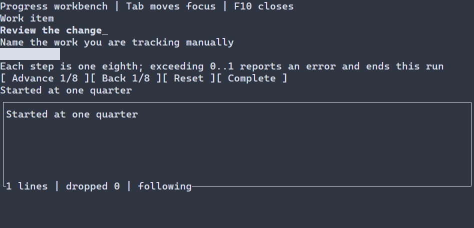

# Gauges {#gauge-guide}

[Русская версия](ru/gauge.md) · [Compact primitives](compact-primitives.md) · [Spinner](loading-indicators.md)

Use `ui::gauge` to display a known numeric value in a finite range. It is determinate and does not schedule its own updates; for ongoing work without a known fraction use a spinner.

## A complete application

The progress workbench is a larger native example: it starts at one quarter, changes the gauge in eighths and records successful actions. Tab moves focus between controls; activate buttons with Enter, Space or left mouse press. Exceeding the range reports an error and ends this run; F10 exits. `runApp` reports errors and restores the terminal.



\include progress_workbench/main.cpp

Build `portals_progress_workbench` with `PORTALS_BUILD_EXAMPLES=ON` and run the executable in a terminal. See [build setup](getting-started.md) and [package setup](package.md).

## Value and configuration

`ui::gauge(progress, .25)` publishes an observing `ui::Ref<Gauge>` after mount. The gauge owns its value. Between frames on the UI thread, `progress.value(.5)` replaces it and `progress.adjust(.125)` adds to it; both return `std::expected<void, ManagedError>`. A failed or out-of-range update leaves the previous value unchanged, and equal values request no redraw. Return the result from an action to propagate the error once, as the workbench does. Disabled gauges still accept programmatic writes. The gauge is presentation-only: it has no timer, independent keyboard or mouse action, or automatic model subscription. The scene owns it; the Ref does not extend its lifetime.

`GaugeOptions` has inclusive `double minimum = 0`, `maximum = 1`, `std::int32_t preferredWidth = 10`, `PrimitiveGlyphs::UNICODE` and `std::size_t maxPaintCells = 16384`. Intrinsic height is one. Bounds and value must be finite, minimum strictly less than maximum with finite span, and value within the inclusive range. Preferred width must be nonnegative and the cap positive; invalid settings fail with `INVALID_ARGUMENT`. The fill occupies `floor(width × fraction)` whole columns across the allocated height. Unicode uses ASCII `#` when the glyph is not one cell; explicit ASCII is also supported. An allocation above the area cap returns `WOULD_BLOCK`, including partial clipping.

Loaded scenes support `Gauge` and typed `scene.get<Gauge>(...)`; the same Ref commands apply. A resource may set value and bounds, for example `Gauge#progress { minimum=0 maximum=1 value=.25 }`. See [scene resources](scene-loading-guide.md) and [command errors and lifetime](compact-primitives.md#gauge-ref-commands).

## Styling reference {#gauge-styling-reference}

The natural selector is `Gauge`; only normal and disabled are painted. Focused and selected do not produce separate gauge parts. `foreground` and `background` take `#RRGGBB`; `bold`, `italic`, `underline` take `true` or `false`. The common resolved style paints both the background and fill glyphs. There are no independent PSS track/fill colors or arbitrary fill string: choose Unicode/ASCII through `GaugeOptions`. Manual `ControlStyle` is the base beneath theme and application PSS; omitted attributes retain lower values.

```pss
Gauge { foreground: #62b4d7; background: #182028; width: 24; }
Gauge:disabled { foreground: #7d828c; }
```

Runtime PSS `width`/`height` accept nonnegative cells, `auto`, `fit-content` or `flex(positive weight)`; `min-width`, `max-width`, `min-height`, `max-height` accept nonnegative cell bounds. Size selectors cannot include state or `:read-only`; conflicting bounds reject the update. Compile-time PSS supports `min-width` among these size properties. See [primitive styling](compact-primitives.md#primitives-styling-reference), [layout](layout.md) and [cascade](styling-guide.md).

See `portals::Gauge`, `GaugeOptions`, `ui::gauge` and `ui::Ref<Gauge>` for exact signatures.
