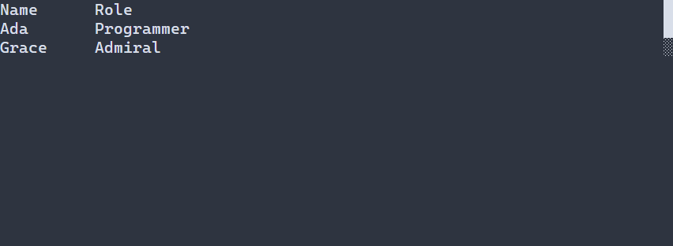

# Arrange controls in a grid

[Русская версия](ru/grid.md)

Use [Grid](../include/portals/grid.hpp) when controls need shared columns or independent rows. `ui::grid` assigns cells in child order. Add `.columns(2)` to make a two-column grid; `.columnGap(2)` leaves two terminal cells between columns. The complete program below shows a name and value side by side. Press F10 to close.

\include guide_grid.cpp

[Example source](examples/guide_grid.cpp). Add it to a C++23 project and link it with `portals::core` ([build instructions](getting-started.md)).

The declarative grid assigns cells automatically as children are added. Set `.row(...)` and `.column(...)` together when a control needs a specific position; `.rowSpan(...)` and `.columnSpan(...)` occupy multiple cells. Explicit and automatic placement can be combined. Placement is checked before controls are mounted, and overlapping rectangles are rejected. Hidden controls still reserve their declared cells.



A sticky header and scrollable grid rows.

## Header, body, and scrolling

Use `ui::header(...)` and `ui::body(...)` to create structural regions. They do not add wrapper controls: their children remain direct children of the grid. The regions share the same columns and column sizing, while each has its own row numbering and row sizing. Put all grid controls inside these sections when using regions.

Call `.sticky()` on the header to keep it at the top while the grid scrolls. Enable the grid's scroll owner with `.scroll()` and choose a fixed outer extent with `.height(...)` or `.width(...)` as needed. In the program below, the complete grid occupies three terminal rows; the header and any scroll chrome use part of that extent. Use the mouse wheel over the grid to scroll its body. F10 closes it.

\include guide_grid_regions.cpp

[Complete regions example](examples/guide_grid_regions.cpp). A fixed height limits the visible scroll area; it does not virtualize rows. Grid children are materialized controls, including children outside the current viewport.

## Track sizes and presentation

Use `.columnSizes(...)` to set policies for all resolved shared columns. Use `.rowSizes(...)` for body rows; header rows keep their own inferred policies. Each policy list must match its resolved track count. `.rows(...)` sets the body row count in column-major flow; `.rowSizes(...)` only sets sizes and does not set that count.

The C++ API can set header, body, and alternating body-row backgrounds through `GridPresentation`, for example with `.presentation(...)`. Backgrounds are painted below real controls and do not become control styles. Controls with opaque backgrounds can cover them. The scene-resource format supports structural `header` and `body` sections and their placement properties, but does not currently express `CellStyle` presentation values.

## Scene resources

Loaded grids use the same checked automatic placement and region rules. This fragment shows the supported `Grid` properties and section structure:

```text
Grid#grid { columns=2
  header { sticky=true Label#heading { text="Heading" columnSpan=2 } Label#sub { text="Sub" } }
  body { Label#first { text="a" } Label#second { text="b" row=0 column=1 } }
}
```

The `header` and `body` sections are structural; their children are ordinary controls. Resource properties do not provide the C++ `GridPresentation`/`CellStyle` API.

## Explicit low-level configuration

`GridOptions` remains available when a caller needs exact low-level placement. It owns nonempty `columns` and `rows` policies plus `GridCell` entries keyed by each child's full `NodeId`. Call `setGridOptions` after the nodes exist and before the next layout. This explicit mode does not infer tracks or placements and continues to allow overlapping cells in sibling order. The declarative `ui::grid` API is additive; it does not change this contract. `Overlay` remains available when every child should share one content rectangle.

Declarative placement defaults to at most 4096 tracks per axis, 4096 structural children, and 65536 units of placement work. Adjust these limits with `.gridOptions(DeclarativeGridOptions{...})`. C++ `GridPresentation` has a separate positive `maxPaintCells` budget for backgrounds and scroll chrome, defaulting to 16384. Invalid placement or track settings return `INVALID_ARGUMENT`; exhausted placement limits return `NODE_LIMIT`; coordinate overflow returns `INVALID_GEOMETRY`; allocation failure returns `NO_MEMORY`. Painting above `maxPaintCells` returns `WOULD_BLOCK` before submitting commands.

See [linear layouts](layout.md), [geometry](geometry.md), and [the frame ownership contract](widget-tree.md).


## Styling reference {#grid-styling-reference}

Grid cells contain real child controls; their text styles are independent of
the grid's presentation. An ordinary grid has no background of its own. Opt-in
header/body regions can paint `GridPresentation::header`, `body`, `rows.even`,
`rows.odd` backgrounds (all absent by default), including gaps. These are C++
presentation values, not PSS `:header`/`:selected` row rules; they do not inherit
into child labels or buttons. The presentation paint budget defaults to 16384 cells.

Use `width`, `height`, `min-width`, `max-width`, `min-height`, `max-height` for the
allocated outer grid, with [the shared sizing grammar](layout.md). Target a known
ID, for example `.id("grid")`. Columns, rows, gaps, padding, spans and sticky header
are grid configuration, not additional PSS properties. Gaps/padding default to zero.

```pss
#grid { width: flex(1); min-width: 20; }
Label { foreground: #dce1e8; }
```

A scrolling grid paints the normal/focused/disabled scroll variants using the
[complete scrollbar properties](scroll-controls.md#scrollbar-styling-reference).
`Overlay` places children but has no own painted surface or special glyph set;
style its painted children. Dialog overlay hosts have [their own composition](dialogs.md).
