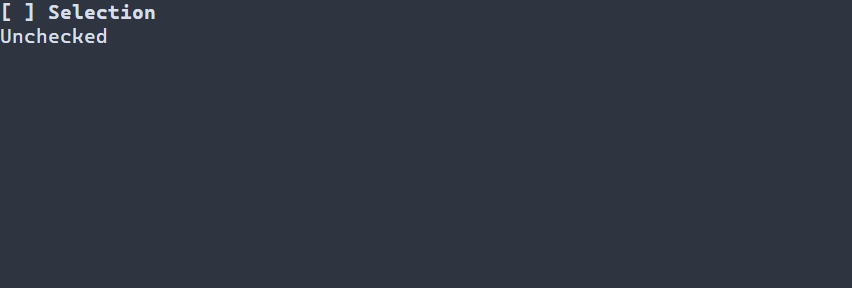

# Labels {#label-guide}

[Русская версия](ru/label.md) · [Basic controls](controls.md) · [Text and state](declarative-ui.md)

Use `ui::label` for a one-line caption or changing status. It displays text and does not accept activation; use a [button](button.md) for an action and a [line editor](line-edit.md) for input.

## A complete application

This larger checkbox example updates the `Label` named `status` after each user change. Space or Enter changes the checkbox; F10 or Ctrl+C exits. The standard runner reports errors and restores the terminal.



\include guide_check_change.cpp

Build `portals_docs_check_change` with `PORTALS_BUILD_TESTS=ON` and run the resulting executable in a terminal. See [build setup](getting-started.md) and [installed package setup](package.md).

## Text, references and resources

`ui::label("Ready")` copies the caption; `ui::label(status, "Ready")` publishes an observing `ui::Ref<Label>` after successful mount. Set `status.text() = "Saved"` between frames to change it through the scene's diagnostic boundary. A label may also observe managed string state or a text source; [text references](text.md) describe supported operations. The scene owns the widget; a Ref does not extend its lifetime. Labels are not focus stops by default and have no activation, keyboard or mouse action of their own.

Scene resources support `Label#status { "Ready" }`; `scene.get<Label>("status")` observes the loaded label. See [scene resources](scene-loading-guide.md) for both formats and text resolution.

## Styling reference {#label-styling-reference}

The natural selector is `Label`. It paints normal, focused and disabled styles, with disabled first; ordinary labels do not receive focus by default. It does not paint selected, header or caret. Caption and allocated background use the same resolved style; there are no label-specific PSS glyph properties.

| Property | Values and effect |
|---|---|
| `foreground`, `background` | `#RRGGBB`; foreground and fill |
| `bold`, `italic`, `underline` | `true` or `false`; explicit false overrides a lower layer |
| `width`, `height` | Nonnegative cells, `auto`, `fit-content`, `flex(positive weight)` in runtime PSS |
| `min-width`, `max-width`, `min-height`, `max-height` | Nonnegative cell bounds; only `min-width` also works in compile-time PSS |

Size declarations cannot depend on a state or `:read-only`; conflicting bounds reject the update and retain the last valid style and geometry. See [layout](layout.md). Manual `ControlStyle` uses terminal-default colors, normal text, bold focus and italic disabled text. Theme and PSS rules override individual fields; unspecified fields retain lower-layer values. See [the cascade](styling-guide.md).

```pss
Label#status { foreground: #dce1e8; min-width: 12; }
Label#status:disabled { italic: true; }
```

See `portals::Label`, `portals::ControlStyle`, `portals::ui::label` and `portals::ui::Ref` for signatures and [basic controls](controls.md#basic-controls-styling-reference) for shared behavior.
