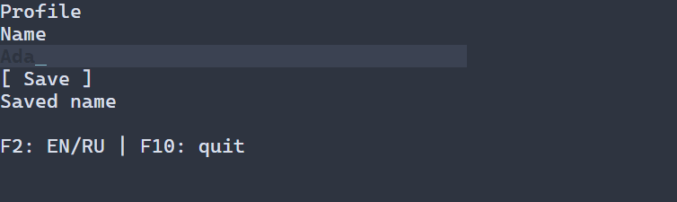

# Row, Column and size policies

[Русская версия](ru/layout.md)

All sizes are integer terminal columns/rows. Rectangles are parent-local,
half-open values; `WidgetTree::arrange` translates and intersects clips through
the checked geometry API. Row orders visible children left to right; Column
orders them top to bottom. Disabled children still occupy space. Hidden children
and their descendants are never measured or arranged and contribute no gap.

Each child may implement the const `LayoutItem` interface. Ordinary widgets use
automatic policies and their guarded `Widget::measure` result. `SizedWidget`
owns a convenient policy pair. Each axis has minimum, preferred, maximum,
mode and a positive flex weight. `INTRINSIC_EXTENT` selects the measured size;
other preferred values are nonnegative. Preferred is clamped to minimum/maximum.
Invalid bounds, modes, weights and options return `TreeError::INVALID_ARGUMENT`.

Sizing can also be requested per axis through the C++ UI builders, PSS, and
loaded-scene attributes. These inputs choose the allocated outer rectangle;
they do not change how a control draws its content inside that rectangle.
The table shows the corresponding axis modes and hard bounds:

| Meaning | C++ UI | PSS | Scene attribute |
|---|---|---|---|
| Exact extent | `.width(n)` / `.height(n)` | `width: n` / `height: n` | `width` / `height` as a nonnegative integer |
| Measured content | `.fitWidth()` / `.fitHeight()` | `width: fit-content` / `height: fit-content` | `fitWidth: true` / `fitHeight: true` |
| Automatic | Existing automatic widget policy | `width: auto` / `height: auto` | `fitWidth: false` / `fitHeight: false` |
| Weighted flex | `.flexX(w)` / `.flexY(w)` | `width: flex(w)` / `height: flex(w)` | `flexX` / `flexY` as positive weights |
| Both axes | `.flex(w)` | Set `width` and `height` independently | `flex` as a common positive weight |
| Hard bounds | `.minWidth(n)` / `.maxWidth(n)` and height equivalents | `min-width`, `max-width`, `min-height`, `max-height` | `minWidth`, `maxWidth`, `minHeight`, `maxHeight` |

Here `n` is a nonnegative integer number of terminal cells; `w` is a positive
32-bit unsigned integer. PSS sizing declarations require selectors that apply
independently of presentation state. A numeric PSS extent is exact: its
intersection with style bounds and the widget's existing hard bounds must be
nonempty. A mode request never relaxes the widget's own bounds. A contradiction
rejects the update and preserves the previously published style and geometry.

Each axis has one mode request. PSS follows its ordinary cascade: a winning
`width` or `height` declaration replaces that axis's earlier request, while
each bound cascades independently. In one scene settings object, competing
mode properties are invalid: for example, `width` together with `fitWidth`,
or `flex` together with `flexX`. Their property order does not choose a winner.
A higher scene source replaces the lower source's mode request and merges
independent bounds. Ordered C++ method chains keep their existing semantics.

The new axis declarations are supported by runtime PSS. The existing
compile-time `min-width` support is unchanged; the compile-time parser rejects
the other new sizing declarations instead of expanding its descriptor budget.

The same measured-width intent can be expressed in either input format:

```text
/* PSS */
Button#save { width: fit-content; min-width: 8; }
```

```json
{
  "fitWidth": true,
  "minWidth": 8
}
```

The scene attributes are shown as a fragment of one control's settings.
`fitWidth: true` selects measured content; `false` selects automatic sizing.
Width and height describe the allocated outer rectangle, while the measured
content is the control's preferred extent within the layout constraints. For a
framed widget, these sizing modifiers constrain the outer frame; inner content
bounds are not copied to it.

### A profile form

The form below keeps the name field between 16 and 40 cells wide. It fills
available width up to that maximum. The save button fits its caption: F2 switches
the demo captions between English and Russian, so the button changes from 8 to
21 cells in a sufficiently wide terminal. Save copies the current name into the
saved-value label.

Terminal resize lays out the same mounted scene again. At viewport widths 80,
32 and 20 the field occupies 40, 32 and 20 cells. Below its hard minimum, the
16-cell allocation is clipped by the viewport. Editing and saved values survive
layout changes. The layout does not implicitly change from rows to columns.

The application owns a small English/Russian catalog and supplies a `TextResolver`
for the initial `i18n` captions. F2 changes the selected language and explicitly
refreshes all four captions with `text(resolver) = i18n(key)`. Changing the language
or catalog alone does not refresh mounted controls. The catalog, selected language
and resolver remain alive until the synchronous `runApp` call returns.

**C++ builders**

\include guide_sizing_form.cpp

**Equivalent scene and PSS**

\include guide_sizing_parity.cpp

Bracketed buttons draw their contour at the allocated left and right edges and
center the caption inside it. Width includes the contour and its inner padding;
in a narrow allocation the caption clips inside the contour.



Complete sources: [C++ form](examples/guide_sizing_form.cpp) and
[scene/PSS form](examples/guide_sizing_parity.cpp). Both link `portals::core`.

Fixed children preserve their clamped preferred extent. Automatic children use
their preferred extent. Flex children also start at their clamped preferred
extent, then share spare space in proportion to weights. Each round assigns
integer quotients and gives remaining cells in stable child order, skipping
children whose maximum has been reached. Capped shares are redistributed; when
all flex maxima are reached, unused space remains. Equal weights in 11 cells
therefore produce widths 6 and 5, in insertion order.

When space is short, later automatic/flex children yield preferred cells first,
down to their minima. Fixed extents and all minima survive. `LayoutOverflow::CLIP`
preserves these extents even when children/gaps/padding exceed the available
space; ancestor clips remove the overflow from painting and hit testing.
There is no negative size or implicit compression below minimum. Representational
overflow is an explicit `INVALID_GEOMETRY`, rather than wrapping coordinates.

Padding is applied on each side; gaps occur only between participating children.
Main alignment applies to the remaining group space after allocation. Start and
stretch start at the leading inset, center gives floor(free/2) before the group,
and end consumes all spare space before it. Cross stretch (or cross flex) fills
the available extent subject to bounds; fixed remains fixed. Cross start/center/end
aligns the resulting child extent using the same floor rule. Underflow aligns
at the leading inset because there is no spare space.

## Frame ownership and errors

`layoutTree` is an external two-phase owner-thread traversal. It obtains owning
structure/policy/measurement snapshots through `inspect` and `read`, measures
children before parents, then calls guarded `arrange` on parents before children.
Its temporary traversal table dies when the pass returns; it is not another
retained tree. A plain parent supports a single-child viewport passthrough;
multiple children require a `Layout` container.

The caller must invoke `layoutTree` **inside an already active `tree.frame`**.
The pass does not create a frame. This precondition is contractual: the current
tree API has no active-frame query. One frame can encompass layout, paint and
rendering of borrowed commands:

A preliminary pass may instead capture an owning `LayoutSnapshot`, as the
[layout-driven view preparation](virtual-preparation.md) runner does. It does
not retain widget borrows or render commands; final layout, paint and rendering
still share one frame.

```cpp
// Between frames, after a viewport change:
auto invalidation =
  tree.invalidate(root, portals::Invalidation::LAYOUT);
if (!invalidation) {
  return invalidation;
}

std::expected<void, portals::TreeError> layout;
auto frame = tree.frame([&] {
  layout = portals::layoutTree(tree, root, viewport, viewport);

  if (!layout) {
    return;
  }

  // Paint the arranged tree and render borrowed commands
  // before returning.
});
```

`setSizePolicy` and `setLinearOptions` validate owning values, edit on the
UI owner between frames, and request layout invalidation. Construction and other
custom policy sources must follow the same invalidation discipline. Viewport
changes likewise require `invalidate(layout)` before entering the next frame.
After a failed pass the coordinator must abort use of that pass, including paint
and hit testing; the solver does not promise transactional rollback or automatic
invalidation from inside a frame. Invalidated geometry is never a valid old layout.

All tree errors propagate; arithmetic failures return `INVALID_GEOMETRY`, library
allocation failures return `NO_MEMORY`, and thrown custom callbacks follow
`tree.read`/measure/arrange's `CALLBACK_FAILED` boundary. No callback or span is
retained. Pure `Layout` and `LayoutItem` callbacks run inside a checked read borrow
in the enclosing frame and must not call tree operations, recursively dispatch
layout, mutate models or perform I/O. A scoped thread-local guard technically
rejects recursive `layoutTree` calls with `WOULD_BLOCK`. The tree technically
protects its ordinary Widget hooks and rejects editing inside frames. Arbitrary
model mutation/I/O and direct tree calls from a custom pure callback remain
contract violations; the library does not claim to sandbox user C++ code.

## Observe final arranged bounds

Register `ui::onLayout(ref, callback)` on a scene to receive the initial valid
geometry and subsequent changes to its local, surface or clip bounds. The scene
owns the registration and captures. The callback runs on the UI thread during a
subsequent scheduler dispatch, after the successful final layout, paint and owning
render have left the tree frame. Preliminary view-preparation passes do not notify.
This event identifies arranged geometry; terminal output may still be pending.

\include guide_layout_observe.cpp

`geometry.local` is parent-relative; `surface` includes ancestor translations;
`clip` intersects the viewport and ancestor clips. Each `NodeGeometry` owns its
values: copy the callback argument to retain it. Equal bounds do not notify or
request another frame. A callback may change controls or remove/close its scene;
its executing capture survives retirement. Changes request later work through
the normal runner. At EOF the existing frame cap remains in force: callback
mutations may remain dirty without another final frame or notification.

For a checked read, use `ref.geometry()` or `ref.size()`, returning
`std::expected<NodeGeometry, ManagedError>` and `std::expected<CellSize, ManagedError>`.
Size is the local arranged extent. Reading never starts layout or reports an
error. Before a successful final frame, while hidden, or after layout invalidation
or rearrangement, reads return `TreeError::INVALID_GEOMETRY` until the next final
publication. Equal-valued replacement geometry still revokes the old read.
Unpublished/destroyed references return `CLOSED`, removed identities retain their
typed stale-node error, and foreign threads return `WRONG_THREAD` before owner
access. Disabled controls keep their geometry.

Hidden ancestors cancel pending observations. Showing a hidden subtree produces
a new initial valid observation, including hide/show between final frames. Removal and close
cancel queued observations; already running callbacks finish safely. Runtime
registration through `ref.onLayout(callback)` follows the same contract and first
queues its current final value after the current dispatch, if one is available.

The existing scheduler DATA capacity, subscription capacity and data budget bound
the queue and deliveries. `ManagedOptions::maxLayoutHandlers` defaults to 256.
Newest pending values replace older ones. Queue-full recovery makes at most
`maxLayoutPublicationRetries` attempts (default 3) without requesting redraw.
Exhaustion cancels that pending value and reports `SchedulerError::WOULD_BLOCK`
once through the managed error channel; it does not mark it delivered. A later
final frame can begin a fresh attempt. Callback failures retain their original
typed cause and existing scene-stop policy. Registering against another scene
or after retirement fails through the normal checked registration channel.

## Extending layouts and controls

Controls can derive from `Widget` and provide intrinsic measure only, or derive
from `SizedWidget` for configurable policies. Grid/Overlay can implement `Layout`:
`childAvailable` supplies measurement bounds, `measureChildren` aggregates owning
`MeasuredChild` values (including stable `NodeId` for matching placements after hiding siblings), and `arrangeChildren` returns exactly one owning local
rectangle per visible child. The interface pointer remains inside `tree.read`.
A custom solver must follow the frame/purity/error contract above. No Node
downcast or core Widget header change is required.
