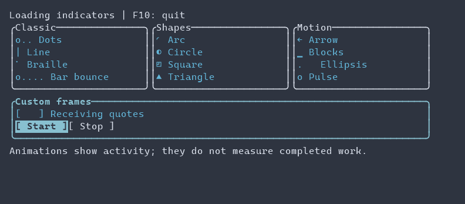

# Show an animated loading indicator {#loading-indicators}

[Русская версия](ru/loading-indicators.md)

Use Spinner for indeterminate work. The default is active `DOTS`, a 100 ms interval, forward direction, start alignment and an empty label; reduced motion is off. Its reference starts, stops or relabels the indicator, rather than receiving user input itself. See [Spinner options and API](../include/portals/spinner.hpp).




[Static preview](images/loading-indicator-presets.png).

The three framed groups show every built-in preset. Start and Stop control the custom sequence below them. The indicator signals ongoing work; use Gauge when the completed amount is known.

## Styling reference {#loading-indicators-styling-reference}

`Spinner` uses normal for an active animation and its label. Inactive, ineligible or reduced-motion frames use `:disabled`; the label keeps its normal appearance. `ControlStyle` supplies manual defaults beneath the cascade. Use `foreground`, `background` (`#RRGGBB`), `bold`, `italic`, and `underline` (`true` or `false`); state-free rules apply to every variant. See [cascade and size constraints](styling-guide.md) for `min-width`, which requires a state-free selector.

Frames, direction, alignment and timing are spinner settings, not PSS parts; there are no independent trailing-segment colors. Presets and custom frames are described below.

| `SpinnerOptions` setting (not PSS) | Default / values |
|---|---|
| `preset`, `frames` | `DOTS`, empty custom source; presets below, nonempty LF-separated frames override preset |
| `interval`, `direction` | 100 ms, `FORWARD`; `REVERSE` is available |
| `alignment` | `START`; `CENTER` or `END` positions the indicator and label together |
| `active`, `reducedMotion`, `label` | true, false, empty text |
| `maxFrames`, `maxFrameBytes`, `maxFrameCells` | 64 frames, 4096 source bytes, 64 cells per frame |
| `maxPaintCells` | 16384 allocated cells |

```pss
Spinner:disabled { foreground: #808080; }
```

Use `ui::spinner()` for work whose completion percentage is unknown. The scene
owns its timer and cleanup. This complete program compares twelve presets and controls a custom sequence
without keeping a scheduler token:

[Complete source](examples/guide_loading_indicators.cpp).

\include{lineno} guide_loading_indicators.cpp

Build `portals_docs_loading_indicators` with tests enabled. Use a terminal at least 72 columns wide and 12 rows high for the three-column
gallery. Start is a no-op when already active. Stop cancels the pending tick; starting again keeps the current
frame and waits one fresh interval. `Ref<Spinner>::start()`, `stop()` and
`label(...)` are checked UI-thread commands. Their failures enter the ordinary
scene error collector, so a simple button callback can ignore the returned
`expected`; callers needing an immediate result can inspect it explicitly.

## Select a sequence

| Preset | Compact name | Appearance | Frames |
|---|---|---|---|
| `DOTS` | `"dots"` | Moving ASCII dot | 3 |
| `LINE` | `"line"` | Rotating ASCII line | 4 |
| `BRAILLE` | `"braille"` | Eight braille dot positions | 8 |
| `BAR_BOUNCE` | `"bar-bounce"` | Marker crossing five cells and back | 8 |
| `ARC` | `"arc"` | Rotating corner | 4 |
| `CIRCLE` | `"circle"` | Rotating half-circle | 4 |
| `SQUARE` | `"square"` | Rotating marked square | 4 |
| `TRIANGLE` | `"triangle"` | Rotating triangle | 4 |
| `ARROW` | `"arrow"` | Changing arrow direction | 4 |
| `BLOCKS` | `"blocks"` | Rising and falling block height | 6 |
| `ELLIPSIS` | `"ellipsis"` | One, two, then three dots | 3 |
| `PULSE` | `"pulse"` | ASCII symbols changing apparent weight | 4 |

Use `ui::spinner("arc")`, `.preset("arc")` or `.preset(SpinnerPreset::ARC)`.
Names ignore ASCII case and treat hyphens and underscores equally. Unknown
names produce a typed configuration error. Existing `SpinnerOptions` forms
remain available.

Set `.preset(...)`, `.interval(150)`, `.direction(SpinnerDirection::REVERSE)`,
or `.alignment(LayoutAlign::CENTER)` on the recipe. Equivalent pipe modifiers
use the same names. The interval is positive monotonic milliseconds; its default
is 100. Horizontal alignment supports START, CENTER and END. Width and height
use ordinary terminal-cell sizing and clipping.

An owning frame list is `.frames({"[   ]", "[=  ]", "[== ]", "[===]"}).interval(120)`.
The recipe copies every frame before the call returns. An empty list restores
the preset; an empty entry or a line break inside an entry is invalid. The
existing LF-separated string form remains available.

For an owning custom single-row sequence, use `.frames("[  ]\n[= ]\n[==]")`.
LF separates complete frames. The source cannot contain empty frames, carriage
returns, terminal controls or a zero-width frame. Custom sources must be valid
under the receiving width policy. Built-in Unicode presets use the complete
four-frame ASCII LINE sequence when
any glyph cannot occupy one cell under the receiving width policy. Custom frames
are validated without substitution. This does not detect the installed font.
BRAILLE now uses eight visible positions with no blank frame instead of its
earlier four-frame cycle. A nonempty custom sequence overrides the preset.

The configurable defaults are 64 frames, 4096 total UTF-8 source bytes, 64 cells
per frame and 16384 allocated paint cells. The corresponding methods are
`.maxFrames(...)`, `.maxFrameBytes(...)`, `.maxFrameCells(...)` and
`.maxPaintCells(...)`. Invalid settings produce typed preparation errors.

## Labels, styles and resources

The [complete resource program](examples/guide_loading_resource.cpp) declares a Spinner in configuration and connects buttons in C++. Build `portals_docs_loading_resource` with tests enabled and run it in a terminal.

\include guide_loading_resource.cpp

`.label(...)` accepts owning literal, formatted or localized `TextValue` input.
The label follows the sequence with one space and contributes to its intrinsic
width. `ui::spinnerLabel(...)` is the pipe form; `ui::label(...)` still creates
an ordinary Label. Runtime `loading.label(...)` stages a checked replacement;
it resets the animation to frame zero and restarts its interval. Localization
uses the explicitly supplied resolver, as for the other text-reference commands.
There is no implicit live locale or model subscription.

The default style type is `Spinner`. Ordinary foreground/background, bold,
italic and underline rules use the current stylesheet and theme layers. Manual
`ControlStyle` supplies the active and dim appearances; inactive and reduced-motion
presentation use the disabled variant. Independent colors for trailing segments
and multi-row animation shapes are not provided by this API.

Configuration resources use the same settings:

```text
scene {
  Spinner#loading { preset=arc label="Loading quotes" interval=100 width=30 }
}
```

`preset`, `frames`, `interval`, `direction`, `alignment`, `active`, `reducedMotion`,
`label`, `maxFrames`, `maxFrameBytes`, `maxFrameCells` and `maxPaintCells` are
canonical leaves. They compose with the existing common size, frame, identity
and style properties. A label can use the existing `i18n(...)` resource resolver.

## Animation lifetime

The managed indicator uses the existing scheduler and monotonic clock. It has
at most one pending timer. Hidden, fully clipped, disabled, inactive and removed
indicators do not continuously request frames. Layout and ordinary mutations
resume eligible animation; the indicator does not poll for visibility. Resume
does not replay missed ticks. `.reducedMotion(true)` renders frame zero without
a timer. Closing the scene cancels its timer registrations.

A standalone low-level Spinner remains a static retained widget; managed scene
construction supplies animation. Existing session constraints still apply:
destroy the ManagedScene outside callbacks and tree frames, and keep the clock
reader nonblocking and non-reentrant. Removing a widget from a supported callback
does not require destroying its scene. See [managed lifecycle](managed-controls.md).
