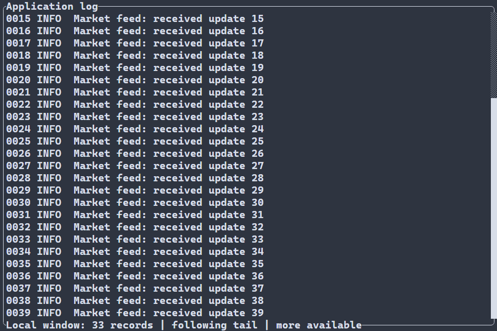
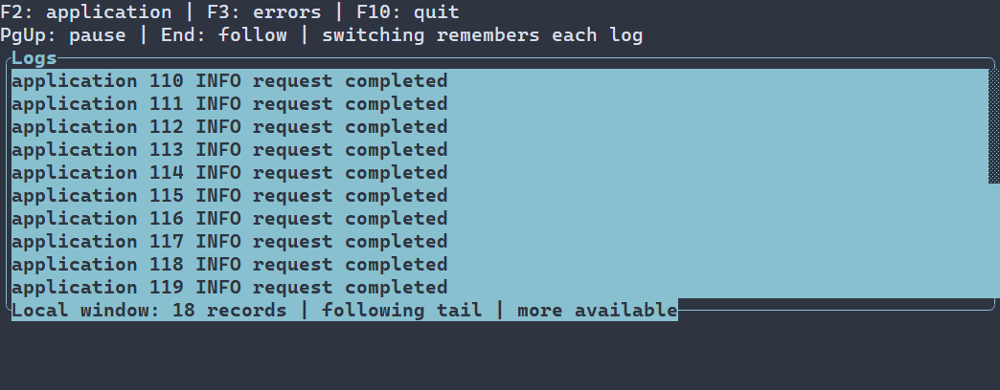
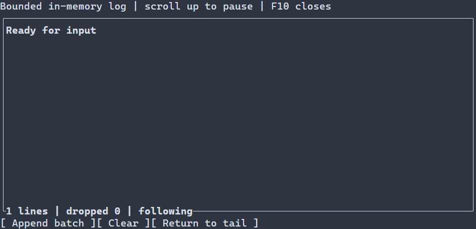

# LogView {#log-view}

[Русская версия](ru/log-view.md) · [Scroll controls](scroll-controls.md) · [Control examples](control-examples.md)

Use LogView either for recent in-memory output or for a bounded view of an external model. `ui::logView("Ready")` owns a rolling journal; `ui::logView(ui::logFile("application.log"))` reads a regular UTF-8 file on the application's background executor. Both follow the tail by default. The file size does not determine the amount of retained text. See [LogView configuration and API](../include/portals/log_view.hpp).

## File-backed log {#log-view-file}



The recording uses a local writer that appends generated records to the file.

Place a UTF-8 `application.log` in the working directory, build
`portals_file_log_example` with `PORTALS_BUILD_EXAMPLES=ON`, and run it in a
terminal. The view opens at the available tail and observes appended records.
PageUp/PageDown, the wheel and scrollbar pause following while you read older
records. Return to tail resumes following; F10 or Ctrl+C exits.

[Complete source](../examples/file_log/main.cpp)

\include file_log/main.cpp

The scene owns the view and cancels its work when the node is removed. File
opening, reads, UTF-8 validation, grapheme parsing and wrapping use the existing
application executor. The UI installs an immutable prepared window. Creating
`ui::logFile(...)` performs no file access; setup and worker failures use the
runner's typed diagnostics, including the native file operation and error code.

The default external view limits are 512 logical records, 1 MiB of record payload
and 64 KiB per record, subject to a shared 8 MiB source/preparation budget. These
are cache limits, not limits on the file or its total record count. The file model
uses 16 KiB read blocks and a 32 KiB record limit by default; `FileLogOptions`
allows records up to 64 KiB. An overlong record returns a typed error without
silently truncating it. One enormous record still requires a different segmented
text model.

Include `<portals/log_file.hpp>` when using the rich `log.fileModel()` API.
`metadata()` returns byte extent and generation, `readBytes()` reads a caller-sized
buffer, and `findLiteral()` searches file bytes in bounded steps with explicit
continuation. Call these methods on a worker, never in a blocking UI callback.
The view does not turn byte extent into a row count or retain a dense file index.
`seekLogByte(tree, node, offset)` accepts a record's starting byte offset;
`seekLogRow(tree, node, ordinal)` applies to finite model bindings with a known
logical row count. Their units are distinct.

Finite snapshots can use the opt-in `<portals/ui_log_source_model.hpp>` adapter
and a worker-side text codec. The original model remains available for its other
operations; the adapter adds read-only display delivery. Generic cursor sources
can provide `WindowProvider<LogLine>` through `ui::logSource(...)` without claiming
a total row count.

Local regular seekable files are supported. Rotation and observed truncation
start a new generation; existing pins stay immutable. Concurrent rewriting is
not a filesystem snapshot: a truncate-and-regrow entirely between observations
may be indistinguishable from growth. Cancellation is cooperative between reads;
an operating-system call on a remote filesystem can still block. Selection,
clipboard, a search toolbar and persistent storage are not supplied by this view.

## Switching models {#log-view-switching-models}



Keep a `ui::Ref<LogView>` and call `log.model(source)` from a UI handler to
replace the source of the existing view. Files are one source family, not a
requirement of `LogView`.

Create UTF-8 `application.log` and `errors.log` in the working directory. F2 and
F3 switch between them without recreating the control:

[Complete switching program](examples/guide_log_models.cpp)

\include guide_log_models.cpp

The same operation accepts `ui::logSource(provider)` for a worker-safe
`WindowProvider<LogLine>`. For an existing immutable finite model, include
`<portals/ui_log_source_model.hpp>` and pass `ui::logSource(snapshot)` for
string records, or `ui::logSource(snapshot, codec)` for domain records. Keep
the original model for its richer operations; replacing the display binding
does not convert it into a file model or require an exact total count.

Replacement preserves the control's identity, Ref, focus, geometry and styles.
It resets the reading position and discards the old displayed window. The new
source starts according to the view's follow-tail setting and its own
capabilities. Switching back starts a fresh binding; it does not restore an
old cursor. Cancelled work from the previous binding cannot install text or
report a stale error into the new binding. Opening and reading the new source
remain background operations.

`log.model(source)` reports an admission failure through the scene's error
collector. Use `log.setModel(source)` when the handler needs to inspect the
`std::expected` result itself. An invalid descriptor leaves the current
binding unchanged. A later read failure belongs to the newly accepted
binding and follows the ordinary runner error policy; admission does not
promise that a file exists or can be read. A rolling in-memory view can also
be bound to an external source; its earlier journal is not retained as an
undoable model switch.

Use ordinary input handlers for replacement. Like other scene mutations,
`setModel` returns `WOULD_BLOCK` during an `onError` notification; the error
callback observes the failure and cannot reenter scene mutation.

## Rolling in-memory log

The following append and retention contracts apply to the rolling journal.
Its defaults retain 512 records and 256 KiB, admit batches up to 16 KiB and records
up to 4 KiB. External sources use the separate limits above; `append` and `clear`
are rejected for an externally bound view.



## Styling reference {#log-view-styling-reference}

`LogView` paints its text, fill and footer with normal, `:focused`, or `:disabled` (disabled takes precedence). Its manual `ControlStyle` supplies defaults beneath the cascade. Use `foreground`, `background` (`#RRGGBB`), `bold`, `italic`, and `underline` (`true` or `false`). A state-free rule applies to all variants; `min-width` requires a state-free selector. See the [cascade and size constraints](styling-guide.md).

The inherited scroll frame and scrollbar have separate part colors and glyph settings: see the [scrollbar styling reference](scroll-controls.md#scrollbar-styling-reference) and [frame styling](controls.md#frame-title-decoration). Their paint attributes inherit the common resolved style when omitted. The right and bottom frame sides must remain enabled for the scrollbar and footer.

```pss
LogView:focused { foreground: #d0e8f0; scrollbar-thumb-foreground: #62b4d7; }
```

`LogView` is a scene-owned, bounded plain-text journal for showing recent output.
Append complete batches of UTF-8 text; the control splits them into records, keeps
the newest records within configured limits, wraps each record on grapheme
boundaries, and paints only its prepared visible rows. Its default height is
flexible, so it uses the available vertical space; an explicit size policy can
change that. It has no child widget per record and does not perform terminal I/O,
file I/O or background work.

At an unchanged width, append reuses the existing wrap ranges and wraps only
newly retained records. It still copies the bounded row descriptors; total append
cost is not independent of the retained row count. A width change rebuilds the
wrap ranges. Hiding the view does not discard its retained data or make append a
background operation. Send expensive data acquisition or transformations through
an appropriate provider before applying a short UI update.

## Ordinary C++ program

Build the `portals_log_view_example` example with `PORTALS_BUILD_EXAMPLES=ON`,
then run it in a terminal. The view starts with `Ready`. Each Append batch click
adds one numbered three-record batch; the longer Unicode record wraps as the
terminal gets narrower. The example retains at most 12 records. Clear removes
the current records, and Return to tail resumes following. Scrolling upward also
pauses following while new records are retained and counted. F10 exits through
the standard runner.

[Complete source](../examples/log_view/main.cpp)

\include log_view/main.cpp

The example keeps its sample messages in memory. It does not read or write files
or claim to preserve output after the process exits.

## Loading LogView from a scene resource {#log-view-resource}

A scene resource can declare the built-in `LogView` by name. C++ obtains typed
refs and connects ordinary button handlers; the resource contains no executable
callbacks and needs no manual control registration.

[Complete resource program](examples/guide_log_view_resource.cpp)

\include guide_log_view_resource.cpp

The configuration properties are `text`, `maxLines`, `maxBytes`,
`maxBatchBytes`, `maxRecordBytes`, `followTail` and `readOnly`, alongside common
layout, frame and style settings. `text` starts empty; defaults for all four
limits are listed below, `followTail` defaults to `true`, and `readOnly` defaults
to `false`. The resource sample starts with one line; C++ buttons append a
two-record batch, clear retained records or return to the tail. Resource
values configure initial content and bounds; append operations remain C++
commands.

The vertical scrollbar uses the right frame side, and the status/Return-to-tail
footer uses the bottom side. Both sides must remain enabled. Frame, title and style
customization may change their appearance, but disabling either required side is
rejected with typed `INVALID_ARGUMENT` during mount. Keep resource
`frame.sides.right` and `frame.sides.bottom` enabled. There is no public
post-mount frame/options setter. The resource example is the complete loaded-scene
path; it does not add another control-registration or persistence layer.

## Batches, records and bounds

An append is one complete batch, not a fragment of a stream. CRLF, CR and LF each
separate records; CRLF is one separator. Empty records between separators are
kept. A final separator ends its preceding record and does not add a phantom
empty record. An empty batch is a no-op. The control does not join a partial
record across separate appends.

| Limit | Default | Hard ceiling |
| --- | ---: | ---: |
| Retained records (`maxLines`) | 512 | 8,192 |
| Retained UTF-8 payload (`maxBytes`) | 256 KiB | 4 MiB |
| Input batch including separators (`maxBatchBytes`) | 16 KiB | 256 KiB |
| One record, excluding its separator (`maxRecordBytes`) | 4 KiB | 64 KiB |

All limits must be positive. `maxRecordBytes` cannot exceed either
`maxBytes` or `maxBatchBytes`. A setting above its hard ceiling is rejected;
the control does not silently clamp it. `maxBytes` counts retained record payload
without line separators, while the batch limit includes separators. Empty records
count toward `maxLines` but contribute no payload bytes.

Each batch is validated and staged before publication. Invalid UTF-8, a limit
violation or an allocation failure rejects the whole batch and leaves retained
records and counters unchanged. A successful batch keeps the newest records that
fit both retained limits. If an oversized record count displaces records from
the same batch, those records are still counted as accepted input and dropped
output. Drop-oldest is a successful retention policy, not a partial-input error.

The wrap index stores numeric record/byte ranges for every visual row, so a
rewrap still scans retained source text and its graphemes; that work is not limited
to the viewport. Retained source records stay within the configured limits, while
the owning prepared `GraphemeText` paint cache contains only rows intersecting the
visible viewport. The limits bound records, payload and index size, but do not give
an exact process-RSS guarantee: grapheme metadata, record objects, visible caches
and staged old/new state also use memory.

## Wrapping and reading position

`LogView` wraps at its current text width without splitting a grapheme. A single
grapheme wider than the viewport is consumed once and clipped by the existing
terminal text policy. Zero-sized or hidden views draw no rows and preserve the
logical follow state or reading anchor until a usable viewport is prepared.

Following the tail is enabled by default. Set `followTail=false` to start paused
at the first record and visual row; the footer shows Return to tail. A deliberate
scroll away from the bottom also pauses following; reaching the bottom or choosing
Return to tail resumes it. Programmatic
`ui::Ref<LogView>::setOffset(ScrollAxis::VERTICAL, ...)` changes are deliberate
navigation too. Appending while paused preserves the reading anchor and
increments the `newWhilePaused` count. The footer reports retained records and
dropped history; while paused it also reports new records and offers Return to tail.

The anchor is a record identity plus a grapheme byte boundary at the first
visible row. Resizing rewraps records and places the view at the visual row that
contains that boundary. If retention evicts the anchored record, the view moves
to the first surviving record and the dropped count makes that loss visible.
The anchor is not an absolute visual row number, so a width change does not
pretend that the old row number still identifies the same text.

## Append, clear and status

`ui::Ref<LogView>` provides short `append(bytes)`, `clear()` and `tail()` commands
for ordinary event handlers. They return `bool` and report technical failures
through the existing scene diagnostic collector. `appendBatch(bytes)`,
`clearLog()` and `followTail()` are checked alternatives that return typed
results without automatically reporting technical failures. A successful
`appendBatch` returns an owning `LogAppendReceipt` with accepted, dropped and
retained record counts and retained payload bytes.

`status()` returns an owning `LogStatus` containing retained lines and bytes,
cumulative dropped lines, records accepted while following is paused, and the
follow/saturation flags. Saturating counters stop at their representable maximum
instead of wrapping; the flags identify a saturated total. The observation
contains scalar values only and does not retain records or the control. Clear
removes retained records, resets drop and paused-new counters, preserves record-ID
history and resumes following.

Mount a usable control through `ManagedScene::logView(...)` or `ui::logView(...)`.
Direct `WidgetTree::emplace<LogView>` alone is insufficient, even if its base
`ScrollArea` lease is initialized: it does not register the managed entry's
scroll-intent observer and preparation path. Commands and measurement on such a
node return typed `INVALID_ARGUMENT`. There is no standalone raw-control setup
path.

The scene owns the log records. A `Ref<LogView>` observes its control and does
not prolong its lifetime. Append copies caller bytes before successful return.
Programmatic append, clear and tail commands remain allowed when the control is
hidden, disabled or configured read-only; read-only blocks user navigation.
Commands follow the existing UI-thread, outside-frame and live-owner checks.
Later layout or render failure does not turn a successful append into a failed
admission: its records have already been retained.

The rolling append path does not frame an incremental byte stream or provide
filtering, search, selection, clipboard copy or persistent storage. Use the
external-source path above for file-backed display.
