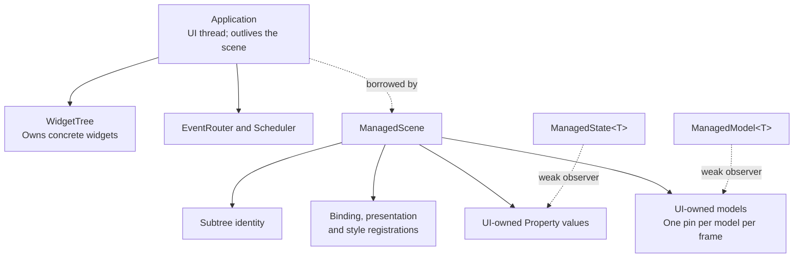

# Managed controls {#managed-controls}

[Русская версия](ru/managed-controls.md)

`<portals/managed.hpp>` adds `ManagedScene`, a lifecycle owner for ordinary
controls, custom widgets and opt-in virtual views. It uses the existing
`Application`, `WidgetTree`, properties, bindings, router and style engine. The low-level APIs remain
available. Nodes can be mounted imperatively or through the separate
[declarative composition API](declarative-ui.md). Managed virtual factories add
automatic preparation of lists, tables and charts without introducing
reconciliation, a second widget tree or another runtime.

## Ownership and execution



Create an `Application`, then `ManagedScene::create(application, options)`. The
optional `ManagedOptions` sets `maxNodes`, `maxStates` and `maxModels`;
each must be greater than zero. Their defaults are 4096, 256 and 64.
See [setting scene limits](declarative-ui.md#scene-fine-settings). Node entries
include removed registrations until the next preparation prunes them; state
owners remain until scene destruction, while model owners remain until close.
Exceeding an owner budget returns a typed `TreeError::NODE_LIMIT`.
Add a `Column`, `Row` or custom layout below `scene.root()`, and create controls with
`scene.emplace<T>(parent, arguments...)`. The returned `Node<T>` remains the
existing checked observer. Concrete custom types may be `final`; no additional
widget base class is required.

The scene is noncopyable, nonmovable and UI-affine. Destroy it before its
`Application`, outside callbacks and tree frames. Removing a child or ancestor
from an admitted callback is supported; destroying either owner from that
callback is not. An admitted callback retains its storage until it returns.

`scene.state<T>(value)` owns the `Property<T>` on the UI thread and returns a
weak `ManagedState<T>`. Copies of the handle do not extend the state owner's
lifetime. `set()` and `snapshot()` return the existing property results; UI
affinity is checked before accessing the property. Use transitively immutable
snapshots for cross-thread data. Do not use the weak handle as a worker-side
mutable model interface.

Call `scene.run()` or `scene.run(terminal)` to retain complete managed errors.
The `Application` still supplies options, width policy and the injected clock.
The terminal overload supports the same deterministic replay contract as
`Application::run`; no native terminal is required for tests.

Normal stop disconnects scene registrations, removes its subtree and destroys
owned models. The scene retains properties until destruction so the caller can
read final property snapshots. Model handles instead report `CLOSED` after stop.
Writes after stop fail because the invalidation target is stale. After scene
destruction, state operations on the creating UI thread return
`TreeError::CLOSED`; wrong-thread operations still return `WRONG_THREAD` before
checking expiration. Copying or destroying a handle is thread independent.
Explicit `close()` is an
idempotent fallible cleanup boundary; the destructor performs RAII cleanup.

## Standard behavior and presentation

`bind(editor, name, result, clipboard, validate)`, `bind(checkbox, enabled,
changed)` and `onClick(button, action)` retain their registrations in the scene.
Ordinary consumer code stores no individual binding tokens and calls no
standard control synchronization functions. The scene obtains focus and
synchronizes standard presentation only at the existing dirty-frame prepare
boundary, before layout and paint. It does not add idle polling.

The property remains authoritative. Initial binding adopts its snapshot, and
latest-snapshot synchronization recovers from rejected notifications. The exact
`PropertyUpdate<T>` receipt still distinguishes a successful commit from failed
notification admission. Resynchronization does not repeat a business callback.
State invalidation must be `PAINT` or `LAYOUT`; `NONE` cannot guarantee this
recovery and is rejected.

Line editing applies `LineEditOptions::editMode` equally to input, clipboard and
fluent text changes; see [editing modes](line-edit.md):

- IMMEDIATE is the default: changed valid candidates publish without Enter.
- ON_COMPLETION confirms a dirty draft synchronously on blur or Enter.
- EXPLICIT preserves the previous opt-in draft/Enter behavior and keeps drafts on blur.
- Enter validates and commits only if the source revision still matches.
- Rejected validation or a revision conflict preserves the draft.
- Escape adopts the latest committed value.
- `Ref<LineEdit>::clear()` is a checked user edit applying the same mode and Undo history;
  immutable placeholder and protected display options are described in [LineEdit](line-edit.md).
- Invalid text and over-limit edits retain the previous draft; semantic rejection
  keeps the newly accepted intermediate text visible without publishing it.

The standard behavior executes before the result callback. Returning a callback
error cannot undo an already committed checkbox toggle or edit. The LineEdit
validator is the explicit commit veto. There is one event registration per node;
`onEvent` is the custom-widget path, not a second registration to stack on a
bound standard control. Callback storage uses `std::function`, so captures must
be copyable; move-only captures are not promised by this version.

## Styles and custom widgets

Managed Label, Button, CheckBox, LineEdit and KeyHints receive their natural style
type names automatically; `ui::plainButton` uses `Button`. Their metadata also enables
`Control` selector matching through `StyleTarget::control`. This flag adds one
compatibility match; it does not introduce a type hierarchy. Custom Control
subclasses retain the default `Control` type unless explicitly styled.
Custom widgets use `scene.style(node, target)` and read `computedStyle()` while
painting. Metadata is staged and installed as a batch. `theme(sheet)` uses the
existing atomic style engine, flushing pending registrations before replacing
the sheet. Explicit theme selection and initial focus remain application intent.

Explicit `scene.style(node, target)` replaces the target metadata; `control`
defaults to false for such targets. Set it explicitly to keep the additional
`Control` match. The recipe `.style(target)` uses the same replacement contract,
with its existing ID modifier rules; `.id()` preserves the other target fields.
Completing a cold List, Table or Chart preserves its ID, classes and nonempty
custom type, assigning the default type only when none was supplied.

One style engine owns a node at a time. Do not bind the same managed node to an
independent `StyleEngine`. The existing precedence remains widget defaults below
matching stylesheet rules; this layer does not introduce a local-override
cascade, hierarchy selectors, inheritance or new PSS syntax.

Register a custom event handler with `onEvent(node, callback)`, returning
`expected<EventReply, TreeError>`. Register custom presentation work once with
`onPrepare(node, callback)`, returning `expected<void, TreeError>`. The latter
receives the concrete widget and the recovered focus observer. It reads domain
state, updates retained presentation when needed and requests the appropriate
invalidation. The scene invokes it; the application does not manually call it
before each frame. Custom `onPrepare` runs before layout and does not supply
virtual-view geometry. Use the dedicated virtual factories for automatic
preparation from the arranged size. Painting must still consume only prepared
presentation.

## Managed virtual views

`model<T>(initialSnapshot, options)` creates an existing `Model<T>` owned by the
scene and returns a weak `ManagedModel<T>`. The handle exposes `publisher()` on
UI so provider code can copy the existing worker-safe publication endpoint.
Snapshots and rows must satisfy the immutable model contract. Handles copied
outside the scene do not extend model ownership, and models cannot be shared
between managed scenes through these factories.

`virtualList`, `virtualTable` and `chart` accept that handle, create independent
range consumers, and register preparation plus the standard `List`, `Table` or
`Chart` style target. Lists and tables also own their standard input bindings.
No per-view token, manual style registration, pin or size calculation is needed.
The usual `style()` and `theme()` operations remain available for customization.

The scene pins each model once during ordinary dirty-frame preparation and uses
that pin for every registered view and bounded layout retry. An optional provider
handler receives borrowed frame/request arguments after each successful view
preparation, in registration order. Copy pending requests before retaining them;
provider scheduling and rejected-completion retry remain application policy.
A missing handler with pending work reports `PREPARE / INVALID_ARGUMENT` and
cancels the unowned request. Do not mutate the managed registry or dispatch the
scheduler from a preparation handler.

Hiding cancels range work; disabling keeps preparation but suppresses input;
removal retires the consumer. Closing the scene destroys model owners and closes
their endpoints. A factory failure removes its attempted child, preserving
earlier children. The [virtual preparation guide](virtual-preparation.md)
describes callback ordering, lifetime and failures. Explicit `ApplicationScene` hooks and low-level preparation
helpers remain supported.

## Errors and partial construction

Managed operations return `expected<..., ManagedError>`. The error retains its
phase, node identity and original `TreeError`, `StyleError` or `ApplicationError`.
It can also retain an independent runner/restoration error and cleanup failure.
`ManagedError::cause` keeps its original three variant alternatives. The optional
`text` detail retains an exact `TextError`, including its byte offset; the optional
`resource` detail retains an exact `TextResourceError`. Text/resource adapters can
keep a compatible tree category in `cause` while preserving the original typed
detail. Managed diagnostics includes the shared `<portals/text_resource.hpp>`
resource categories without importing text factories.
Existing visitors over the tree/style/application variant remain valid.
The run wrapper is required when the caller needs these complete details;
calling the `ApplicationScene` compatibility hooks directly cannot carry the
whole error object through their `TreeError` return type.

Business callbacks return their errors explicitly. Throwing from a callback
still follows the existing `CALLBACK_FAILED` boundary; using `.value()` there
would discard the original expected error. The scene-level `onInput` callback
returns `expected<bool, ManagedError>` so a failed theme replacement can retain
its full style error. `true` consumes the event before routing. Mutable captures
retain their state between events. Replacing the interceptor or closing the
subtree from inside it retains the active callback until it returns.

An admitted custom preparation callback may remove its own node. Successful
removal does not suppress an explicitly returned error or a translated exception.
Checked insertion also revalidates its result after deferred unmount callbacks
have run; it cannot return a child already removed by that cleanup.

Failed construction removes the attempted child; earlier successful children
remain scene-owned. Destroying the scene cleans a partially built form. This is
resource cleanup, not rollback of external effects performed by constructors,
mount hooks or business callbacks.

## Bounded scene diagnostics

`ManagedOptions::diagnostics` configures `maxErrors`, `maxContexts` and
`maxContextBytes`; each must be greater than zero. Their defaults are 64,
8 and 1024. The scene constructs a fixed
array of error slots and a separate overflow slot before mounting its root,
including the empty context containers. This finite construction cost allows
reporting without creating or moving containers, including MSVC Debug iterator
proxies. Invalid or unrepresentable budgets return
`INVALID_ARGUMENT`; failed allocation returns `NO_MEMORY` without mounting a
partial subtree. The count limit bounds the error history; the context count and
combined label-byte limit bound the owning causal trace of each error.

`reportError(error, contexts, origin)` collects an explicit error and notifies the
optional `onError` observer. It does not request a frame, stop the runner or select
a recovery policy. Checked setup calls continue returning their explicit
`expected` errors and are not automatically duplicated in the history. Managed
runtime failures are recorded through the existing first-failure path, which
still requests orderly shutdown and returns the original failure from `run()`.
Successful operations and ordinary redraws do not create diagnostic entries.

Each `ManagedDiagnostic` owns a `ManagedError` and its copied
`ManagedDiagnosticContext` breadcrumbs. A context contains `operation`, `name`,
`scope`, `expectedType` and the original `origin`. Contexts are copied in supplied
order, retaining up to `maxContexts`; label bytes are copied in the field order
above until the shared `maxContextBytes` budget is exhausted. Truncation is a
byte-prefix policy, so a truncated UTF-8 label may need escaping when formatted.
`contextsTruncated` identifies either limit. Source locations are stored by value
under the [standard source-location contract](https://eel.is/c++draft/support.srcloc).
This is a causal trace, not a physical call stack. Deferred operations must capture an origin at
registration and pass it when reporting; a default report origin only identifies
the `reportError` call site. No formatted report or borrowed exception is stored.

```cpp
ManagedOptions options;
options.diagnostics.maxErrors = 32;

auto created = ManagedScene::create(application, options);
if (!created) {
  return std::unexpected(created.error());
}

auto scene = std::move(*created);
auto registered = scene->onError([](const ManagedDiagnostic &diagnostic) {
  // Inspect typed fields here; the reference is borrowed for this call only.
  // Presentation/output remains application policy.
});
if (!registered) {
  return std::unexpected(registered.error());
}

std::array contexts{ManagedDiagnosticContext{
  "lookup", "message", "form", "LineEdit", std::source_location::current()}};
auto reported = scene->reportError(
  ManagedError{ManagedPhase::STATE, {}, TreeError::INVALID_ARGUMENT, {}, {}}, contexts);
if (!reported) {
  // Handle WRONG_THREAD or CLOSED explicitly.
}
```

After `maxErrors` entries, the oldest errors survive and `droppedErrors` increases.
The observer still receives the original overflowing error and report origin in
an allocation-free reused diagnostic with `storageOverflow = true`; its
contexts are omitted and `contextsTruncated` is set if contexts were supplied.
When copying context storage fails, the stored original error and origin survive,
the partial trace is discarded, `contextUnavailable` is set and `contextFailures`
increases. Recording an error without contexts and the overflow fallback require
no allocation after successful scene creation. Construction of caller arguments
and allocations performed by an observer happen outside that guarantee.

`onError` owns its copyable callback and mutable captures. It runs synchronously
on UI after recording and can inspect `diagnostics()`. It must not retain a
reference to the borrowed diagnostic, its labels or context storage. A thrown
exception sets the record's `observerFailed` flag and increments
`observerFailures`, preserving the original cause and stop policy. Nested
`reportError` calls are collected, set `notificationSuppressed`, and increment
`suppressedNotifications`; they do not recursively invoke the observer and are
available through inspection/draining. Overflowing temporary flags are only
available during their observer call; the batch retains the counters. Counters
saturate at `size_t`'s maximum.

Observer registration, scene mutation, `close()`, `clearErrors()` and
`drainErrors()` return `WOULD_BLOCK` while an observer is active. Replacement or
clearing outside a call releases the prior callback; close releases it after
marking the scene closed. Immediate managed-error notifications occur before
terminal restoration and never write mandatory stdout/stderr or display a dialog. After shutdown, `run()`
adds independent application/restoration and cleanup details to its retained
first runtime diagnostic. If that record was cleared or drained earlier, the
complete final error is appended instead of rewriting an unrelated entry. An
application-only runtime error is collected at that final boundary. No observer
is called after close.

`diagnostics()` copies an owning `ManagedDiagnosticBatch`; `drainErrors()` copies
then clears it, preserving the constructed slots and context-container storage.
Copies are constructed directly at the error boundary; no `noexcept` container
move is relied on for allocation handling. Allocation failure returns
`NO_MEMORY` and leaves the history/counters unchanged. `clearErrors()` clears
history and counters without allocating. Neither clearing method resets a runtime
first failure or changes shutdown policy. Inspection, clear and drain remain
available after close, with `batch.closed = true`; reporting and registration
return `CLOSED`. All these operations check UI affinity first and return
`WRONG_THREAD` without mutating the collector or calling an observer. These are
checked scene operations; a detached/worker-safe property channel belongs to the
later property facade, not this collector foundation. The scene and application
must remain alive throughout any operation.

## Examples and verification

For application code, start with [declarative composition](declarative-ui.md)
and the [fluent gallery](../examples/gallery/fluent_form.hpp).
These scene descriptions use the managed control factories internally.

The [installed-package tests](package.md) compile controls against a relocated
installation using `find_package(Portals CONFIG REQUIRED)` and `portals::core`.
The [form fixture](../tests/package_consumer/form_support.hpp) exercises editing,
validation, state updates, focus, theme changes and custom widget behavior.
[Replay support](../tests/package_consumer/form_replay.hpp) supplies a finite
terminal and scripted input. The typed-error scenario checks the original error,
phase, node and transport cleanup.
