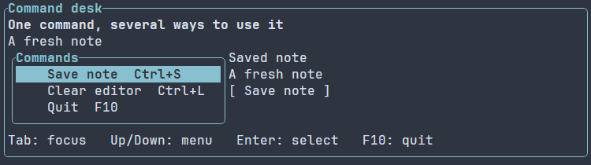
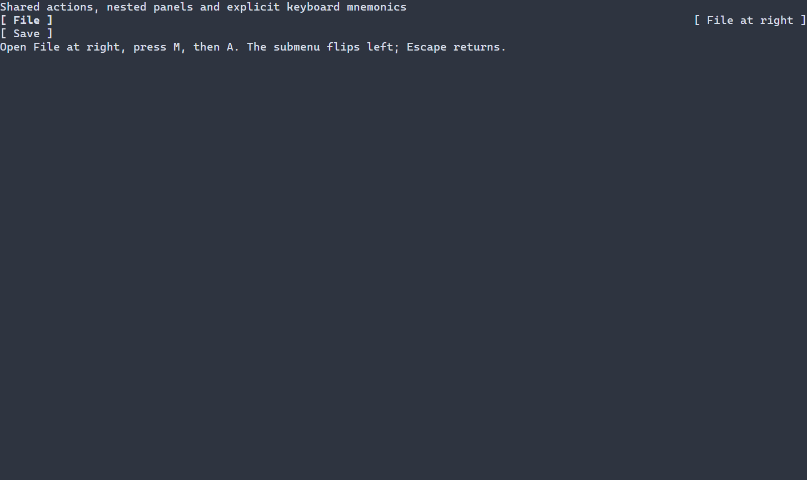

# Menus of shared actions {#menus}

[Русская версия](ru/menus.md) · [Shared actions](actions.md) · [Runnable examples](examples.md)

A menu lets the user choose an application command with the arrow keys or the
mouse. Pass the same action to a menu, a button and an explicit shortcut to share
their callback, caption and availability.



[Watch keyboard selection and command execution](images/commands.gif).

## A complete application

\include guide_menu.cpp

The [complete source](examples/guide_menu.cpp) links `portals::core`; see
[package setup](package.md). Tab moves focus to the menu. Up and Down move the
selection; Enter runs its action. The Save button and Ctrl+S run the same action.
F10 exits through the normal application cleanup.

The menu is an ordinary retained control in the scene. Its frame and width use
the same [layout modifiers](layout.md) as other controls. Both axes prefer the
prepared content by default; the menu does not consume spare space. In the
example, `minWidth(12)` and `maxWidth(32)` bound the complete framed block,
including its border. Short captions stay compact; longer captions grow the block
up to its cap. See [sizing modes and bounds](compact-primitives.md).
It starts visible and
does not open a popup. A menu bar, nested menus and a searchable command palette
are outside this API.

## Share state and presentation

Use `ui::ActionMetadata` when a command needs a shortcut caption, help text or
initial enabled, visible or checked state. The [Command desk example](../examples/commands/main.cpp),
built as `portals_commands_example`, shows an editor, a framed menu and a Save
button. The saved label changes only when the shared Save command runs.

The `shortcut` field is display text. Bind keys explicitly with `ui::onKey`, as
the example does. Updating an action updates its menu and button presenters
through the existing scene preparation. A checked action remains checked until
the application changes its metadata; selection does not toggle it.

Hidden commands occupy no row. Disabled commands remain visible and cannot run.
Keyboard navigation skips unavailable commands. A menu with no eligible action
has no active selection. Changing focus preserves its local selection.
Home and End select the first and last eligible command. Enter and Space activate
on a reported press; explicit repeat and release events do not activate. Up and
Down may repeat. Keyboard and mouse activation preserve the original modifiers.
Legacy terminal input may not distinguish repeated keys from separate presses;
each decoded activation is accepted in that case. The menu does not infer a held
key or add a debounce delay.

The default `MenuOptions::maxEntries` is 256. Every entry, including a duplicate,
also counts against its action set's `maxPresenters` limit. An empty menu is
valid. Allocating less height clips rows through the ordinary layout; this control
does not add scrolling automatically. Use a different composition when every row
must remain reachable in a small viewport.

## Ownership and errors

Menus reuse the [ActionSet lifetime and error contracts](actions.md). A recipe
retains its cold declarations until mounting; the attached scene owns the
callbacks. Reusing a set already attached to another scene is rejected. Closing
the scene retires the actions, including when a callback closes its own scene.
An ordinary failed menu mount restores newly attached action sets to their cold
state. Actions already used by the scene remain attached. Independent bindings
created by application setup code are preserved; arbitrary setup side effects
are not rolled back.

Menu configuration and action admission failures follow the ordinary typed
setup-error path to `ui::runApp`. A command callback can return its existing
checked result; the scene collects that result through the same path used by
action buttons and key handlers. Menu data never contains executable commands
loaded from a scene resource.
The flat `ui::menu` factory receives code-bound `ActionRef` values; its command
binding syntax is not provided in scene resources. The separate PopupMenu adapter
below binds a code-owned action graph to loaded presentation.

The first implementation provides a bounded command list. It does not perform
background search or keep command history; use the separate model-backed search
APIs when building those application features.

## Popup menus and submenus

Use `ui::scene(body, ui::popupMenu(...))` to declare an initially closed popup.
The scene composes or reuses its existing overlay host. A `ui::Ref<PopupMenu>`
observes the real sized control with ordinary content/min/max/flex modifiers.
The [complete example](examples/guide_popup_menu.cpp) shares Save between a button,
explicit shortcut and popup, and opens a nested More panel:

```cpp
ui::popupMenu(commands, {
  ui::menuItem(save, U's'),
  ui::submenu("More", {ui::menuItem(copy, U'a')}, U'm'),
  ui::menuItem(quit, U'q')
}).minWidth(18).maxWidth(56)
```

Call `commands.open(opener)` from an ordinary managed callback. Its anchor must
be a visible arranged control in the same host's body. `dismiss()` closes the
whole activation; `opened()` returns a checked observation. Opening an already
open popup is unchanged. Reopening can use another valid body anchor. All panels
share one input scope and saved focus return. A leaf closes that scope and
restores focus before invoking its existing ActionRef. If closing fails, the
leaf does not run; published closure is not rolled back. Callbacks may remove
their action, popup subtree or scene.

Up/Down wrap eligible rows; Home/End select the first/last. Right or Enter opens
a branch; Left closes the deepest branch. Escape closes the deepest branch, then
the root. Enter and Space activate leaves on reported press. Disabled leaves
remain visible and are skipped; hidden/retired leaves occupy no row. Empty
branches are disabled. Selection scrolls into the bounded viewport during layout.
Panels prefer the right edge, flip left when space is scarce and remain clipped
to the viewport. Their gaps preserve underlying paint. Outside left press closes
the whole popup and is consumed. Tab closes and resumes ordinary focus traversal.

Mnemonics are explicit Unicode scalars shown in a hint column. Captions keep
literal `&` characters. ASCII comparison ignores case; other scalars compare
exactly, without locale-dependent folding or normalization. Duplicate mnemonics
cycle eligible matches without executing; a unique match opens or activates.
Legacy VT TextInput and native CHARACTER press use the same path. Supported
decoders emit one event per decoded scalar; two independently injected Key/Text
events remain two events. No timing debounce is introduced.

`PopupMenuOptions` defaults to 256 total entries, depth 8 (maximum 32), a 60x20
cell plane cap and a one-cell transparent panel gap. Every leaf occurrence also
uses its ActionSet presenter budget, including duplicates in closed branches.
The tree is owning and immutable after mount; leaf metadata stays shared.
Invalid options/Unicode use `INVALID_ARGUMENT`, entry/depth bounds use
`NODE_LIMIT`/`DEPTH_LIMIT`, allocation failure uses `NO_MEMORY`. No search,
history, hover timer, menu bar or command scheduler is added.

## Loaded popup presentation

Register the code-owned action graph through the fluent resource adapter:

```cpp
auto resources = ui::SceneResourceOptions{}.popupMenu("FileMenu", commands, {
  ui::menuItem(save, U's'),
  ui::submenu("More", {ui::menuItem(copy, U'a')}, U'm')
});

auto app = ui::scene(body,
  ui::resource("FileMenu{fitWidth=true minWidth=18 maxWidth=56}", resources));
```

Registration errors are collected at checked prepare/`ui::runApp`, before file
reads or terminal entry. Advanced callers can still check
`resources.registry.popupMenu(...)` directly.

The resource carries ordinary scalar sizing, id/classes and visible/enabled
presentation. Construction budgets and the command graph remain in code;
ActionRefs and callbacks are never deserialized. Unknown properties and invalid
scalar bounds use positioned resource errors before publication. The adapter
adds no popup payload to every control's settings. The ordinary flat Menu keeps
its existing code-bound factory and shortcut metadata semantics.

The popup outline reuses the existing Border frame-text and paint implementation.
`PopupMenuOptions::frame` accepts existing frame patterns, custom glyphs, title
chrome and its paint-work budget. All four one-cell sides are required in this
slice. Loaded `frame` scalar settings configure the same native popup frame,
without adding an outer wrapper. Theme frame line/title colors are applied.
Shared PSS glyph-profile overrides currently target Border/scroll controls;
that automatic profile staging is not provided for PopupMenu. Select a frame
pattern/glyph policy in code or its resource binding instead.

`maximumPanelSize` is a hard cap on the complete popup plane. Explicit fixed
width/height or hard minima beyond it return `INVALID_GEOMETRY`; conflicting
ordinary/PSS bounds retain the existing typed validation errors. A larger max
bound is only an upper allowance and does not force the popup to grow.

Anchored opening requires an already arranged body frame. Opening before that first frame returns the existing typed WOULD_BLOCK error; no hidden layout or input-time frame is performed. Once the body anchor is ready, opening and mnemonic navigation may arrive in one input batch before the first popup presentation.

### Native popup recording

The complete program opens a left popup, invokes a nested command, then opens
the same menu at the right edge. Its submenu opens to the left; Escape restores
the parent and then the opener. The recording also includes terminal resizing
and the shared Save button. It uses keyboard input and the terminal's colors.

\image html popup-menu.png "A submenu opens left at the viewport edge"


