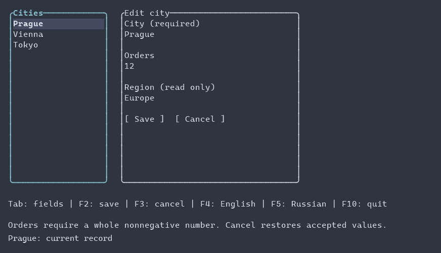

# Map a form to the current record {#model-forms}

[Русская версия](ru/model-forms.md) · [Record edit sessions](record-edit.md) · [Field validation](form-fields.md)

Use `<portals/ui_model_form.hpp>` when a list selects a record and a form edits
its members. A form is an ordinary `Column` containing real `FormField` and
`LineEdit` controls. It shares the navigation and edit session already used by
the list; application code does not copy values when current changes.

## A city form

The example edits a required city name and a nonnegative order count. Region
remains readable while user editing is blocked. F2 saves the current record,
F3 cancels its drafts, F4 selects English, F5 selects Russian, and F10 exits.
In `EXPLICIT` mode, moving to another city retains the first city's draft and
Undo/Redo history. A malformed count stays visible until corrected or canceled.

[Complete typed example](examples/guide_city_form.cpp):

\include docs/examples/guide_city_form.cpp

Build an application against `portals::core` as shown in
[Connecting an application](package.md). The source needs C++23. For two ordinary
string fields, [this smaller example](examples/guide_record_form.cpp) uses the
same directory and save/cancel behavior as the record-edit guide:

\include docs/examples/guide_record_form.cpp



## Field declarations

`ui::field(caption, &City::orders)` owns its caption and mapping configuration.
The member pointer selects a local C++ member; it is not a persistent schema key.
Use `.key("city.orders")` when an external adapter needs an explicit schema
identity. Register that adapter with `edit.field("city.orders", &City::orders,
endpoint)` before constructing the form. Both declarations then share the same
field definition and exact qualified write targets.

| Declaration | Behavior |
|---|---|
| `.required()` | Show the native required marker and reject empty scalar text at publication |
| `.validate(rule)` | Apply an owning typed synchronous rule in addition to existing field validation |
| `.readOnly()` | Block user editing through the native editor policy; explicit programmatic commands retain their checked behavior |
| `.options(config)` | Replace the ordinary `FormFieldConfig`, including text/async rules, help, messages and editor limits |
| `.reference(ref)` | Publish an ordinary `Ref<FormField>` after the entire subtree mounts; `ref.editor()` observes its `LineEdit` |
| `.codec(codec)` | Use explicit owning scalar parse/format callbacks |
| `.editor(factory)` | Supply an actual custom editor recipe with an explicit typed binding |

Modifiers are applied in call order. In particular, `.options(...)` replaces
settings established by an earlier `.required()` or `.readOnly()` call. A form accepts ordinary consuming widget recipes alongside field declarations,
so its Save/Cancel row can be a direct child. It uses gap one by default; its returned `Description<Column>` supports the usual
layout, sizing, framing and setup operations.

The default mapper supports `std::string`, integral types except `bool`, and
floating-point types supported by `charconv`. Numbers use locale-independent decimal `charconv`
conversion and require a complete candidate. Whitespace, a suffix, overflow,
NaN and infinity are rejected; no prefix is silently accepted. Use a custom codec
for an enum, a domain value or another textual representation. The built-in
endpoint accounts for strings and trivially copyable values; other owning types
need an explicit endpoint implementing their `ownedBytes()` contract. Unsupported owning
values without a codec or factory fail checked mount with `INVALID_ARGUMENT`.

## Modes, validation and identity

The form preserves its session's `IMMEDIATE`, `ON_COMPLETION` or `EXPLICIT` mode.
Keyboard input, paste, fluent text assignments and bound typed field assignments
use the existing publication path. Required/text checks and typed validation run
before a candidate reaches the model. Async validation uses the ordinary
`FormFieldConfig::validateAsync` worker path and its candidate/message bounds.
No validator runs during painting. Form-required/text/mapping rules belong to each
mounted editor; creating an unused recipe does not change another editor or the
explicit rule registered through `EditField::validate()`.

For several editors of the same field, session commands and typed field setters use
the existing preferred binding: the first eligible live FormField in binding
registration order, then a plain editor if no FormField is available. Rules from
separate editors are not implicitly intersected. Direct Ref edits use that control's
policy. Removing the preferred editor lets the next eligible binding take over.
An async draft retains its generation's approval requirement after editor removal;
a newly mounted editor can supply a replacement policy, and Cancel discards local input.

A malformed numeric draft has owning text and history even though it has no typed
value. Inspect its bytes through `ref.text().get()`; the field snapshot's typed
`draft` is empty when parsing fails. For a retained target that is no longer current,
`field.draftText(originalTarget)` explicitly copies its editor bytes without parsing
or contacting the source. This also recovers malformed text from an orphan after
record deletion or source closure. It returns `nullopt` when the retained target has
no text editor state; the owning copy survives navigation and discard. Validation status and messages remain
attached to that exact record. Cancel adopts its admitted accepted value and
resets local history; Undo/Redo retain their ordinary editing meaning.

Read-only models supply readable fields and keep navigation usable. With no
current record, the standard editors are empty and inactive; form construction
succeeds. A descriptor's `.readOnly()` blocks user editing independently of
source write capability. It does not grant a write capability to a read-only source.

When deletion resolves navigation to a nearest surviving current row, the form
creates a new exact target for that resolved row's stable identity. The previous
record's retained targets and raw input remain independent; Save cannot transfer
an orphan draft into its replacement. Navigation retains its nearest-resolution
diagnostic.

Drafts, pending requests and replies retain the existing resource/session/record/
field/version/sequence qualification. A late reply for the previous record cannot
replace the newly displayed record. Save submits per field, and
`edit.lastResult()` exposes partial acceptance or pending work. The form adds no
multi-field transaction guarantee. See [session lifetime and replies](record-edit.md)
for retained targets, conflicts, source closure and cancellation of local input.

## Captions and language changes

Pass a literal, `TextValue`, an existing live scalar caption source or a `ValueText`
expression directly to `ui::field`. The mapper mounts the normal `Label` recipe,
so delivery, errors and ownership follow the existing caption API. A live required
caption has a separate native required-marker label beside it.

For language changes, the typed example uses
`text(i18n("orders"), translate, russian)`: the locale model is an explicit dependency
of the existing resolver. Changing it updates the caption. A bare `TextValue`
uses its normal resolution policy; the form adds no ambient locale or scheduler.
See [Live captions](value-models.md).

## Custom codecs and editors

A codec owns `format(const Value&) -> expected<string, TreeError>` and
`parse(string_view) -> expected<Value, TreeError>`. Return `INVALID_ARGUMENT` for a
rejected complete candidate. Other errors follow the checked editor diagnostic
path. Callbacks run synchronously on the UI thread, must be short and
non-reentrant, and must not retain borrowed input. Exceptions use the existing
mount/input error boundary. Formatting owns the complete scalar output.

One retained field has one text representation and history. Copies of a mapping
share their codec owner. Direct `lineEdit(field, codecOwner)` and
`formField(caption, field, codecOwner, config)` accept a
`shared_ptr<const ui::EditTextCodec<Value>>`. Reuse that owner when mounting another
editor for the field. A different codec owner, or adding a representation after
the field was activated without one, fails checked mount with `INVALID_ARGUMENT`.
It cannot reinterpret an already admitted draft/history.

A factory receives `EditField<Row, Value>` and the descriptor's requested user
read-only policy. For example, this owning factory chooses the existing typed
text editor and explicitly stages its native policy; `codecOwner` is an already
created owning codec:

```cpp
ui::field("Orders", &City::orders).editor(
  [codecOwner](ui::EditField<City, int> field, bool readOnly) {
    return ui::lineEdit(std::move(field), codecOwner).readOnly(readOnly);
  });
```

The wrapper supplies the real `FormField`, caption, help, appearance and required
marker. A custom editor supplies its property-to-field binding, user read-only
policy, source-readonly presentation, value validation, history and focus behavior.
The marker alone does not implement custom value validation. Ordinary text/async
editor options are used by the default mapper; a custom factory configures its
own editor. A mapping's `.validate()` accompanies the field copy passed to its
factory. `field.set()` checks this local typed rule before admitting a candidate;
the factory keeps its own rejected UI input. Passing that field to the native typed
LineEdit also preserves the rule through input and session publication. It does not
replace the shared model rule. No arbitrary widget property is connected automatically.

## Scalar text limits

The default mapper is a bounded single-line scalar editor. Its existing
`LineEditOptions::limits` apply; defaults allow 4096 input bytes. Retained values,
drafts and history also use the session's independent `EditOptions` budget.
A built-in owned/read-only field checks a selected string's size against the
mounted scalar editor's byte bound before copying that member. Oversized input
reports `INVALID_ARGUMENT`; it is never truncated. An unbound typed field keeps
its ordinary retention contract, without a new editor-length limit.

An external `EditEndpoint::read` supplies an owning field value and must enforce
its own bounded access contract before producing it. A codec formats a complete
scalar; it does not stream a huge document. For windowed text or binary data,
choose a capability-aware editor/source through an explicit factory, for example
an existing [document viewer](document-view.md) for read-only windowed content.
A factory is an extension point, not automatic support for large-text editing or
for every widget property.
