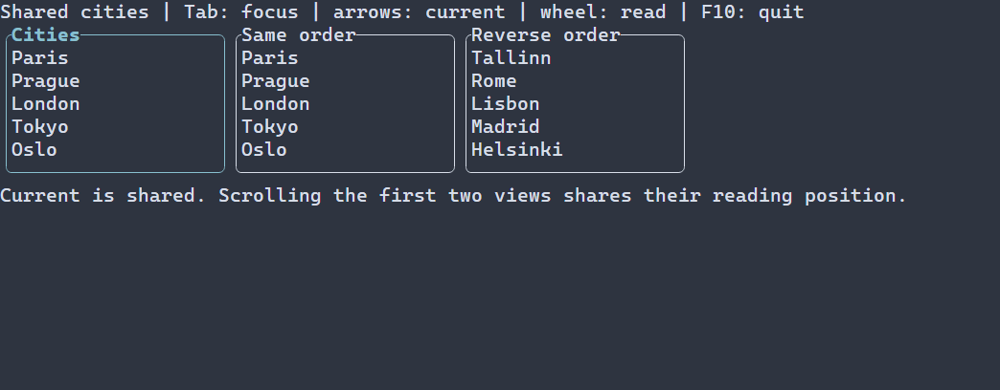

# Share navigation between model views

[Русская версия](ru/model-navigation.md) · [Model bookmarks](model-positions.md)

Use one navigation context when a list and table should follow the same current
record. Create separate contexts when each view needs an independent cursor.
The scene owns the context; removing a view does not erase its position.

This page describes the checked managed API in `<portals/managed.hpp>`.
The model, scene and view nodes in the fragment already exist on the UI thread.
Both views use the same `ManagedModel<T>`:

```cpp
auto navigation = scene.navigation(model);
if (!navigation) {
  return std::unexpected(navigation.error());
}
auto listBinding = scene.bindNavigation(list, *navigation);
if (!listBinding) {
  return listBinding;
}
return scene.bindNavigation(table, *navigation);
```

The context creates its resource identity automatically. Creating another context
for the same managed model reuses the resource domain but keeps its cursor separate.
Bindings are opt-in; unbound views keep their existing behavior.

## Current, selection and reading position

`current()` publishes the logical current record. `selection()` publishes an
independent bounded selected set. `readingAnchor()` identifies the first record
being read. Keyboard focus and fractional viewport offsets remain local to each view.
Scrolling alone never changes current.

Default bindings share current. Pass `NavigationBindingOptions{.readingAnchor = true}`
to also share the reading anchor. Each projection maps the stable row identity to
its own order; views do not copy each other's screen offsets. A projection without
the requested record leaves its own viewport in place. Absence from a filtered
projection does not establish deletion from the source.

A binding to another model requires the explicit
`NavigationProjection::PRESERVES_ROW_IDS` agreement. The caller guarantees that
complete row identities refer to the original resource. The library cannot prove
that guarantee from equal ordinal positions.

`setSelection` canonicalizes complete IDs and defaults to at most 1024 entries,
configurable through `NavigationOptions::maxSelectedRows`. The channel is available
to observers; the standard list/table binding still uses its existing single-current
selection behavior. It does not add multi-selection painting to those controls.

## Update and resolve

`navigate(RowId)` uses bounded identity lookup. A surviving row keeps its current
identity across insertions and reordering. A ready identity index can update exact
position metadata even while the row payload is pending. `bookmark()` and
`readingBookmark()` return the latest revision-qualified metadata separately from
the logical channels. Reordering the same record does not notify current observers.

Removal needs a complete `PositionChangeMap`, supplied with `setChangeMap`, or a
provider reply. The default affinity chooses a surviving successor, then a predecessor
at the end. Missing proof does not silently choose the old row number. A pending
result retains the bookmark; it retries on model publication or explicit resolution,
without polling. The finite fallback cannot promise convergence when the provider
cannot expose the required replacement identity through its base snapshot.

For an external resolver, create a context with a `ModelResource` and source session,
call `beginResolve`, perform I/O on the existing worker path, and deliver `applyReply`
on the UI thread. Session, target revision and request sequence reject stale replies.
The generic context does not require a total row count or own a scheduler.

## Lifetime, errors and scope

Handles are weak and UI-affine. Use them on the scene's thread; wrong-thread access
returns `WRONG_THREAD`, and access after scene closure returns `CLOSED`. Closing the
scene cancels pending resolution. Bookmarks and copied channel snapshots remain
independent values. Provider errors and allocation failures use the existing typed
error paths. Successful earlier channels can remain committed if a later channel
fails; retrying does not duplicate their logical notifications.

This integration covers managed finite-model lists and tables plus the generic
navigation context. Automatic LogView bookmarks, model-switch restoration,
current-record forms and persistent storage are separate integrations. The existing
low-level model and view APIs remain available.

## Complete provider-integration example



[Full source](examples/guide_model_navigation.cpp) shows three framed lists. The first
two share reading position; all three share current, including a reverse-order
projection. Tab changes focus, arrows navigate, and F10 closes the application.
Build `portals_docs_model_navigation` with tests enabled, or compile the source
against the [installed SDK](package.md). This advanced example keeps the provider
and checked binding steps visible; it is not a compact model-descriptor tutorial.

@include docs/examples/guide_model_navigation.cpp
