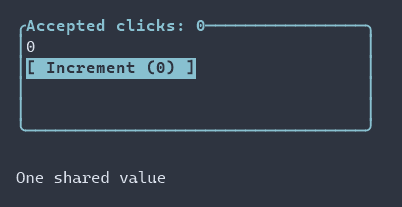
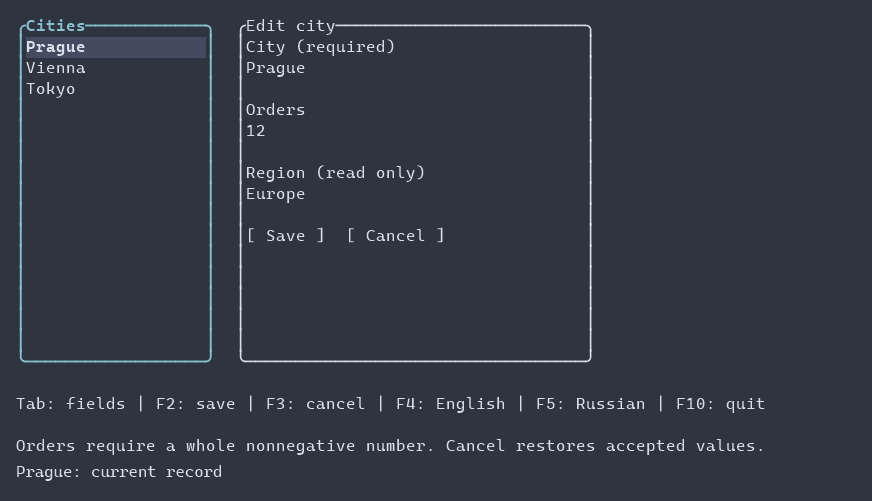
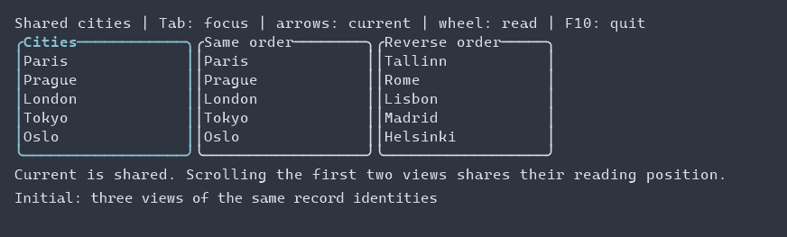
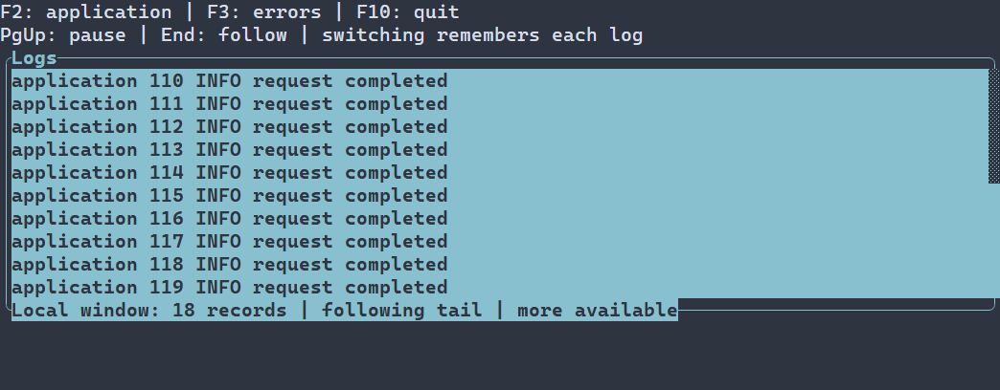
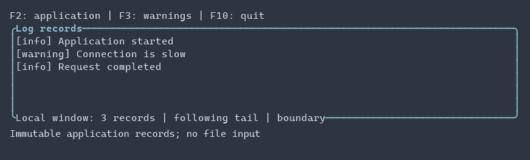
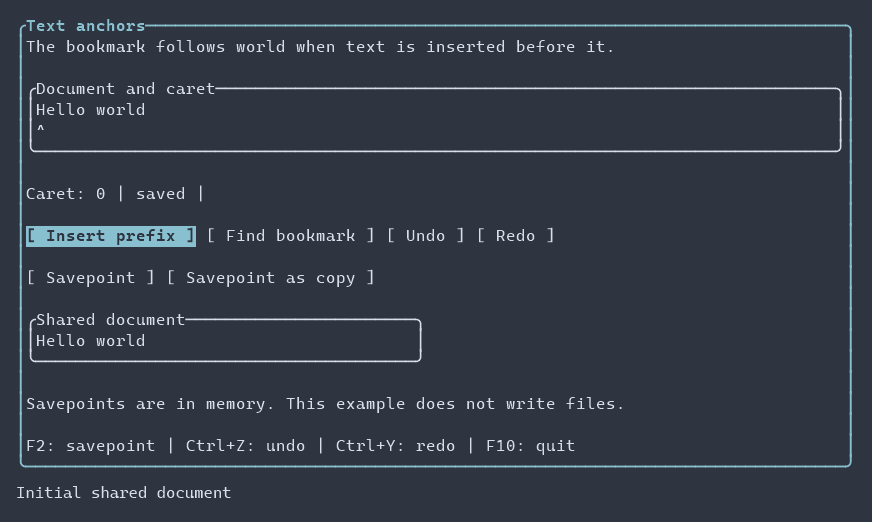

# Model workspaces: selection, drafts and reading places {#model-workflows}

[Русская версия](ru/model-workflows.md) · [Model capabilities](model.md) · [Application setup](package.md)

Start with one model and one navigation context. Bind every view that should follow
the same current record to that context. A form edits the selected record through
an edit session; application code does not shuttle fields between widgets.

The examples below are complete applications. Build them with C++23 and
`portals::core` as described in [Connecting an application](package.md). The
programs contain their scene, handlers and cleanup. The recordings use separate
test infrastructure; none of it is part of the application sources.

## One value, several captions

[The complete counter](examples/guide_value_captions.cpp) binds an integer field
of one record model to a label, a button caption and a frame title. Incrementing
that field updates all three through their bindings, without assigning three strings.



[Value models](value-models.md) also shows an owning Region record and distinguishes
changing a value from replacing a view's source. Rebinding one Label changes that
view; the shared navigation used below coordinates a group of collection views.

## A small list and table

[Complete source](examples/guide_view_models.cpp) declares two collections and
shares one navigation context between a city list and an order table. F2 and F3
choose the source. Returning to a retained source restores its current record and
reading place. Both views may have different column widths and viewport geometry.

```cpp
auto navigation = ui::navigation(europe, {.readingAnchor = true});
```

Pass that same `navigation` to `ui::virtualList` and `ui::virtualTable`.
`navigation.model(asia)` collects admission errors through the scene;
`navigation.setModel(asia)` returns a checked result when a handler must react.
Rejected admission keeps the old group. A later asynchronous source read failure
belongs to the accepted new binding; admission does not promise successful I/O.

[Source replacement and its limits](view-models.md#view-models-example) explain
the full program and source-dependent captions.

## A city orders workspace



[Complete source](examples/guide_city_form.cpp) combines a list, table and form:

- **Cities** selects the current record with a click or Up/Down. Before selection,
  the form is empty and inactive. Wheel scrolling changes the reading
  position; it does not silently select a different city.
- **Accepted values** shows model data. Editing Orders leaves that table unchanged
  until Save accepts the draft.
- **Current city draft** edits the required name and nonnegative order count.
  Country is readable and blocks user editing.
- Europe and Asia, or F6 and F7, replace the source for the shared navigation.
  Return to Europe to recover its place and the draft of the same city.
- F2 saves the current record; F3 cancels its drafts. F4 and F5 change the Orders
  caption through the existing `i18n` resolver, without replacing the editor.

Region is an enum, not another mutable text label. `ui::bySource<City, Region>`
maps the accepted resource to that enum; two labels format it independently.
There is no second variable that can drift away from the installed source.

The form uses `EXPLICIT` mode. Its drafts and Undo/Redo histories belong to exact
resource, record and field identities. Moving current changes what is displayed;
it does not retarget an earlier write request. Save submits per field and is not
a multi-field transaction. Conflicts, deleted records and pending replies require
the [record edit session contract](record-edit.md); an orphan draft is never
committed to the nearest surviving city. The example uses immediate in-memory
endpoints; it does not simulate an external server or manufacture a conflict.

[Typed form declarations and customization](model-forms.md) explain validators,
read-only presentation, codecs and field limits.

## Different ordering, the same record



[Complete source](examples/guide_model_navigation.cpp) shares current across
three lists. The first two also share their reading anchor. The third uses a
reversed model that deliberately preserves the original row identities.

Ordinary consumers use the cold navigation descriptor directly. The reversed
projection uses one checked `configure` binding with
`NavigationProjection::PRESERVES_ROW_IDS`. This explicit agreement is needed:
equal row numbers in unrelated models do not establish shared record identity.
The scene constructs both provider snapshots inside its checked factory.
`cityList` reuses the formatter and viewport as an ordinary view recipe. Its
formatter converts this sample's fixed ASCII names directly to grapheme text;
it does not apply an additional format pattern. The recipe uses the default
WidthPolicy; a view using a different width policy needs a matching formatter.

## Read one log, switch, then return



[File-backed source switching](examples/guide_log_models.cpp) keeps one LogView
and two retained source descriptors. PageUp pauses following; F2/F3 choose a log;
End follows the available tail again. A paused file returns to its saved record
after switching away and back, including when new records were appended.
The complete program expects `application.log` and `errors.log` in its working
directory. It contains no generator or recording driver.



[A read-only domain model](examples/guide_log_snapshot.cpp) uses the same LogView
with finite immutable records and a worker-side formatting callback. It reads no
files and exposes no writing capability. Its exact count is a capability of that
particular snapshot, not a requirement imposed on every log source.

For a source whose count is unknown, use the existing
`WindowProvider<LogLine>` contract. Readiness, available tail and final end remain
distinct; a viewport does not redefine the capabilities of the underlying model.
[LogView source contracts](log-view.md) describe bounded loading, retention,
bookmarks, rotation and shared budgets. Slow reads and formatting run on the
application worker path.

## A document outlives its view



[Complete source](examples/guide_text_anchors.cpp) keeps text, caret, history and
a bookmark in a finite document session. Insert a prefix, restore the bookmark,
then use Undo/Redo. A savepoint records a content state and a logical save target;
it does not write a file. Changing that target keeps caret and selection.

[Portable reading places](navigation-checkpoint.md) are a separate operation:
an explicit provider codec exports position metadata for a reopened resource.
The checkpoint contains no document text, draft, Undo history or write permission.
The current finite editor defaults to 4096 bytes/graphemes. These examples do not
claim to implement a windowed editor for an arbitrarily large field.

## Customize presentation without duplicating state

Keep the source, navigation and edit declarations unchanged when changing the
layout. `.width`, `.height`, `.minWidth`, `.maxWidth` and `.framed` configure the
view's geometry; they do not load that many records into the model or replace
its total count. The examples title each work area so accepted data and drafts
remain distinguishable.

Use [PSS layers and theme parameters](styling-guide.md) for colors and control
states, and [frame and scrollbar styles](scroll-controls.md) for their individual
parts. For a compact starting point, add this ordinary layer to a scene:

```cpp
| ui::style("Button { bold: true; }")
```

Model updates and model replacement serve different purposes. Publish new data
through the existing source when a feed advances. Replace a binding when the user
chooses another source. A market-data feed tick is an update; choosing a different
instrument is a potential source change. The UI does not need a new binding for
every price revision.
