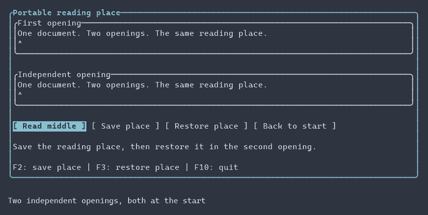

# Save a navigation position {#navigation-checkpoint}

[Русская версия](ru/navigation-checkpoint.md) · [Model bookmarks](model-positions.md) · [Text anchors](text-anchors.md)

A navigation checkpoint is an owning byte value containing saved locations and
their purpose: current item, reading place, selection or edit destination. An
application can keep these bytes in memory or pass them to its own storage adapter.
The document or collection remains in its original model.

Include `<portals/navigation_checkpoint.hpp>` and link `portals::core`.
The header is optional and is not included by `ui.hpp`.

## Try two independent openings

The [complete application](examples/guide_navigation_checkpoint.cpp) opens the
same immutable example text twice. Click **Read middle**, **Save place**, then
**Restore place**. The second opening moves to the saved location. **Back to start**
moves only the second opening; restoring again returns it to the saved place.
F2 saves, F3 restores, and F10 exits. Restoring before the first save shows a prompt to save a place.

\include docs/examples/guide_navigation_checkpoint.cpp

The program copies and parses the encoded bytes in memory. It does not read or
write files and does not persist between process runs. The portable resource key
identifies this exact version of the immutable ASCII text. Each opening has its
own in-memory resource namespace. The provider translates the saved offset into
a bookmark qualified for the receiving opening.

The [provider helper](examples/navigation_checkpoint_provider.hpp) is part of
the complete program. It validates the exact immutable text and revision before
capture or restore. Its one-byte offset codec is specific to this short ASCII
document; it is unsuitable for edited text or arbitrary files:

\include docs/examples/navigation_checkpoint_provider.hpp

## Supply the provider conversion

Implement `NavigationBookmarkCodec` for a model that supports persistence:

| Operation | Provider responsibility |
|---|---|
| `descriptor()` | Supply a stable codec name, positive version and portable resource key, including compatible lineage. Keep its strings valid through the outer operation. |
| `resource()` | Identify the current in-memory resource domain. |
| `encode()` | Write location metadata into the supplied bounded output span and return the number of bytes written. |
| `decode()` | Validate payload, kind, affinity and role, then return an owning bookmark in the receiving resource domain. |

The library does not infer durable identity from a filename, row ordinal or
runtime `SourceStamp`, `RowId` or `SourceCursor`. The provider must translate a
stable business key or version-qualified text location into its current model.
For text, it must also validate or resolve grapheme boundaries.

`NavigationCheckpoint::capture(entries, codec)` returns a new immutable envelope.
`bytes()` borrows its encoded bytes while that value or a copy survives.
`parse(bytes)` validates and copies incoming bytes. `restore(codec)` returns a
complete owning vector of locations; it does not apply them to a navigation
context. Apply an appropriate successful result through the existing checked
navigation or document API, which can still reject a stale or unavailable location.
Applying several channels separately does not provide a group transaction.

One checkpoint belongs to one portable resource domain. Save separate checkpoints
for unrelated models. Copies share immutable bytes and retain no codec, storage,
model, page, scene or widget.

## Preserve meaning without granting access

Each `NavigationCheckpointEntry` carries a `NavigationCheckpointRole`:

- `CURRENT`: current item or caret location.
- `READING_ANCHOR`: reading place independent of current selection.
- `SELECTION`: one selected location; several entries preserve their declared order.
- `EDIT_ANCHOR`: a prospective edit location. Reacquire write capability, field identity
  and current expected version before submitting a write.

An imported location is not an `EditTarget` and cannot authorize a commit. A nearest
read result does not authorize writing to the neighboring record. The envelope
contains no model values, password, draft, Undo/Redo history or credentials by
default; provider payloads must follow the same restriction.

## Bound memory and handle errors

`NavigationCheckpointOptions` defaults to 64 KiB of encoded envelope, 128 entries,
4096 provider bytes per entry and 1024 bytes for each codec/resource identity.
`bookmarks` uses the existing 4096-byte charged limit for each decoded bookmark.
These limits describe metadata, independently of logical model size.

Capture reserves the configured envelope capacity and stages owning entry copies.
Parse retains the actual encoded size; load can temporarily hold a maximum-size
read buffer and the parsed value together. Restoring owns an entry vector and
its decoded bookmarks. Allocator bookkeeping and memory allocated inside provider
callbacks are additional costs; an encoded byte count is not a process-memory peak.

Malformed structure or checksum reports `CORRUPT_INPUT`; a limit violation reports
`TOO_LARGE`. Unknown envelope and codec versions report `UNSUPPORTED_VERSION` and
`UNSUPPORTED_CODEC_VERSION`. A mismatched codec name reports `UNSUPPORTED_CODEC`;
a mismatched resource reports `WRONG_RESOURCE`. Invalid local options or entries
report `INVALID_ARGUMENT`. Storage I/O failures use `STORAGE_FAILURE`. Providers and storage can report
`UNSUPPORTED`, `CLOSED` or their typed failures. Cancellation returns `CANCELLED`;
allocation failure returns `NO_MEMORY`. An unexpected exception from `encode`, `decode`, `read` or `write` becomes
`PROVIDER_FAILURE`. The `descriptor` and `resource` getters are declared `noexcept`
and must not throw. Keep the original checkpoint until a replacement succeeds.

The version-one envelope includes a checksum for accidental corruption. It does
not authenticate bytes or make an untrusted provider trustworthy. A structurally
valid envelope still needs the correct codec, resource and live resolution.

## Use application storage off the UI thread

`NavigationCheckpointStorage` is an optional synchronous adapter with bounded
`read(output, stop)` and `write(bytes, stop)` operations. The library installs no
filesystem backend or scheduler. A storage read must return one complete encoded record or a typed failure; if the complete record does not fit, return `TOO_LARGE` rather than a truncated prefix. Invoke `loadNavigationCheckpoint` and
`saveNavigationCheckpoint` on the application's existing worker path whenever the
adapter can block. These functions do not dispatch work or enforce UI affinity.

Keep the codec/storage object alive and serialize operations for their entire
call. Check cancellation in blocking provider/storage work. A failed or cancelled
load returns no replacement and cannot erase the caller's in-memory position.
A failed write also preserves the checkpoint, but external storage may have
changed: atomic file replacement and durability belong to the adapter's contract.
Apply the restored navigation on the UI thread using its normal live handle.

Encoding and checksum work scale with encoded metadata. Use the worker path for expensive codecs or large configured budgets. The functions stage their own result and do not assign application navigation state; they do not roll back side effects performed explicitly by provider or storage callbacks.
