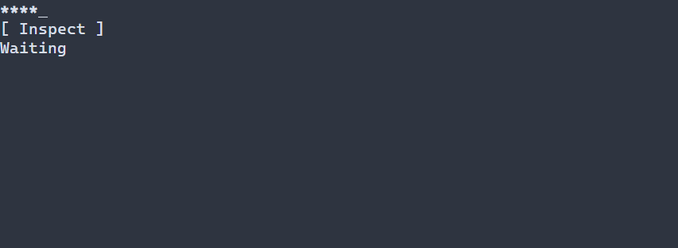

# Protected passwords {#password-guide}

[Русская версия](ru/password.md) · [LineEdit](line-edit.md) · [Protected input details](controls.md#password-control)

Use `ui::password` for protected single-line values. A LineEdit password display only masks an ordinary plaintext model and history; it does not provide this protected storage contract.

## A complete application

This program checks whether a value was supplied without copying its bytes into the status label. Type a value, Tab to Inspect and activate with Enter, Space or a left click; F10 exits. `runApp` reports errors and restores the terminal.



\include guide_password.cpp

Build `portals_docs_password` with `PORTALS_BUILD_TESTS=ON` and run it in a supported native terminal. See [build setup](getting-started.md) and [package setup](package.md).

## Values and editing

`ui::PasswordRef` observes the scene-owned control. `withPlaintext` lends a `SecretView` only for the synchronous callback: do not retain its pointers. `value()` returns a checked protected `PasswordValue` identity; `value(value)` applies a protected candidate between frames. A copied identity may retain an old encrypted snapshot until its last owner releases it. Read-only blocks user edits but allows the explicit setter. No ordinary plaintext getter, copy/cut or undo history is provided.

Default `PasswordOptions::editMode` is `IMMEDIATE`; `ON_COMPLETION` commits on Enter, activation or blur, and `EXPLICIT` on Enter or activation. Escape adopts the latest model for a deferred draft; it cannot undo already published immediate edits. A conflicting external revision cannot silently overwrite a dirty deferred draft. Keyboard editing uses routed actions and text input. Mouse selection is not implemented; paste is disabled unless `pastePolicy` is explicitly `ENABLED`.

The default display uses one ASCII `*` per grapheme and reveals the count. `.noEcho()` hides value, placeholder and selection glyphs, uses intrinsic width one and fixes the caret at the origin. `PasswordOptions::limits` defaults to `{4096, 4096, 4096, 8192}` and `securePolicy.maxBytes` to 4096; both apply without truncation. Protected native storage and idle encryption are required on Windows or Linux; unsupported guarantees are rejected, including the native policy on WASM. Plaintext input buffers and a synchronous borrow are outside the protected value's idle storage. See [editing and security limits](controls.md#editor-presentation-limits).

Resources may declare `Password#password { text = "", placeHolder = "Password" }` or omit text. Nonempty text literals and text-resource expressions are rejected; provide secrets through typed state or a checked provider. The [complete resource example](examples/guide_password_resource.cpp) uses `scene.get<Password>("password")`; see [resource details](controls.md#password-control).

## Styling reference {#password-styling-reference}

The natural selector is `Password`. Normal/focused/disabled paint the field, selected paints the enabled selection, and caret paints the focused enabled caret. Header is not painted. With no-echo there are no value or selection glyphs, although the focused caret remains. `PasswordOptions::style` is `ControlStyle`, while `selection` and `cursor` are `CellStyle`; manually, selection defaults to bold italic and cursor to bold underline, with terminal colors. PSS cannot change the mask glyph or reveal the value.

| Property | Values and effect |
|---|---|
| `foreground`, `background` | `#RRGGBB`; foreground and fill |
| `bold`, `italic`, `underline` | `true` or `false`; explicit false overrides a lower layer |
| `width`, `height` | Nonnegative cells, `auto`, `fit-content`, `flex(positive weight)` in runtime PSS |
| `min-width`, `max-width`, `min-height`, `max-height` | Nonnegative cell bounds; only `min-width` also works in compile-time PSS |

Size declarations cannot depend on a state or `:read-only`; conflicting bounds reject the update and retain the last valid style and geometry. See [layout](layout.md). Manual `ControlStyle` uses terminal-default colors, normal text, bold focus and italic disabled text. Theme and PSS rules override individual fields; unspecified fields retain lower-layer values. See [the cascade](styling-guide.md).

```pss
Password { min-width: 16; }
Password:focused { background: #245070; }
Password:selected { background: #426080; }
Password:caret { underline: true; }
```

See `portals::Password`, `PasswordOptions`, `PasswordValue`, `SecretView` and `ui::PasswordRef` for exact contracts.
