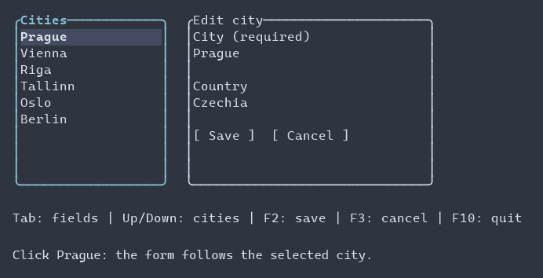

# Edit the current record {#record-edit}

[Русская версия](ru/record-edit.md) · [Shared navigation](model-navigation.md) · [Model switching](view-models.md)

Use an edit session when a list selects a record and a form edits its fields.
The session owns the draft and its editing history independently of the temporary
controls. Returning to a record restores its draft; changing the current row does
not redirect an edit that started on the previously displayed record.

Include `<portals/ui_model_edit.hpp>` for this optional API.

Use session and field operations on the UI thread, including retained-draft
inspection and receipt application. Background work receives owning request
values; deliver its receipt through the existing UI delivery path before calling
`applyReply()`. Shared ownership does not make the mutable session thread-safe.

## A city directory

Choose a city, change its name or country, and choose Save. In this example the
session uses `EXPLICIT`: moving to another city keeps the first city's draft.
Return to it to continue editing. Cancel restores the current record's accepted
value. Use Up/Down while the list has focus, and Tab to move between the list,
fields and buttons. F2 saves, F3 cancels, and F10 or Ctrl+C exits.

[Complete source](examples/guide_record_edit.cpp):

\include docs/examples/guide_record_edit.cpp

## When values reach the model

The session reuses the ordinary editor's modes and validation:

| Mode | Publication and navigation |
|---|---|
| `IMMEDIATE` | Valid input reaches the model during editing. Invalid intermediate text remains a draft of its original record. |
| `ON_COMPLETION` | Completion attempts to publish. A user transition is rejected while validation, conflict or pending completion prevents leaving the existing target. |
| `EXPLICIT` | Navigation retains drafts by record. Commit applies the current edit; cancel discards its draft in favor of the current accepted value. |

A forced deletion cannot be vetoed. An uncommitted draft remains associated with
the missing target for explicit inspection or recovery; a nearby surviving record
is a reading destination, never a replacement write target. Closing the source
prevents further writes. Closing the edit owner does not promise automatic
persistence: longer storage requires an explicit application-owned export or owner.

Undo and Redo belong to the original record and field. They are not commit/cancel,
and an external change cannot be overwritten by applying the old history silently.
Retention is bounded. Admission failure keeps the previous draft and current
position rather than evicting dirty input to make room.

`EditOptions` defaults to 128 retained field targets and a 4 MiB logical owning-
payload budget. It accounts for retained values and text/history capacities;
allocator bookkeeping, temporary preparation and memory owned by callers or
backends are outside that budget. It is not a process RSS limit. Ordinary editor
text limits also continue to apply.

## Fields and source guarantees

`field(&City::name)` is a process-local selector. An explicit key such as
`field("city.name", &City::name)` gives an adapter an owning schema identity.
A member pointer is not a portable field identifier.

A write is qualified by the resource and lineage, bound model incarnation
(`sourceSession`), edit-request namespace (`session`), exact record, field,
expected version and request sequence. The model incarnation is an SDK identity,
not the remote server's generation. Conditional endpoints check the
precondition together with applying the write. An update to another record need
not conflict; record-level versioning may conservatively conflict on another
field of the same record. Direct model writes are external changes to an active draft.

Request admission and backend acceptance are different outcomes. A pending reply
does not clear newer dirty input. Late replies remain attached to their original
target and cannot overwrite a newer accepted result. The session reports each
field separately through `lastResult()`. A successful checked `commit()` means
the command was admitted; inspect the per-field receipts to distinguish pending
work from acceptance. `commit()` and `cancel()` return the existing
`EditorCommandResult`, also used by editor Undo/Redo. Return it directly from a
managed handler; use `.result()` when explicit checked error handling is needed. Separate field submissions are not one atomic transaction.

In a bound text field, Escape cancels that field. The example's Cancel button
and F3 cancel the current record's fields. If a refreshed accepted value exceeds
the retention budget, cancellation reports a recoverable limit and preserves
the existing draft.

Cancel removes the local draft; it does not withdraw or undo a write already
admitted by a backend. That request remains pending, and new input for the same
field waits for its receipt. Discarding a live in-flight target returns a checked
`WOULD_BLOCK`; after source closure its orphan can be inspected and discarded.

An asynchronous adapter must also check its own backend incarnation together
with applying the write. Ignoring an old UI receipt cannot repair a stale write
that a backend has already applied.

Read-only sources keep navigation and readable fields. Having no current record
does not make scene construction fail. External adapters use bounded field-value
access and the existing worker/delivery path, without loading the full model or
performing blocking I/O in an input handler. Large text and custom widget mapping
have their own capabilities; an ordinary field binding does not imply a full
in-memory copy is suitable for every source.
