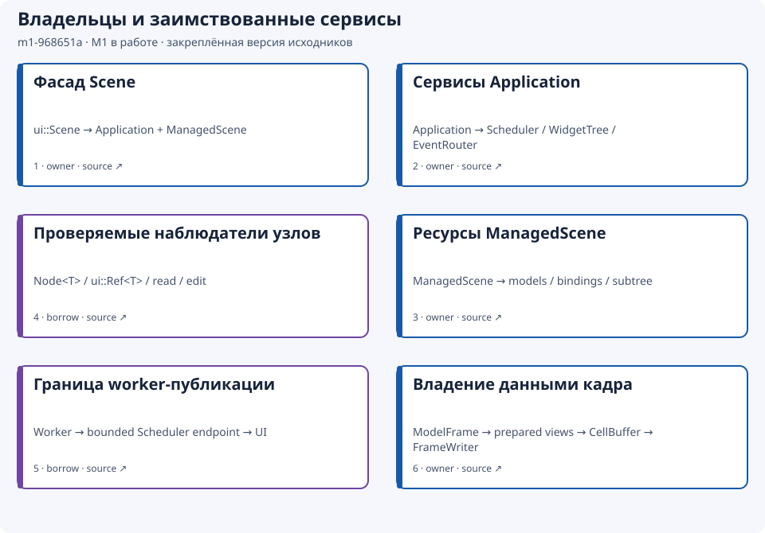
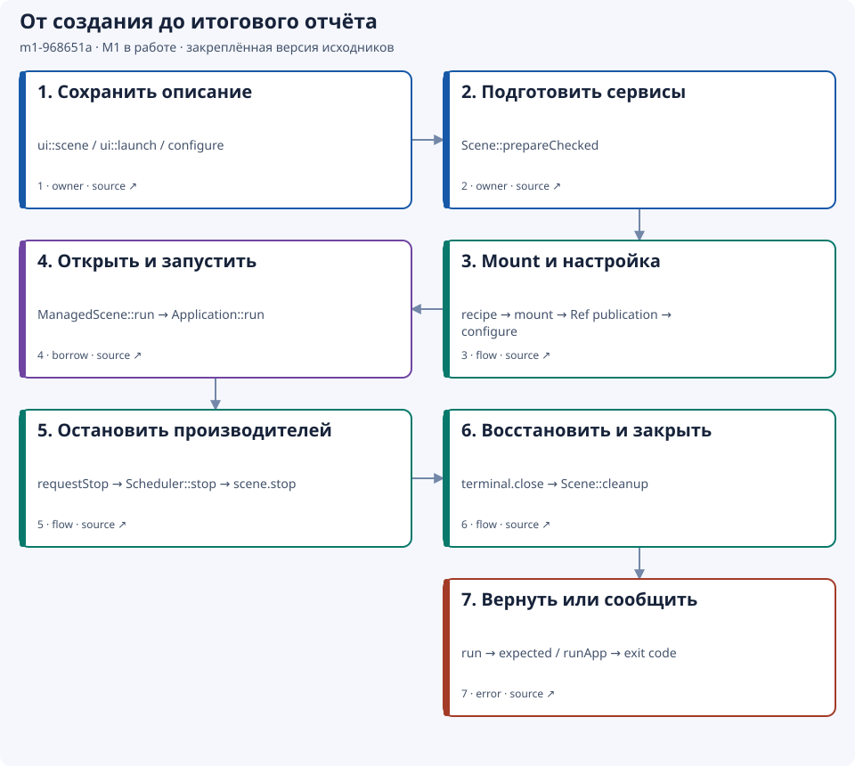
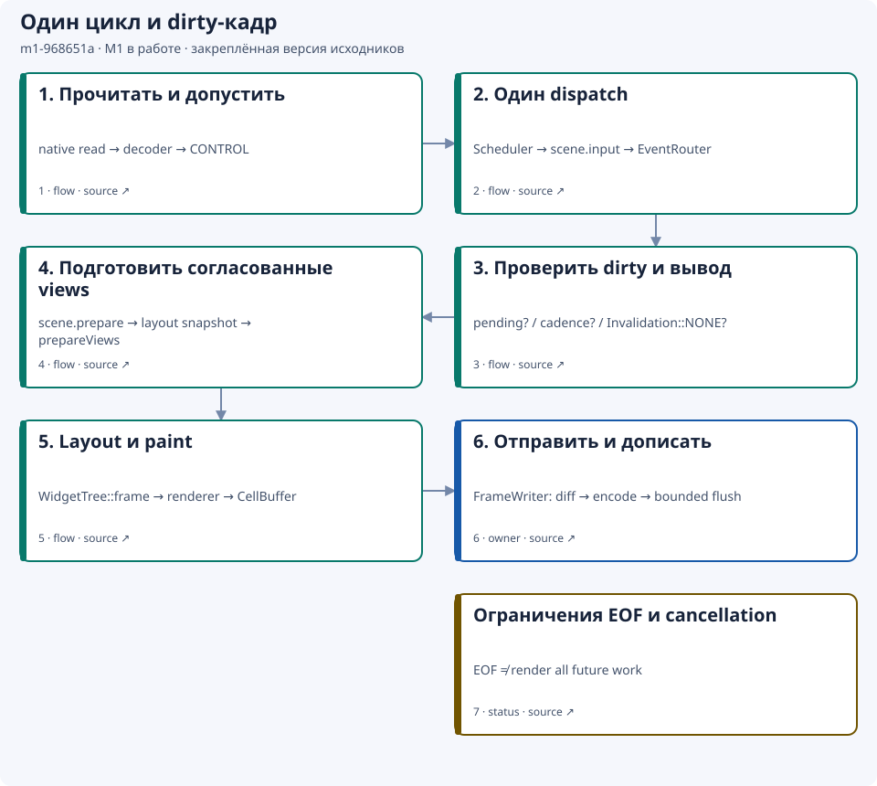
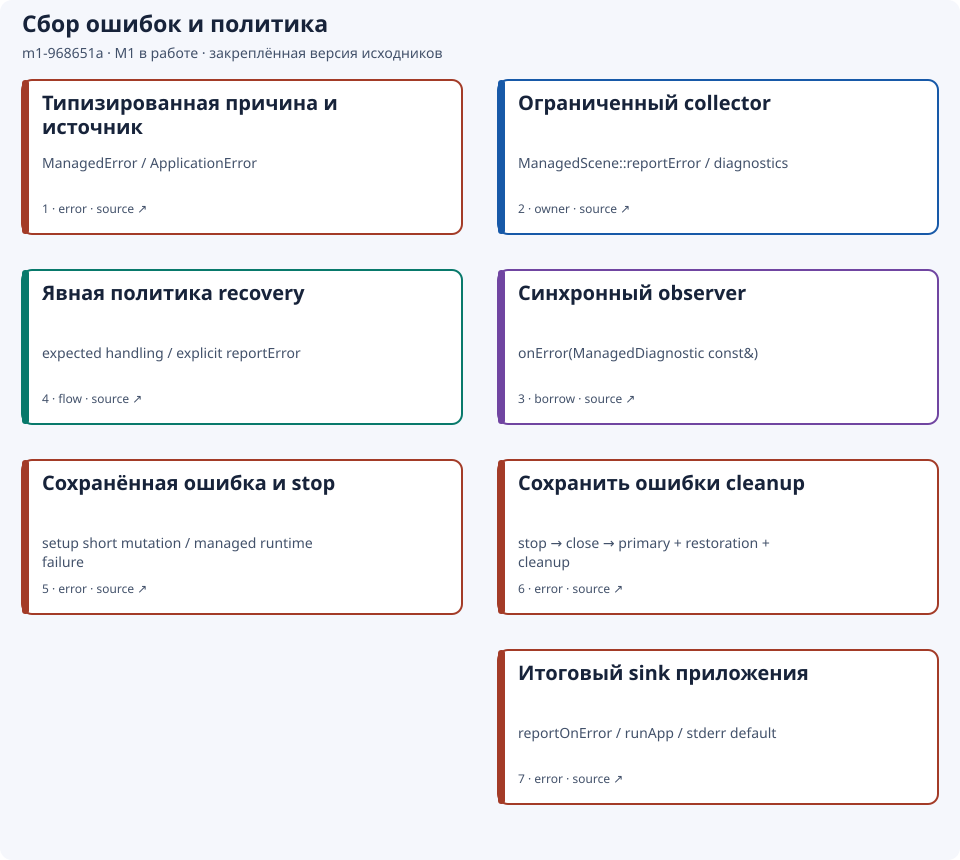
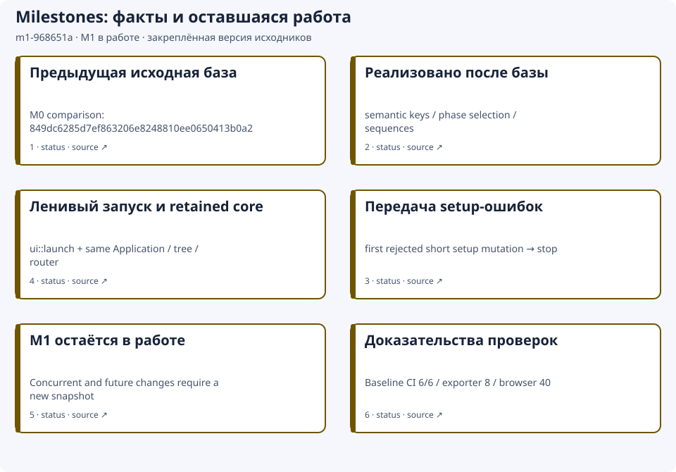

# Архитектура {#architecture-ru}

Начните с [полного приложения](application.md): fluent-фасад `ui::Scene`
владеет приложением и managed-сценой, создаёт контролы при подготовке и использует
те же планировщик, дерево и маршрутизатор, которые описаны ниже.

[Подробная английская версия](../architecture.md)

## Версионные архитектурные карты

[Автономный просмотр](../architecture/snapshots/m1-968651a/index.html?lang=ru)
содержит карты владения, lifecycle, кадров, ошибок и изменений milestone. Данные
встроены; сервер, CDN и дополнительная установка не нужны. Выберите язык, карту
и узел, чтобы прочитать контракт и открыть закреплённый исходник. Управление
доступно через Tab и Enter. Каждую карту можно скачать отдельным SVG. Ссылкам
на GitHub требуется сеть.

Снимок описывает ревизию
`968651a90b6a1542fd3ab2cec159b457e548681f`. **M1 остаётся в работе.**
Он не включает последующую незакоммиченную работу и не означает приёмку milestone.
База сравнения — `849dc6285d7ef863206e8248810ee0650413b0a2`. Описание после карт
относится к текущей рабочей версии и может изменяться после закреплённого снимка.
База опубликована через [PR #36](https://github.com/ttldtor/portals/pull/36);
[запуск CI](https://github.com/ttldtor/portals/actions/runs/38799649714) завершил
шесть проверок успешно для PR head `28723ed04810c597c2fe31f0d75cd9416c5916ac`,
затем слитого в закреплённую ревизию. Отдельно при подготовке snapshot прошли
восемь exporter/source/help tests и 40 offline browser combinations: карты,
языки, темы и ширина 1440/390 px, включая реальные скачивания SVG. Эти проверки
не запускают C++ runtime suite. Полная собранная справка и поставленный артефакт
новой foundation на этой границе подготовки — **NOT_VERIFIED**; проверки
интеграции остаются обязательными.

Синие карточки обозначают владельцев, фиолетовые — наблюдение и заимствование,
зелёные — координацию, красные — границы ошибок, охристые — статус и ограничения.
Роль указана также текстом. Стрелки lifecycle и frame показывают обычный успешный
путь; выходы по ошибке описаны на карте ошибок. На остальных картах порядок
карточек задаёт чтение; отношения владения явно указаны в описаниях узлов.

### Сопровождение снимков

Редактируемый [maps.json](../architecture/snapshots/m1-968651a/maps.json)
порождает включённые в репозиторий SVG и HTML. SVG работают без JavaScript
в Markdown и собранной справке. Пользователю SDK не нужны Python, Node.js или
renderer диаграмм. Авторы используют существующее окружение Python для tools и
[exporter](developer-tools-build.md#tool-architecture-ru), которому достаточно
стандартной библиотеки.

Для интегрированного milestone создайте новый каталог
`<milestone>-<source-revision-prefix>` в `docs/architecture/snapshots`.
Скопируйте manifest, задайте уникальный `id`, полную `revision`, базу сравнения
и точный статус на двух языках. Сверьте узлы и source references с этой ревизией;
опишите новые возможности, изменённые гарантии и сохранённые инварианты.
Промежуточный снимок получает статус «в работе»; закрытие требует принятых в
проекте доказательств проверок и ревью. Будущие targets не получают выдуманную
ревизию или готовый snapshot.

Создайте и проверьте exports через `--source <directory>/maps.json`. Проверьте
закреплённые ссылки, точное повторное создание, соответствие EN/RU, текст и связи
SVG, обычный и узкий экран, обе темы, клавиатурную навигацию и export. Получите
независимое ограниченное fact review и проверьте поставленный артефакт справки.
Добавьте снимок сюда и в перевод; зарегистрируйте каталог в шаге копирования
assets справки. Предыдущие snapshots сохраняйте неизменными; исправления получают
новый ID. Публикующий commit фиксирует exporter/template и доказательства
проверок. Поле `revision` обозначает runtime-исходники; эта версия может
предшествовать commit, публикующему документацию.

Portals — терминальная UI-библиотека C++23, сохраняющая дерево виджетов между кадрами. [`Application`](../../include/portals/application.hpp) владеет средой UI и синхронно обслуживает терминал на потоке создания. Сцена владеет моделями, привязками и источниками данных. Рабочие потоки публикуют неизменяемые снимки через ограниченные каналы планировщика; дерево изменяется на UI-потоке.

## Компоненты

| Компонент | Ответственность |
|---|---|
| `Application` | Планировщик, дерево, маршрутизатор, ввод, подготовка кадров, вывод и очистка |
| `ApplicationScene` | Модели, привязки, источники данных, подготовка представлений и остановка собственных производителей |
| `TerminalSession` / `InputDecoder` | Системный ввод-вывод и декодирование событий |
| `Scheduler` | Раздельные очереди CONTROL/DATA, таймеры, публикации и отмена по области действия |
| `EventRouter` | Фокус, проверка попадания, разрешение действий и проверенная доставка |
| `WidgetTree` | Память виджетов, идентичность, геометрия и запросы обновления |
| `Property<T>` / `Model<T>` | Неизменяемые значения, ревизии, наблюдатели и диапазоны данных |
| Контейнеры и элементы управления | Измерение, размещение, рисование и подготовка отображения |
| Темы / PSS | Разрешение стилей и проверенные атомарные замены |
| Отрисовка / `CellBuffer` | Преобразование заимствованных команд в буфер ячеек с собственным хранением данных |
| `FrameWriter` | Разностное кодирование, ожидающий вывод и подтверждённый кадр |
| Diagnostics | Ограниченные причинные сведения и владеющие снимки |

Ядро использует стандартную библиотеку и системные API. Сегментацию графем обеспечивает встроенная частная зависимость utf8proc. Doxygen и тестовые инструменты нужны при разработке и сборке.

## Цикл обслуживания

Каждый цикл `Application::run` принимает ограниченный ввод, один раз обслуживает планировщик, готовит максимум один изменившийся кадр и максимум один раз обслуживает вывод. Непринятое событие CONTROL и один системный пакет либо остаток сырых байтов сохраняются. Windows поставляет уже декодированные события; POSIX — байты с временными метками для сроков декодера.

Ожидание выполняет системное чтение терминала. Положительный `inputSlice` ограничивает задержку обслуживания публикаций рабочих потоков. Ожидающий вывод запрещает новую отправку кадра, сохраняя запрос обновления дерева. Частота кадров отсчитывается от фактической отправки и завершения; догоняющие серии не создаются. В простое проверяются ввод и размер, периодической перерисовки нет.

CONTROL и DATA имеют независимые лимиты. `REPLACE_LATEST` применяется к полным снимкам отображения после обработки всех исходных событий. Например, каждый финансовый тик входит в OHLC до публикации. Очередь ограничивает число владельцев; размеры данных и длительность пользовательских обработчиков ограничивает приложение.

## От события до кадра

1. Ввод принимается во владеющее событие CONTROL; трассировка при необходимости добавляет причинный токен.
2. `scene.input` обрабатывает глобальную команду или маршрутизатор разрешает фокус, цель и действие.
3. Изменение `Property` запрашивает обновление и уведомляет наблюдателей. Успешная квитанция может отдельно сообщать об отказе доставки уведомлений.
4. `scene.prepare` синхронизирует привязки и получает один снимок каждой модели для всех её представлений. Запросы источникам обслуживаются вне рисования.
5. В `tree.frame` выполняются размещение, рисование и преобразование команд в `CellBuffer`. Заимствованный текст потребляется до выхода из кадра.
6. `FrameWriter` кодирует и передаёт буфер вне размещения и рисования. Частичный вывод сохраняется; подтверждённый кадр меняется после полной согласованной передачи.

Ошибка подготовки, рисования или преобразования завершает запуск с исходной причиной. Частичный кадр не отправляется, автоматические заглушки не создаются. Трассировка различает обработчик, изменение данных, запрос кадра, кодирование и транспорт. Несколько причин могут относиться к одному кадру; токен хранит первую записанную причину. Пустая разность после изменения допустима. Принятые транспортом байты не подтверждают физическое отображение. Потери диагностических записей сообщаются явно.

## Владение и завершение

При прямом использовании `Application` создайте его до `ApplicationScene`, привязок и моделей, а уничтожьте после них. Фасад `ui::Scene` сам соблюдает порядок внутренних владельцев; внешние сервисы, заимствующие приложение, освобождайте через `scene.onStop` до удаления managed-узлов. Запуск заимствует сцену один раз. Обработчики не должны уничтожать владельцев или повторно запускать их. Маршрутизатор и дерево освобождаются до планировщика.

`Node<T>` наблюдает за сессией, слотом и поколением. `read` и `edit` заимствуют ссылку только на время обработчика. Удаление сразу закрывает область действия узла и делает дескриптор недействительным; активное заимствование откладывает освобождение памяти. Отмена не прерывает исполняющийся обработчик и не ожидает рабочий поток.

Остановка закрывает планировщик, вызывает `scene.stop` для отмены и ожидания собственных производителей, затем закрывает терминал. Очистка также выполняется после ошибки и заранее запрошенной отмены. `ApplicationError` сохраняет первую фазу и причину, отдельно — ошибку восстановления терминала. Выводите отчёт после завершения и восстановления терминала.

EOF завершает декодирование, доставляет принятый CONTROL и передаёт уже отправленный кадр. Будущие кадры, таймеры и DATA не ожидаются; принятое изменение может остаться неотображённым. Транспортная ошибка, включая `OUTPUT_UNCERTAIN`, завершает запуск без переоткрытия и повторения неопределённых байтов. Срок закрытия зависит от прогресса системного хоста.

## Расширение

Представления одной модели используют общий неизменяемый снимок и независимые диапазоны. `RowId` и `ColumnId` сохраняют идентичность при перестановке. Подготовка не запускает скрытые рабочие потоки. Для настройки доступны сцена, методы виджетов, форматировщики, лимиты, политика ширины и частота кадров. Рисование читает подготовленные данные без ввода-вывода, изменения моделей и обслуживания планировщика.

Экспериментальный [UiAsync](ui-coroutines.md) использует тот же планировщик. Общая история приложения, системный буфер обмена и Drag-and-Drop указаны в [плане возможностей](planned-features.md).
