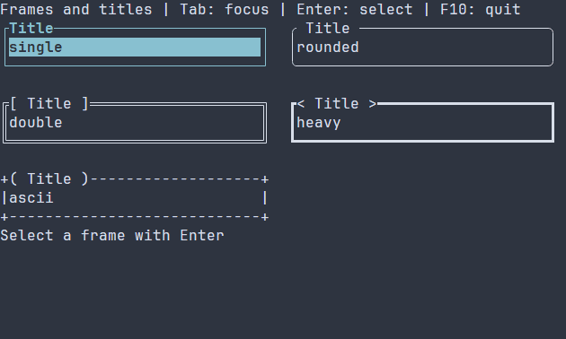

# Рамки Border {#border-guide-ru}

[English version](../border.md) · [Компактные примитивы](compact-primitives.md) · [Компоновка](layout.md)

`ui::border(child)` и его синоним `ui::frame` помещают один дочерний элемент внутрь оформленной границы. Сцена владеет рамкой и дочерним описанием; отрисовка и ввод дочернего элемента ограничены внутренней областью. Если граница не нужна, используйте обычную компоновку.

## Полное приложение

Это более широкая галерея: обычные кнопки без собственных скобок помещены в пять рамок с разными линиями и украшениями заголовка. Tab переводит фокус, Enter активирует выбор и обновляет подпись, F10 завершает программу. `runApp` сообщает об ошибках и восстанавливает терминал.



\include guide_frame_styles.cpp

Соберите `guide_frame_styles` в [отдельном проекте примеров](examples.md) или `portals_docs_frame_styles` с `PORTALS_BUILD_TESTS=ON`, затем запустите исполняемый файл в терминале. Для установленного SDK см. [пакет](package.md).

## Настройка рамки

Пример применяет к кнопке `.framed("rounded", "Title").titleDecoration("spaced")`: `.framed(...)` оборачивает контрол, а действие остаётся у кнопки. `FrameOptions` по умолчанию выбирает `FramePattern::SINGLE`, все четыре стороны, пустой заголовок, выравнивание START и `TitleDecoration::NONE`. Встроенные варианты линий: single, rounded, double, heavy и ASCII; украшения заголовка: none, spaced, square, angle, round и profile. Свои символы рамки и края заголовка задаются во владеющем `FrameOptions`, а не обычными свойствами PSS. Заголовок не увеличивает собственную ширину; показывается только целый префикс графем, помещающийся на верхней границе.

`BorderOptions::glyphs` по умолчанию выбирает Unicode с переходом на ASCII, если символ занимает не одну ячейку согласно политике ширины; ASCII можно выбрать явно. `maxPaintCells` по умолчанию 16384 и должен быть положительным. Превышение лимита выделенного периметра возвращает `WOULD_BLOCK` даже при частичном обрезании. `maxTitleBytes` по умолчанию 4096; недопустимый текст заголовка или украшения отклоняется. Пустая область не рисуется; у очень маленькой рамки границы схлопываются, а содержимое может не поместиться. Рамка не заполняет внутреннюю область.

Сцена владеет `Border`; наблюдающий `ui::Ref<Border>` можно опубликовать через `.reference(ref)`. У рамки нет собственного действия: вложенные элементы сохраняют фокус, клавиатуру и мышь. Загружаемые сцены регистрируют `Border` как контейнер с обычными дочерними элементами; именованный элемент доступен через `scene.get<Border>(...)`. См. [ресурсы сцен](scene-loading-guide.md) и [настройку рамок](controls.md#control-frames-ru).

## Настройка оформления {#border-styling-reference-ru}

Естественный селектор — `Border`. Рисуются normal, focused и disabled, причём disabled имеет приоритет. Правило без состояния применяется ко всем вариантам; `:selected`, `:header`, `:caret` не рисуются. Ручная основа `ControlStyle` использует цвета терминала, обычный текст, жирный фокус и курсив для disabled; тема и PSS переопределяют отдельные поля. Стиль рамки не передаётся дочернему элементу.

Общие `foreground`/`background` принимают `#RRGGBB`, `bold`, `italic`, `underline` — `true` или `false`. Для отдельного оформления линии, заголовка и его краёв добавьте каждое из пяти имён к префиксу `frame-line-`, `frame-title-` или `frame-ends-`; неуказанные атрибуты части берутся из разрешённого общего стиля. `glyph-profile` по умолчанию равен `default`, `glyph-fallback` — `unicode`; явно заданные собственные символы имеют приоритет. PSS не задаёт тип линий, стороны и текст заголовка. Допустимые профили, fallback и свойства частей приведены в [справке по рамкам](compact-primitives.md#primitives-styling-reference-ru).

```pss
Border { frame-line-foreground: #7d8797; frame-title-foreground: #f2c879; }
Border:focused { frame-ends-bold: true; }
```

Runtime PSS принимает также `width` и `height`: неотрицательные ячейки, `auto`, `fit-content` или `flex(положительный вес)`; `min-width`, `max-width`, `min-height`, `max-height` задают неотрицательные границы в ячейках. Селектор размера не может содержать состояние или `:read-only`; конфликт границ отклоняет обновление. Из этих свойств compile-time PSS поддерживает `min-width`. См. [компоновку](layout.md) и [каскад](styling-guide.md).

Точные сигнатуры: `portals::Border`, `BorderOptions`, `FrameOptions`, `ui::border`, `ui::frame`.
