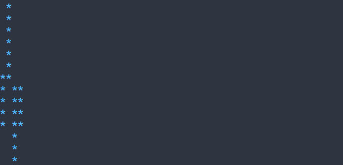

# Построить линейный или свечной график {#chart-ru}

[Английская версия](../chart.md)

График показывает линию или свечи OHLC из неизменяемой модели. По умолчанию используются линия, автоматический масштаб по видимым данным, ASCII-символы свечей и нулевой промежуток между ними. График отображает данные; навигацию и команды задают окружающие контролы. Для загруженной конфигурации нужна типизированная фабрика, передающая модель и accessor из C++; см. [регистрацию ресурсов](../../include/portals/ui_scene_resource.hpp).



В примере четыре интервала. По умолчанию каждый занимает один столбец, поэтому остальная ширина графика остаётся пустой; данные не растягиваются.

## Настройка оформления {#chart-styling-reference-ru}

Тип `Chart` рисует область графика разрешённым обычным стилем; ручное значение по умолчанию задаёт `ChartOptions::background`. Доступны `foreground`, `background` (`#RRGGBB`), `bold`, `italic`, `underline` (`true` или `false`). Правило без состояния задаёт все варианты, но график использует обычный. См. [каскад и ограничения размеров](styling-guide.md); `min-width` задаётся без состояния.

Серии используют стили ячеек `ChartOptions::line`, `rising` и `falling`, а не отдельные части PSS. Их цвета текста по умолчанию — `#50b4f0`, `#3cc878` и `#e65a5a`; незаданный фон кисти наследует разрешённый фон графика. Набор символов свечей выбирается через `ChartOptions::glyph_set`, как описано ниже.

```pss
Chart { background: #102030; }
```

Используйте [Chart<T>](../../include/portals/chart.hpp). Поддерживаются линии и свечи. Программа ниже соединяет линией четыре цены закрытия. F10 закрывает приложение.

Программа использует адаптер Prices — неизменяемый `ModelSnapshot<Ohlc>` с четырьмя записями. Адаптер, заголовки и вся программа приведены ниже и в [guide_chart.cpp](../examples/guide_chart.cpp).

<details>
<summary>Полная программа</summary>

\include guide_chart.cpp

</details>

[Отдельный проект примеров](examples.md) собирает цель `guide_chart`; запустите полученную программу в терминале. Она связывается с `portals::core`.


ChartMode::LINE соединяет соседние корректные close. Замените режим на ChartMode::CANDLES, чтобы показать те же open/high/low/close свечами. Функция доступа возвращает optional<Ohlc>; nullopt создаёт разрыв. Сцена выполняет подготовку и вывод. Для ожидающих данных задайте prepared в ui::ChartConfig<T>.

Термины: [рецепт](glossary.md#glossary-recipe-ru), [кадр](glossary.md#glossary-frame-ru), [владение](glossary.md#glossary-ownership-ru).

<details>
<summary>Справка API и ограничения</summary>

`Canvas` отправляет отсечённые локальные ячейки из метода рисования. `Chart<T>` подготавливается между кадрами и использует обычный путь дерева и преобразования команд. Терминалом и циклом эти компоненты не владеют.

**Подготовка**

Таблица и график открывают независимых потребителей одной [модели](model.md). После обслуживания планировщика получите общий [фиксированный снимок](glossary.md#glossary-model-pin-ru) `ModelFrame<T>` для обеих подготовок: он сохраняет данные и доступность диапазонов. Функция доступа заимствует неизменяемую строку и возвращает `optional<Ohlc>` только при подготовке. `Ohlc` хранит цены открытия (`open`), максимума (`high`), минимума (`low`) и закрытия (`close`) за интервал. Функция доступа не сохраняет ссылку, не меняет дерево или модель, не ждёт и не выполняет ввод-вывод. Снимки удерживают память источника. Изменения, подготовка и уничтожение выполняются на UI; чтение — через `tree.read`.

`prepareChart(..., viewport, first)` показывает последовательные интервалы от first. По умолчанию одному интервалу соответствует столбец. Для свечей `candle_gap` добавляет неотрицательные промежутки. Видимое число округляется вверх из `width / (gap + 1)`; записи не пропускаются. Линейный график игнорирует промежутки. Чтение ограничено шириной области; пустое окно и нулевая высота не читают строки. Нужное доменное разрешение агрегирует источник до публикации. Лимит диапазона модели применяется также к графику.

`glyph_set` выбирает ASCII (`|`, `#`) или BOX_DRAWING с тонкой тенью, заполненным телом и горизонтальным doji. При широкой политике Ambiguous Unicode-кисти заменяются ASCII для гарантированной одной ячейки. Библиотечное значение по умолчанию — плотно размещённые ASCII-свечи.

Движок стилей задаёт фон области по обычному разрешённому стилю. Линия и свечи наследуют фон, если собственный не указан. Цвета роста и падения независимы. Без темы применяется `ChartOptions::background`. Замена темы перерисовывает подготовленный график без чтения модели.

Ожидание возвращает один `ModelRequest<T>` для запуска приложением. Ответ должен иметь ту же ревизию; затем обслужите планировщик, получите новый снимок и подготовьте график. Ожидание и ошибка показывают пустой фон и различаются `rangeState()`. Публикация отменяет устаревшую работу, удаление отменяет без ожидания потока. Ошибка подготовки сохраняет прежнее отображение, чужой снимок отклоняется до чтения и функции доступа.

**Агрегация и публикация**

Каждый упорядоченный тик поступает в принадлежащий производителю `OhlcBucket`. Он сохраняет первый open, максимальный high, минимальный low и последний close. `add` отклоняет NaN и infinity без изменения. Порядок, границы интервалов, историю и политику отклонений задаёт приложение. `reset()` вызывается при начале следующего интервала.

`REPLACE_LATEST` применяется к полному агрегированному снимку. Канал модели использует отклонение при заполнении. Между входной очередью отображения и моделью приложение удерживает один последний ожидающий снимок. Входной обработчик и повтор работают на UI, производитель использует скопированный канал. Очищайте ожидающий снимок только после принятой отправки. `WOULD_BLOCK` сохраняет его даже после остановки производителя. Более новая полная ревизия может заменить его, поскольку включает прошлые вклады.

Ошибки публикации обрабатываются явно; повтор не выполняется циклом внутри обработчика. Отключите входной канал до освобождения заимствуемого хранилища снимка; область действия живёт дольше подписки. Частота кадров ограничивается монотонным сроком независимо от частоты тиков. Применение модели происходит при последующем обслуживании; проверяйте снимок и `lastError()`.

**Координаты и разрывы**

Логическая Y растёт вверх, ячейки — вниз. Автомасштаб использует подготовленные корректные close для линии и high/low для свечей. Конечный `ChartRange` задаёт явный диапазон. Максимум попадает в строку ноль, минимум — в последнюю, с ближайшим округлением. Равные границы центрируют значения. Поддерживаются субнормальные числа и противоположные конечные пределы double без преобразования бесконечности в целое.

Пустой результат функции, нечисловое поле и нарушение `low <= open/close <= high` создают разрыв. Соседние корректные close соединяются; разрыв прерывает линию. Пересекающие явный диапазон отрезки отсекаются логически до перевода в ячейки. Тень и тело свечи отсекаются отдельно; полностью невидимый объект ячеек не создаёт. Пустые данные очищают фон.

Линия по умолчанию рисуется `*`, ASCII-тень — `|`, тело — `#`. BOX_DRAWING использует горизонтальный doji при совпавших экранных open и close, включая округление и отсечение. Параметры задают режим, масштаб, фон, стили, ширину и символы. После изменения размера нужна подготовка окончательной области; несовпадение даёт `INVALID_GEOMETRY`.

**Пользовательский Canvas**

`Canvas(context, clip)` рисует стилизованные пробелы; необязательный одноячеечный `GraphemeText` задаёт символ кисти. Он должен оставаться неизменным до преобразования текущего кадра. Точки отсекаются; линии используют DDA по главной оси с включёнными концами и округлением равных расстояний от нуля. Обход ограничен видимым отрезком даже при крайних координатах. Перевод на поверхность и отсечение предками выполняет получатель кадра. При ошибке отбросьте частичные команды.

Удержанная страница завершения может обслужить новый последовательный интервал при совпадающих ревизии, числе строк и лимите чтения. Только текущие строки проходят функцию доступа; рисование кэш не читает. Промах остаётся ожидающим, ошибка источника сообщается явно. Результаты разных потребителей не объединяются.

Индикаторы, биржевые подключения, автоматические временные интервалы и пересчёт разрешения, навигация, подписи осей и отдельный запуск приложения этим компонентом не предоставляются.

</details>
