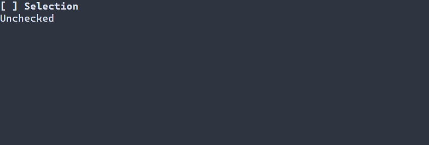

# Флажки {#check-box-guide-ru}

[English version](../check-box.md) · [Три состояния](three-state.md) · [Переключатель](switch.md)

`ui::checkbox` подходит для независимого выбора, например подписки на уведомления. [Switch](switch.md) может представлять настройку вроде включения сети; оба допускают булеву привязку, принятое изменение пользователя обновляет связанное значение, а побочные действия и сохранение определяет приложение. Для смешанного значения используйте `ui::threeState`, для одного выбора из нескольких — группу радиокнопок.

## Полное приложение

Программа использует `CheckBox` с необязательным циклом из трёх состояний и показывает каждое изменение пользователем в надписи. Space или Enter меняет значение, F10 или Ctrl+C завершает программу; `runApp` сообщает об ошибках и восстанавливает терминал.



\include guide_check_change.cpp

Соберите `portals_docs_check_change` с `PORTALS_BUILD_TESTS=ON` и запустите в терминале. Булев флажок создаётся как `ui::checkbox("Alerts", true)`; если начальное значение опущено, используется значение контекста, иначе флажок снят. См. [сборку](getting-started.md) и [пакет](package.md).

## Состояние, ввод и ресурсы

Булева модель переключает снятое и установленное состояние. `CheckState` дополнительно представляет `MIXED`; `CheckBoxOptions::cycle` по умолчанию равен `TWO_STATE`, где смешанное состояние переходит в установленное. `.threeState()` выбирает цикл снято → установлено → смешано → снято. Активируют немодифицированные Enter, Space и нажатие левой кнопки мыши; отпускание, движение, вставка и жесты с модификаторами игнорируются. Скрытый или недоступный предок блокирует активацию. Отдельного режима read-only у флажка нет.

`ui::Ref<CheckBox>` наблюдает смонтированный виджет; `ui::onChange(ref, handler)` получает успешные изменения пользователя, как в примере. Внешнее изменение модели не вызывает этот бизнес-обработчик. Отклонённые уведомления наблюдателей не отменяют commit. Сцена владеет привязкой и виджетом; Ref не продлевает их жизнь. Точные результаты и общая модель описаны в [правилах привязки](controls.md) и [описании трёх состояний](controls.md#check-box-with-three-states-ru).

Ресурс поддерживает `CheckBox#enabled { "Enabled"; checked = true }`; получить его можно через `scene.get<CheckBox>("enabled")`. См. [ресурсы сцен](scene-loading-guide.md).

## Настройка оформления {#check-box-styling-reference-ru}

Естественный селектор — `CheckBox`. Normal, focused и disabled рисуют подпись и маркер целиком, disabled имеет приоритет. Установленное и смешанное значения выбирают `[x] ` и `[-] `; снятое — `[ ] `. Они не выбирают `:selected`; header и caret не рисуются. Строки маркеров фиксированы, отдельных свойств их символов или цвета в PSS нет.

| Свойство | Значения и действие |
|---|---|
| `foreground`, `background` | `#RRGGBB`; цвет текста и заливки |
| `bold`, `italic`, `underline` | `true` или `false`; явное false переопределяет нижний слой |
| `width`, `height` | Неотрицательное число ячеек, `auto`, `fit-content`, `flex(положительный вес)` в runtime PSS |
| `min-width`, `max-width`, `min-height`, `max-height` | Неотрицательные границы в ячейках; в compile-time PSS поддерживается только `min-width` |

Правила размера не зависят от состояния или `:read-only`; конфликт ограничений отклоняет обновление, сохраняя последние корректные стиль и геометрию. См. [компоновку](layout.md). Ручной `ControlStyle` использует цвета терминала, обычный текст, жирный шрифт при фокусе и курсив для недоступного элемента. Тема и PSS переопределяют отдельные поля; остальные сохраняют значения нижнего слоя. См. [каскад](styling-guide.md).

```pss
CheckBox { min-width: 12; }
CheckBox:focused { foreground: #ffffff; background: #245070; }
CheckBox:disabled { italic: true; }
```

См. `portals::CheckBox`, `CheckState`, `CheckBoxOptions`, `ui::checkbox` и [общие стили](controls.md#basic-controls-styling-reference-ru).
