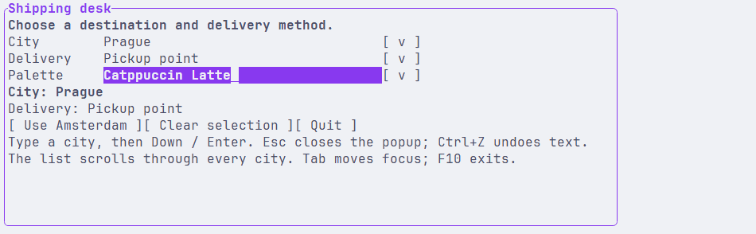
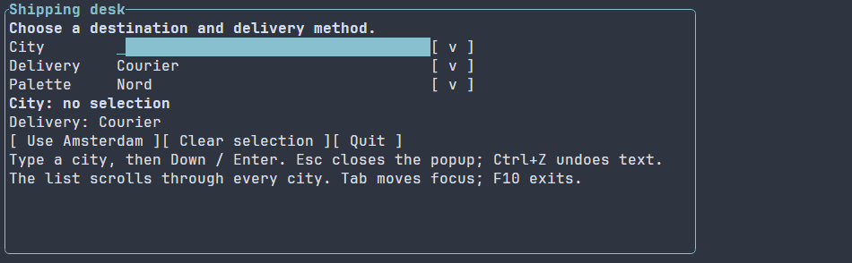

# Выбор строк модели {#choices-ru}

[English version](../choices.md) · [Модели](model.md) · [LineEdit](line-edit.md) · [Живые подсказки](live-search.md)

`ComboBox` объединяет редактируемый черновик с выбором строки источника.
`DropDown` показывает принятый выбор в поле только для чтения. Оба контрола
принимают неизменяемые модели и готовят видимые строки popup в worker через
существующий provider виртуального списка.



Полная форма также показывает прокрутку списка, выбор найденного города
и переключение тёмной и светлой палитр:



Изображения получены из захваченного нативного приложения через VHS.
Вид зависит от шрифта и возможностей терминального хоста.

## Полная программа

[Полный исходник](../examples/guide_choices.cpp)

\include guide_choices.cpp

Введите город, нажмите Down для открытия popup и Enter для принятия
подсвеченной строки. Escape закрывает popup. F10 завершает обычный runner.
Фабрика копирует небольшой литеральный источник; хранить binding tokens
в прикладном коде не требуется.

Минимальный пример собирается целью `portals_docs_choices` при включённых
тестах. Цель `portals_choices_example` при включённых примерах собирает полную
форму. Нативные presets описаны в [руководстве по сборке](getting-started.md).

## Черновик и принятый выбор

Основное поле и принятый выбор представляют разное состояние:

- Ввод меняет обычный черновик LineEdit с выбранным режимом применения,
  валидацией и Undo. Каталог исходных строк при этом сохраняется.
- Подсветка строки обозначает позицию навигации. Enter или активация указателем
  принимает строку и меняет редактор через его обычную checked-команду.
- `ChoiceSelection` владеет ограниченной подписью и идентичностью строки.
  Одинаковые подписи остаются разными строками. `text()` можно читать после
  удаления источника или контрола; повторное принятие сохранённой ссылки
  проверяет её актуальность.
- `ui::onSelect(ref, callback)` сообщает об изменении принятого выбора,
  включая пустой handle после очистки или инвалидирования источником.
  Повторное принятие той же строки и очистка уже пустого выбора не создают
  лишнего уведомления.
- `clearSelection()` очищает принятый выбор, сохраняя отображаемый текст,
  в том числе подпись DropDown. Проверяйте `selection()` или `onSelect`, чтобы
  отличать принятый выбор от сохранённого текста. Escape
  при открытом popup закрывает его, сохраняя уже применённые немедленные правки.

`combo.text()` предоставляет обычное текстовое свойство редактора.
`combo.editor()` нужен для расширенного доступа к LineEdit. Основное поле
DropDown доступно только для чтения; поиск внутри popup использует отдельный
временный запрос. Закрытие popup ComboBox сохраняет черновик и историю
основного редактора.

## Модели и проекции

Источником служит managed-модель, владеющий неизменяемый снимок либо
`RowCollection<T>`, включая checked-результат создания коллекции. Если модель
строк `City` уже существует, поле для подписи можно указать указателем на член:

```cpp
auto input = ui::comboBox(city, cities, &City::name);
```

Проекция работает в worker и должна безопасно читать неизменяемые данные.
UI-ссылки и сервисы с привязкой к потоку в неё передавать не следует.
Изменение источника инвалидирует несовместимый выбор и устаревшие результаты,
сохраняя видимый черновик. Позиция в исходной модели отличается от позиции
в ранжированном результате поиска.

Для начального выбора задайте `ComboBoxConfig::initial`. Программный `select()`
по managed-модели требует её первого pin в обычном цикле подготовки.
`runApp` управляет обычными циклами подготовки; low-level host сам вызывает
`ManagedScene::prepare`. Метод `Scene::prepareChecked()` монтирует сцену,
но не выполняет эту подготовку runtime-моделей.

Проекция также может вернуть владеющий `std::string`, например результат
`std::format`. Worker удерживает его на время подготовки отображаемого текста.
Проекция с результатом `string_view` заимствует данные неизменяемого снимка.
Лимиты байтов строки и временной памяти ограничивают хранилище библиотеки;
выделения памяти внутри пользовательской проекции до её возврата остаются
ответственностью приложения.

Обычная прокрутка достигает всех строк источника ограниченными запросами
видимого диапазона. Непустой поисковый запрос использует индекс из
[живых подсказок](live-search.md); top-K ограничивает поисковую выдачу.

## Программные команды

`open()`, `select(index)` и `select(selection)` возвращают проверяемый результат допуска операции.
Создание popup, компоновка и чтение строки завершаются через существующие
UI- и worker-фазы. Допущенная операция ещё не обязательно открыла popup
или приняла строку. `opened()` читает завершённое состояние, `onSelect`
сообщает о принятом выборе. Новейшее намерение и точная идентичность
источника защищают от устаревших доставок.

`select(index)` принимает порядковый номер исходной строки с нуля и фиксирует
источник для запроса. `select(selection)` откладывает принятие актуального
владеющего выбора до штатной обработки команд, в том числе при вызове из
обработчика кнопки. `dismiss()` отменяет и ожидающее открытие. Закрытие или удаление
владельца освобождает временный popup и его модели результатов. Явная
программная команда выбора может прочитать одну строку при закрытом popup.

Ошибки provider и транспорта попадают в существующую типизированную
диагностику runner. Необязательный failure callback позволяет сразу показать
предметную ошибку в интерфейсе. Восстановимые ошибки действий следуют
[контракту runner](application.md).

## Оформление и ограничения

Сцена заполняет фоном темы весь viewport, включая промежутки между контролами
и свободное место. Смена палитры обновляет этот фон вместе с контролами.
Дополнительный контрол для заливки не требуется. Прикладное правило, например
`Scene { background: #182028; }`, переопределяет фон темы и сохраняется при её
переключении.

Для оформления используются естественные селекторы `ComboBox` и `DropDown`
и существующие слои темы и стилей. Форма Shipping desk сохраняет прикладные
правила при смене базовой темы. Popup переворачивается или ограничивается
размерами терминального viewport.

`ComboBoxConfig` разделяет высоту и ширину popup, бюджет видимого диапазона
и поисковые ограничения. По умолчанию видны восемь строк, максимальная ширина
составляет 60 ячеек, запрос просмотра ограничен 32 строками; поиск использует
свои существующие defaults. Менять настройки нужно при иной потребности
приложения; недопустимые значения возвращают checked-ошибки.

Сцена автоматически предоставляет существующий overlay host и переиспользует
совместимый явно указанный host. Открытый popup занимает обычные ресурсы слоя
и моделей, а при закрытии освобождает их. Закрытый контрол не запускает
самостоятельный просмотр или поиск. Основной контрол и его черновик остаются
в retained-дереве.

Основные контролы используют естественные PSS-типы `ComboBox` и `DropDown`.
Их дочерние элементы имеют классы `.choice-editor` и `.choice-trigger`.
Для popup используются `Dialog.choice-popup` и дочерние `.choice-search`,
`.choice-list`, `.choice-completion`. Оформление берётся из стандартных стилей
LineEdit, Button, VirtualList и Dialog; поштучная регистрация не нужна.

## Полная форма и настройка

[Полный исходник Shipping desk](../../examples/choices/main.cpp)

\include choices/main.cpp
## Загружаемые сцены

Реестр ресурсов распознаёт `ComboBox`, `DropDown` и обычные настройки контролов,
включая `text` и `placeholder`. Модели источников и обработчики задаются в C++.
Чтобы передать каталог загружаемому контролу, зарегистрируйте типизированную
фабрику через `SceneResourceOptions::control<ComboBox>` или
`control<DropDown>` и верните соответствующий рецепт с
`.settings(arguments.settings)`. [Руководство по загрузке сцен](scene-loading-guide.md)
показывает регистрацию и обработку ошибок при ленивом запуске.

Типизированная фабрика и её псевдонимы сообщают о необходимости popup-host без
повторного запуска пользовательских обработчиков. Непрозрачной фабрике с типом
`Widget`, которая условно возвращает выбор, нужен явно заданный совместимый
`ui::overlayHost`.

Режимы редактора `PASSWORD` и `NO_ECHO` отклоняются с `INVALID_ARGUMENT` до
публикации ссылок на выбор: поиск по каталогу не должен отправлять защищённый
текст поля в проекцию на рабочем потоке.
