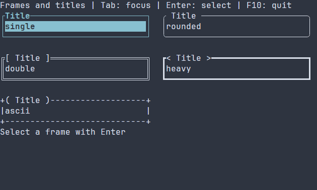

# Короткие рамки, индикаторы и размеры

[Английская версия](../compact-primitives.md)

Небольшая retained-сцена собирается стандартными виджетами. Кнопка использует
существующий Button/action/router path без обязательных brackets; её активируют
Enter, Space и левый клик. F10 также завершает приложение. Пользовательский
подкласс Widget и цикл опроса не нужны.

## Стили рамок и оформления заголовка

Стили рамок не зависят от оформления заголовка. Встроены стили
`single`, `rounded`, `double`, `heavy` и `ascii`; заголовок можно оформить как
`none`, `spaced`, `square`, `angle` или `round`. Внутри рамки можно использовать
`plainButton`.


[Статичный кадр PNG](../images/frame-styles.png)

В записи Tab переводит фокус, Enter выбирает рамку и обновляет подпись под
ней, F10 завершает приложение. Соберите `guide_frame_styles` через
[отдельный проект руководств](../examples.md).
[Полный исходник](../examples/guide_frame_styles.cpp) приведён ниже.

\include guide_frame_styles.cpp

## Обычная композиция

```cpp
#include <portals/ui.hpp>

int main() {
  using namespace portals;

  auto content = ui::vbox(ui::label("Transfer"),
    ui::gauge(.65).width(24),
    ui::plainButton("Exit", [] {
      ui::quit();
    }));
  auto scene = ui::scene(ui::hbox(
    ui::border(std::move(content)).width(30).height(7)));

  scene.onKey(key::F10, ui::quit);

  return scene.runApp();
}
```

## Pipe-композиция

```cpp
#include <portals/ui.hpp>

int main() {
  using namespace portals;

  auto scene = ui::scene(ui::hbox(
    ui::vbox(
      ui::label("Transfer"),
      ui::gauge(.65).width(24),
      ui::plainButton("Exit", [] {
        ui::quit();
      }))
      | ui::border()
      | ui::width(30)
      | ui::height(7)));

  return scene
    | ui::onKey(key::F10, ui::quit)
    | ui::runApp();
}
```

## Размеры и flex

`width(cells)` и `height(cells)` заменяют только выбранную ось фиксированными
неотрицательными границами. `flexX(weight)`, `flexY(weight)` и `flex(weight)`
включают существующий flex-режим с положительным весом и нулевой preferred-базой,
сохраняя minimum/maximum. Так область делится по весам даже для дочерних виджетов,
которые измеряют весь предложенный viewport.
Модификаторы выполняются по порядку при mount: `width(10).flexX()` сохраняет
предел десять ячеек; `flex().height(3)` оставляет горизонтальный flex и фиксирует
высоту. Отрицательный размер и нулевой вес возвращают `ManagedError` с
`TreeError::INVALID_ARGUMENT`; созданное поддерево удаляется, refs не публикуются.
Операции доступны как consuming-методы и pipe-стадии. Политики применяет родительский
layout; корень приложения получает размер viewport.

`fitWidth()` и `fitHeight()` выбирают `SizeMode::CONTENT`: виджет предпочитает
собственный размер содержимого, при нехватке места может уменьшиться до жёсткого
минимума и не растёт ради свободных ячеек. `minWidth(cells)`, `maxWidth(cells)`,
`minHeight(cells)` и `maxHeight(cells)` меняют только соответствующую границу
листа; те же операции доступны как стадии `ui::fitWidth()`, `ui::fitHeight()`,
`ui::minWidth(cells)`, `ui::maxWidth(cells)`, `ui::minHeight(cells)` и
`ui::maxHeight(cells)`. Ограничения применяются после обычной настройки рецепта.
Поэтому `.width(20).fitWidth()` остаётся шириной ровно 20 ячеек, а
`.fitWidth().minWidth(8)` предпочитает внутренний размер, но не выделяет меньше
восьми ячеек. Рамка размерного виджета наследует предпочтение содержимого или
flex, а эти модификаторы ограничивают внешнюю рамку. Числовые внутренние границы
на неё не копируются.

По умолчанию меню использует режим содержимого по обеим осям. У остальных
семейств виджетов значения по умолчанию не меняются. Меню предпочитает размеры
содержимого, не использует свободное место и может сжиматься только до жёсткого
минимума. Жёсткий минимум сохраняется и при обрезке viewport. Минимум выше
заданного максимума недопустим; конфликт минимума с ограничением Dialog или
Toast приводит к типизированной ошибке компоновки. Стандартное ограничение
размеров на малом viewport для них сохраняется.

## Контракты рамки и индикатора

### Обновление сохранённого индикатора {#gauge-ref-commands-ru}

Передайте `ui::Ref<Gauge> progress` первым аргументом: `ui::gauge(progress, .25)`.
В callback кнопки или конфигурации сцены после mount вызов `progress.value(.5)`
заменяет значение, а `progress.adjust(.125)` прибавляет к текущему. Оба возвращают
`std::expected<void, ManagedError>` и однократно передают ошибку существующему
коллектору сцены. Игнорирование ошибки в void callback действия сохраняет
диагностику, но не завершает запуск. Верните checked-результат из callback для
передачи ошибки адаптеру действия: стандартная политика `runApp` тогда выводит
её и завершает запуск без повторного отчёта. При конфигурации сцены проигнорированная
ошибка короткой команды останавливает подготовку через существующий setup scope.
Прежде чем публиковать связанное клиентское состояние, проверьте успешность команды.

Полный [пример журнала прогресса](../../examples/progress_workbench/main.cpp)
сочетает название работы, дробные шаги, кнопки сброса и завершения, строку статуса
и ограниченный журнал действий. При включённых examples соберите
`portals_progress_workbench` и запустите в терминале; F10 завершает приложение
через обычный cleanup runner. Значением владеет Gauge, второго числового состояния
в клиентском коде нет.

Команды требуют опубликованный живой Ref на потоке его создания, между кадрами.
Отсутствующая/уничтоженная сцена даёт `CLOSED`, удалённый узел — `STALE_NODE`,
другой поток — `WRONG_THREAD`, конфликт с кадром/заимствованием — `WOULD_BLOCK`.
Gauge отображает значение; disabled-состояние допускает эти программные изменения. NaN/infinity,
переполнение сложения и результат вне включительного диапазона дают
`INVALID_ARGUMENT`, сохраняя состояние и invalidation; ограничения значения
через clamp нет. Равная запись и неизменившаяся сумма, включая нулевой сдвиг,
не запрашивают кадр. Новые подписки, таймеры и владельцы не создаются.
Gauge из ресурса принимает те же команды после получения типизированного
`Ref<Gauge>`.

### Отрисовка и низкоуровневые операции

`border(child, options, style)` и alias `frame` владеют одним consuming-рецептом.
Они монтируются в одной транзакции с дочерними refs и ошибками. Отступ в одну
ячейку измеряет и размещает существующий LinearLayout. Внутренний clip ограничивает
отрисовку и hit testing даже при переполнении fixed/minimum-size дочернего элемента.
Пустая область ничего не рисует. Одноячеечные строки/столбцы сворачиваются в углы
и оставшийся край; рамка два на два содержит четыре угла без содержимого.
Рамка не заполняет и не закрашивает внутреннюю область.

`gauge(value, options, style, policy)` — строго determinate-индикатор. По умолчанию
диапазон `[0, 1]`, intrinsic-ширина десять ячеек и высота одна. Границы конечны,
`minimum < maximum`, их разность конечна и представима. Значение конечно и
входит во включительный диапазон. Недопустимое значение, NaN/бесконечность,
отрицательная preferred-ширина и нулевой paint cap дают `INVALID_ARGUMENT`.
Заполнение занимает `floor(width * fraction)` столбцов по всей выделенной высоте.

Между кадрами используйте `setGaugeValue(tree, node, value)` или
`adjustGaugeValue(tree, node, delta)`: операция проверяет
аргумент до изменения состояния, запрашивает только paint, а для равного значения
не запрашивает redraw. В уже dirty `onPrepare` callback метод `Gauge::display(value)`
обновляет snapshot без запроса следующего кадра. Таймер и анимация не создаются.

`BorderOptions` и `GaugeOptions` выбирают Unicode/ASCII glyphs и положительный
`maxPaintCells` (по умолчанию 16384). Декорация владеет GraphemeText с полной
WidthPolicy принимающей сцены, включая revision/emoji/ambiguous. Unicode-декорация
шире одной ячейки заменяется ASCII. До submit рамка проверяет выделенный периметр,
индикатор — площадь. Превышение cap даёт `WOULD_BLOCK`, даже если область частично
обрезана; повышайте cap лишь вместе с достаточными render budgets. Полностью
обрезанные узлы пропускаются существующим tree path. Сама реализация paint виджета
не выделяет heap-память. Submitted text принадлежит виджету до конца enclosing
frame и потребляется renderer до завершения этого frame.

Переданный `ControlStyle` владеет foreground/background и остальными значениями
normal/focused/disabled. Это manual defaults ниже theme rules, а не явное
переопределение темы. У Border/Gauge эти defaults задаются только при construction.
Динамические цвета меняет существующий style resolver, включая exact-Ref application
styles: computed cache и приоритет темы остаются согласованными. Border/Gauge используют существующий style resolver и
синхронизацию disabled ancestors. `plainButton` возвращает тот же `Button`, что и
`button`: сохраняются refs, bindings, keyboard и pointer routing; убраны только
обязательные brackets. Обычный `button` сохраняет прежние brackets по умолчанию. Обе фабрики отображают
лимиты caption в `NODE_LIMIT`, некорректный UTF-8 — в `INVALID_ARGUMENT` и сохраняют
исходный `TextError` вместе с transactional cleanup.

## Low-level расширение и совместимость

Семантика трёхаргументного `WidgetTree::arrange` сохранена. Новая перегрузка с
четырьмя аргументами пересекает дополнительный surface `contentClip` с обычным
inherited/root clip узла; descendants наследуют итоговый geometry clip.
`Layout::childClip` по умолчанию возвращает полную выделенную область, поэтому
Row/Column/Grid, Overlay и пользовательские layouts сохраняют размещение и clipping.
Border использует hook для внутренней области. Недопустимый custom clip и
переполнение transform дают типизированные geometry errors; неуспешный pass отбрасывается.

Новый virtual hook и хранение Button требуют пересборки SDK и consumers.
Совместимость исходников сохранена; совместимость со старыми object files не обещается.
См. [декларативную композицию](declarative-ui.md) и [layout policies](layout.md).

## Стиль приложения для точного Ref

Полный пример задаёт владеющие значения по умолчанию в конструкторе и стиль
приложения для конкретного Ref. `ui::style(ref, pss)` копирует исходный текст до
отложенного mount; его слой приложения перекрывает тему и сохраняется при её
замене. Селектор `*` действует только на указанный узел благодаря точной области
слоя. Область не меняет правила сопоставления: управляемая кнопка автоматически
получает тип `Button` и также совпадает с селекторами `Control`. Явные метаданные
описаны в [контракте стилевой цели](styles.md).
При ошибке фабрики не публикуются ни Ref, ни частичный scoped-стиль; тот же Ref
и владеющую стадию стиля можно использовать в новой сцене.

```cpp
#include <portals/ui_style.hpp>

int main() {
  using namespace portals;

  ui::Ref<Button> exit;
  ControlStyle defaults;
  defaults.normal.foreground = RgbColor{180, 180, 180};

  auto scene =
    ui::scene(ui::border(ui::vbox(ui::gauge(.65).width(24),
      ui::plainButton(
        "Exit",
        [] {
          ui::quit();
        },
        defaults)
        .reference(exit))));

  scene
    | ui::style(exit,
      "* { foreground: #ffffff; background: #203040; }");

  return scene
    | ui::onKey(key::F10, ui::quit)
    | ui::runApp();
}
```


## Настройка оформления {#primitives-styling-reference-ru}

`Border` использует normal/focused/disabled, причём disabled имеет приоритет.
`Gauge` использует normal/disabled; фокус и selected не выделяют отдельные части
индикатора. Ручной `ControlStyle` задаёт исходные значения до темы и прикладного
PSS. Рамка не передаёт свой стиль текста дочерним контролам.

Общие свойства отрисовки: `foreground` и `background` (`#RRGGBB`),
`bold`, `italic`, `underline` (`true` или `false`). Пропущенные поля сохраняют
ручные значения или результат нижнего слоя стилей; явное `false` переопределяет
атрибут. См. [селекторы и приоритеты](styling-guide.md). В runtime PSS размеры
задают `width`, `height` (ячейки, `auto`, `fit-content`, `flex(weight)`) и
`min-width`, `max-width`, `min-height`, `max-height` (неотрицательные ячейки).
Для размеров нужен селектор без состояния; конфликт границ отклоняет обновление.
Из этих свойств размеров compile-time PSS поддерживает только `min-width`.
См. [политики размеров](layout.md).

### Рамки и заголовки

К каждому префиксу `frame-line-`, `frame-title-`, `frame-ends-` добавляется каждый
суффикс: `foreground`, `background`, `bold`, `italic`, `underline`. Эти 15 свойств
независимо оформляют линии, текст заголовка и его обрамление. Пропущенные атрибуты
берутся из соответствующего общего вычисленного стиля. `glyph-profile` принимает
`default`, `unicode`, `ascii`, `nf-rounded`, `nf-chevron`, `nf-slash`, `nf-backslash`;
`glyph-fallback` — `unicode` или `ascii`. По умолчанию сохраняется ручной/обычный
набор с резервной проверкой Unicode. Явные собственные символы важнее набора.

| Настройка C++ или сцены, не свойство PSS | Значение по умолчанию / варианты |
|---|---|
| `FrameOptions::pattern` | `SINGLE`; single, rounded, double, heavy, ascii |
| `sides` | Все четыре границы по одной ячейке; отсутствие границы убирает её отступ |
| `customGlyphs` | Нет; topLeft/topRight/bottomLeft/bottomRight/horizontal/vertical — по одной печатной графеме шириной в ячейку, до 64 байт |
| `title`, `titleAlignment` | Пустой заголовок, `START`; start/center/end |
| `titleDecoration` | `NONE`; none/spaced/square/angle/round/profile |
| `customTitleDecoration` | Нет; собственные prefix/suffix важнее пресета, каждый до 64 байт и 16 графем шириной в ячейку |
| `maxTitleBytes` | 4096 байт исходника; неверный ввод отклоняется до замены рамки |
| `BorderOptions::glyphs` | Unicode с резервом ASCII при неподходящей ширине; доступен явный ASCII |
| `BorderOptions::maxPaintCells` | 16384 ячейки периметра; это лимит работы, не настройка цвета/размера |

Цвета PSS не задают рисунок рамки, стороны, литеральные линии и текст заголовка.
Используйте `.framed(...)`, `.titleDecoration(...)` или соответствующую конфигурацию;
[руководство по заголовкам](controls.md#frame-title-decoration-ru) показывает собственные края.
Заголовок вписывается в верхнюю границу, не увеличивая собственную ширину рамки.

### Индикатор Gauge

Исходные `GaugeOptions`: minimum 0, maximum 1, preferredWidth 10,
блок Unicode с резервом ASCII `#`, maxPaintCells 16384. Заполненные целые ячейки
используют общий стиль; отдельных PSS-свойств цвета заполнения/дорожки и произвольной
строки заполнения нет. Эти настройки создания задаются через `GaugeOptions`,
а цвета и выделенный размер — через обычный PSS.

```pss
Border { frame-line-foreground: #7d8797; frame-title-foreground: #f2c879; }
Border:focused { frame-ends-bold: true; }
Gauge { foreground: #62b4d7; background: #182028; width: 24; }
```
