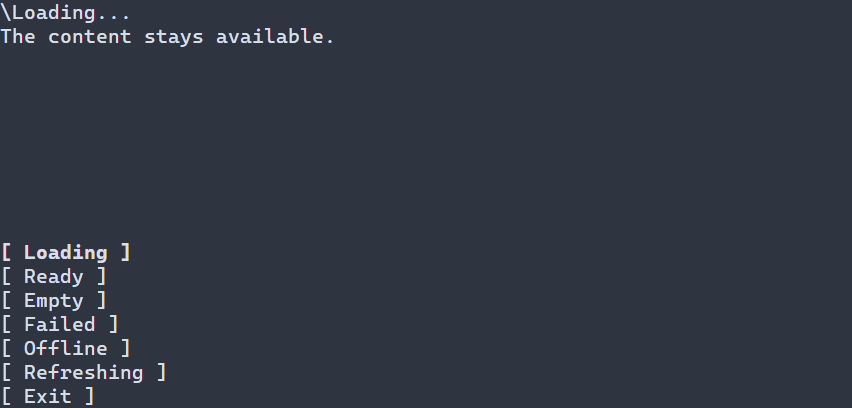

# Отображение загрузки данных {#data-presentation-ru}

[Английская версия](../data-presentation.md)

На экране результатов может понадобиться показать загрузку, затем содержимое
или пустой результат, а при ошибке — объяснение и явную повторную попытку.
`ui::dataStateView` показывает эти состояния вокруг существующего поддерева:
состояние предоставляет приложение или поддерживаемое виртуальное представление,
а необязательный callback выполняет повторную попытку. Во время ожидания может
анимироваться индикатор. Обёртка не получает данные и не виртуализирует содержимое.
Для постоянно доступного содержимого без смены состояния данных достаточно
обычного элемента. Это распространённый паттерн загрузки, пустого результата
и ошибки, не привязанный к конкретному источнику данных.



Состояние загрузки: содержимое остаётся доступным.

## Запуск явного представления

Эта управляемая демонстрация меняет представление кнопками; она не загружает
данные и не выполняет повторную попытку. Программа запускается в состоянии
готовности, сохраняет видимость подписи во всех состояниях и завершается кнопкой
**Exit** или F10. Проверяемый результат `display` из обработчика поступает в
стандартную диагностику `runApp`. Контролами владеет сцена, а `presentation`
наблюдает за контролом.

\include guide_data_state.cpp

Для сборки этого руководства из исходников Portals включите `PORTALS_BUILD_TESTS`,
затем соберите и запустите `portals_docs_data_state`. Собственное приложение
свяжите с `portals::core`, как описано в [руководстве по пакету](package.md).

`ui::dataStateView(DataPresentation{...}, content)` владеет значением представления.
Только этот режим принимает `ui::Ref<DataStateView>::display` и явную проверяемую
операцию `setDataStateView(tree, node, value)`. Укажите `DataContentPolicy::REPLACE`
в `DataStateConfig`, если независимо организованная работа допускает скрытие тела
вне `READY` и `REFRESHING`. По умолчанию `KEEP_BODY` сохраняет тело активным.

## Наблюдение за состоянием сцены

Вместо начального значения передайте `ManagedState<DataPresentation>` той же сцены
или доступный только для чтения `ManagedSource<DataPresentation>`. Например,
внутри фабрики сцены с параметром `ManagedScene &owner`:

```cpp
return owner.state(DataPresentation{DataPhase::LOADING})
  .transform([](auto state) {
    return ui::dataStateView(state, ui::label("Results"));
  });
```

Производитель меняет состояние существующей проверяемой операцией `set`.
`display` отклоняет оба связанных режима с `TreeError::INVALID_ARGUMENT`:
связь с изменяемым состоянием не предоставляет контролу изменяемую ссылку.

Для явных и связанных значений `generation` должна быть ненулевой. Значение
старше последнего принятого поколения игнорируется после проверок потока, времени
жизни и кадра. Равное поколение допускает смену фазы, в том числе завершение
ожидания; полностью равное значение ничего не меняет. Продвигайте поколение
производителя при отмене или замене работы: представление не различает
конкурирующие завершения с одинаковым номером. Выбранный производитель или связь
фиксированы на время жизни смонтированного контрола.

## Наблюдение за виртуальным контролом

Перегрузка с единственным управляемым рецептом `VirtualList` или `VirtualTable`
следит за подготовленным диапазоном видимой области. Для `model` и функции
форматирования из [руководства по виртуальному списку](virtual-list.md) замените
возвращаемый рецепт следующим:

```cpp
return ui::dataStateView(
  ui::virtualList(model, [](const ModelRow<std::string> &row) {
    return displayText(row.value);
  }));
```

Обёртка читает владеющие факты состояния из той же успешной подготовки тела.
Она не закрепляет и не запрашивает модель повторно, не создаёт второй кэш или
подсистему запросов. Тело остаётся активным во всех фазах, чтобы существующий
обработчик поставщика мог получать и завершать работу. `REPLACE` и `display`
в этом режиме отклоняются. Фиксированное поколение представления 1 независимо
от поколений запросов и ревизий модели.

| Подготовленный диапазон | Представление |
| --- | --- |
| Ещё не подготовлен, строки ожидаются или активный запрос без готовых строк | `LOADING` |
| Готовые строки с активным запросом | `REFRESHING` |
| Ошибка диапазона без активного запроса | `FAILED` |
| Успешный результат с нулём логических строк | `EMPTY` |
| Готовые непустые строки без активного запроса | `READY` |

`OFFLINE` — явная информация предметной области; обёртка не выводит её из текста
ошибки. Обновление сохраняет лишь содержимое, которое существующий поставщик
и контрол разрешают считать готовым, и не создаёт устаревшие данные. Явный повтор
запроса при ошибке базового диапазона сохраняет текущий запрос до завершения или
обычной отмены, даже когда кадры индикатора повторно подготавливают контрол.

## Подписи, повтор и ошибки

`DataStateConfig::labels` владеет сообщениями `TextValue` и подписью кнопки повтора.
Литералы UTF-8 и ключи ресурсов используют политику ширины принимающей сцены.
Для ключей ресурсов задайте `resolver`; разрешение и проверка текста выполняются
при монтировании без автоматической подписки на смену языка. Для смены языка
создайте новую композицию с нужными подписями и функцией разрешения ресурсов.

К композиции применяется обычная тема. `messageStyle` и `retryStyle` задают ручные
стили под слоем разрешения темы. Семантические классы: `data-status`,
`data-spinner`, `data-message`, `data-retry`; приоритет описан в
[руководстве по слоям стилей](style-layers.md).

`retry` — необязательный владеющий обработчик с результатом
`std::expected<void, TreeError>`. Кнопка повтора появляется в `FAILED` и `OFFLINE`;
обработчик вызывается только явной активацией. Для автоматического режима вызовите
в нём существующую операцию тела `retryVirtualList` или `retryVirtualTable`.
Ожидание работы подавляет повторную активацию. Появление полосы само не запускает
запрос, а появление ошибки не перехватывает фокус.

Состояние предметной области `DataPhase::FAILED` отделено от технического сбоя.
Ошибки параметров, выделения памяти, форматирования, обработчиков поставщика и
текстовых ресурсов сохраняют исходные типизированные причины в существующей
управляемой диагностике. Технический сбой не превращается в `OFFLINE` или `FAILED`.
Первоначальное монтирование проверяется и откатывается при отказе. В режиме
владения значением отклонённое обновление `display` или `setDataStateView` не
публикует частично изменённое состояние или текст. Эта гарантия относится к
представлению; удаления из обработчиков приложения и обновления модели сохраняют
собственные эффекты и действующие правила типизированных ошибок и остановки.

Полоса резервирует `statusRows` строк терминала (по умолчанию 1), в том числе
в состоянии готовности. Единственный ограниченный временем жизни одноразовый
таймер с интервалом `spinnerInterval` (по умолчанию 100 мс) перевзводится только
для видимого, включённого ожидающего содержимого с непустой областью отсечения.
Скрытие, удаление и закрытие останавливают анимацию; готовые и статические состояния
не опрашиваются. `showStatus = false` исключает полосу, подписи, кнопку повтора и таймер.
В этой конфигурации `retry` должен быть пустым; настроенный callback повтора
приводит к ошибке `TreeError::INVALID_ARGUMENT` при монтировании.

Параметры перечислены в [публичных объявлениях](../../include/portals/data_presentation.hpp),
а время жизни сцены и обработка ошибок — в [декларативном API](declarative-ui.md).


## Настройка оформления {#data-presentation-styling-reference-ru}

`DataStateView` — композиция Column, а не поверхность, автоматически передающая
свои цвета потомкам. Части полосы состояния имеют устойчивые стилевые цели:

| Цель | Оформление |
|---|---|
| `Row.data-status` | Компоновка полосы, сама не рисует заливку |
| `DataStateIndicator.data-spinner` | Индикатор ожидания в одну ячейку, normal/disabled |
| `Label.data-message` | Сообщение, обычные стили Label |
| `Button.data-retry` | Необязательная кнопка повтора, normal/focused/disabled |

Корень и части полосы также получают класс текущей фазы: `ready`, `loading`,
`empty`, `error`, `offline`, `refreshing`. Это классы (`.error`), а не новые
псевдосостояния. Пример не предполагает дочерних ID. `showStatus=false` не создаёт
эти части. `messageStyle` задаёт исходный стиль сообщения/индикатора, `retryStyle`
— кнопки повтора, до переопределений темы/PSS.

Общие свойства отрисовки: `foreground` и `background` (`#RRGGBB`),
`bold`, `italic`, `underline` (`true` или `false`). Пропущенные поля сохраняют
ручные значения или результат нижнего слоя стилей; явное `false` переопределяет
атрибут. См. [селекторы и приоритеты](styling-guide.md). В runtime PSS размеры
задают `width`, `height` (ячейки, `auto`, `fit-content`, `flex(weight)`) и
`min-width`, `max-width`, `min-height`, `max-height` (неотрицательные ячейки).
Для размеров нужен селектор без состояния; конфликт границ отклоняет обновление.
Из этих свойств размеров compile-time PSS поддерживает только `min-width`.
См. [политики размеров](layout.md).

Полоса резервирует `statusRows` (по умолчанию 1). `DataStateLabels` задаёт тексты,
кадры индикатора встроены, `spinnerInterval` по умолчанию равен 100 мс.
Это поля `DataStateConfig`, а не PSS-свойства `status-rows` или spinner.
Стиль не меняет фазу, видимость содержимого, не начинает запрос и не вызывает retry.

```pss
Label.data-message.error { foreground: #e65a5a; }
DataStateIndicator.data-spinner { foreground: #62b4d7; }
Button.data-retry:focused { bold: true; }
```
