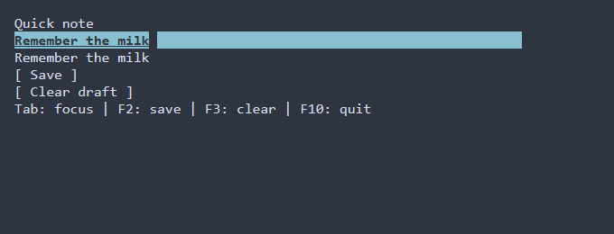

# Первое приложение: заметка {#first-application-ru}

<!-- translation-source: docs/first-application.md
source-revision: d6ef4e75340772de254ef7a2d7514856e5f8e7f5
status: current
-->

[English](../first-application.md) · [Руководства](guides.md) · [Глоссарий](glossary.md)

Создадим приложение с полем ввода, кнопками **Save** и **Clear draft**.
За четыре шага вы опишете форму, свяжете её с действиями и добавите оформление.
**Save** копирует текст в строку под редактором. Заметка хранится до выхода;
записи на диск в этом примере нет.

## 1. Создайте и запустите форму

Потребуются Git, CMake 3.24+, Ninja и инструментарий с поддержкой C99 и C++23,
включая `<expected>` и `<format>`. В Windows откройте x64 Developer PowerShell
для Visual Studio. Подробности подключения — в [кратком руководстве](index.md).

Создайте каталог `quick-note`, сохраните этот код в `main.cpp`:

<details open>
<summary>Полный main.cpp после шага 1</summary>

```cpp
#include <portals/ui.hpp>

int main() {
  using namespace portals;

  ui::Ref<LineEdit> draft;

  auto scene = ui::scene(ui::vbox(
    ui::label("Quick note"),
    ui::lineEdit(draft, "Remember the milk"),
    ui::label("Tab: focus | F10: quit")));

  return scene
    | ui::onKey("F10", ui::quit)
    | ui::runApp();
}
```

</details>

`ui::vbox` описывает вертикальное расположение контролов. Это [рецепт](glossary.md#glossary-recipe-ru),
который `ui::scene` сохраняет в [сцене](glossary.md#glossary-scene-ru).
`ui::Ref<LineEdit> draft` даёт доступ к созданному полю. После запуска можно
редактировать **Remember the milk**; F10 завершает приложение.

В том же каталоге создайте `CMakeLists.txt`:

```cmake
cmake_minimum_required(VERSION 3.24)
project(QuickNote LANGUAGES CXX)

include(FetchContent)
FetchContent_Declare(portals
  GIT_REPOSITORY https://github.com/ttldtor/portals.git
  GIT_TAG cb0fdec5634cfc9d877791313bdee5da2c6aa18f
)
FetchContent_MakeAvailable(portals)

add_executable(quick_note main.cpp)
target_link_libraries(quick_note PRIVATE portals::core)
```

Из каталога `quick-note` выполните:

```powershell
cmake -S . -B build -G Ninja -DCMAKE_BUILD_TYPE=Release
cmake --build build --target quick_note
./build/quick_note
```

В Windows файл называется `build/quick_note.exe`. Запускайте его в терминале.
CMake загрузит закреплённую ревизию Portals при первой конфигурации.
Если исходники уже есть локально, при конфигурации можно добавить
`-DFETCHCONTENT_SOURCE_DIR_PORTALS="C:/path/to/portals"` (подставьте свой путь).
[Полный исходник шага 1](../examples/tutorial_note_1.cpp).

## 2. Покажите сохранённый текст

Завершите приложение. Продолжим редактировать тот же `main.cpp` из шага 1.
После объявления `ui::Ref<LineEdit> draft;` добавьте ссылки на метку и кнопку:

```cpp
  ui::Ref<Label> saved;
  ui::Ref<Button> save;
```

Внутри `ui::vbox(...)`, сразу после `ui::lineEdit(draft, "Remember the milk"),`,
добавьте два контрола. Последнюю метку с подсказкой оставьте после них:

```cpp
    ui::label(saved, "Nothing saved yet"),
    ui::button(save, "Save"),
```

Между объявлением `scene` и `return scene` создайте действие `saveNote`.
В цепочке после `return scene` добавьте `ui::onClick(save, saveNote)` перед
`ui::onKey("F10", ui::quit)`. Этот участок `main` получится таким:

```cpp
  auto saveNote = [draft, saved] {
    saved.text() = draft.text();
  };

  return scene
    | ui::onClick(save, saveNote)
    | ui::onKey("F10", ui::quit)
    | ui::runApp();
```

`saveNote` читает текущий текст редактора и присваивает его метке.
Оператор `|` добавляет к сцене [стадию UI](glossary.md#glossary-ui-stage-ru);
`ui::onClick` связывает кнопку с действием. Захватывайте ссылки в обработчике
по значению: они наблюдают за контролами сцены и не продлевают их жизнь.
Подробнее — в [ссылках на контролы](text-property.md).

<details>
<summary>Полный main.cpp после шага 2</summary>

```cpp
#include <portals/ui.hpp>

int main() {
  using namespace portals;

  ui::Ref<LineEdit> draft;
  ui::Ref<Label> saved;
  ui::Ref<Button> save;

  auto scene = ui::scene(ui::vbox(
    ui::label("Quick note"),
    ui::lineEdit(draft, "Remember the milk"),
    ui::label(saved, "Nothing saved yet"),
    ui::button(save, "Save"),
    ui::label("Tab: focus | F10: quit")));

  auto saveNote = [draft, saved] {
    saved.text() = draft.text();
  };

  return scene
    | ui::onClick(save, saveNote)
    | ui::onKey("F10", ui::quit)
    | ui::runApp();
}
```

</details>

[Скачать исходник шага 2](../examples/tutorial_note_2.cpp).

Повторите команду сборки из шага 1 и запустите приложение. Измените текст,
нажмите Tab, чтобы перейти к **Save**, затем Enter. Под полем появится введённая
заметка. Дальнейшее редактирование не меняет эту строку до следующего **Save**.

## 3. Добавьте очистку и клавиши

Завершите приложение. В `main.cpp` из шага 2 после `ui::Ref<Button> save;`
добавьте ссылку на кнопку очистки:

```cpp
  ui::Ref<Button> clear;
```

Внутри `ui::vbox(...)` добавьте **Clear draft** после **Save** и обновите
последнюю метку с подсказкой. Объявление `scene` теперь выглядит так:

```cpp
  auto scene = ui::scene(ui::vbox(
    ui::label("Quick note"),
    ui::lineEdit(draft, "Remember the milk"),
    ui::label(saved, "Nothing saved yet"),
    ui::button(save, "Save"),
    ui::button(clear, "Clear draft"),
    ui::label("Tab: focus | F2: save | F3: clear | F10: quit")));
```

После существующего действия `saveNote` объявите `clearDraft`.
Дополните цепочку обработчиков: свяжите новую кнопку с очисткой, F2 — с
сохранением, F3 — с очисткой. Участок от `clearDraft` до конца цепочки:

```cpp
  auto clearDraft = [draft] {
    draft.text() = "";
  };

  return scene
    | ui::onClick(save, saveNote)
    | ui::onClick(clear, clearDraft)
    | ui::onKey("F2", saveNote)
    | ui::onKey("F3", clearDraft)
    | ui::onKey("F10", ui::quit)
    | ui::runApp();
```

`clearDraft` очищает только поле ввода; сохранённая строка остаётся на экране.
Кнопка **Clear draft** и F3 вызывают одно действие. Кнопка **Save** и F2
вызывают другое — уже созданное на предыдущем шаге `saveNote`.

<details>
<summary>Полный main.cpp после шага 3</summary>

```cpp
#include <portals/ui.hpp>

int main() {
  using namespace portals;

  ui::Ref<LineEdit> draft;
  ui::Ref<Label> saved;
  ui::Ref<Button> save;
  ui::Ref<Button> clear;

  auto scene = ui::scene(ui::vbox(
    ui::label("Quick note"),
    ui::lineEdit(draft, "Remember the milk"),
    ui::label(saved, "Nothing saved yet"),
    ui::button(save, "Save"),
    ui::button(clear, "Clear draft"),
    ui::label("Tab: focus | F2: save | F3: clear | F10: quit")));

  auto saveNote = [draft, saved] {
    saved.text() = draft.text();
  };

  auto clearDraft = [draft] {
    draft.text() = "";
  };

  return scene
    | ui::onClick(save, saveNote)
    | ui::onClick(clear, clearDraft)
    | ui::onKey("F2", saveNote)
    | ui::onKey("F3", clearDraft)
    | ui::onKey("F10", ui::quit)
    | ui::runApp();
}
```

</details>

[Скачать исходник шага 3](../examples/tutorial_note_3.cpp).

Соберите и запустите программу снова. Нажмите F2, затем F3: поле станет пустым,
а сохранённая заметка останется. Введите новый текст и нажмите F2 для замены.
Tab перемещает фокус между полем и кнопками; Enter активирует кнопку в фокусе.
Дополнительные формы сочетаний описаны в [руководстве по вводу](input.md).

## 4. Добавьте оформление

Завершите приложение. В начале `main.cpp` из шага 3, после
`#include <portals/ui.hpp>`, добавьте заголовок для операций со стилями:

```cpp
#include <portals/ui_style.hpp>
```

В цепочке после `return scene`, перед `ui::onClick(save, saveNote)`,
добавьте две стадии:

```cpp
    | ui::theme(nordTheme())
    | ui::style("Button { min-width: 16; bold: true; }")
```

`ui::theme(nordTheme())` выбирает палитру. Правило PSS делает текст кнопок
полужирным и задаёт минимальную ширину в 16 ячеек терминала.
Ссылки, описание формы и обработчики из шага 3 остаются на своих местах.
[Стили](styling-guide.md) и [темы](themes-guide.md) описаны отдельно.

<details>
<summary>Полный main.cpp после шага 4</summary>

```cpp
#include <portals/ui.hpp>
#include <portals/ui_style.hpp>

int main() {
  using namespace portals;

  ui::Ref<LineEdit> draft;
  ui::Ref<Label> saved;
  ui::Ref<Button> save;
  ui::Ref<Button> clear;

  auto scene = ui::scene(ui::vbox(
    ui::label("Quick note"),
    ui::lineEdit(draft, "Remember the milk"),
    ui::label(saved, "Nothing saved yet"),
    ui::button(save, "Save"),
    ui::button(clear, "Clear draft"),
    ui::label("Tab: focus | F2: save | F3: clear | F10: quit")));

  auto saveNote = [draft, saved] {
    saved.text() = draft.text();
  };

  auto clearDraft = [draft] {
    draft.text() = "";
  };

  return scene
    | ui::theme(nordTheme())
    | ui::style("Button { min-width: 16; bold: true; }")
    | ui::onClick(save, saveNote)
    | ui::onClick(clear, clearDraft)
    | ui::onKey("F2", saveNote)
    | ui::onKey("F3", clearDraft)
    | ui::onKey("F10", ui::quit)
    | ui::runApp();
}
```

</details>

[Скачать исходник шага 4](../examples/tutorial_note_4.cpp).
Соберите приложение той же командой и запустите его, чтобы увидеть оформление.

## Результат



На изображении — вывод итоговой программы в терминале в памяти размером
64 × 10 ячеек после **Save**, с темой Nord. Он отображён через xterm.js;
шрифт и цвета в вашем терминале могут отличаться.

Если приложение не запустилось, `ui::runApp()` сообщает об ошибке в stderr
после попытки восстановления терминала и возвращает ненулевой код.
Создание описания перед `runApp()` подчиняется обычным правилам исключений C++;
для включения этого шага в границу обработки ошибок есть
[фабричная перегрузка](declarative-ui.md).
[Диагностика](diagnostics.md) объясняет стандартный и пользовательский отчёт.

Далее можно [добавить общее состояние](property.md) или
[изменить размещение контролов](layout.md). Для следующей практической задачи
выберите [руководство](guides.md).
