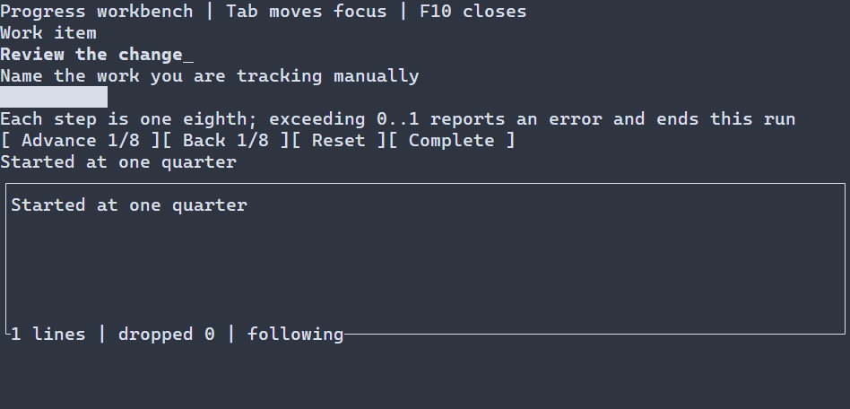

# Индикаторы Gauge {#gauge-guide-ru}

[English version](../gauge.md) · [Компактные примитивы](compact-primitives.md) · [Индикатор ожидания](loading-indicators.md)

`ui::gauge` показывает известное числовое значение в конечном диапазоне. Он показывает определённый прогресс и сам не планирует обновления; для работы без известной доли используйте spinner. Gauge отображает значение, например ход передачи; для изменения значения пользователем, например громкости, используйте [Slider](sliders.md).

## Полное приложение

Progress workbench — более широкое нативное приложение: оно начинает с четверти, изменяет значение восьмыми долями и записывает успешные действия. Tab переводит фокус между элементами; кнопки активируются Enter, Space или нажатием левой кнопки мыши. Выход за диапазон сообщает об ошибке и завершает этот запуск; F10 завершает программу. `runApp` сообщает об ошибках и восстанавливает терминал.



\include progress_workbench/main.cpp

Соберите `portals_progress_workbench` с `PORTALS_BUILD_EXAMPLES=ON` и запустите в терминале. См. [сборку](getting-started.md) и [пакет](package.md).

## Значение и настройки

`ui::gauge(progress, .25)` публикует наблюдающий `ui::Ref<Gauge>` после монтирования. Значением владеет индикатор. Между кадрами на UI-потоке `progress.value(.5)` заменяет его, а `progress.adjust(.125)` прибавляет величину; обе операции возвращают `std::expected<void, ManagedError>`. Неуспешное изменение или выход за диапазон сохраняет прежнее значение, равное значение не запрашивает перерисовку. Верните результат из обработчика, чтобы передать ошибку один раз, как в примере. Недоступный Gauge допускает программные записи. Это отображающий элемент без таймера, собственного действия клавиатуры или мыши и автоматической подписки на модель. Сцена владеет им; Ref не продлевает его жизнь.

`GaugeOptions` содержит включительные `double minimum = 0`, `maximum = 1`, `std::int32_t preferredWidth = 10`, `PrimitiveGlyphs::UNICODE` и `std::size_t maxPaintCells = 16384`. Собственная высота — одна ячейка. Границы и значение должны быть конечными, minimum строго меньше maximum с конечной разностью, значение — внутри включительного диапазона. Предпочтительная ширина неотрицательна, лимит положителен; ошибка настроек возвращает `INVALID_ARGUMENT`. Заполняется `floor(width × fraction)` целых столбцов по всей выделенной высоте. Если Unicode-символ занимает не одну ячейку, используется ASCII `#`; ASCII можно выбрать явно. Превышение лимита выделенной площади возвращает `WOULD_BLOCK`, в том числе при частичном обрезании.

Загружаемые сцены поддерживают `Gauge` и типизированный `scene.get<Gauge>(...)`; команды Ref остаются теми же. Ресурс может задать значение и границы, например `Gauge#progress { minimum=0 maximum=1 value=.25 }`. См. [ресурсы сцен](scene-loading-guide.md) и [ошибки и время жизни команд](compact-primitives.md#gauge-ref-commands-ru).

## Настройка оформления {#gauge-styling-reference-ru}

Естественный селектор — `Gauge`; рисуются только normal и disabled. Focused и selected не создают отдельных частей индикатора. `foreground` и `background` принимают `#RRGGBB`, `bold`, `italic`, `underline` — `true` или `false`. Общий разрешённый стиль рисует фон и символы заполнения. Отдельных цветов дорожки и заполнения или произвольной строки заполнения в PSS нет: Unicode/ASCII выбирается через `GaugeOptions`. Ручной `ControlStyle` — основа под темой и PSS приложения; неуказанные атрибуты сохраняют нижние значения.

```pss
Gauge { foreground: #62b4d7; background: #182028; width: 24; }
Gauge:disabled { foreground: #7d828c; }
```

Runtime PSS `width`/`height` принимает неотрицательные ячейки, `auto`, `fit-content` или `flex(положительный вес)`; `min-width`, `max-width`, `min-height`, `max-height` — неотрицательные границы. Селектор размера не содержит состояние или `:read-only`; конфликт границ отклоняет обновление. Из этих свойств compile-time PSS поддерживает `min-width`. См. [стили примитивов](compact-primitives.md#primitives-styling-reference-ru), [компоновку](layout.md) и [каскад](styling-guide.md).

Точные сигнатуры: `portals::Gauge`, `GaugeOptions`, `ui::gauge`, `ui::Ref<Gauge>`.
