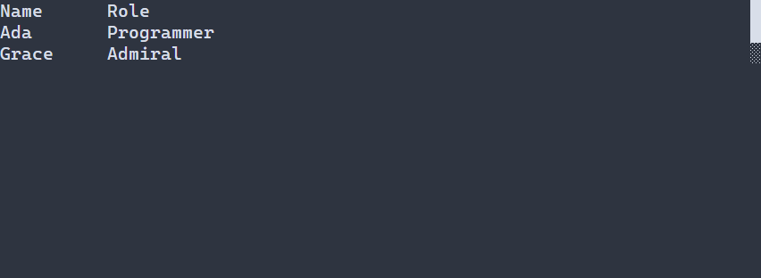

# Разместить элементы в сетке {#grid-ru}

[Английская версия](../grid.md)

Используйте [Grid](../../include/portals/grid.hpp), когда элементам нужны общие столбцы или независимые строки. `ui::grid` назначает ячейки в порядке добавления детей. Добавьте `.columns(2)`, чтобы создать два столбца, а `.columnGap(2)` оставит между ними две экранные ячейки. Полная программа ниже выводит подпись и значение рядом. Нажмите F10, чтобы закрыть приложение.

\include guide_grid.cpp

[Исходник примера](../examples/guide_grid.cpp). Добавьте его в проект на C++23 и свяжите с целью `portals::core` ([инструкция сборки](getting-started.md)).

Декларативная сетка автоматически назначает ячейки по мере добавления детей. Если элементу нужна точная позиция, задайте одновременно `.row(...)` и `.column(...)`; `.rowSpan(...)` и `.columnSpan(...)` занимают несколько ячеек. Явное и автоматическое размещение можно сочетать. Сетка проверяет размещение до создания элементов; перекрывающиеся диапазоны запрещены. Скрытые элементы также резервируют назначенные им ячейки.



Закреплённый заголовок и прокручиваемые строки сетки.

## Заголовок, содержимое и прокрутка

Используйте `ui::header(...)` и `ui::body(...)`, чтобы объявить структурные области. Они не создают дополнительные контейнеры: их дети остаются непосредственными детьми сетки. Области используют общие столбцы и их размеры, но нумерация строк и политики строк у каждой области свои. При использовании областей помещайте в них все элементы сетки.

Вызов `.sticky()` для заголовка закрепляет его сверху при прокрутке сетки. Включите владельца прокрутки вызовом `.scroll()` и при необходимости задайте фиксированный внешний размер через `.height(...)` или `.width(...)`. В следующей программе вся сетка занимает три строки терминала; заголовок и элементы прокрутки используют часть этой высоты. Для прокрутки содержимого наведите указатель на сетку и используйте колесо мыши. F10 закрывает приложение.

\include guide_grid_regions.cpp

[Полный пример с областями](../examples/guide_grid_regions.cpp). Фиксированная высота ограничивает видимую область прокрутки, но не виртуализирует строки. Все дети сетки создаются как элементы управления, в том числе за пределами текущей видимой области.

## Размеры дорожек и оформление

Используйте `.columnSizes(...)`, чтобы задать политики для всех общих столбцов после разрешения размещения. `.rowSizes(...)` задаёт размеры строк содержимого; для строк заголовка сохраняются отдельные автоматически выведенные политики. Длина каждого списка политик должна совпадать с количеством соответствующих дорожек. В режиме `COLUMN_MAJOR` вызов `.rows(...)` задаёт число строк содержимого, а `.rowSizes(...)` только задаёт размеры и не меняет это число.

В C++ можно задать фоны заголовка, содержимого и чётных/нечётных строк содержимого с помощью `GridPresentation`, например через `.presentation(...)`. Фон рисуется под элементами управления и не становится их стилем. Элементы с непрозрачным фоном могут его закрыть. Формат ресурсов сцены поддерживает структурные области `header` и `body` и свойства их размещения, но пока не позволяет задавать значения `CellStyle` из `GridPresentation`.

## Ресурсы сцены

Загруженные сетки используют те же правила проверяемого автоматического размещения и областей. Во фрагменте показаны поддерживаемые свойства `Grid` и структура секций:

```text
Grid#grid { columns=2
  header { sticky=true Label#heading { text="Heading" columnSpan=2 } Label#sub { text="Sub" } }
  body { Label#first { text="a" } Label#second { text="b" row=0 column=1 } }
}
```

Секции `header` и `body` задают структуру; их содержимое — обычные элементы управления. Свойства ресурса не предоставляют API `GridPresentation`/`CellStyle` из C++.

## Явная низкоуровневая конфигурация

`GridOptions` остаётся доступным, когда нужно точно задать каждое размещение. В нём хранятся непустые политики `columns` и `rows`, а также элементы `GridCell`, связанные с полными `NodeId`. Вызывайте `setGridOptions` после создания узлов и до следующей компоновки. Этот режим не выводит дорожки или размещения автоматически и по-прежнему разрешает перекрытие ячеек в порядке соседей. Декларативный API `ui::grid` добавляет более короткий способ описания сетки, сохраняя прежний контракт. Если все дети должны занимать одну область, используйте `Overlay`.

По умолчанию декларативная сетка ограничивает каждую ось 4096 дорожками, число структурных детей — 4096, а работу по размещению — 65536 единицами. Лимиты можно изменить через `.gridOptions(DeclarativeGridOptions{...})`. В C++ `GridPresentation` задаёт отдельный положительный бюджет `maxPaintCells` для фонов и элементов прокрутки; по умолчанию он равен 16384. Неверные параметры дорожек или размещения возвращают `INVALID_ARGUMENT`, исчерпание лимита размещения — `NODE_LIMIT`, переполнение координат — `INVALID_GEOMETRY`, нехватка памяти — `NO_MEMORY`. Превышение `maxPaintCells` возвращает `WOULD_BLOCK` до отправки команд рисования.

См. также [линейные контейнеры](layout.md), [геометрию](geometry.md) и [контракт владения кадром](widget-tree.md).


## Настройка оформления {#grid-styling-reference-ru}

Ячейки Grid содержат реальные дочерние контролы; их стили текста независимы
от оформления сетки. Обычная сетка не рисует собственный фон. При включённых
областях header/body значения `GridPresentation::header`, `body`, `rows.even`,
`rows.odd` задают заливку, включая промежутки. По умолчанию все отсутствуют.
Это C++-настройки оформления, а не строки PSS `:header`/`:selected`; они не
наследуются подписями и кнопками. Бюджет заливки по умолчанию — 16384 ячейки.

`width`, `height`, `min-width`, `max-width`, `min-height`, `max-height` задают
внешний размер по [общим правилам](layout.md). Адресуйте известный ID, например
`.id("grid")`. Колонки, строки, промежутки, padding, spans и sticky header —
настройки сетки, а не дополнительные свойства PSS. Промежутки/padding по умолчанию нулевые.

```pss
#grid { width: flex(1); min-width: 20; }
Label { foreground: #dce1e8; }
```

Прокручиваемая сетка рисует полосу с вариантами normal/focused/disabled и
[полным набором свойств скроллбара](scroll-controls.md#scrollbar-styling-reference-ru).
`Overlay` размещает потомков, но не рисует собственную поверхность и не задаёт
особый набор символов; оформляйте рисующие дочерние контролы. У диалогового
overlay host есть [своя композиция](dialogs.md).
