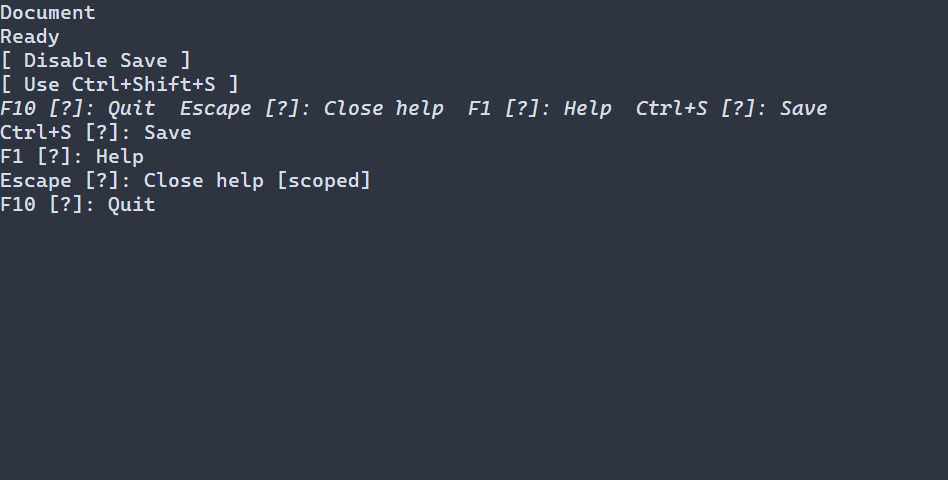

# Подсказки клавиш и справка {#key-help-ru}

[Английская версия](../key-help.md)

KeyHints показывает краткие подсказки сочетаний, HelpView — более полную справку о зарегистрированных командах. Приложение задаёт сочетания и открывает или закрывает справку через ссылку; клавиши показаны в примере ниже. См. [настройки KeyHints](../../include/portals/key_hints.hpp) и [настройки HelpView](../../include/portals/help_view.hpp).



## Настройка оформления {#key-help-styling-reference-ru}

`KeyHints` рисует обычный стиль, `:focused` или `:disabled` (отключение имеет приоритет). У содержимого полной справки собственная цель `HelpView.help-body`; оно рисуется обычным стилем, и стиль внешней оболочки на него автоматически не действует. `ControlStyle` задаёт ручные значения по умолчанию под каскадом.

Доступны `foreground`, `background` (`#RRGGBB`), `bold`, `italic`, `underline` (`true` или `false`). Правило без состояния охватывает все варианты. См. [каскад и ограничения размеров](styling-guide.md); `min-width` задаётся без состояния.

Следующие значения оформления задаются в конфигурации, а не в PSS; строки
хранятся с владением. `KeyHintsOptions::format` и `HelpViewOptions::format`
используют `KeyFormatOptions`. Фон и текстовый стиль внешнего HelpView
не наследуются его телом.

| Настройка | Значение по умолчанию |
|---|---|
| `KeyHintsOptions::entrySeparator` | Два пробела |
| `overflowMarker`, `emptyText`, `unavailableText` | `+`, пусто, `?` |
| `HelpViewOptions::emptyText`, `unavailableText` | `No key bindings`, `Help unavailable` |
| `KeyFormatOptions::strokeSeparator`, `alternativeSeparator` | ` then `, ` / ` |
| `repeatMarker`, `releaseMarker`, `unknownMarker` | ` [repeat]`, ` [release]`, ` [?]` |
| `maxBytesPerBinding` | 8192 байта на целую форматированную строку |

```pss
HelpView.help-body { foreground: #d0d8e0; }
```

Имя команды задаётся там же, где регистрируется её сочетание клавиш. `KeyHints`
и `HelpView` читают эти же регистрации: изменение сочетания или доступности
команды не требует вручную обновлять отдельный список подсказок.

## Полное приложение

\include guide_key_help.cpp

Пример подключает `portals::core`; см. [описание пакета](package.md). [Отдельный проект примеров](examples.md)
собирает `guide_key_help`. Приложение работает в обычном терминале, без режима воспроизведения тестов.
Команда «Save» меняет текст состояния, но не сохраняет файл.

F1 открывает справку, Escape закрывает её в активной области фокуса, F10 завершает
приложение через штатное средство запуска (runner). Эти клавиши явно назначены приложением: сами контролы не добавляют скрытые команды открытия, закрытия или выхода. Кнопки
отключают команду «Save» либо меняют её сочетание. Оба изменения отображаются в подсказках и полной справке.

Тело справки зарегистрировано для вычисления стилей как `HelpView.help-body`.
Переданный `ControlStyle` задаёт ручные значения по умолчанию; правила темы и
приложения имеют приоритет. Если вычисленный стиль недоступен, используется
заданный вручную обычный вариант. Стиль внешнего контейнера `HelpView` автоматически
не применяется к телу. `KeyHints` сначала выбирает оформление отключённого контрола,
если сам контрол или его предок отключён; в остальных случаях выбирается оформление
для фокуса или обычное.

Обработчики в примере возвращают проверяемый результат вызовов `help.open()`,
`help.close()` и команд изменения привязки клавиш. Ошибки передаются существующему
механизму обработки ошибок. Эти команды возвращают `std::expected`, а не объект-
прокси присваивания текстовому свойству, который автоматически собирает ошибки.
Вне обработчика результат нужно проверять явно.
## Сведения о командах и изменениях

В ресурсе `CONFIGURATION` для `HelpView` и `KeyHints` доступны локальные встроенные фабрики. `KeyHints{help="guide"}` ссылается на HelpView с ID `guide` в том же ресурсе; без `help` требуется ровно один экземпляр с возможностями HelpView. Регистрации клавиш остаются в C++. См. [описание привязки ресурса](declarative-reference.md).

`ui::keyInfo(label)` добавляет владеющее имя к обычной регистрации `ui::onKey`.
Необязательная `.description(text)` задаёт пояснение для полной справки.
`.owner(reference)` связывает доступность команды с контролом и его предками;
`.scope(reference)` ограничивает её существующей областью фокуса. Дополнительного
приоритета эти модификаторы не создают: побеждает последняя подходящая доступная
регистрация. Более глубокая область сама по себе не перекрывает более новую
глобальную регистрацию.

`.reference(binding)` нужен, если потребуется менять эту команду.
`ui::KeyBindingRef` наблюдает за командой, принадлежащей сцене; уничтожение
наблюдателя не снимает регистрацию. Операции с проверкой результата: `setEnabled`, `setVisible`,
`setText`, `rebind`, `unbind` и `remove`. Отвязка сочетания сохраняет идентификатор и пояснение; удаление прекращает
регистрацию. Созданный идентификатор действует только внутри сцены
и не подходит как ключ сохранённой пользовательской настройки.

Неопубликованный или закрытый наблюдатель возвращает типизированную ошибку. Операции выполняются в потоке интерфейса. Удалённый контрол не восстанавливается через повторное
использование его слота. Имя и пояснение принимают владеющие выражения `TextValue`.
Для ресурсов функцию разрешения текста `resolver` можно передать явно: `ui::keyInfo(expression, resolver)`.
Функция разрешения текста вызывается при проверке и подготовке метаданных, а не
при каждой отрисовке.
Снимок для чтения не удерживает функцию разрешения текста или обработчик команды.

## Два способа показа команд

`ui::keyHints(help)` занимает одну строку и показывает именованные доступные
команды, размещая только целые записи. Действие переполнения открывает указанную
справку через существующую маршрутизацию и фокус. Если все записи помещаются
или строка пуста, невидимой дополнительной остановки Tab не появляется.

`ui::helpView(help)` изначально скрыт и содержит обычный `ScrollArea`. Это
немодальная панель: фон остаётся доступен, Tab не запирается внутри. Открытие
входит в существующую область фокуса, закрытие использует штатный стек возврата.
Скрытие, отключение или удаление завершают эту активацию. Повторное открытие
создаёт новую; старое подтверждение активации не может закрыть её.

Полная справка объясняет недоступность команд и условные пересечения сочетаний.
Наличие конфликта не определяет победителя во всех возможных контекстах фокуса.
Старые регистрации без метаданных продолжают работать и доступны для просмотра;
для кратких подсказок требуется явное имя команды.

Отключённая команда остаётся в полной справке как недоступная и исчезает из
кратких подсказок. Если скрыть команду через `setVisible(false)`, она перестаёт обрабатываться
и исчезает из представлений. Скрытые или отключённые владельцы и предки не допускают
команду. Изменение одного пояснения сохраняет ожидающую последовательность
клавиш; смена сочетания или доступности отменяет прежний ожидающий снимок.

## Поддержка терминала, ошибки и ограничения

Поддержка фаз задаётся явно через `KeyCapabilities`. При значении `UNKNOWN` команды
продолжают обрабатываться и помечаются ` [?]`; это не гарантирует поддержку
событий отпускания и повтора клавиши или различение левых и правых модификаторов. `UNSUPPORTED` исключает затронутые
именованные команды. Эти метаданные не согласовывают протокол с терминалом.

По умолчанию используются ASCII-имена клавиш, ` then ` между клавишами последовательности, ` / ` между альтернативами и
отдельные пометки повтора и отпускания клавиш.
Строки настраиваются через `KeyFormatOptions`, `KeyHintsOptions` и
`HelpViewOptions`. Обрезка соблюдает границы графем. Лимит отформатированной
записи — 8192 байта. Настройки сцены по умолчанию ограничивают имя 512 байтами,
описание — 2048 байтами, суммарную логическую полезную нагрузку представления —
1 МиБ. Существующие ограничения числа регистраций и сочетаний сохраняются.

При регистрации и изменении сначала подготавливаются данные, затем публикуется
результат. Недопустимый или превышающий лимит кандидат сохраняет прежнюю
регистрацию и маршрутизацию. Если новое представление не подготовилось, видимый
контрол показывает маркер недоступности, а не выдаёт прежний снимок за актуальный.
Ошибка проходит через существующую диагностику. Неизменившийся неудачный вход
не пересчитывается каждый кадр; последующее изменение или явная инвалидация
позволяют повторить подготовку. Сбой представления не отменяет независимо
опубликованное изменение команды.

Скрытые представления не форматируют строки. Статические подсказки и справка
не опрашивают состояние, не добавляют второй таймер и не вызывают постоянную
перерисовку. Основные контракты описаны в разделах [ввод](input.md),
[фокус](focus.md) и [управляемые контролы](managed-controls.md).
