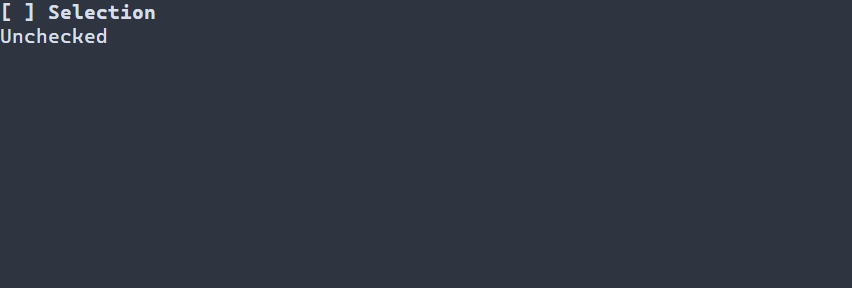

# Надписи {#label-guide-ru}

[English version](../label.md) · [Базовые элементы](controls.md) · [Текст и состояние](declarative-ui.md)

Используйте `ui::label` для однострочной подписи или меняющегося статуса. Надпись показывает текст и не активируется; для действия нужна [кнопка](button.md), для ввода — [редактор строки](line-edit.md).

## Полное приложение

Этот более общий пример флажка обновляет `Label` с именем `status` после изменения пользователем. Space или Enter меняет флажок; F10 или Ctrl+C завершает программу. Стандартный запуск сообщает об ошибках и восстанавливает терминал.



\include guide_check_change.cpp

Соберите `portals_docs_check_change` с `PORTALS_BUILD_TESTS=ON` и запустите полученный исполняемый файл в терминале. См. [сборку](getting-started.md) и [установленный пакет](package.md).

## Текст, ссылки и ресурсы

`ui::label("Ready")` копирует подпись; `ui::label(status, "Ready")` публикует наблюдающий `ui::Ref<Label>` после успешного монтирования. Присваивание `status.text() = "Saved"` между кадрами меняет текст через диагностику сцены. Надпись также может наблюдать управляемое строковое состояние или источник текста; операции описаны в [справке по тексту](text.md). Виджетом владеет сцена; Ref не продлевает его жизнь. Надпись по умолчанию не получает фокус и не имеет собственного действия клавиатуры или мыши.

Ресурс сцены поддерживает `Label#status { "Ready" }`; `scene.get<Label>("status")` наблюдает загруженный элемент. Форматы и разрешение текста описаны в [ресурсах сцен](scene-loading-guide.md).

## Настройка оформления {#label-styling-reference-ru}

Естественный селектор — `Label`. Он рисует normal, focused и disabled, причём disabled имеет приоритет; обычно надпись не получает фокус. Selected, header и caret не рисуются. Подпись и выделенный фон используют один стиль; отдельных свойств символов PSS нет.

| Свойство | Значения и действие |
|---|---|
| `foreground`, `background` | `#RRGGBB`; цвет текста и заливки |
| `bold`, `italic`, `underline` | `true` или `false`; явное false переопределяет нижний слой |
| `width`, `height` | Неотрицательное число ячеек, `auto`, `fit-content`, `flex(положительный вес)` в runtime PSS |
| `min-width`, `max-width`, `min-height`, `max-height` | Неотрицательные границы в ячейках; в compile-time PSS поддерживается только `min-width` |

Правила размера не зависят от состояния или `:read-only`; конфликт ограничений отклоняет обновление, сохраняя последние корректные стиль и геометрию. См. [компоновку](layout.md). Ручной `ControlStyle` использует цвета терминала, обычный текст, жирный шрифт при фокусе и курсив для недоступного элемента. Тема и PSS переопределяют отдельные поля; остальные сохраняют значения нижнего слоя. См. [каскад](styling-guide.md).

```pss
Label#status { foreground: #dce1e8; min-width: 12; }
Label#status:disabled { italic: true; }
```

Сигнатуры: `portals::Label`, `portals::ControlStyle`, `portals::ui::label`, `portals::ui::Ref`; общие правила — в [базовых элементах](controls.md#basic-controls-styling-reference-ru).
