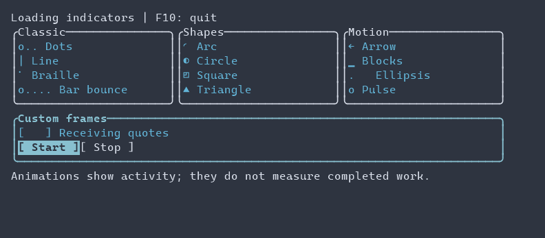

# Анимированный индикатор загрузки {#loading-indicators-ru}

[English version](../loading-indicators.md)

Spinner подходит для работы без известного процента завершения. По умолчанию активны `DOTS`, интервал 100 мс, прямое направление, выравнивание по началу и пустая подпись; reduced motion выключен. Через ссылку можно запустить, остановить индикатор или изменить подпись; сам он пользовательский ввод не принимает. См. [настройки и API Spinner](../../include/portals/spinner.hpp).




[Статичный кадр](../images/loading-indicator-presets.png).

В трёх подписанных рамках видны все встроенные пресеты. Start и Stop управляют собственной последовательностью ниже. Индикатор показывает, что работа продолжается; при известном объёме выполненного используйте Gauge.

## Настройка оформления {#loading-indicators-styling-reference-ru}

`Spinner` использует обычный стиль для активной анимации и подписи. Неактивные, недопущенные или статичные при reduced motion кадры используют `:disabled`; подпись сохраняет обычное оформление. `ControlStyle` задаёт ручные значения по умолчанию под каскадом. Доступны `foreground`, `background` (`#RRGGBB`), `bold`, `italic`, `underline` (`true` или `false`); правило без состояния применяется ко всем вариантам. См. [каскад и ограничения размеров](styling-guide.md): `min-width` задаётся без состояния.

Кадры, направление, выравнивание и время задаются настройками индикатора, а не частями PSS; отдельных цветов хвостовых сегментов нет. Готовые и пользовательские кадры описаны ниже.

| Настройка `SpinnerOptions`, не PSS | Значение по умолчанию / варианты |
|---|---|
| `preset`, `frames` | `DOTS`, пустой источник; пресеты ниже, непустые кадры с разделителем LF заменяют пресет |
| `interval`, `direction` | 100 мс, `FORWARD`; доступен `REVERSE` |
| `alignment` | `START`; `CENTER` и `END` размещают индикатор и подпись вместе |
| `active`, `reducedMotion`, `label` | true, false, пустой текст |
| `maxFrames`, `maxFrameBytes`, `maxFrameCells` | 64 кадра, 4096 байт исходника, 64 ячейки на кадр |
| `maxPaintCells` | 16384 выделенные ячейки |

```pss
Spinner:disabled { foreground: #808080; }
```

`ui::spinner()` подходит для работы, у которой пока неизвестен процент выполнения.
Сцена владеет таймером и освобождает его. Полная программа сравнивает двенадцать пресетов и управляет собственной
последовательностью без хранения токена таймера:

[Полный исходник](../examples/guide_loading_indicators.cpp).

\include{lineno} guide_loading_indicators.cpp

Собери `portals_docs_loading_indicators` с включёнными тестами. Для галереи из трёх колонок нужен терминал не менее 72 столбцов и 12 строк.
Повторный Start уже активного индикатора ничего не меняет. Stop отменяет ожидающий tick; новый
Start сохраняет текущий кадр и ждёт один новый интервал. `Ref<Spinner>::start()`,
`stop()` и `label(...)` — проверяемые команды UI-потока. Ошибки попадают в обычный
коллектор сцены: простой обработчик кнопки может игнорировать возвращённый
`expected`, а при необходимости результат можно проверить немедленно.

## Последовательность кадров

| Набор | Краткое имя | Вид | Кадров |
|---|---|---|---|
| `DOTS` | `"dots"` | Движущаяся точка ASCII | 3 |
| `LINE` | `"line"` | Вращающаяся линия ASCII | 4 |
| `BRAILLE` | `"braille"` | Восемь позиций Брайля | 8 |
| `BAR_BOUNCE` | `"bar-bounce"` | Метка движется по пяти ячейкам и обратно | 8 |
| `ARC` | `"arc"` | Вращающийся угол | 4 |
| `CIRCLE` | `"circle"` | Вращающийся полукруг | 4 |
| `SQUARE` | `"square"` | Вращающаяся метка квадрата | 4 |
| `TRIANGLE` | `"triangle"` | Вращающийся треугольник | 4 |
| `ARROW` | `"arrow"` | Стрелка меняет направление | 4 |
| `BLOCKS` | `"blocks"` | Высота блока растёт и уменьшается | 6 |
| `ELLIPSIS` | `"ellipsis"` | Одна, две и три точки | 3 |
| `PULSE` | `"pulse"` | Символы ASCII меняют плотность | 4 |

Пресет задаётся через `ui::spinner("arc")`, `.preset("arc")` или
`.preset(SpinnerPreset::ARC)`. Имена нечувствительны к регистру ASCII; дефис
и подчёркивание равнозначны. Неизвестное имя даёт типизированную ошибку
конфигурации. Прежние формы со `SpinnerOptions` сохранены.

У рецепта есть `.preset(...)`, `.interval(150)`,
`.direction(SpinnerDirection::REVERSE)` и `.alignment(LayoutAlign::CENTER)`.
Одноимённые pipe-модификаторы задают те же значения. Интервал — положительное
число монотонных миллисекунд; по умолчанию 100. Горизонтальное выравнивание:
START, CENTER или END. Ширина, высота и отсечение используют обычные ячейки терминала.

Собственный список кадров: `.frames({"[   ]", "[=  ]", "[== ]", "[===]"}).interval(120)`.
Рецепт копирует все кадры до возврата из вызова. Пустой список возвращает
пресет; пустой элемент или перевод строки внутри элемента недопустим.
Строковая форма с разделителем LF также сохранена.

Собственный однострочный набор: `.frames("[  ]\n[= ]\n[==]")`.
LF разделяет целые кадры. Пустые кадры, CR, управляющие символы терминала и кадры
нулевой ширины не допускаются. Исходник должен соответствовать действующей
политике ширины. Для встроенных Unicode-пресетов выбирается вся четырёхкадровая последовательность
ASCII LINE, если хотя бы один символ не занимает одну ячейку при действующей
политике ширины. Собственные кадры проверяются без подмены. Это не определение
установленного шрифта. BRAILLE теперь использует восемь видимых позиций без
пустого кадра вместо прежнего четырёхкадрового цикла. Непустая собственная последовательность заменяет preset.

Настраиваемые ограничения по умолчанию: 64 кадра, 4096 байтов всего UTF-8
исходника, 64 ячейки на кадр и 16384 выделенные ячейки отрисовки. Методы:
`.maxFrames(...)`, `.maxFrameBytes(...)`, `.maxFrameCells(...)`,
`.maxPaintCells(...)`. Недопустимые настройки дают типизированную ошибку подготовки.

## Подпись, стили и ресурсы

[Полная программа с ресурсом](../examples/guide_loading_resource.cpp) объявляет Spinner в конфигурации и привязывает кнопки в C++. Соберите `portals_docs_loading_resource` с включёнными тестами и запустите программу в терминале.

\include guide_loading_resource.cpp

`.label(...)` принимает владеющее литеральное, форматированное или локализованное
значение `TextValue`. Подпись идёт после анимации через один пробел и участвует
в собственной ширине. Pipe-вариант — `ui::spinnerLabel(...)`; `ui::label(...)`
по-прежнему создаёт обычный Label. Runtime-команда `loading.label(...)` подготавливает
проверяемую замену: сбрасывает кадр в ноль и заново запускает интервал. Локализация
использует явно переданный resolver, как другие команды текстовых ссылок.
Автоматической подписки на смену языка или модель здесь нет.

Стилевой тип по умолчанию — `Spinner`. Обычные foreground/background, bold,
italic и underline используют действующие таблицы стилей и слои темы. Ручной
`ControlStyle` задаёт активное и приглушённое оформление; неактивный режим и
reduced motion используют disabled-вариант. Раздельные цвета следа и многострочные
формы анимации этим API не предоставляются.

В конфигурационном ресурсе доступны те же настройки:

```text
scene {
  Spinner#loading { preset=arc label="Loading quotes" interval=100 width=30 }
}
```

Канонические листья: `preset`, `frames`, `interval`, `direction`, `alignment`,
`active`, `reducedMotion`, `label`, `maxFrames`, `maxFrameBytes`, `maxFrameCells`
и `maxPaintCells`. Они сочетаются с общими свойствами размеров, рамки, идентичности
и стиля. Подпись может использовать существующий ресурсный resolver `i18n(...)`.

## Время жизни анимации

Managed-индикатор использует существующий scheduler и монотонные часы. У него
не более одного ожидающего таймера. Скрытые, полностью отсечённые, отключённые,
неактивные и удалённые индикаторы не запрашивают постоянную перерисовку.
Компоновка и обычные изменения возобновляют подходящую анимацию; опроса видимости
нет. Пропущенные ticks не воспроизводятся. `.reducedMotion(true)` показывает
нулевой кадр без таймера. Закрытие сцены отменяет её регистрации таймеров.

При low-level создании Spinner остаётся статическим retained-виджетом; анимацию
подключает managed-сцена. Прежние ограничения сессии сохраняются: ManagedScene
уничтожают вне callbacks и tree frames, а reader часов должен быть неблокирующим
и нерекурсивным. Удаление контрола из разрешённого обработчика не требует
уничтожения сцены. См. [managed lifecycle](managed-controls.md).
