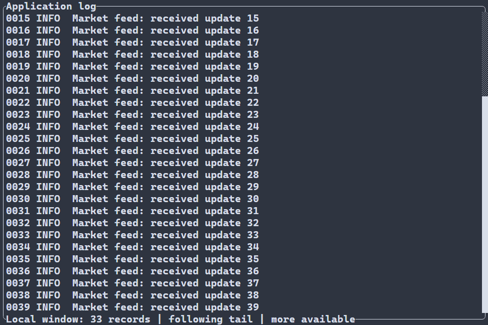
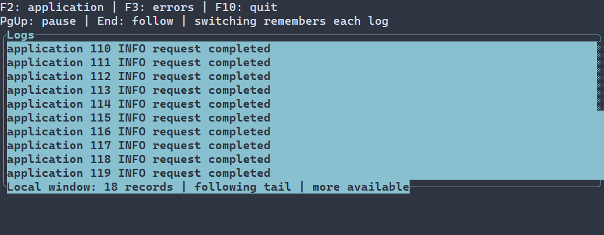
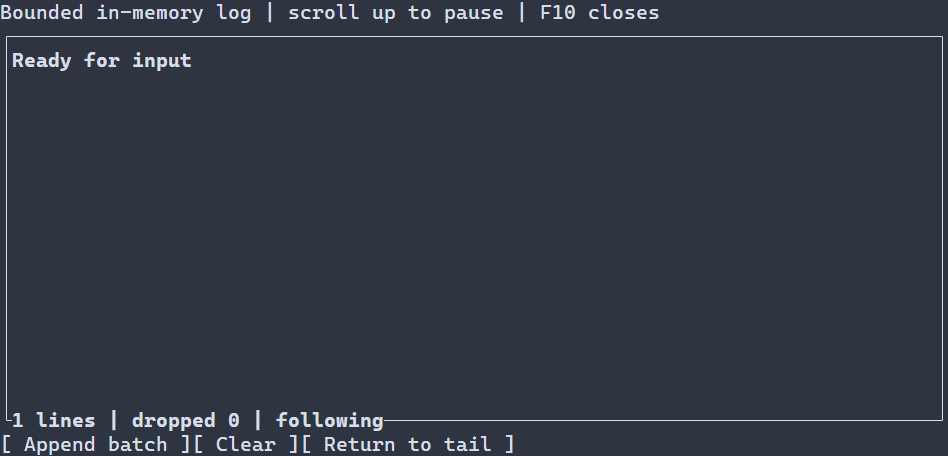

# LogView {#log-view-ru}

[English version](../log-view.md) · [Контролы прокрутки](scroll-controls.md) · [Примеры контролов](control-examples.md)

LogView показывает последние записи в памяти или ограниченное окно внешней модели. `ui::logView("Ready")` владеет журналом с вытеснением старых записей; `ui::logView(ui::logFile("application.log"))` читает обычный UTF-8-файл через фоновый исполнитель приложения. В обоих случаях следование за концом включено по умолчанию. Размер файла не определяет объём хранимого текста. См. [настройки и API LogView](../../include/portals/log_view.hpp).

## Журнал из файла {#log-view-file-ru}



При записи локальный генератор добавляет в файл тестовые записи.

Поместите UTF-8-файл `application.log` в рабочий каталог, соберите
`portals_file_log_example` с `PORTALS_BUILD_EXAMPLES=ON` и запустите в терминале.
Журнал открывается у доступного конца и подхватывает новые записи. PageUp/PageDown,
колесо и полоса прокрутки приостанавливают следование, чтобы можно было читать
предыдущие записи. Return to tail возобновляет следование; F10 или Ctrl+C завершает
приложение.

[Полный исходник](../../examples/file_log/main.cpp)

\include file_log/main.cpp

Сцена владеет контролом и отменяет его работу при удалении узла. Открытие файла,
чтение, проверка UTF-8, разбор графем и перенос выполняются через существующий
фоновый исполнитель. Поток UI устанавливает неизменяемое подготовленное окно.
Создание `ui::logFile(...)` не обращается к файлу; ошибки подготовки и фоновой
работы попадают в типизированную диагностику runner, включая файловую операцию
и системный код ошибки.

Внешнее представление по умолчанию хранит не более 512 логических записей, 1 МиБ
их текста и 64 КиБ на запись в пределах общего бюджета источника и подготовки
8 МиБ. Это ограничения кеша, а не размера файла или общего числа записей.
Файловая модель использует блоки чтения по 16 КиБ и предел записи 32 КиБ;
`FileLogOptions` позволяет увеличить последний до 64 КиБ. Слишком длинная запись
даёт типизированную ошибку без молчаливого обрезания. Для одной огромной записи
нужна другая модель с сегментированным текстом.

Для расширенного API `log.fileModel()` подключите `<portals/log_file.hpp>`.
`metadata()` возвращает размер в байтах и поколение; `readBytes()` читает в буфер
вызывающего кода; `findLiteral()` ищет по байтам файла ограниченными шагами
с явным продолжением. Эти методы вызывают в фоновом потоке, а не в блокирующем
обработчике UI. Представление не выдаёт байтовый размер за число строк и не
строит полный индекс файла. `seekLogByte(tree, node, offset)` принимает позицию
начала записи в байтах; `seekLogRow(tree, node, ordinal)` работает с конечной
моделью с известным числом логических записей. Единицы этих переходов различаются.

Для конечных слепков есть отдельно подключаемый адаптер
`<portals/ui_log_source_model.hpp>` с преобразованием записи в текст в фоне.
Исходная модель остаётся доступна для остальных операций; адаптер добавляет
доставку данных для чтения. Курсорный источник можно подключить через
`ui::logSource(...)` как `WindowProvider<LogLine>` без объявления общего числа строк.

Поддерживаются обычные локальные файлы с позиционным чтением. Замена файла
и замеченное усечение начинают новое поколение; старые pins остаются
неизменяемыми. Параллельное изменение не создаёт слепок файловой системы:
усечение и повторное заполнение целиком между наблюдениями может выглядеть
как рост. Отмена проверяется между чтениями; системный вызов на сетевой файловой
системе всё ещё может блокироваться. Выделение, буфер обмена, панель поиска
и постоянное хранилище этот контрол не предоставляет.

## Переключение моделей {#log-view-switching-models-ru}



На записи чтение application.log приостановлено на записи 092. После перехода к errors.log и фонового добавления записей возврат открывает прежнее место application.log. End переходит к новому концу. Оба файла и добавление записей обеспечивает локальная обвязка записи демонстрации.

Сохраните `ui::Ref<LogView>` и вызывайте `log.model(source)` из обработчика UI,
чтобы заменить источник существующего представления. Файл — лишь один из
видов источников; он не обязателен для `LogView`.

Создайте UTF-8-файлы `application.log` и `errors.log` в рабочем каталоге.
F2 и F3 переключают их без пересоздания контрола:

[Полная программа переключения](../examples/guide_log_models.cpp)

\include guide_log_models.cpp

Тот же вызов принимает `ui::logSource(provider)` для пригодного к работе
в фоне `WindowProvider<LogLine>`. Для существующего неизменяемого слепка конечной
модели подключите `<portals/ui_log_source_model.hpp>`: `ui::logSource(snapshot)`
показывает строковые записи, `ui::logSource(snapshot, codec)` преобразует
предметные записи в текст в фоне. Исходная модель остаётся доступна для её
остальных операций. Смена привязки не превращает модель в файловую и не
требует точного общего количества строк.

Смена сохраняет идентичность контрола, Ref, фокус, геометрию и стили, освобождая
прежнее отображаемое окно. Источник с поддержкой закладок запоминает логическое
место чтения и режим следования. PageUp приостанавливает следование, End включает
его снова. Если переключиться на другой журнал и вернуться через сохранённый
дескриптор, приостановленное представление вернётся к своей записи даже после
добавления данных; следующее за концом — к доступному концу. Открытие файла и
разрешение закладки выполняются существующим фоновым исполнителем, а не обработчиком UI.

Кеш закладок принадлежит навигационной сессии представления: по умолчанию 256 КиБ
метаданных и не более 4096 байт на закладку. Он не удерживает страницы данных или
объекты моделей. По умолчанию представления перемещаются независимо. Чтобы новое
представление продолжило прежнюю сессию, передайте явный `LogNavigation`, полученный
через `ManagedScene::logNavigation()`, в `LogSourceViewConfig`. Бюджеты ограничивают
сохранённые метаданные, а не размер источника или общее количество записей. Проверяемый `reset(resource)` удаляет сохранённую закладку, не перемещая активное представление и не запрашивая перерисовку; обычная последующая подготовка или навигация может сохранить его текущее место снова.

Файловая закладка проверяет системную идентичность файла и ограниченный фрагмент
записи. Наблюдаемая ротация, усечение или несовместимая перезапись могут сделать
позицию недоступной; одного пути недостаточно для доказательства непрерывности.
Произвольные изменения между наблюдениями не всегда обнаружимы. Собственные
источники могут предоставить `LogBookmarkProvider`, не объявляя общее число строк.
Отсутствие такой возможности или потеря истории отражаются в `LogRestoreStatus`:
представление не выдумывает ближайшую запись и не включает следование молча.
Отменённые операции прежней привязки не могут подставить текст или сообщить
устаревшую ошибку в новую.

`log.model(source)` передаёт ошибку принятия команды в коллектор сцены.
Для явной проверки `std::expected` используйте `log.setModel(source)`.
Невалидный дескриптор сохраняет текущую привязку. Последующая ошибка чтения
относится уже к принятому источнику и следует обычной политике ошибок runner:
успешное принятие команды не обещает существования или доступности файла.
Журнал в памяти также можно привязать к внешнему источнику; прежние записи
не сохраняются как отменяемое переключение модели.

Переключайте модель из обычных обработчиков ввода. Как и остальные изменения
сцены, `setModel` возвращает `WOULD_BLOCK` во время уведомления `onError`:
этот обработчик наблюдает ошибку и не допускает повторного входа в изменение сцены.

## Журнал в памяти с вытеснением

Далее описаны добавление и хранение записей в памяти. По умолчанию сохраняются
512 записей и 256 КиБ, пакет ограничен 16 КиБ, запись — 4 КиБ. Для внешнего
источника действуют отдельные пределы выше; `append` и `clear` для такого
представления отклоняются.



## Настройка оформления {#log-view-styling-reference-ru}

`LogView` рисует текст, фон и нижнюю строку обычным стилем, `:focused` или `:disabled` (отключение имеет приоритет). Ручной `ControlStyle` задаёт значения по умолчанию под каскадом. Доступны `foreground`, `background` (`#RRGGBB`), `bold`, `italic`, `underline` (`true` или `false`). Правило без состояния действует на все варианты; `min-width` задаётся без состояния. См. [каскад и ограничения размеров](styling-guide.md).

У наследуемых рамки и полосы прокрутки есть отдельные цвета частей и настройки символов: см. [справку по полосе прокрутки](scroll-controls.md#scrollbar-styling-reference-ru) и [оформление рамки](controls.md#frame-title-decoration-ru). Незаданные атрибуты частей наследуют общий разрешённый стиль. Правая и нижняя стороны рамки должны оставаться включёнными для полосы и нижней строки.

```pss
LogView:focused { foreground: #d0e8f0; scrollbar-thumb-foreground: #62b4d7; }
```

`LogView` — ограниченный журнал простого текста, которым владеет сцена. Добавляйте
полные пакеты UTF-8: контрол разделит их на записи, сохранит самые новые записи
в заданных пределах, перенесёт строки по границам графем и нарисует только
подготовленные видимые строки. На каждую запись не создаётся отдельный дочерний
виджет. Высота по умолчанию гибкая, поэтому контрол использует доступное
вертикальное пространство; явная политика размера может её изменить. Контрол не
выполняет ввод-вывод в терминал или файлы и не запускает фоновую работу.

При неизменной ширине добавление использует уже вычисленные переносы старых
записей и рассчитывает переносы только для новых сохранённых записей. Ограниченный
массив описателей строк всё ещё копируется: стоимость всего append не становится
независимой от числа сохранённых строк. При смене ширины переносы перестраиваются.
Скрытый виджет сохраняет данные, а append не превращается в фоновую операцию.
Дорогую загрузку и обработку данных следует выполнять через подходящий provider,
оставляя на UI короткое применение результата.

## Обычная программа на C++

Соберите пример `portals_log_view_example` с параметром
`PORTALS_BUILD_EXAMPLES=ON` и запустите его в терминале. В начале журнал содержит
`Ready`. Каждое нажатие Append batch добавляет один нумерованный пакет из трёх
записей; длинная запись с Unicode переносится при уменьшении ширины терминала.
Пример хранит не более 12 записей. Clear удаляет текущие записи, а Return to tail
возобновляет следование. Прокрутка вверх также приостанавливает следование, пока
новые записи сохраняются и учитываются. F10 завершает работу через стандартный
runner.

[Полный исходник](../../examples/log_view/main.cpp)

\include log_view/main.cpp

Пример хранит демонстрационные сообщения в памяти. Он не читает и не записывает
файлы и не обещает сохранить вывод после завершения процесса.

## Загрузка LogView из ресурса сцены {#log-view-resource-ru}

В тексте сцены можно объявить встроенный `LogView` по имени. C++ получает
типизированные ссылки и подключает обычные обработчики кнопок; в ресурсе нет
исполняемых callback и не нужна ручная регистрация контрола.

[Полная программа ресурса](../examples/guide_log_view_resource.cpp)

\include guide_log_view_resource.cpp

Параметры конфигурации: `text`, `maxLines`, `maxBytes`, `maxBatchBytes`,
`maxRecordBytes`, `followTail` и `readOnly`, а также общие настройки компоновки,
рамки и стиля. `text` по умолчанию пуст; значения четырёх лимитов приведены ниже,
`followTail` по умолчанию равен `true`, а `readOnly` — `false`. Ресурс задаёт
начальное содержимое и пределы. В примере исходный текст — одна запись, а кнопки
C++ добавляют пакет из двух записей, очищают журнал или возвращают вид к концу.

Вертикальная полоса прокрутки занимает правую сторону рамки, а статусная строка с
Return to tail — нижнюю. Обе стороны обязательны. Настройка рамки, заголовка и
стиля может менять оформление, но отключение любой требуемой стороны отклоняется
с типизированной `INVALID_ARGUMENT` при монтировании. В ресурсе оставляйте
`frame.sides.right` и `frame.sides.bottom` включёнными. Публичного метода смены
рамки и параметров после монтирования нет. Ресурсный пример показывает полную
загрузку сцены; отдельной регистрации контрола или хранилища он не добавляет.

## Пакеты, записи и пределы

Добавление — это один полный пакет, а не фрагмент потока. CRLF, CR и LF разделяют
записи; CRLF считается одним разделителем. Пустые записи между разделителями
сохраняются. Последний разделитель завершает предыдущую запись, но не добавляет
фиктивную пустую запись в конец. Пустой пакет ничего не меняет. Контрол не
склеивает неполную запись из нескольких добавлений.

| Предел | По умолчанию | Жёсткий максимум |
| --- | ---: | ---: |
| Сохраняемые записи (`maxLines`) | 512 | 8 192 |
| Сохраняемое содержимое UTF-8 (`maxBytes`) | 256 КиБ | 4 МиБ |
| Пакет ввода с разделителями (`maxBatchBytes`) | 16 КиБ | 256 КиБ |
| Одна запись без разделителя (`maxRecordBytes`) | 4 КиБ | 64 КиБ |

Все пределы должны быть положительными. `maxRecordBytes` не может превышать
`maxBytes` и `maxBatchBytes`. Настройка выше жёсткого максимума отклоняется, а не
молча ограничивается. `maxBytes` считает содержимое сохранённых записей без
разделителей строк, а предел пакета включает разделители. Пустые записи занимают
лимит `maxLines`, но не расходуют байтовый предел содержимого.

Пакет проверяется и подготавливается целиком до публикации. Некорректный UTF-8,
нарушение предела или ошибка выделения памяти отклоняют весь пакет и сохраняют
прежние записи и счётчики. При успешном добавлении остаются самые новые записи,
помещающиеся в оба предела хранения. Если предел числа записей вытеснил строки
того же пакета, они всё равно считаются принятыми входными и вытесненными
выходными данными. Вытеснение старых записей — штатная политика хранения, а не
ошибка частичного ввода.

Числовой индекс хранит диапазоны записей и байтов для каждой визуальной строки,
поэтому повторное перенесение всё равно сканирует сохранённый текст и его
графемы; эта работа не ограничена только видимой областью. Исходные записи
остаются в заданных пределах, а собственный кэш подготовленных `GraphemeText`
содержит только строки, пересекающие видимую область. Пределы ограничивают
записи, содержимое и размер индекса, но не дают точной гарантии RSS: память также
расходуют метаданные графем, объекты записей, кэш и временное старое/новое состояние.

## Перенос строк и позиция чтения

`LogView` переносит строки по текущей ширине текста, не разделяя графему. Если
одна графема шире области просмотра, она потребляется один раз и обрезается по
обычной политике терминального текста. Скрытая область или область нулевого
размера не рисует строки и сохраняет логическое следование или якорь чтения до
подготовки пригодной области.

По умолчанию включено следование за концом журнала. `followTail=false` начинает
просмотр с первой записи и строки в режиме паузы; в нижней строке доступна команда
Return to tail. Намеренная прокрутка вверх также приостанавливает следование;
достижение конца или команда Return to tail возобновляет его.
Изменение смещения через `ui::Ref<LogView>::setOffset(ScrollAxis::VERTICAL, ...)`
также считается намеренной навигацией.
Добавление во время паузы сохраняет якорь чтения и увеличивает `newWhilePaused`.
Подвал показывает число сохранённых записей и вытесненную историю; при паузе он
также показывает число новых записей и предлагает Return to tail.

Якорь состоит из идентификатора записи и байтовой границы графемы в первой
видимой строке. При изменении ширины записи переносятся заново, а представление
возвращается к визуальной строке с этим якорем. Если запись-якорь вытеснена,
вид переходит к первой оставшейся записи; счётчик вытеснений показывает потерю.
Якорь не является абсолютным номером визуальной строки, поэтому изменение
ширины не делает прежний номер строки указателем на тот же текст.

## Добавление, очистка и статус

`ui::Ref<LogView>` предоставляет короткие команды `append(bytes)`, `clear()` и
`tail()` для обычных обработчиков событий. Они возвращают `bool` и передают
технические ошибки в существующий сборщик диагностики сцены. Проверяемые варианты
`appendBatch(bytes)`, `clearLog()` и `followTail()` возвращают типизированные
результаты без автоматической регистрации технических ошибок. Успешный
`appendBatch` возвращает владеющий `LogAppendReceipt` с числом принятых,
вытесненных и сохранённых записей и объёмом сохранённого содержимого.

`status()` возвращает владеющий `LogStatus`: число сохранённых строк и байтов,
накопленное число вытесненных строк, количество записей, поступивших при паузе,
а также признаки следования и насыщения счётчиков. При насыщении счётчики
останавливаются на максимальном представимом значении и не переполняются; флаги
показывают, что итог достиг этого предела. Результат содержит только скалярные
значения и не удерживает записи или контрол. Очистка удаляет записи,
сбрасывает счётчики вытеснений и новых записей при паузе, сохраняет историю
идентификаторов и возобновляет следование.

Рабочий контрол монтируется через `ManagedScene::logView(...)` или
`ui::logView(...)`. Одного `WidgetTree::emplace<LogView>` недостаточно, даже если
инициализировать базовую привязку `ScrollArea`: такой вызов не устанавливает
наблюдатель managed-записи за намерением прокрутки и путь подготовки. Команды и
измерение такого узла возвращают типизированную `INVALID_ARGUMENT`. Отдельного
пути инициализации необслуживаемого контрола нет.

Записями владеет сцена. `Ref<LogView>` только наблюдает за контролом и не
продлевает его жизнь. Перед успешным возвратом добавление копирует входные байты.
Программные команды добавления, очистки и перехода к концу разрешены для скрытого,
отключённого или доступного только для чтения контрола; режим только для чтения
запрещает пользовательскую навигацию. Действуют обычные проверки потока UI,
вызова вне кадра и времени жизни владельца. Ошибка последующей компоновки или
рисования не отменяет успешное добавление: записи уже сохранены.

Добавление пакетов в память не собирает фрагменты байтового потока и не
предоставляет фильтры, поиск, выделение, буфер обмена или постоянное хранилище.
Для чтения файла используйте описанное выше подключение внешнего источника.
