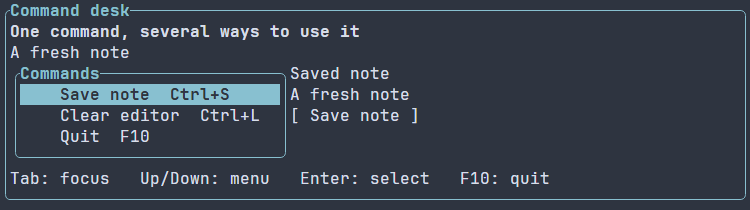
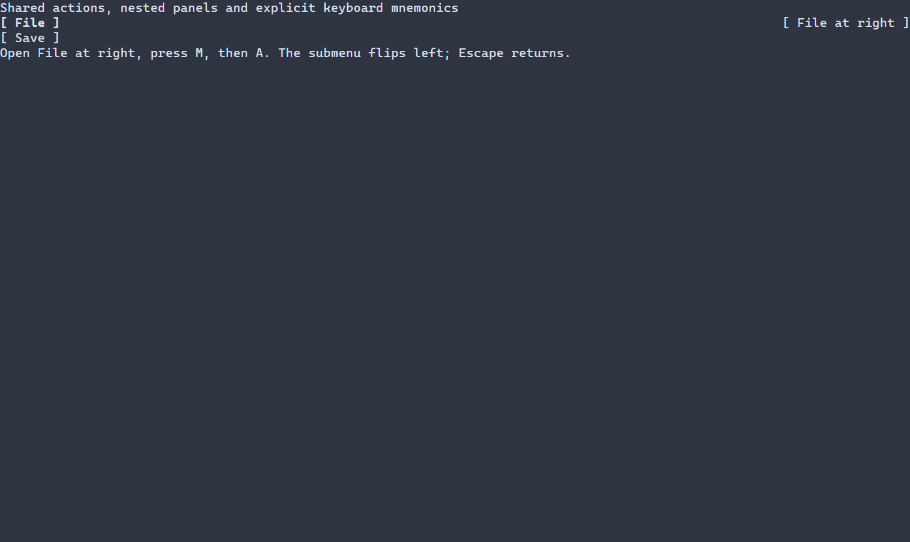

# Меню общих действий {#menus-ru}

[English version](../menus.md) · [Общие действия](actions.md) · [Готовые примеры](examples.md)

Меню позволяет выбрать команду приложения стрелками или мышью. Одно действие
можно передать меню, кнопке и явно заданному сочетанию клавиш: они используют
общий обработчик, подпись и состояние доступности.



[Анимация выбора клавиатурой и выполнения команды](../images/commands.gif).

## Полная программа

\include guide_menu.cpp

[Полный исходник](../examples/guide_menu.cpp) связывается с `portals::core`;
см. [подключение пакета](package.md). Tab переводит фокус в меню. Стрелки вверх
и вниз меняют выделение; Enter выполняет действие. Кнопка Save и Ctrl+S вызывают
то же действие. F10 завершает приложение с обычным освобождением ресурсов.

Меню — обычный retained-контрол внутри сцены. Рамка и ширина задаются теми же
[модификаторами компоновки](layout.md), что у других контролов. По умолчанию обе
оси предпочитают подготовленный размер содержимого; меню не занимает свободное
место. В примере `minWidth(12)` и `maxWidth(32)` ограничивают весь блок вместе
с рамкой. С длинной подписью блок растёт до максимума, с короткой остаётся
компактным. Подробнее — [режимы размеров и границы](compact-primitives.md).
Меню сразу видно,
оно не открывает всплывающую панель. Строка меню, вложенные меню и палитра команд
с поиском в этот API пока не входят.

## Общие состояние и оформление

`ui::ActionMetadata` позволяет задать подпись сочетания клавиш, справочный текст
и начальные enabled, visible или checked. [Пример Command desk](../../examples/commands/main.cpp),
цель `portals_commands_example`, содержит редактор, меню в рамке и кнопку Save.
Сохранённая подпись изменяется только при выполнении общей команды Save.

Поле `shortcut` содержит текст для отображения. Сочетания явно подключаются
через `ui::onKey`, как в примере. Изменение действия обновляет его представления
в меню и кнопках через обычную подготовку сцены. Отметка checked сохраняется,
пока приложение не изменит метаданные; выбор строки не переключает её.

Скрытая команда не занимает строку. Отключённая остаётся видимой, но не выполняется.
Навигация клавиатурой пропускает недоступные команды. Если доступных команд нет,
активного выделения тоже нет. Смена фокуса сохраняет локальное выделение меню.
Home и End выбирают первую и последнюю доступную команду. Enter и пробел выполняют
команду при сообщённом нажатии; явные события повтора и отпускания не активируют
пункт. Стрелки вверх и вниз могут повторяться. Клавиатура и мышь сохраняют
исходные модификаторы. Legacy-ввод терминала может не отличать удержание клавиши
от отдельных нажатий: тогда принимается каждая декодированная активация. Меню
не угадывает удержание и не добавляет задержку debounce.

По умолчанию `MenuOptions::maxEntries` равен 256. Каждая запись, включая дубликат,
также учитывается в лимите `maxPresenters` своего набора действий. Пустое меню
допустимо. При недостаточной высоте обычная компоновка обрезает строки; сам
контрол не добавляет прокрутку. Для доступа ко всем строкам в маленьком viewport
нужна другая композиция.

## Владение и ошибки

Меню использует [контракты времени жизни и ошибок ActionSet](actions.md).
Рецепт удерживает ещё не подключённые декларации до монтирования; после него
обработчиками владеет сцена. Повторное подключение набора к другой сцене
отклоняется. Закрытие сцены освобождает действия, в том числе когда сцену
закрывает её собственный обработчик.
При обычном отказе монтирования меню новые привязки наборов действий возвращаются
в исходное неподключённое состояние. Наборы, уже используемые сценой, сохраняют
привязку. Независимые обработчики, созданные кодом настройки приложения,
сохраняются; произвольные побочные действия настройки не откатываются.

Ошибки настройки меню и регистрации действий поступают в обычный типизированный
канал ошибок подготовки `ui::runApp`. Обработчик команды может вернуть свой
checked-результат: сцена собирает его тем же способом, что для action-кнопок и
обработчиков клавиш. Загружаемые ресурсы сцены не содержат исполняемых команд.
Фабрика плоского `ui::menu` принимает `ActionRef` из кода; синтаксис привязки её
команд в ресурсах сцены не предоставляется. Отдельный адаптер PopupMenu ниже
связывает граф действий из кода с загружаемым представлением.

Первая реализация предоставляет ограниченный список команд. Фоновый поиск и
история команд в него не входят; для таких возможностей приложения используются
отдельные API поиска по модели.

## Всплывающие меню и подменю

`ui::scene(body, ui::popupMenu(...))` создаёт изначально закрытый слой; сцена
сама создаёт или переиспользует существующий overlay host. `ui::Ref<PopupMenu>`
наблюдает настоящий sized-контрол, поддерживающий обычные content/min/max/flex.
[Полный пример](../examples/guide_popup_menu.cpp) использует одно действие Save
в кнопке, явной клавиатурной привязке и меню, а More открывает подменю.

```cpp
ui::popupMenu(commands, {
  ui::menuItem(save, U's'),
  ui::submenu("More", {ui::menuItem(copy, U'a')}, U'm'),
  ui::menuItem(quit, U'q')
}).minWidth(18).maxWidth(56)
```

`commands.open(opener)` требует видимый размещённый anchor в body того же host.
`dismiss()` закрывает всю цепочку, `opened()` возвращает проверяемое наблюдение.
Повторное открытие уже открытого меню ничего не меняет. После закрытия можно
выбрать другой допустимый anchor. Все панели делят один input scope и один
возврат focus. Перед ActionRef сначала закрывается popup и восстанавливается
focus; при ошибке закрытия действие не вызывается. Уже опубликованное закрытие
не откатывается. Callback может удалить своё действие, меню или сцену.

Up/Down циклически выбирают доступные строки, Home/End — первую/последнюю.
Right/Enter открывают ветку, Left закрывает глубокую панель. Escape закрывает
сначала подменю, затем корень. Enter/Space активируют leaf на сообщённом PRESS.
Disabled-строки видны, но пропускаются; hidden/retired не занимают строку.
Пустая ветка недоступна. Выбор прокручивается в ограниченный viewport при layout.
Панели предпочитают правый край, при нехватке места открываются влево и остаются
обрезаны viewport. Промежутки сохраняют фон body. Внешний левый click закрывает
цепочку и поглощается. Tab закрывает popup и продолжает обычный обход focus.

Мнемоника задаётся явным Unicode scalar и показана в отдельной колонке-подсказке.
`&` в старых и новых captions остаётся буквальным. Для ASCII регистр не важен;
остальные scalars сравниваются точно, без locale/casefold/normalization.
Дубликаты последовательно выбирают совпадения без выполнения; единственное
совпадение открывает или активирует. Legacy VT TextInput и native CHARACTER PRESS
поддержаны одинаково. Декодер выдаёт одно событие на scalar; два независимо
введённых Key/Text события остаются двумя событиями, временного debounce нет.

Defaults PopupMenuOptions: 256 entries во всём дереве, depth8 (максимум32),
plane cap60x20 cells и прозрачный gap1cell. Каждый leaf occurrence также занимает
presenter budget ActionSet, включая дубликаты закрытых веток. Дерево owning и
неизменяемое после mount, metadata leaf остаётся общей. Неверные options/Unicode
дают INVALID_ARGUMENT, bounds — NODE_LIMIT/DEPTH_LIMIT, allocation — NO_MEMORY.
Поиск, history, hover timers, menubar и второй command scheduler не добавляются.

## Загружаемое представление popup

```cpp
auto resources = ui::SceneResourceOptions{}.popupMenu("FileMenu", commands, {
  ui::menuItem(save, U's'),
  ui::submenu("More", {ui::menuItem(copy, U'a')}, U'm')
});

auto app = ui::scene(body,
  ui::resource("FileMenu{fitWidth=true minWidth=18 maxWidth=56}", resources));
```

Ошибки регистрации собираются при checked prepare/`ui::runApp`, до чтения файла
или входа в терминал. Для явной проверки остаётся доступен
`resources.registry.popupMenu(...)`.

Resource задаёт обычные scalar sizing,
id/classes и visible/enabled; budgets и граф ActionRef остаются в коде. Callback
и ActionRef не десериализуются. Неизвестное свойство и неверные bounds дают
позиционированную resource error до публикации. Тяжёлый popup payload всем
контролам не добавляется. Обычный плоский Menu сохраняет свой code-bound API.

Рамка переиспользует существующий Border frame-text/paint. В
`PopupMenuOptions::frame` доступны принятые patterns/custom glyphs/title chrome
и paint-work budget. В этом срезе требуются все четыре одноклеточные стороны.
Загружаемые scalar `frame` settings настраивают эту же рамку, без внешнего wrapper.
Цвета линии/title из theme поддержаны. Автоматические PSS glyph-profile overrides
общего staging пока поддержаны для Border/scroll, но не PopupMenu; для popup
следует выбрать pattern/glyph policy в коде или resource binding.

`maximumPanelSize` — жёсткий cap всей popup plane. Explicit fixed width/height и
hard minima сверх cap дают INVALID_GEOMETRY; противоречивые обычные/PSS bounds
сохраняют существующие typed errors. Больший max лишь разрешает размер, а не
принуждает меню расти.

Для anchored open нужен уже размещённый кадр body. До первого такого кадра возвращается существующий typed WOULD_BLOCK: скрытый layout и кадр из input callback не выполняются. Когда anchor готов, open и мнемоники могут прийти одним пакетом ввода до первого показа popup.

### Запись всплывающего меню

Полная программа открывает меню слева и вызывает вложенную команду, затем
открывает то же меню у правого края. Подменю раскрывается влево; Escape сначала
возвращает родительскую панель, затем фокус на кнопку. Запись также показывает
изменение размеров терминала и общую команду Save на кнопке. Используются
клавиатурный ввод и цвета терминала.

\image html popup-menu.png "Подменю раскрывается влево у края viewport"


