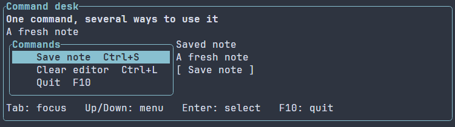

# Меню общих действий {#menus-ru}

[English version](../menus.md) · [Общие действия](actions.md) · [Готовые примеры](examples.md)

Меню позволяет выбрать команду приложения стрелками или мышью. Одно действие
можно передать меню, кнопке и явно заданному сочетанию клавиш: они используют
общий обработчик, подпись и состояние доступности.

[Анимация выбора клавиатурой и выполнения команды](../images/commands.gif).

## Полная программа

\include guide_menu.cpp

[Полный исходник](../examples/guide_menu.cpp) связывается с `portals::core`;
см. [подключение пакета](package.md). Tab переводит фокус в меню. Стрелки вверх
и вниз меняют выделение; Enter выполняет действие. Кнопка Save и Ctrl+S вызывают
то же действие. F10 завершает приложение с обычным освобождением ресурсов.

Меню — обычный retained-контрол внутри сцены. Рамка и ширина задаются теми же
[модификаторами компоновки](layout.md), что у других контролов. Меню сразу видно,
оно не открывает всплывающую панель. Строка меню, вложенные меню и палитра команд
с поиском в этот API пока не входят.

## Общие состояние и оформление

`ui::ActionMetadata` позволяет задать подпись сочетания клавиш, справочный текст
и начальные enabled, visible или checked. [Пример Command desk](../../examples/commands/main.cpp),
цель `portals_commands_example`, содержит редактор, меню в рамке и кнопку Save.
Сохранённая подпись изменяется только при выполнении общей команды Save.

Поле `shortcut` содержит текст для отображения. Сочетания явно подключаются
через `ui::onKey`, как в примере. Изменение действия обновляет его представления
в меню и кнопках через обычную подготовку сцены. Отметка checked сохраняется,
пока приложение не изменит метаданные; выбор строки не переключает её.

Скрытая команда не занимает строку. Отключённая остаётся видимой, но не выполняется.
Навигация клавиатурой пропускает недоступные команды. Если доступных команд нет,
активного выделения тоже нет. Смена фокуса сохраняет локальное выделение меню.
Home и End выбирают первую и последнюю доступную команду. Enter и пробел выполняют
команду при сообщённом нажатии; явные события повтора и отпускания не активируют
пункт. Стрелки вверх и вниз могут повторяться. Клавиатура и мышь сохраняют
исходные модификаторы. Legacy-ввод терминала может не отличать удержание клавиши
от отдельных нажатий: тогда принимается каждая декодированная активация. Меню
не угадывает удержание и не добавляет задержку debounce.

По умолчанию `MenuOptions::maxEntries` равен 256. Каждая запись, включая дубликат,
также учитывается в лимите `maxPresenters` своего набора действий. Пустое меню
допустимо. При недостаточной высоте обычная компоновка обрезает строки; сам
контрол не добавляет прокрутку. Для доступа ко всем строкам в маленьком viewport
нужна другая композиция.

## Владение и ошибки

Меню использует [контракты времени жизни и ошибок ActionSet](actions.md).
Рецепт удерживает ещё не подключённые декларации до монтирования; после него
обработчиками владеет сцена. Повторное подключение набора к другой сцене
отклоняется. Закрытие сцены освобождает действия, в том числе когда сцену
закрывает её собственный обработчик.
При обычном отказе монтирования меню новые привязки наборов действий возвращаются
в исходное неподключённое состояние. Наборы, уже используемые сценой, сохраняют
привязку. Независимые обработчики, созданные кодом настройки приложения,
сохраняются; произвольные побочные действия настройки не откатываются.

Ошибки настройки меню и регистрации действий поступают в обычный типизированный
канал ошибок подготовки `ui::runApp`. Обработчик команды может вернуть свой
checked-результат: сцена собирает его тем же способом, что для action-кнопок и
обработчиков клавиш. Загружаемые ресурсы сцены не содержат исполняемых команд.
Текущая фабрика меню принимает `ActionRef` из кода; синтаксис привязки команд меню
в загружаемых ресурсах сцены пока не предоставляется.

Первая реализация предоставляет ограниченный список команд. Фоновый поиск и
история команд в него не входят; для таких возможностей приложения используются
отдельные API поиска по модели.
