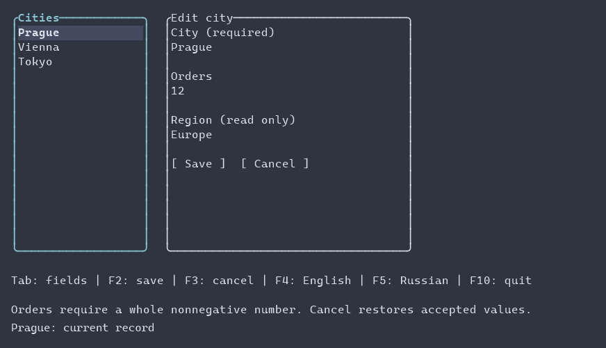

# Форма текущей записи {#model-forms-ru}

[English version](../model-forms.md) · [Сессии редактирования](record-edit.md) · [Валидация полей](form-fields.md)

Подключите `<portals/ui_model_form.hpp>`, чтобы список выбирал запись, а форма
редактировала её поля. Форма — обычный `Column` с настоящими `FormField` и
`LineEdit`. Она использует навигацию и сессию редактирования списка; вручную
копировать значения при смене текущей записи не требуется.

## Форма городов

Рабочее место объединяет список городов, таблицу принятых значений и форму
черновика. Форма редактирует обязательное название и неотрицательное число
заказов. Страну можно читать; пользовательский ввод в ней запрещён. Кнопки
Europe/Asia либо F6/F7 меняют общий источник. F2 сохраняет текущую запись,
F3 отменяет её черновики, F4 выбирает английский язык, F5 — русский, F10
завершает приложение. Полная последовательность действий разобрана в
[прикладных примерах моделей](model-workflows.md). Режим `EXPLICIT` сохраняет черновик и историю Undo/Redo
при переходе к другому городу. Ошибочное число остаётся видимым до исправления
или отмены.

[Полный типизированный пример](../examples/guide_city_form.cpp):

\include docs/examples/guide_city_form.cpp

Подключение приложения к `portals::core` описано в [руководстве по пакету](package.md).
Исходнику нужен C++23. Для двух строковых полей есть
[короткий пример](../examples/guide_record_form.cpp) с тем же справочником городов
и действиями сохранения/отмены, что и в руководстве по сессиям:

\include docs/examples/guide_record_form.cpp



## Объявление полей

`ui::field(caption, &City::orders)` владеет подписью и настройками привязки.
Указатель на член выбирает локальное поле C++; переносимым ключом схемы он не
является. Для внешнего адаптера задайте `.key("city.orders")`, предварительно
зарегистрировав его через `edit.field("city.orders", &City::orders, endpoint)`.
Оба объявления используют одно определение поля и квалифицированные цели записи.

| Объявление | Поведение |
|---|---|
| `.required()` | Показывает штатную отметку обязательности и отклоняет пустой scalar-текст при публикации |
| `.validate(rule)` | Добавляет владеющую типизированную синхронную проверку к существующей проверке поля |
| `.readOnly()` | Запрещает пользовательский ввод штатной политикой редактора; явные программные команды сохраняют свои проверки |
| `.options(config)` | Заменяет `FormFieldConfig`: текстовые/async-проверки, подсказки, сообщения и лимиты редактора |
| `.reference(ref)` | Публикует обычный `Ref<FormField>` после успешного монтажа всего поддерева; `ref.editor()` наблюдает его `LineEdit` |
| `.codec(codec)` | Задаёт владеющие преобразования scalar-значения в текст и обратно |
| `.editor(factory)` | Задаёт настоящий custom editor с явной типизированной привязкой |

Модификаторы применяются по порядку вызова. В частности, `.options(...)` заменяет
настройки более ранних `.required()` и `.readOnly()`. По умолчанию форма имеет
интервал один. Рядом с полями можно передавать обычные потребляемые рецепты
виджетов — например, строку кнопок Save/Cancel. Возвращаемый `Description<Column>` поддерживает обычные операции
компоновки, размеров, рамки и setup.

Стандартная привязка поддерживает `std::string`, целые типы кроме `bool` и типы
с плавающей точкой. Числа используют независимое от локали десятичное преобразование
`charconv`; проверяется весь ввод. Пробелы, суффикс, переполнение, NaN и бесконечность
отклоняются: частичный числовой префикс не принимается. Для enum, доменного значения
или другого представления задайте codec. Встроенный endpoint учитывает строки
и trivially-copyable значения; для других владеющих типов нужен явный endpoint
с реализацией `ownedBytes()`. Неподдерживаемый владеющий тип без codec
или фабрики возвращает `INVALID_ARGUMENT` при checked-монтаже.

## Режимы, проверки и идентичность

Форма сохраняет режим сессии: `IMMEDIATE`, `ON_COMPLETION` или `EXPLICIT`.
Клавиатурный ввод, вставка, fluent-присваивание текста и присваивание привязанному
типизированному полю используют существующий путь публикации. Обязательность,
текстовые и типизированные проверки выполняются до изменения модели. Async-проверка
использует штатный worker-путь `FormFieldConfig::validateAsync` и его лимиты
кандидата/сообщения. Во время рисования проверки не запускаются. Обязательность,
текстовые правила и `.validate()` формы принадлежат конкретному смонтированному
редактору. Создание неиспользованного recipe не меняет другой редактор или правило,
явно заданное через `EditField::validate()`.

Для нескольких редакторов одного поля команды сессии и типизированные присваивания
используют существующий preferred binding: первый доступный живой FormField в порядке
регистрации bindings, затем обычный редактор, если FormField нет. Правила разных
редакторов автоматически не пересекаются. Прямая операция через Ref использует
политику этого контрола. После удаления предпочтительного редактора выбирается
следующий доступный. Async-черновик сохраняет требование подтверждения своей generation
после удаления редактора; новый смонтированный редактор может задать другую политику,
а Cancel отменяет локальный ввод.

У ошибочного числового черновика остаются владеющий текст и история, хотя
типизированного значения у него нет. Прочитайте байты через `ref.text().get()`;
типизированный `draft` в snapshot пуст, если разбор не удался. Для удерживаемой
цели, которая уже не является текущей, `field.draftText(originalTarget)` явно
копирует байты редактора без разбора и обращения к источнику. Так можно восстановить
ошибочный текст orphan-черновика после удаления записи или закрытия источника.
Если у цели нет текстового состояния редактора, возвращается `nullopt`; владеющая
копия сохраняется после навигации и discard. Состояние проверки
и сообщения относятся к исходной записи. Cancel принимает её допущенное актуальное
значение и сбрасывает локальную историю. Undo/Redo сохраняют обычный смысл
редактирования.

Модели только для чтения сохраняют читаемые поля и рабочую навигацию. Если текущей
записи нет, штатные редакторы пусты и неактивны; создание формы успешно.
`.readOnly()` отдельно запрещает пользовательский ввод. Этот модификатор не
добавляет источнику возможность записи.

Если после удаления навигация выбирает ближайшую оставшуюся текущую запись,
форма создаёт для её устойчивого ID новую точную цель. Старые удерживаемые цели
и исходный ввод остаются независимыми: Save не переносит orphan-черновик в запись,
которая заняла его место. Диагностика NEAREST в навигации сохраняется.

Черновики, pending-запросы и ответы сохраняют существующую квалификацию
resource/session/record/field/version/sequence. Поздний ответ для прежней записи
не заменяет новую отображаемую запись. Сохранение отправляет поля отдельно;
`edit.lastResult()` показывает частичное принятие и pending-работу. Общую атомарную
транзакцию форма не добавляет. В [руководстве по сессиям](record-edit.md) описаны
удерживаемые цели, конфликты, закрытие источника и отмена локального ввода.

## Подписи и смена языка

Передайте в `ui::field` литерал, `TextValue`, существующий живой scalar-источник
подписи или выражение `ValueText`. Привязка монтирует обычный `Label`, сохраняя
его доставку, ошибки и владение. У живой обязательной подписи штатная отметка
показывается отдельным `Label` рядом с ней.

Пример использует `text(i18n("orders"), translate, russian)`: модель языка служит
явной зависимостью существующего resolver. Её изменение обновляет подпись.
Обычный `TextValue` сохраняет свою политику разрешения. Форма не добавляет
неявную локаль или scheduler. Подробнее — [Живые подписи](value-models.md).

## Свой codec или редактор

Codec владеет функциями `format(const Value&) -> expected<string, TreeError>` и
`parse(string_view) -> expected<Value, TreeError>`. Для отклонённого полного
кандидата верните `INVALID_ARGUMENT`; остальные ошибки используют checked-диагностику
редактора. Callback выполняется синхронно в UI-потоке, должен быть коротким,
не допускать повторного входа и не сохранять заимствованный ввод. Исключения
обрабатывает существующая граница монтажа/ввода. Форматирование владеет полным
scalar-результатом.

У удерживаемого поля одно текстовое представление и одна история. Копии объявления
разделяют владельца codec. Прямые `lineEdit(field, codecOwner)` и
`formField(caption, field, codecOwner, config)` принимают
`shared_ptr<const ui::EditTextCodec<Value>>`. Для второго редактора того же поля
используйте того же владельца. Другой владелец codec, как и добавление представления
после активации поля без него, даёт checked-ошибку `INVALID_ARGUMENT` при монтаже.
Уже допущенный черновик и история не переинтерпретируются.

Фабрика получает `EditField<Row, Value>` и запрошенную политику пользовательского
read-only. Здесь `codecOwner` — заранее созданный владеющий codec; фабрика выбирает
существующий типизированный текстовый редактор и явно задаёт его штатную политику:

```cpp
ui::field("Orders", &City::orders).editor(
  [codecOwner](ui::EditField<City, int> field, bool readOnly) {
    return ui::lineEdit(std::move(field), codecOwner).readOnly(readOnly);
  });
```

Обёртка предоставляет настоящий `FormField`, подпись, подсказку, оформление и
отметку обязательности. Custom editor отвечает за связь своего свойства с полем,
пользовательский read-only, отображение read-only источника, проверки значений,
историю и фокус. Одна отметка не реализует проверку custom-значения. Текстовые/async
настройки используются стандартной привязкой; фабрика настраивает собственный
редактор. `.validate()` объявления сопровождает копию поля, переданную фабрике.
`field.set()` проверяет это локальное типизированное правило до admission кандидата;
отклонённый UI-ввод сохраняет сама фабрика. Передача этого поля штатному типизированному
LineEdit сохраняет правило при вводе и публикации сессии. Общее правило модели при
этом не заменяется. Автоматической связи произвольного свойства виджета нет.

## Лимиты scalar-текста

Стандартная привязка — ограниченный однострочный scalar-редактор. Действуют
`LineEditOptions::limits`, по умолчанию до 4096 входных байтов. Удерживаемые значения,
черновики и история отдельно учитываются бюджетом `EditOptions`. Встроенный
owned/read-only endpoint сравнивает длину выбранной строки с байтовым лимитом
смонтированного scalar-редактора до копирования этого члена. Слишком большой ввод
возвращает `INVALID_ARGUMENT`, усечения нет. У типизированного поля без редактора
сохраняется обычный контракт удержания без нового лимита длины редактора.

Внешний `EditEndpoint::read` возвращает владеющее поле и должен сам обеспечить
ограниченный доступ до его создания. Codec форматирует полное scalar-значение;
потоковую обработку большого документа он не предоставляет. Для оконного текста
или бинарных данных явно выберите источник и редактор по их capabilities через
фабрику — например, существующий [просмотрщик документов](document-view.md) для
оконного чтения. Фабрика служит точкой расширения; автоматической поддержки
редактирования больших текстов и любого свойства виджета она не обещает.
