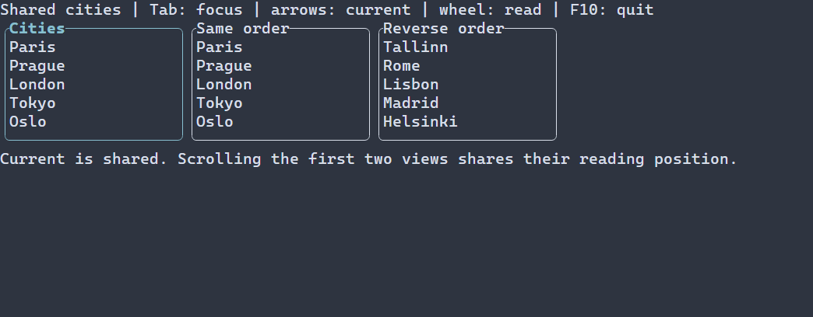

# Общая навигация представлений модели {#model-navigation-ru}

[Английская версия](../model-navigation.md) · [Закладки модели](model-positions.md)

Общий контекст навигации нужен, когда список и таблица должны показывать одну
текущую запись. Отдельные контексты позволяют перемещаться независимо.
Контекст принадлежит сцене: удаление представления не удаляет его позицию.

Здесь описан checked API из `<portals/managed.hpp>`. В следующем фрагменте сцена,
модель и узлы уже созданы в UI-потоке. Список и таблица используют один
`ManagedModel<T>`:

```cpp
auto navigation = scene.navigation(model);
if (!navigation) {
  return std::unexpected(navigation.error());
}
auto listBinding = scene.bindNavigation(list, *navigation);
if (!listBinding) {
  return listBinding;
}
return scene.bindNavigation(table, *navigation);
```

Идентичность ресурса создаётся автоматически. Другой контекст той же managed-модели
использует общий домен ресурса, сохраняя независимый курсор. Представления без
привязки сохраняют прежнее поведение.

## Текущая запись, выделение и место чтения

`current()` публикует текущую запись, `selection()` — отдельное ограниченное
множество выбранных записей, `readingAnchor()` — первую читаемую запись.
Клавиатурный фокус и дробное смещение прокрутки остаются локальными для вьюхи.
Прокрутка сама по себе не меняет текущую запись.

По умолчанию связывается текущая запись. Чтобы также связать место чтения,
передайте `NavigationBindingOptions{.readingAnchor = true}`. Каждая проекция
переводит устойчивый ID в собственный порядок; экранные смещения не копируются.
Если нужной записи нет в проекции, её viewport остаётся на месте. Отсутствие
в отфильтрованной проекции не доказывает удаления из исходной модели.

Привязка другой модели требует явного соглашения
`NavigationProjection::PRESERVES_ROW_IDS`. Вызывающая сторона гарантирует, что
полные ID обозначают записи исходного ресурса. Равенство порядковых номеров
такой гарантии не даёт.

`setSelection` приводит полные ID к каноническому порядку. Лимит по умолчанию —
1024 записи, настройка — `NavigationOptions::maxSelectedRows`. Канал доступен
наблюдателям, но стандартная привязка списка и таблицы использует прежнюю
политику одной текущей записи. Множественное визуальное выделение не добавляется.

## Обновления и восстановление

`navigate(RowId)` использует ограниченный поиск по идентичности. Вставки и
перестановки сохраняют текущую запись. Готовый индекс позволяет обновить точную
позицию, даже если содержимое строки ещё загружается. `bookmark()` и
`readingBookmark()` возвращают актуальные метаданные с ревизией отдельно от
логических каналов. Перестановка той же записи не уведомляет наблюдателей current.

Для удаления нужен полный `PositionChangeMap`, переданный через `setChangeMap`,
или ответ провайдера. По умолчанию выбирается следующий выживший элемент, а
в конце — предыдущий. Без доказательства изменений старый номер строки не
используется для угадывания. При ожидании закладка сохраняется; новая попытка
выполняется по публикации модели или явному разрешению, без постоянного опроса.
Конечный адаптер не гарантирует завершение, если базовый snapshot провайдера
не позволяет получить необходимую идентичность замещающей записи.

Для внешнего resolver создайте контекст с `ModelResource` и сессией источника,
вызовите `beginResolve`, выполните I/O существующим worker-механизмом и передайте
`applyReply` в UI-потоке. Сессия, целевая ревизия и номер запроса отсекают
устаревшие ответы. Общий контекст не требует общего количества строк и не владеет
отдельным планировщиком.

## Владение, ошибки и границы

Handle слабый и привязан к UI-потоку. Обращение из другого потока возвращает
`WRONG_THREAD`, после закрытия сцены — `CLOSED`. Закрытие отменяет незавершённое
разрешение. Закладки и копии снимков каналов остаются независимыми значениями.
Ошибки провайдера и выделения памяти передаются существующим typed-механизмом.
Если поздний канал завершился ошибкой, ранее успешно обновлённый канал может
остаться применённым; повторная попытка не дублирует его логическое уведомление.

Эта интеграция охватывает списки и таблицы managed конечных моделей и общий
контекст навигации. Автоматические закладки LogView, восстановление при смене
модели, формы текущей записи и постоянное хранение — отдельные интеграции.
Существующие низкоуровневые API моделей и представлений остаются доступны.

## Полный пример интеграции провайдера



[Полный исходник](../examples/guide_model_navigation.cpp) показывает три списка
в рамках. Первые два связывают место чтения; все три связывают текущую запись,
включая проекцию с обратным порядком. Tab меняет фокус, стрелки перемещают текущую
запись, F10 завершает приложение. Соберите `portals_docs_model_navigation` с
включёнными тестами либо исходник с [установленным SDK](package.md). Это расширенный
пример с явным провайдером и checked-привязками, а не учебник компактных описаний модели.

@include docs/examples/guide_model_navigation.cpp
