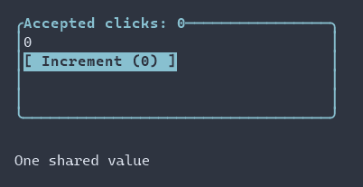
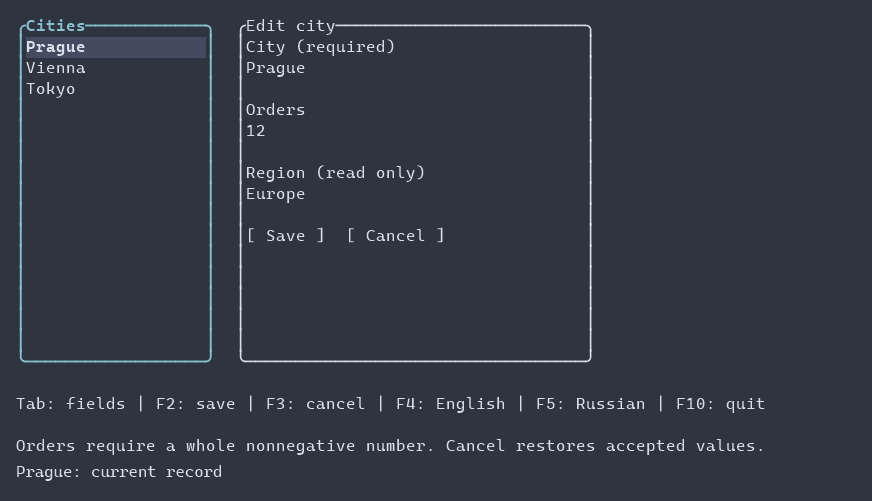
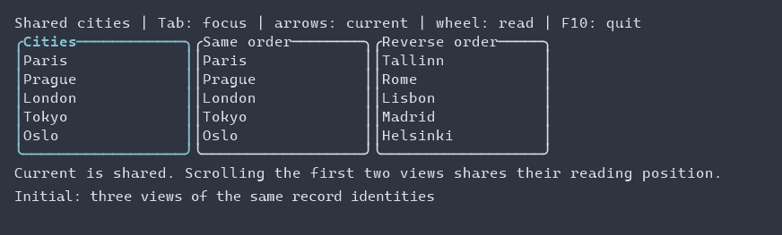
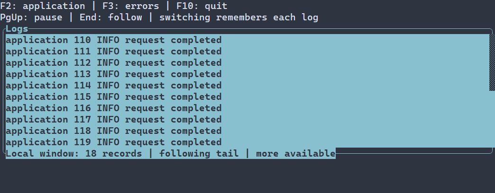
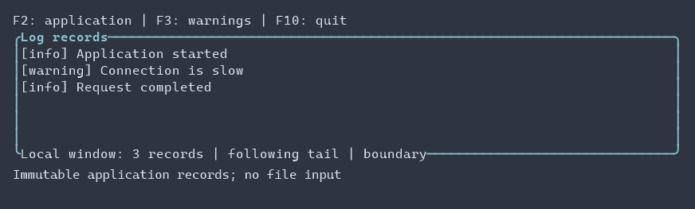
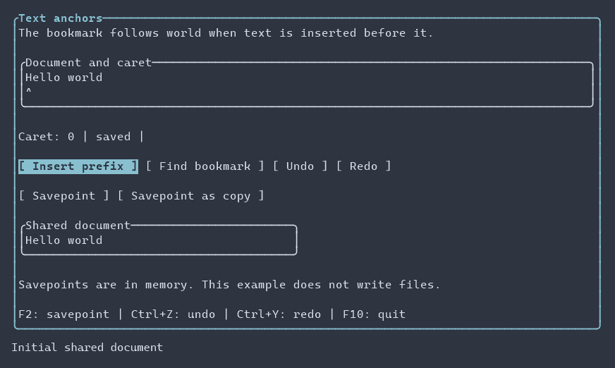

# Модели в приложении: выбор, черновики и место чтения {#model-workflows-ru}

[English version](../model-workflows.md) · [Возможности моделей](model.md) · [Подключение приложения](package.md)

Начните с одной модели и одного контекста навигации. Передайте этот контекст
представлениям, которые должны следовать одной текущей записи. Форма редактирует
её через сессию редактирования; переносить значения между контролами вручную
не требуется.

Ниже приведены полные приложения. Для сборки нужны C++23 и `portals::core`;
подключение описано в [руководстве по пакету](package.md). Исходники включают
сцену, обработчики и завершение работы. Записи подготовлены отдельной тестовой
обвязкой, которая не входит в пользовательские программы.

## Одно значение, несколько подписей

[Полный пример счётчика](../examples/guide_value_captions.cpp) связывает целочисленное
поле одной модели записи с Label, подписью Button и заголовком рамки. Изменение
поля обновляет все три представления через привязки, без присваивания трёх строк.



[Модели значений](value-models.md) также показывают владеющую запись Region и
различают изменение значения и смену источника представления. Переназначение
одного Label меняет его привязку; общая навигация ниже координирует группу
представлений коллекции.

## Короткий пример списка и таблицы

[Полный исходник](../examples/guide_view_models.cpp) задаёт две коллекции и общий
контекст навигации для списка городов и таблицы заказов. F2 и F3 выбирают источник.
Возврат к сохранённому источнику восстанавливает его текущую запись и место
чтения. Ширина колонок и геометрия окна у представлений могут различаться.

```cpp
auto navigation = ui::navigation(europe, {.readingAnchor = true});
```

Передайте тот же `navigation` в `ui::virtualList` и `ui::virtualTable`.
`navigation.model(asia)` передаёт ошибку назначения сборщику сцены;
`navigation.setModel(asia)` возвращает проверяемый результат, если обработчику
нужно отреагировать. При отказе назначения остаётся прежняя группа. Ошибка
последующего асинхронного чтения относится к уже принятому источнику:
назначение не обещает успешного ввода-вывода.

[Переключение источников и его ограничения](view-models.md#view-models-example-ru)
разбирает полную программу и подписи, зависящие от источника.

## Рабочее место заказов по городам



[Полный исходник](../examples/guide_city_form.cpp) объединяет список, таблицу и форму:

- **Cities** выбирает текущую запись щелчком или клавишами Up/Down. До выбора
  форма пуста и неактивна. Колесо меняет место чтения и не выбирает
  другой город незаметно для пользователя.
- **Accepted values** показывает данные модели. Во время ввода Orders таблица
  сохраняет прежнее значение до принятия черновика кнопкой Save.
- **Current city draft** редактирует обязательное имя и неотрицательное число
  заказов. Страну можно читать; пользовательский ввод в ней запрещён.
- Europe и Asia либо F6 и F7 меняют источник общей навигации. Вернитесь в Europe,
  чтобы восстановить место и черновик того же города.
- F2 сохраняет текущую запись, F3 отменяет её черновики. F4 и F5 меняют подпись
  Orders через существующий `i18n` resolver, сохраняя сам редактор.

Регион представлен перечислением. `ui::bySource<City, Region>` сопоставляет
принятому ресурсу значение этого перечисления; две подписи форматируют его
независимо. Дополнительная изменяемая строка, способная разойтись с установленным
источником, не нужна.

Форма использует режим `EXPLICIT`. Черновики и истории Undo/Redo принадлежат
точным идентификаторам ресурса, записи и поля. Смена текущей записи меняет
отображение, сохраняя адрес ранее отправленного запроса записи. Save отправляет
изменения по полям и не обещает общей транзакции. Для конфликтов, удаления записей
и ожидающих ответов действует [контракт сессии редактирования](record-edit.md):
осиротевший черновик не записывается в ближайший уцелевший город. Пример использует
немедленные конечные точки в памяти и не имитирует внешний сервер или конфликт.

[Объявления и оформление полей](model-forms.md) объясняет валидаторы, режим
только для чтения, кодеки и ограничения размера.

## Разный порядок, одна запись



[Полный исходник](../examples/guide_model_navigation.cpp) синхронизирует текущую
запись трёх списков. Первые два также разделяют якорь чтения. Третий использует
обратный порядок и намеренно сохраняет идентификаторы исходных записей.

Обычные представления принимают декларацию навигации напрямую. Для обратной
проекции остаётся одна checked-привязка в `configure` с
`NavigationProjection::PRESERVES_ROW_IDS`. Это существенное явное соглашение:
равные номера строк разных моделей не доказывают идентичность записей.
Оба снимка поставщика создаются внутри проверяемой фабрики сцены.
`cityList` повторно использует форматтер и размеры как обычный рецепт
представления. Форматтер сразу превращает фиксированные ASCII-имена примера
в графемный текст, без дополнительного шаблона форматирования. Рецепт использует
стандартную WidthPolicy; для представления с другой политикой ширины нужен
соответствующий форматтер.

## Чтение лога с возвратом к месту



[Переключение файлов](../examples/guide_log_models.cpp) использует один LogView
и два сохраняемых дескриптора источников. PageUp приостанавливает слежение,
F2/F3 выбирают лог, End снова следует доступному хвосту. При возврате к файлу
с приостановленным слежением восстанавливается запись, даже если в лог уже
добавлены новые строки. Полная программа ожидает `application.log` и `errors.log`
в рабочем каталоге. Генератора данных или драйвера записи в ней нет.



[Модель доменных записей только для чтения](../examples/guide_log_snapshot.cpp)
передаёт тому же LogView конечный неизменяемый снимок и форматирует записи
в рабочем потоке. Программа не читает файлы и не предоставляет запись в модель.
Точное количество строк — возможность конкретного снимка, а не требование
ко всем источникам логов.

Для источника с неизвестным количеством записей предназначен существующий
`WindowProvider<LogLine>`. Готовность данных, доступный хвост и окончательный
конец различаются; окно просмотра не заменяет возможности исходной модели.
[Контракты LogView](log-view.md) описывают ограниченную загрузку, удержание данных,
закладки, ротацию и общие бюджеты. Медленное чтение и форматирование выполняются
на рабочем пути приложения.

## Документ живёт независимо от представления



[Полный исходник](../examples/guide_text_anchors.cpp) хранит текст, каретку,
историю и закладку в конечной сессии документа. Добавьте префикс, восстановите
закладку и попробуйте Undo/Redo. Точка сохранения отмечает состояние содержимого
и логическую цель сохранения, без записи файла. Смена этой цели сохраняет
каретку и выделение.

[Переносимое место чтения](navigation-checkpoint.md) решает другую задачу:
явный кодек поставщика экспортирует метаданные позиции для повторного открытия
ресурса. Checkpoint не содержит текст документа, черновик, Undo или право записи.
У конечного редактора действуют стандартные пределы 4096 байт/графем. Эти примеры
не объявляют реализованным оконный редактор произвольно большого поля.

## Оформление без дублирования состояния

Меняйте компоновку, сохраняя объявления источника, навигации и сессии.
`.width`, `.height`, `.minWidth`, `.maxWidth` и `.framed` настраивают геометрию
представления; они не загружают столько записей в модель и не заменяют её общий
размер. Заголовки областей помогают различать принятые данные и черновики.

[Слои PSS и параметры тем](styling-guide.md) задают цвета и состояния контролов,
а [стили рамок и полос прокрутки](scroll-controls.md) — оформление их частей.
Например, к сцене можно добавить обычный слой:

```cpp
| ui::style("Button { bold: true; }")
```

Обновление данных и смена модели выполняют разные задачи. Новые данные потока
публикуются через прежний источник; другой источник назначается при выборе
пользователя. Тик рыночных данных обновляет модель, а выбор другого инструмента
может менять источник. Переназначать привязку на каждую ценовую ревизию не нужно.
