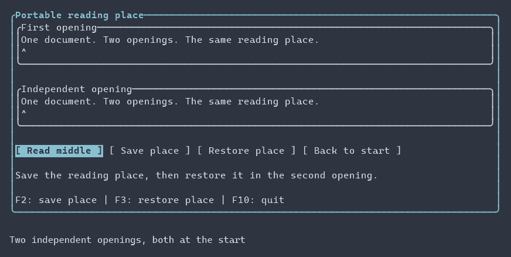

# Сохранение навигационной позиции {#navigation-checkpoint-ru}

[English version](../navigation-checkpoint.md) · [Закладки модели](model-positions.md) · [Текстовые якоря](text-anchors.md)

Навигационный снимок — владеющее значение из байтов, которое хранит места в модели
и их назначение: текущая запись, место чтения, выделение или цель редактирования.
Приложение может оставить эти байты в памяти или передать своему адаптеру хранения.
Сам документ или коллекция остаётся в исходной модели.

Подключите `<portals/navigation_checkpoint.hpp>` и `portals::core`.
Этот необязательный заголовок не входит в `ui.hpp`.

## Два независимых открытия

[Полное приложение](../examples/guide_navigation_checkpoint.cpp) дважды открывает
один неизменяемый пример текста. Нажмите **Read middle**, **Save place**, затем
**Restore place**. Второе открытие перейдёт к сохранённому месту. **Back to start**
перемещает только второе открытие; повторное восстановление возвращает его к
сохранённой позиции. F2 сохраняет место, F3 восстанавливает, F10 завершает приложение. До первого сохранения восстановление показывает подсказку сохранить место.

\include docs/examples/guide_navigation_checkpoint.cpp

Программа копирует и разбирает закодированные байты в памяти. Она не читает и не
записывает файлы и не сохраняет состояние между запусками процесса. Переносимый
ключ ресурса обозначает эту конкретную версию неизменяемого ASCII-текста. У каждого
открытия собственное пространство идентификаторов в памяти. Поставщик переводит
сохранённое смещение в закладку, квалифицированную для принимающего открытия.

[Поставщик кодека](../examples/navigation_checkpoint_provider.hpp) входит в полный
исходник приложения. До сохранения или восстановления он проверяет точный текст
и его неизменённую ревизию. Однобайтовый кодек смещения предназначен только для
этого короткого ASCII-документа; для редактируемого текста и произвольных файлов
он не подходит:

\include docs/examples/navigation_checkpoint_provider.hpp

## Преобразование со стороны модели

Реализуйте `NavigationBookmarkCodec` для модели с поддержкой сохранения позиций:

| Операция | Ответственность поставщика |
|---|---|
| `descriptor()` | Стабильное имя кодека, положительная версия и переносимый ключ ресурса с поколением совместимой истории. Строки должны оставаться действительными до завершения внешней операции. |
| `resource()` | Текущее пространство идентификаторов ресурса в памяти. |
| `encode()` | Записать метаданные позиции в предоставленный ограниченный буфер и вернуть число записанных байтов. |
| `decode()` | Проверить данные, вид позиции, сторону вставки и назначение; вернуть владеющую закладку в пространстве принимающего ресурса. |

Библиотека не выводит долговременную идентичность из имени файла, номера строки
или временных `SourceStamp`, `RowId`, `SourceCursor`. Поставщик переводит устойчивый
предметный ключ или версионированное место текста в текущую модель. Для текста
он также проверяет или разрешает границы графем.

`NavigationCheckpoint::capture(entries, codec)` возвращает новый неизменяемый
снимок. `bytes()` заимствует его байты, пока живо это значение или копия.
`parse(bytes)` проверяет и копирует входящие байты. `restore(codec)` возвращает
полный владеющий вектор позиций, не меняя контекст навигации. Подходящий успешный
результат нужно применить через существующий проверяемый API навигации или
документа: он ещё может отклонить устаревшую или недоступную позицию. Применение
нескольких каналов по отдельности не даёт групповой транзакции.

Один снимок относится к одному переносимому ресурсу. Для несвязанных моделей
используйте отдельные снимки. Копии разделяют неизменяемые байты и не удерживают
кодек, хранилище, модель, страницу данных, сцену или контрол.

## Назначение позиции и права записи

Каждая `NavigationCheckpointEntry` содержит `NavigationCheckpointRole`:

- `CURRENT`: текущая запись или положение каретки.
- `READING_ANCHOR`: место чтения, независимое от текущего выделения.
- `SELECTION`: одна выбранная позиция; несколько записей сохраняют заданный порядок.
- `EDIT_ANCHOR`: предполагаемое место редактирования. До записи заново получите
  право записи, идентичность поля и актуальную ожидаемую версию.

Импортированная позиция не является `EditTarget` и не разрешает commit. Ближайшая
допустимая позиция чтения не разрешает запись в соседнюю запись. По умолчанию
снимок не содержит значений модели, паролей, черновиков, истории Undo/Redo или
учётных данных; данные поставщика должны соблюдать то же ограничение.

## Ограничения памяти и ошибки

По умолчанию `NavigationCheckpointOptions` ограничивает закодированный снимок
64 КиБ, число позиций — 128, данные поставщика одной позиции — 4096 байт, каждое
имя кодека и ключ ресурса — 1024 байт. `bookmarks` использует существующий предел
4096 учитываемых байт для каждой декодированной закладки. Это метаданные, объём
которых не зависит от логического размера модели.

Capture резервирует настроенную ёмкость снимка и временно копирует владеющие
записи позиций. Parse удерживает фактический размер байтов; load может временно
держать одновременно максимальный буфер чтения и разобранное значение. Restore
владеет вектором записей и декодированными закладками. Служебные данные аллокатора
и выделения памяти внутри callback поставщика учитываются отдельно; длина
закодированных байтов не является пиком памяти процесса.

Повреждение структуры или контрольной суммы даёт `CORRUPT_INPUT`, превышение
ограничения — `TOO_LARGE`. Неизвестные версии формата и кодека дают `UNSUPPORTED_VERSION` и
`UNSUPPORTED_CODEC_VERSION`. Несовпадение имени кодека даёт `UNSUPPORTED_CODEC`,
ресурса — `WRONG_RESOURCE`. Недопустимые локальные настройки или записи дают
`INVALID_ARGUMENT`. Сбой ввода-вывода адаптер хранилища сообщает как `STORAGE_FAILURE`. Поставщик или хранилище
могут вернуть `UNSUPPORTED`, `CLOSED` или свой типизированный отказ. Отмена даёт
`CANCELLED`, нехватка памяти — `NO_MEMORY`. Неожиданное исключение из `encode`, `decode`, `read` или `write` становится
`PROVIDER_FAILURE`. Методы `descriptor` и `resource` объявлены `noexcept` и не
должны бросать исключения. Сохраняйте прежний снимок до успешной замены.

Формат первой версии включает контрольную сумму случайного повреждения. Она не
подтверждает подлинность байтов или надёжность поставщика. Структурно правильному
снимку всё ещё нужны подходящие кодек, ресурс и разрешение позиции в живой модели.

## Хранение вне UI-потока

Необязательный `NavigationCheckpointStorage` задаёт синхронные ограниченные
операции `read(output, stop)` и `write(bytes, stop)`. Библиотека не устанавливает
файловую реализацию или планировщик. Чтение должно вернуть одну полную закодированную запись или типизированный отказ; если запись не помещается, верните `TOO_LARGE`, а не усечённый префикс. Если адаптер может блокироваться, вызывайте
`loadNavigationCheckpoint` и `saveNavigationCheckpoint` через существующий рабочий
путь приложения. Эти функции сами не запускают работу и не проверяют UI-affinity.

Удерживайте кодек и хранилище живыми, сериализуйте операции на всё время вызова.
Проверяйте отмену внутри блокирующей работы поставщика или хранилища. Неудачная
или отменённая загрузка не возвращает замену и не стирает позицию в памяти
вызывающей стороны. Неудачная запись тоже сохраняет снимок, но внешнее хранилище
могло измениться: атомарная замена файла и долговечность — контракт адаптера.
Применяйте восстановленную навигацию в UI-потоке через обычный живой handle.

Работа кодирования и контрольной суммы зависит от объёма метаданных. Дорогие кодеки и большие настроенные бюджеты выполняйте в рабочем потоке. Функции подготавливают собственный результат и сами не присваивают состояние навигации приложения; явные побочные действия callback поставщика или хранилища они не откатывают.
