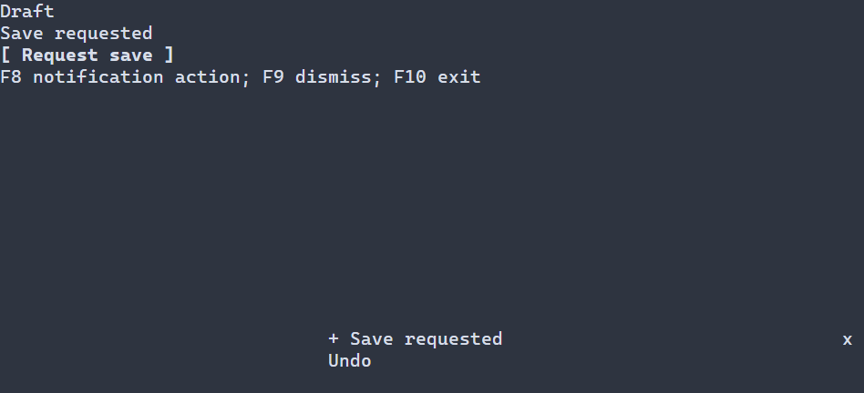

# Уведомления приложения {#notifications-ru}

[English](../notifications.md)

Уведомления показывают короткие сообщения, пока пользователь продолжает работу. `ui::NotificationCenter` наблюдает очередь сцены; действия определяются обработчиками приложения и временем показа. Значения по умолчанию и ввод с клавиатуры и указателя описаны ниже. См. [настройки и API уведомлений](../../include/portals/toast.hpp).

Для загружаемой сцены зарегистрируйте фабрику C++ с семантической схемой; ресурс не задаёт исполняемые обработчики. См. [регистрацию ресурсов](../../include/portals/ui_scene_resource.hpp).



## Настройка оформления {#notifications-styling-reference-ru}

Уведомления разрешают обычный стиль логических частей `Toast`. Классы важности — `.toast-info`, `.toast-success`, `.toast-warning`, `.toast-failure`; `.toast-message`, `.toast-action`, `.toast-dismiss` и `.toast-indicator` оформляют соответствующие части. Значения частей по умолчанию берутся из разрешённого стиля важности; для индикатора его настройки задают цвет текста и фон тревоги до применения правила индикатора. Это объекты оформления, а не отдельные виджеты.

Доступны `foreground`, `background` (`#RRGGBB`), `bold`, `italic`, `underline` (`true` или `false`). Правила и слои подчиняются [каскаду стилей](styling-guide.md); общие ограничения `min-width` относятся к компоновке виджетов, а не к этим объектам отрисовки. Символ индикатора и время задаются настройками, а не свойствами PSS.

```pss
Toast.toast-warning { foreground: #e0b040; }
Toast.toast-action { bold: true; }
```

`ui::notifications(center, content)` показывает короткие сообщения, пока
пользователь продолжает редактировать основное содержимое. Сцена владеет очередью,
обработчиками и таймером; `ui::NotificationCenter` — копируемый наблюдающий
дескриптор. Щелчок по уведомлению сам по себе не переносит фокус из редактора.

## Полное приложение

В [примере с загружаемым содержимым](../examples/guide_toast_resource.cpp) содержимое берётся из конфигурации, а центр уведомлений и действия остаются в C++. Соберите `portals_docs_toast_resource` с включёнными тестами и запустите программу в терминале.

\include guide_toast_resource.cpp

Кнопка в примере отмечает запрос на сохранение и предлагает действие приложения.
Записи файла здесь нет. F8 вызывает последнее доступное действие, F9 убирает
сообщение, F10 завершает приложение. Эти сочетания назначены самим приложением.

\include guide_toast.cpp

Подключение установленной библиотеки описано в [руководстве по пакету](package.md).
Исходник собирается как обычное приложение с `portals::core`. В дереве Portals
ему соответствует цель `portals_docs_toast` при `PORTALS_BUILD_TESTS=ON`.

Если диалоги не нужны, отдельный host не требуется. При наличии диалогов
поместите обёртку уведомлений в основное содержимое host:

```cpp
auto content =
  ui::notifications(notices, ui::column(ui::lineEdit("Draft")));
auto layout = ui::overlayHost(std::move(content),
  ui::dialog(details, "Details", ui::label("Request details")));
```

Фрагмент предполагает `ui::NotificationCenter notices` и
`ui::Ref<Dialog> details`. Диалоги рисуются поверх уведомлений. Обёртка не
увеличивает собственный размер содержимого. Удаление обычного дочернего контрола
содержимого сохраняет уведомления приложения; удаление их обёртки или закрытие
сцены закрывает center.

## Важность сообщения

Оформление можно выбрать прямо у владеющего сообщения:
`ui::toast("Saved").success()`. Методы `.info()`, `.success()`, `.warning()` и
`.error()` выбирают существующие стили INFO, SUCCESS, WARNING и FAILURE.
Эквивалентный вариант с pipe: `ui::toast("Saved") | ui::success()`.
Последний модификатор важности имеет приоритет, сохраняя остальные настройки
и действия сообщения. `.error()` выбирает оформление ошибки, но не сообщает
об ошибке приложения и не меняет политику диагностики.

## Очередь и время показа

| Настройка | Значение по умолчанию и смысл |
|---|---|
| `NotificationOptions::capacity` | 32 сообщения, включая выбранные для показа |
| `maxVisible` | 3 выбранных сообщения; из-за отсечения на экране может быть меньше |
| `placement`, `maximumWidth` | `BOTTOM_END`, 48 ячеек терминала |
| `margin`, `gap` | По 1 ячейке; уменьшаются при малом размере области |
| `ToastOptions::duration` | 5000 мс; `std::nullopt` сохраняет сообщение без срока |
| `dismissOnAction` | `true`: убрать сообщение до вызова обработчика |
| `dedupKey` | Пустой отключает дедупликацию; непустой сравнивается побайтно с учётом регистра |
| `refreshDeduplicated` | `false`: сохранить прежние данные, действие, ID и срок |
| `reducedMotion` | `false`; индикатор и чередование его фона включаются отдельно |

Срок отсчитывается после первого завершённого layout, в котором конкретное
сообщение получило непустую видимую область с учётом отсечения. Это граница
логического кадра до отправки в терминал. Сообщение в очереди или полностью за
пределами видимой области ещё не получает начального срока. Скрытие center или
блокировка модальным диалогом снимают таймер, сохраняя уже назначенные абсолютные
сроки. Когда показ снова разрешён, просроченные сообщения удаляются.

При переполнении по умолчанию вытесняется самое старое подходящее временное
сообщение из ожидающей части очереди. Выбранные для показа, постоянные сообщения
и выполняемые действия защищены. Если подходящей записи нет, новый запрос
намеренно отбрасывается. `show(...)` не возвращает сведения об этом решении;
`post(...)` позволяет проверить `ToastPostStatus`, назначенный `ToastId` и ID
вытесненной записи. Политика `REJECT_NEW` вместо этого возвращает типизированную
ошибку `NODE_LIMIT`, сохраняя очередь.

## Команды, владение и ошибки

`show`, `dismiss`, `dismissLatest`, `activate`, `activateLatest`, `clear`,
`setVisible` и `setReducedMotion` используют существующий механизм коротких
проверяемых команд и диагностики. `snapshot()` возвращает самостоятельный
неизменяемый снимок с полным текстом, подписями действий, исходными ID и сроками.
Снимок не удерживает обработчики или сцену. Ошибки запросов не отправляются
в диагностику автоматически.

Вызывайте команды center в UI-потоке. Допущенный к выполнению обработчик владеет
захватами и данными до возврата, даже если удалит собственное поддерево
уведомлений. Перед новым вызовом проверяются исходный ID, видимость, доступность
и модальные ограничения. Сам обработчик может явно открыть диалог и изменить
фокус. Его ошибка регистрируется один раз; автоматического повторного вызова нет.

Ошибка до принятия запроса сохраняет прежнюю очередь и таймер. Успешно
опубликованная тема или слой стилей сохраняются, если последующая подготовка
уведомлений завершается ошибкой: остаётся прежнее изображение уведомлений и
типизированная ошибка подготовки. Уведомления не заменяют журнал ошибок
приложения и не устанавливают автоматические всплывающие сообщения об ошибках.

Действующая политика диагностики может остановить приложение после ошибки.
Повторная команда уведомления не возобновляет остановленный или закрытый host;
восстановление возможно, пока владеющие сервисы продолжают работать.

## Стили и необязательные индикаторы

Логические части `Toast` предоставляют классы `.toast-info`, `.toast-success`,
`.toast-warning`, `.toast-failure`, `.toast-message`, `.toast-action`,
`.toast-dismiss` и `.toast-indicator`. Это части отрисовки уведомления, а не
отдельные контролы с фокусом. Применяйте правила через существующие
[слои стилей](style-layers.md). Изменение итоговых значений вызывает перерисовку
только при фактическом изменении оформления.

Отсечение текста сохраняет границы графем; снимок содержит полный текст.
Необязательный индикатор должен занимать одну ячейку. При явно включённом
чередовании фона период по умолчанию равен 500 мс. Режим reduced motion оставляет
статический индикатор. Истечение срока и чередование используют один действующий
таймер Scheduler; подготовка может временно создать его замену. При отсутствии
отложенной работы center не создаёт анимацию и постоянные запросы перерисовки.
