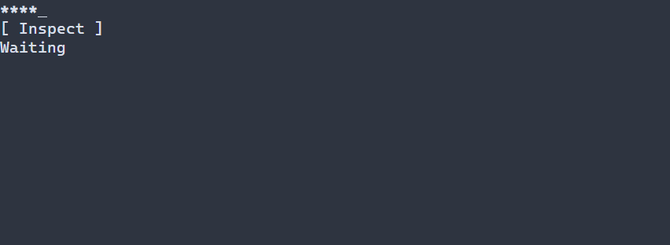

# Защищённый ввод пароля {#password-guide-ru}

[English version](../password.md) · [LineEdit](line-edit.md) · [Подробности защищённого ввода](controls.md#password-control-ru)

`ui::password` предназначен для защищённого однострочного значения. Маска LineEdit скрывает отображение обычной модели с открытым текстом и историей, но не предоставляет этот контракт защищённого хранения.

## Полное приложение

Программа проверяет наличие значения, не копируя его в надпись. Введите значение, перейдите Tab к Inspect и активируйте Enter, Space или левой кнопкой мыши; F10 завершает программу. `runApp` сообщает об ошибках и восстанавливает терминал.



\include guide_password.cpp

Соберите `portals_docs_password` с `PORTALS_BUILD_TESTS=ON` и запустите в поддерживаемом нативном терминале. См. [сборку](getting-started.md) и [пакет](package.md).

## Значение и редактирование

`ui::PasswordRef` наблюдает элемент, принадлежащий сцене. `withPlaintext` предоставляет `SecretView` только на время синхронного вызова: не сохраняйте его указатели. `value()` возвращает проверяемую защищённую идентичность `PasswordValue`; `value(value)` применяет защищённый кандидат между кадрами. Копия идентичности может удерживать старый зашифрованный снимок до освобождения последнего владельца. Read-only блокирует ввод пользователя, но разрешает явный setter. Обычного getter открытого текста, копирования/вырезания и истории Undo нет.

По умолчанию `PasswordOptions::editMode` равен `IMMEDIATE`; `ON_COMPLETION` публикует значение при Enter, активации или потере фокуса, `EXPLICIT` — при Enter или активации. Escape принимает последнюю модель для отложенного черновика; уже опубликованную немедленную правку он не отменяет. Конфликтующая внешняя версия не перезаписывает изменённый отложенный черновик молча. Редактирование клавиатурой использует маршрутизированные действия и текстовый ввод. Выделение мышью не реализовано; вставка отключена, пока `pastePolicy` явно не установлен в `ENABLED`.

По умолчанию отображается один ASCII `*` на графему, что раскрывает количество. `.noEcho()` скрывает символы значения, подсказки и выделения, задаёт собственную ширину одну ячейку и фиксирует курсор в начале. `PasswordOptions::limits` по умолчанию `{4096, 4096, 4096, 8192}`, `securePolicy.maxBytes` — 4096; действуют обе границы без усечения. На Windows и Linux обязательны защищённое нативное хранение и шифрование в состоянии покоя; неподдерживаемые гарантии отклоняются, включая нативную политику на WASM. Буферы ввода и синхронное заимствование открытого текста находятся вне защищённого хранения в покое. См. [режимы и ограничения](controls.md#password-control-ru).

Ресурс допускает `Password#password { text = "", placeHolder = "Password" }` или отсутствие text. Непустые литералы и текстовые ресурсные выражения отклоняются; секрет передаётся через типизированное состояние или проверяемый поставщик. [Полный пример ресурса](../examples/guide_password_resource.cpp) использует `scene.get<Password>("password")`; подробности — в [справке](controls.md#password-control-ru).

## Настройка оформления {#password-styling-reference-ru}

Естественный селектор — `Password`. Normal/focused/disabled рисуют поле, selected — выделение включённого поля, caret — курсор включённого поля в фокусе. Header не рисуется. При no-echo символы значения и выделения отсутствуют, но курсор в фокусе остаётся. `PasswordOptions::style` имеет тип `ControlStyle`, `selection` и `cursor` — `CellStyle`; ручные значения используют цвета терминала, выделение жирное курсивное, курсор жирный подчёркнутый. PSS не меняет символ маски и не раскрывает значение.

| Свойство | Значения и действие |
|---|---|
| `foreground`, `background` | `#RRGGBB`; цвет текста и заливки |
| `bold`, `italic`, `underline` | `true` или `false`; явное false переопределяет нижний слой |
| `width`, `height` | Неотрицательное число ячеек, `auto`, `fit-content`, `flex(положительный вес)` в runtime PSS |
| `min-width`, `max-width`, `min-height`, `max-height` | Неотрицательные границы в ячейках; в compile-time PSS поддерживается только `min-width` |

Правила размера не зависят от состояния или `:read-only`; конфликт ограничений отклоняет обновление, сохраняя последние корректные стиль и геометрию. См. [компоновку](layout.md). Ручной `ControlStyle` использует цвета терминала, обычный текст, жирный шрифт при фокусе и курсив для недоступного элемента. Тема и PSS переопределяют отдельные поля; остальные сохраняют значения нижнего слоя. См. [каскад](styling-guide.md).

```pss
Password { min-width: 16; }
Password:focused { background: #245070; }
Password:selected { background: #426080; }
Password:caret { underline: true; }
```

Точные контракты: `portals::Password`, `PasswordOptions`, `PasswordValue`, `SecretView`, `ui::PasswordRef`.
