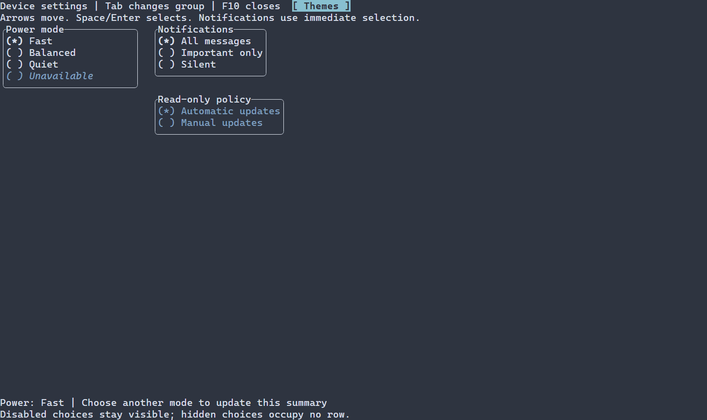

# Группы единственного выбора {#radio-group-ru}

[English](../radio-group.md) · [Примеры контролов](control-examples.md)

Группа подходит для выбора одного значения из небольшого резидентного набора; для поиска или постраничного источника см. [контролы выбора](choices.md). Настройки и проверяемые изменения описаны в [API RadioGroup](../../include/portals/radio_group.hpp). Полная программа ниже собирается целью `guide_radio_group` в [отдельном проекте примеров](examples.md); запустите полученную программу в терминале. Запись показывает более крупную форму настроек устройства.

`RadioGroup` показывает резидентные варианты с выбранным стабильным значением
и отдельным локальным активным пунктом. Группа занимает одну позицию Tab.
По умолчанию стрелки перемещают active без изменения модели, переходят через
границу и пропускают скрытые/отключённые пункты. Home/End перемещают active
в начало/конец доступных. Space или Enter подтверждает active; щелчок по
доступной строке выбирает её сразу. Потеря фокуса не подтверждает выбор.
Навигация не повышает revision и не вызывает `onChange`. Повторный выбор —
no-op; без доступных пунктов ввод не меняет значение.

`.immediate()` включает выбор при навигации; явная форма —
`.selectionMode(RadioSelectionMode::IMMEDIATE)`. `.immediate(false)` возвращает
default `ON_ACTIVATION`. Low-level конструктор принимает ту же defaulted policy
после `WidthPolicy`; ресурсы — `radioSelectionMode=IMMEDIATE` или
`ON_ACTIVATION`. В прежних выпусках стрелки выбирали сразу; default изменён.

Для отдельной сборки из корня репозитория:

```powershell
cmake -S docs/examples -B build/guide-examples
cmake --build build/guide-examples --config Release --target guide_radio_group
```

## Начать с подписей

```cpp
ui::Ref<RadioGroup> mode;
auto scene = ui::scene(ui::radioGroup(mode, {"Fast", "Balanced", "Quiet"}));
```

Сцена создаёт и хранит модель, сама назначает идентификаторы строк и выбирает
первый включённый видимый вариант. Пустая группа не имеет выбранного значения.
[Полный пример настроек устройства](../../examples/radio_group/main.cpp)
показывает модель, отключённые и скрытые варианты, группу только для чтения,
тему, рамки и изменение размера. При `PORTALS_BUILD_EXAMPLES=ON` соберите цель
`portals_radio_group_example` и запустите полученный EXE в обычном терминале.
F10 завершает приложение через стандартный runner с восстановлением терминала
и типизированной диагностикой ошибок. Клиент использует C++23 и `portals::core`.



[Статичный кадр](../images/radio-group.png)

## Модель и единый Ref

Полный клиент создаёт принадлежащее сцене состояние без ручных идентификаторов,
сегментации текста, токенов привязки и собственного cleanup:

\include{lineno} guide_radio_group.cpp

`ui::radioGroup(ref, owner.radioState(...))` сохраняет исходную проверяемую ошибку
создания состояния. Чтобы разделять модель с другими потребителями, сохраните
`ManagedState` в фабрике сцены. Переданная готовая модель
`ManagedState<RadioGroupValue>` сохраняет точное значение, включая отсутствие
выбора: mount не записывает в неё значение по умолчанию.

`mode.value()` возвращает авторитетное владеющее значение с проверкой потока
и времени жизни. `mode.select(value.selectedId())` выполняет программный выбор
и возвращает исходную квитанцию `PropertyUpdate<RadioGroupValue>`.
`std::nullopt` снимает выбор; пользователь не может снять его повторной
активацией. Программа может выбрать существующий отключённый/скрытый ID.
Неизвестный полный ID даёт `INVALID_ARGUMENT` до изменения модели. Ошибка `select`
также попадает в существующий сборщик ошибок сцены как `radio.select`, даже если
void-обработчик игнорирует результат. Успешная квитанция не меняется;
низкоуровневый `ManagedScene::selectRadio` только возвращает проверяемый результат.

`ui::onChange` получает только успешные изменившие значение пользовательские
операции. Программные записи, отказы и равные значения его не вызывают.
Обработчик принимает `const RadioGroupValue&` либо точную квитанцию
`const PropertyUpdate<RadioGroupValue>&`. Они удерживают неизменяемые данные;
`selectedText()` заимствует подпись на время жизни значения. Сохраните
значение/snapshot, если подпись понадобится после callback. Пустая подпись
допустима; отсутствие выбора проверяется через `selectedId()`.
Ошибка callback не откатывает commit. Добавленный во время доставки обработчик
начинает действовать со следующей операции. Удаление группы прекращает
оставшиеся обработчики текущей операции.

## Варианты и стабильная идентичность

```cpp
ui::radioGroup(std::vector<RadioOption>{
  {"Fast"}, {"Quiet"}, {"Unavailable", false}, {"Legacy", true, false}});
```

Тот же вектор принимает `owner.radioState(...)`. Подпись поддерживает
`TextValue` и `i18n("key")`; для ключей передайте явный `KeyTextResolver`.
Ресурсы и Unicode проверяются при подготовке с фактической `WidthPolicy`
получающей сцены. Ошибки ресурса/текста сохраняют исходную типизированную
диагностику. Paint/layout не читают модель и не вызывают форматтеры клиента.
Управляющие символы отображаются штатными текстовыми заменителями.

Для переупорядочиваемых, переименовываемых или заменяемых доменных данных
создайте `RowCollection<RadioItem>` с готовыми полными
`RowId {value, generation}` и проверенными `GraphemeText`, затем
`RadioGroupValue::from(rows, selectedId)`. Сохраняйте ID для того же значения;
при повторном использовании числового ID для другого значения увеличивайте
generation. Разные WidthPolicy и отсутствующий выбранный ID отвергаются.
Новый набор и новый выбранный ID либо `nullopt` записываются одним значением.

`withSelection(...)` разделяет строки и подготовленный навигационный индекс:
смена выбора не копирует вектор строк. Автоматические ID строкового shorthand
локальны его неизменяемому источнику и не обещают идентичности между независимо
созданными коллекциями. Щелчок использует ID последней разложенной строки
и проверяет его в актуальной модели. Удалённый/недоступный кандидат либо
заменённый shorthand поглощает устаревший щелчок без commit и `onChange`;
существующая синхронизация обновляет отображение. Явные стабильные ID сохраняют
значение при перестановке строк.

Скрытые варианты не занимают строку. Отключённые остаются видимыми. Навигация
пропускает оба вида, а уже выбранный отключённый/скрытый вариант сохраняет
значение. `.readOnly()` сохраняет focus, навигацию active и программные записи,
но запрещает пользовательский выбор в обоих режимах. Active сохраняет RowId
при смене фокуса и внешнего выбора. Если пункт стал недоступным, используется
доступный selected, затем первый доступный; выбранное значение сохраняется. Групповые visible/enabled следуют
обычным правилам дерева и router. Начальный резидентный предел — существующий
настраиваемый `CollectionLimits::maxRows=4096`; превышение даёт ошибку без
усечения. Ленивый/страничный provider и поисковый popup сюда не входят.

## Стиль и размер

`RadioGroup` — естественное стилевое имя typed и загружаемого контрола.
Работают ID/classes, селекторы `Control`, слои темы и ручной `ControlStyle`
с normal/focused/disabled. Пока группа имеет фокус, подпись active использует
`focused`; после потери фокуса — `normal`. Маркер selected сохраняет `selected`:
оба состояния видны на одной строке и на разных. Disabled имеет
приоритет для обеих частей. Без stylesheet выбранный маркер использует ручной
`ControlStyle::focused`, сохраняя заданные цвета. Маркеры `( ) ` и `(*) `
имеют одинаковую измеренную ширину.

Во встроенных темах read-only группы используют приглушённый цвет disabled-текста
на фоне поверхности, без bold, italic и underline. Группы сохраняют фокус и
навигацию; активная подпись и оформление рамки сохраняют обычную палитру focused.
Выбранные маркеры используют фон поверхности и в редактируемых, и в read-only
группах. Sparse-условие `RadioGroup:read-only` сочетается с одной ролью:
`RadioGroup:read-only:focused` или `RadioGroup:selected:read-only`. Стили приложения
могут переопределять эти значения. Подробнее — [стили](styles.md).

Пересоберите потребителей с соответствующим SDK: добавленный qualifier
селектора и virtual hook меняют API/vtable. Старые positional
префиксы конструктора и aggregate сохраняют совместимость исходников.

Естественная ширина — максимальная ширина видимой подписи плюс маркер;
высота — количество видимых вариантов. Доступны обычные fit/min/max/flex
и рамки. Узкая область обрезает только целые графемы. Привязанный контрол
обходит в paint только строки внутри суммарного clip предков. Созданная
напрямую непривязанная группа безопасно пуста и рисует локальную область;
binding предоставляет проверяемый контекст геометрии дерева. Низкоуровневый
клиент хранит `RadioGroupBinding`, вызывает `sync()` для модели
и `syncRadioGroup` для focus/eligibility между кадрами.

## Загружаемая сцена

Builtin `RadioGroup` создаёт пустой внутренний источник. Варианты или готовую
авторитетную модель передаёт явно зарегистрированная
`SceneResourceRegistry::add<RadioGroup>` фабрика. Новый синтаксис массивов
и списки подписей с разделителями не вводятся. Фабрика
`ui::radioGroup({"Fast", "Balanced", "Quiet"})`, зарегистрированная как `Modes`,
получает допустимые scalar settings и сохраняет стилевую идентичность
`RadioGroup`. `scene.get<RadioGroup>("mode")` предоставляет тот же
`value`, `select` и `onChange`.

Полный клиент загружаемой сцены:

\include{lineno} guide_radio_group_resource.cpp

```text
scene {
  Modes#mode {
    radioInitial.index = 1
    readOnly = false
    width = 24
    classes = "settings"
  }
}
```

`radioInitial.index` — исходный ordinal от нуля, включая скрытые варианты.
`radioInitial.enabled=false` явно задаёт отсутствие выбора; true требует index.
False вместе с index и выход за границы дают ошибку. Эти литералы применяются
только к внутреннему shorthand: любое конкурирующее initial значение при
внешней модели возвращает типизированный `INVALID_ARGUMENT`, сохраняя модель.
`readOnly`, размеры и рамки используют те же свойства, что и typed recipe.
Подписи, модели, обработчики и resolver локализации остаются в коде.

Чужая сцена и повторный binding дают `INVALID_ARGUMENT`; ошибки потока,
времени жизни узла, frame и бюджетов сохраняются. Успешная квитанция может
содержать отклонённые/отменённые observer notifications: commit остаётся в силе.
Повторная равная запись не повторяет доставку; для синхронизации читайте
актуальный snapshot или используйте штатное наблюдение.


## Настройка оформления {#radio-group-styling-reference-ru}

Естественный селектор — `RadioGroup`. Стили normal и disabled рисуют строки; `focused` рисует подпись активной строки, `selected` — маркер выбранной. У недоступной строки обе части используют disabled. Ручной `ControlStyle` задаёт normal/focused/disabled, а selected по умолчанию равен focused. Встроенная тема может переопределить эти поля. Маркеры `( ) ` и `(*) ` заданы реализацией; свойства PSS для их замены нет. `header` и `caret` не рисуются.

Общие свойства отрисовки действуют на соответствующий рисуемый элемент:

| Свойство | Значение |
| --- | --- |
| `foreground` | цвет текста или символа `#RRGGBB` |
| `background` | цвет заливки `#RRGGBB` |
| `bold` | `true` или `false` |
| `italic` | `true` или `false` |
| `underline` | `true` или `false` |

Ручной `ControlStyle` по умолчанию использует цвета терминала, обычный текст, жирный шрифт при фокусе и курсив для недоступного элемента. Тема и PSS переопределяют отдельные поля; неуказанные поля сохраняют значения нижнего слоя, включая явное `false`. Селектор без состояния задаёт все варианты. См. [каскад и селекторы](styling-guide.md) и [стили](styles.md).

Свойства размеров `width` и `height` принимают неотрицательное число ячеек, `auto`, `fit-content` или `flex(положительный вес)`; `min-width`, `max-width`, `min-height`, `max-height` — неотрицательное число ячеек. Селектор не должен содержать состояние или `:read-only`. Эти свойства, кроме `min-width`, доступны только в runtime PSS. При противоречии ограничениям виджета обновление отклоняется с сохранением прежних стиля и геометрии. Ограничения и приоритеты описаны в [компоновке](layout.md). Размер влияет на выделенную область, а не на сами символы.

```pss
RadioGroup { min-width: 16; }
RadioGroup:focused { bold: true; }
RadioGroup:selected { foreground: #62b4d7; }
```
