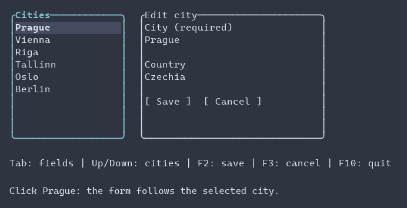

# Редактирование текущей записи {#record-edit-ru}

[English version](../record-edit.md) · [Общая навигация](model-navigation.md) · [Смена моделей](view-models.md)

Сессия редактирования нужна, когда список выбирает запись, а форма меняет её поля.
Она хранит черновик и историю независимо от временных контролов. При возвращении
к записи восстанавливается её черновик. Смена текущей записи не перенаправляет
начатую правку в другую запись, пока на экране ещё показана прежняя.

Для этого опционального API подключите `<portals/ui_model_edit.hpp>`.

Операции сессии и полей выполняются в UI-потоке, включая чтение сохранённого
черновика и применение ответа. Фоновая работа получает владеющие значения запроса;
перед вызовом `applyReply()` доставьте её ответ через существующий механизм
доставки в UI. Совместное владение не делает изменяемую сессию потокобезопасной.

## Справочник городов

Выберите город, измените название или страну и нажмите Save. Здесь используется
режим `EXPLICIT`: переход к другому городу сохраняет черновик первого. Вернитесь,
чтобы продолжить ввод. Cancel возвращает принятое значение текущей записи.
Пока фокус в списке, Up/Down меняют город; Tab переводит фокус между списком,
полями и кнопками. F2 сохраняет, F3 отменяет, F10 или Ctrl+C завершает приложение.

[Полный исходник](../examples/guide_record_edit.cpp):

\include docs/examples/guide_record_edit.cpp

## Когда значение попадает в модель

Сессия использует существующие режимы и валидацию редактора:

| Режим | Публикация и навигация |
|---|---|
| `IMMEDIATE` | Допустимый ввод сразу передаётся модели. Промежуточный недопустимый текст остаётся черновиком исходной записи. |
| `ON_COMPLETION` | Завершение пытается применить значение. Пользовательский переход отклоняется, если валидация, конфликт или ожидающее завершение не позволяют оставить существующую цель. |
| `EXPLICIT` | Переход сохраняет черновики по записям. Commit применяет текущую правку; cancel возвращает актуальное принятое значение. |

Вынужденное удаление записи нельзя отменить редакторским veto. Неприменённый
черновик остаётся связан с отсутствующей целью для явного чтения или восстановления.
Ближайшая сохранившаяся запись подходит для чтения, но не становится целью записи.
Закрытие источника запрещает дальнейшие изменения. Закрытие владельца сессии не
обещает автоматического сохранения: для более долгой жизни нужен явный владелец
или экспорт приложения.

Undo и Redo относятся к исходной записи и полю, а не заменяют commit/cancel.
История прежней версии не должна молча перезаписать внешние изменения. Хранение
ограничено бюджетом. Отказ в приёме правки сохраняет предыдущий ввод и позицию, а не
вытесняет несохранённый черновик ради освобождения места.

По умолчанию `EditOptions` допускает 128 сохранённых целей полей и логический
бюджет владеющих данных 4 MiB. В него входят сохранённые значения и ёмкости
текста и истории. Служебные данные аллокатора, временная подготовка и память,
которой владеет вызывающий код или источник, в этот бюджет не входят. Это
не ограничение RSS всего процесса. Собственные ограничения текстового редактора
тоже продолжают действовать.

## Поля и гарантии источника

`field(&City::name)` — локальный селектор процесса. Явный ключ вроде
`field("city.name", &City::name)` даёт адаптеру владеющую идентичность схемы.
Указатель на член не является переносимым идентификатором поля.

Цель записи содержит resource и lineage, экземпляр привязанной модели
(`sourceSession`), пространство запросов редактирования (`session`), точную
запись, поле, ожидаемую версию и sequence. Экземпляр модели — идентичность SDK,
а не поколение удалённого сервера. Адаптер с условной записью проверяет ожидаемую версию вместе с
применением изменения. Обновление другой записи не обязано создавать конфликт;
версия на уровне записи может консервативно конфликтовать при внешней правке
другого поля той же записи. Прямые изменения модели считаются внешними для активного черновика.

Приём запроса и принятие значения источником — разные результаты. Ожидающий ответ не очищает
более новый ввод. Поздний ответ относится к исходной цели и не отменяет более
свежее принятое значение. Результат каждого поля доступен через `lastResult()`.
Успешный `commit()` означает приём команды; ответы отдельных полей
позволяют отличить ожидающую работу от принятого значения. `commit()` и `cancel()`
возвращают существующий `EditorCommandResult`, как команды Undo/Redo редактора.
Из управляемого обработчика возвращайте его напрямую; для явной проверки ошибки
используйте `.result()`. Отдельные отправки полей не образуют одну атомарную
транзакцию.

В привязанном текстовом поле Escape отменяет правку этого поля. Кнопка Cancel
и F3 в примере отменяют правки полей текущей записи. Если обновлённое принятое
значение не помещается в бюджет хранения, отмена сообщает о восстанавливаемом
отказе по лимиту и сохраняет существующий черновик.

Cancel убирает локальный черновик, но не отзывает и не откатывает уже принятый
источником запрос. Он остаётся ожидающим; новый ввод в это поле ждёт ответа.
Удаление живой цели с выполняющимся запросом возвращает проверяемую ошибку
`WOULD_BLOCK`; после закрытия источника оставшийся черновик можно прочитать
и удалить.

Асинхронный адаптер обязан также проверять собственное поколение backend вместе
с применением изменения. Отбрасывание старого ответа в UI не исправляет устаревшую
запись, которую источник уже применил.

Источник только для чтения сохраняет навигацию и чтение полей. Отсутствие текущей записи не должно
ломать создание сцены. Внешние адаптеры используют ограниченный доступ к значениям полей
и существующие механизмы фоновой работы и доставки результатов. Они не загружают всю модель и не выполняют
блокирующий I/O в обработчике. Большой текст и привязки произвольных виджетов
имеют отдельные возможности: обычное поле не обещает пригодность полной копии
для любого источника.

[Декларативные типизированные формы](model-forms.md) собирают несколько полей
этой сессии в обычную композицию `FormField`/`LineEdit`.

`field.draftText(originalTarget)` явно копирует точные байты удерживаемого
текстового редактора без разбора и I/O. Это позволяет восстановить ошибочный
типизированный черновик после удаления записи. Для цели без текстового состояния
возвращается `nullopt`; проверки потока и идентичности сохраняются.

Выделение, закладки и точки сохранения текстового документа описаны в разделе [текстовые якоря](text-anchors.md).
