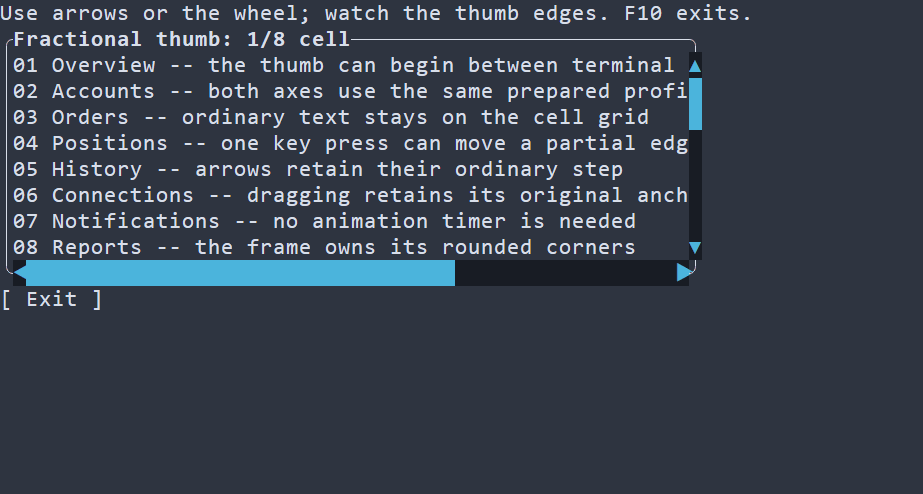
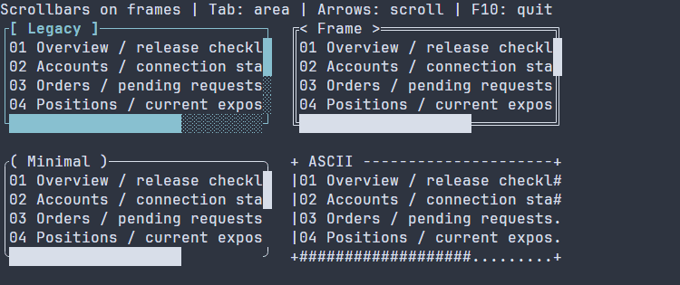
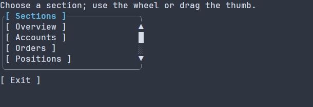
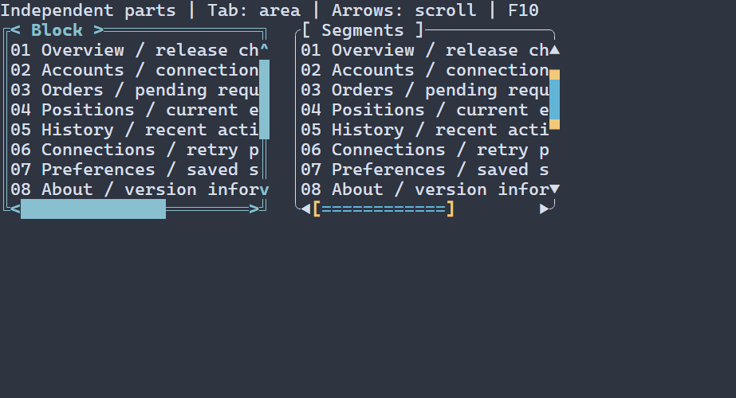
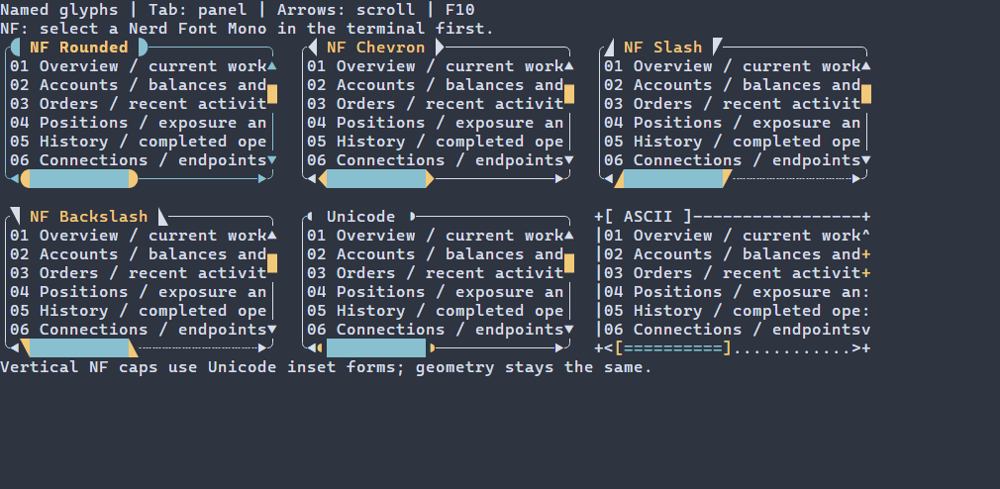

# Прокрутка обычного содержимого {#scroll-controls-ru}

[Английская версия](../scroll-controls.md)

Оберните один корень обычного содержимого в `ui::scrollArea`; несколько контролов
объедините через `ui::vbox`, `ui::hbox` или `ui::grid`. Сцена создаёт controller,
обрезает и перемещает содержимое, подготавливает layout и показывает контрол,
который получил фокус. Эта полная программа содержит восемь кнопок в округлой
рамке с заголовком Sections. Внешний размер — 28 столбцов на шесть строк,
внутри остаётся не более четырёх строк; полоса прокрутки лежит на рамке. Используйте колесо, стрелки, Page Up/Down, Home/End или
перетаскивайте ползунок. Exit и F10 завершают штатный runner с восстановлением терминала.

[Полный исходник](../examples/guide_scroll_controls.cpp):

\include guide_scroll_controls.cpp

Свяжите приложение с `portals::core`; см. [подключение пакета](package.md).
В [каталоге примеров](examples.md) приведена отдельная сборка через CMake.
Её программа `guide_scroll_controls` открывает нативный терминал.


## Дробные границы ползунка {#fractional-scrollbar-thumb-ru}

`.scrollbar("fractional-block")` задаёт ползунок, положение и пропорциональная
длина которого рассчитываются в восьмых долях ячейки. В управляемой сцене колесо,
клавиши направлений и перетаскивание проходят через промежуточные позиции
контроллера за 120 мс. Все представления общего контроллера видят одно положение.
Обычный текст продолжает перемещаться по сетке ячеек.

Переход использует существующий scheduler сцены и перестаёт планировать вызовы
после достижения цели. Новое событие колеса накапливает запрошенную конечную
позицию; отпускание ползунка позволяет закончить последний переход. Page/Home/End
и кнопки-стрелки на полосе сохраняют немедленное перемещение. Программная команда
позиционирования отменяет старый переход, в том числе при успешном назначении
того же значения. Скрытые, отключённые, отсоединённые контролы и контролы только
для чтения не продолжают анимацию.

По умолчанию один обычный детент колеса задаёт расстояние в три логические строки.
Нативный Windows-ввод сохраняет дробную величину и несколько детентов события;
координаты обычного перетаскивания по-прежнему измеряются целыми ячейками.
Плавный переход показывает промежуточные положения между такими событиями.

Длительность настраивается через `ScrollAreaOptions::smoothDurationMs` или
`ScrollBarOptions::smoothDurationMs`; ноль отключает переходы. Например,
`{.smoothDurationMs = 0}` можно передать существующим аргументом настроек в
`ui::scrollArea`. Целочисленные/ASCII-профили и низкоуровневые привязки без сервиса
часов сохраняют немедленное перемещение. Для низкоуровневого API общий сервис
повтора кнопок-стрелок и дробного движения описан типом `ScrollRepeatServices`.

В полном примере содержимое выходит за область просмотра по обеим осям.
Запустите цель `portals_docs_fractional_scroll` основной сборки либо соберите
`guide_fractional_scroll` в [проекте установленных примеров](examples.md).
Управление: стрелки и колесо; F10 и Exit закрывают приложение.

\include guide_fractional_scroll.cpp



В записи используются нативные события колеса Windows, в том числе по 1/8 обычного
деления, и перетаскивание ползунков по обеим осям. Сохранены захваченные кадры
терминала с частотой 50 кадров/с; промежуточные изображения не дорисованы.

Профиль использует пустую дорожку и подготовленные блочные глифы Unicode. Он
заполняет только отсутствующие локальные цвета текста и фона; цвета темы и явные
цвета частей и сегментов сохраняют обычный приоритет. Примеру не нужна таблица
стилей. Длина пропорциональна области просмотра, округляется сразу до восьмых
долей и ограничена существующим минимумом в одну ячейку. Дробная граница может
занять дополнительную ячейку. Частично занятые ячейки участвуют в перетаскивании.

Для PSS задайте `scrollbar-track-pattern: minimal` вместе с
`scrollbar-thumb-pattern: fractional-block`. Типизированные стили используют
`ScrollbarThumbPattern::FRACTIONAL_BLOCK`; загружаемая сцена принимает
`scrollbar { pattern=FRACTIONAL_BLOCK }`.

Непустая пользовательская дорожка, собственные окончания ползунка и политика
ширины, не поддерживающая нужные блочные глифы шириной в ячейку, отклоняются до
публикации новой конфигурации. Для таких случаев выберите обычный профиль
`block` или `ascii`. Скруглённые окончания остаются отдельным вариантом профиля
глифов. Изменение только дробной части смещения запрашивает PAINT; изменение
целой части или метрик также запрашивает layout. Paint использует готовые глифы
и актуальное owning-представление контроллера, в том числе при общем контроллере
нескольких контролов. Профиль не добавляет постоянную перерисовку или инерцию.
Растеризация глифов по-прежнему зависит от терминала и шрифта.

### Шрифт для дробных блоков

Переносимый профиль использует стандартные Block Elements U+2581–U+258F. Нижние
и левые блоки вместе с цветами текста и фона также задают верхние и правые доли.
Nerd Font не обязателен. Выбранный шрифт терминала должен содержать эти глифы и
выводить каждый в одной ячейке; проверка ширины Unicode не определяет отсутствие
символа в шрифте.

Для нативной записи используется Cascadia Mono. Проверенные локальные файлы
Cascadia Mono и DejaVu Sans Mono содержат все пятнадцать блоков; в проверенном
Consolas отсутствуют двенадцать из них и требуется подстановка другого шрифта.
Покрытие зависит от версии шрифта и не гарантирует выбор fallback конкретным
терминалом.

Эталонный [tui-scrollbar](https://docs.rs/tui-scrollbar/0.2.7/tui_scrollbar/)
по умолчанию использует дополнительные верхние и правые блоки U+1FB82–U+1FB8B из
[Symbols for Legacy Computing](https://www.unicode.org/charts/PDF/U1FB00.pdf).
Для них требуется отдельное покрытие шрифта. В проверенном 3270 Nerd Font Mono
они присутствуют, но само название Nerd Font не гарантирует нужный набор.
Переносимый дробный профиль Portals не требует этих дополнительных символов.

## Точное позиционирование указателя {#precise-pointer-scrolling-ru}

Обычный код `ui::scrollArea(...)` и `ui::scrollBar(...)` не требует новых настроек.
`ApplicationOptions::nativePointer` по умолчанию использует AUTO с неподтверждённым
порядком ввода и сохраняет обычные cell mouse reports. Нативные записи Windows
console также остаются клеточным backend. Колесо и клавиатурная прокрутка сохраняют
прежнее поведение.

Для подходящего POSIX-хоста расширенная настройка
`settings.nativePointer.ordering = NativeInputOrder::FIFO` задаёт контракт хоста:
полные пакеты ввода предшествуют ответам на запросы, обработанные позже, и не
перемешиваются с ответами. Portals не выводит это свойство из имени терминала,
окружения или успешного DECRPM. `NativePointerPolicy::OFF` отключает дополнительное
согласование. Физический pixel-хост пока не квалифицирован: за объявление порядка
отвечает вызывающая сторона, а PTY-моделирование не является приёмкой хоста.

[Полный расширенный пример](../examples/guide_precise_scroll.cpp) использует штатные
Lyra adapter и runner. Содержимое шире и выше viewport, поэтому доступны обе оси.
Соберите `guide_precise_scroll` через [отдельный проект примеров](examples.md),
связав его с `portals::lyra`. `--help` завершается до создания сцены и доступа к
терминалу. Обычный запуск сохраняет клеточный fallback; `--fifo-host` объявляет
описанный контракт и разрешает AUTO попытаться согласовать точность. F10 и Exit
штатно закрывают приложение. Коды завершения: 0 для справки/успешного завершения,
1 для runtime-ошибки, 2 для неверных аргументов. Режимы восстанавливает runner.

AUTO требует поддержки 1016, уведомлений о размере 2048, положительных размеров
в символах и ненулевых размеров текстовой области в пикселях. Дополнительный запрос
ограничен 100 мс и четвертью оставшегося setup-бюджета; обычной настройке остаётся
резерв времени. Отсутствующие/неподдерживаемые ответы и нулевые пиксели сохраняют
cell reporting. Свежие private-mode запросы с неповторяемыми в процессе nonce
связывают две FIFO-границы. Состояния tracking и encoding запрашиваются после первой
свежей границы и должны прийти до второй. Tracking должен быть выключен; выбранный
tracker — допускать изменение и находиться в reset. Оба encoding должны допускать
изменение и соответствовать прежним единицам. Permanent mode, отсутствие свежего
состояния или недостаточный output limit сохраняют cell-режим при запуске. Если
неизвестный nonce mode не отвечает, точность также не включается. Одной завершённой записи для доказательства границы мало. Если пользовательские
пределы декодера не вмещают нативные size/barrier reports, расширение не включается,
а пределы не увеличиваются. Смена шрифта без какого-либо report ненаблюдаема: хост
обязан присылать предусмотренные контрактом уведомления о размере.


Все POSIX-перегрузки запуска с включёнными сообщениями мыши требуют исходного
клеточного контекста. Если обязательные запросы режимов показывают уже активный
1016, запуск возвращает `INPUT_PROTOCOL` с
`TerminalProtocolIssue::INITIAL_PIXEL_CONTEXT_UNKNOWN` ("initial pixel context unknown")
до смены encoding/tracking: исходные метрики накопленных пиксельных samples неизвестны.
Проверка действует и при `OFF` для точного ввода, и без подтверждённого порядка FIFO.
Отключение сообщений мыши пропускает настройку мыши и запросы её режимов;
предсуществующий внешний ввод мыши в этом случае не классифицируется.
Остальные правила проверки неподдерживаемых или неполных ответов о режимах не меняются.

В каждом точном mouse event сохраняются `column`/`row` в клетках. Необязательное
owning-поле `precision` содержит пиксельные координаты от нуля, размеры в символах
и пикселях, использованные для этого sample, и поколение. Drag сохраняет точку
захвата и начальный логический offset. Обе оси используют проверенные рациональные
единицы до точного обратного отображения. Целые позиции выше 2^53 и обе конечные
позиции остаются точными. Текст по-прежнему рисуется в целых клетках; точность
указателя не меняет растеризацию текста или установленную частоту кадров.

Нативный resize, несовместимая метрика и смена размера шрифта отменяют capture и
удержание стрелки в порядке ввода. Смена шрифта не требует LAYOUT; освобождение
capture может запросить обычную перерисовку. Одинаковые reports не отменяют capture
и не создают новый кадр. Wire metrics не меняют нативный viewport: кандидат будущего
размера сохраняется до соответствующего resize, исторический report не откатывает
layout. Потеря пригодной метрики в pixel-режиме запрашивает ограниченный по времени
последовательный возврат к клеткам. Клавиши продолжают работать, неоднозначные pointer
samples подавляются только на время перехода. Отвергнутый слишком длинный или неверный CSI 48 также отменяет старый pixel-контекст.
Ошибка транспорта или deadline барьера возвращает `TerminalErrorKind::INPUT_PROTOCOL` с последующей очисткой.

Вывод режимов и не более одного отложенного кадра используют существующего нативного
владельца записи. Протокольные байты не входят в статистику завершённых байтов кадра.
Новый поток, scheduler и блокирующий I/O внутри input callback не добавляются.
Владелец активного drag выделяется до capture; отказ возвращает `NO_MEMORY` без
публикации anchor. MOVE не выделяет новый payload drag.

Спецификации: [SGR-Pixels 1016 и DECRPM](https://invisible-island.net/xterm/ctlseqs/ctlseqs.html),
[in-band resize 2048 / CSI 48](https://gist.github.com/rockorager/e695fb2924d36b2bcf1fff4a3704bd83).

## Сравнение стилей полос на рамке

В галерее с клавиатурным управлением одинаковый корень содержимого из восьми
подписей шириной 40 ячеек показан в четырёх внешних областях 30 на 6, сеткой
2 на 2. У каждой области размещение `ON_FRAME`: дорожки проходят по правой и
нижней линиям рамки. Показаны четыре стиля: legacy, frame, minimal и ASCII.
Отступы рамки оставляют viewport содержимого 28 на 4 ячейки до учёта прочих
отступов layout. Обычное содержимое из восьми строк не виртуализировано. Tab
переводит фокус на область, стрелки прокручивают её, F10 завершает приложение.

Стандартные темы выделяют части полосы при фокусе акцентным цветом на фоне
поверхности. Фокус не инвертирует фон и не меняет диапазон прокрутки.
Стили приложения могут переопределять оформление каждой части независимо.


[Статичный кадр PNG](../images/scrollbar-gallery.png)

Соберите `guide_scrollbar_gallery` через [отдельный проект руководств](../examples.md).
[Полный исходник](../examples/guide_scrollbar_gallery.cpp) приведён ниже.

\include guide_scrollbar_gallery.cpp

## Функциональные кнопки со стрелками

Добавьте `.arrows()` или `| ui::arrows()` к native `ScrollArea` или `ScrollBar`.
По умолчанию стрелки выключены; `.arrows(false)` переопределяет включённый default
контекста. Нажатие меняет позицию на `keyStep`. Managed-сцена автоматически
подключает удержание и очистку: первый повтор через 350 мс, затем один шаг каждые 60 мс.
Запоздавшая доставка делает один шаг, не накапливая пропущенные повторы.
`readOnly` блокирует ввод стрелок, сохраняя checked-программные команды.


[Статичный кадр PNG](../images/scroll-arrows.png)

Нативная запись MSVC Debug использует scripted SGR mouse press/release events:
удержание DOWN прокручивает вперёд, UP возвращает назад. Подписи обозначают
введённые события. Доставка событий от физической мыши host этим не проверена.

Канал длиной хотя бы3 ячейки резервирует первую и последнюю ячейки под кнопки.
Ползунок и его travel используют оставшуюся часть. Углы рамки и пересечение полос
в канал не входят. На более коротком канале кнопки сворачиваются без увеличения
минимального размера контрола и без изменения viewport/range. Отпускание, уход
указателя с нажатой кнопки, потеря capture, hide/disable, удаление и изменение
геометрии/метрик прекращают удержание. На границе диапазона таймер останавливается;
новых публикаций offset и перерисовок нет.

Constructor-only поля `ScrollAreaOptions`/`ScrollBarOptions`: `arrows`,
`arrowDelay`, `arrowRepeat`. Оба интервала — положительные целые миллисекунды;
ноль и переполнение deadline возвращают `TreeError::INVALID_ARGUMENT`.
Sparse settings и загружаемые сцены используют те же имена, например
`ScrollBar{arrows=true arrowDelay=400 arrowRepeat=80}`. PSS меняет оформление;
переключение поведения после mount в этот API не входит.

Glyphs функциональных стрелок независимы от декоративных `ScrollbarSkin::ends`:
`horizontal.backward`, `horizontal.forward`, `vertical.backward`, `vertical.forward`.
В ресурсе добавьте к путям префикс `scrollbar.`. Custom glyph — ровно один
printable grapheme шириной 1 ячейка под принимающей width policy; пустая строка
недопустима. Defaults — Unicode triangles с существующим ASCII fallback.
Свойства `scrollbar-arrows-foreground/background/bold/italic/underline` задаются
по отдельности и не меняют track, thumb, decorative ends, corner или frame.

Прежние low-level overloads `bindScrollArea(router, tree, node)` и
`bindScrollBar(router, tree, node)` дают один шаг по клику. Overloads с
`ScrollRepeatServices{now, onError}` добавляют удержание через `WidgetTree::at`
и существующий scheduler scope узла. Передайте источник времени того же scheduler
и обработчик typed `TreeError` для поздних ошибок регистрации. Дерево и references,
захваченные callbacks, должны пережить узел, binding и допущенные вызовы.
Callbacks копируются; их исключения проходят существующую callback-failure границу.
Ошибка регистрации при первом нажатии не меняет offset. Поздняя ошибка сначала
останавливает удержание, затем вызывает `onError`. При отсутствии host capture
capabilities оба overloads сохраняют одиночный клик.

## Содержимое и размещение полос

Обычное содержимое остаётся в памяти, включая контролы вне viewport; оно
измеряется и размещается как обычное поддерево. Для больших наборов данных
используйте [виртуальные views](virtual-preparation.md), которые владеют своим
состоянием прокрутки. Встроенные полосы не добавляют Tab stops.
`ScrollAreaOptions::focusable` управляет собственной остановкой области;
клавиатурный фокус на дочернем контроле остаётся на этом контроле.

`ScrollAreaOptions` задаёт наличие полос, шаги, размещение и необязательную рамку.
Каждая ось поддерживает `AUTO` (полоса при переполнении), `ALWAYS` и `NEVER`.
`NEVER` скрывает полосу; колесо, клавиши и checked-команды продолжают работать.
По умолчанию колесо перемещает содержимое на три логические ячейки, стрелки —
на одну, Page Up/Down — на страницу с перекрытием в одну ячейку.
Home/End выбирают границы диапазона.

| Размещение | Viewport и содержимое |
| --- | --- |
| `RESERVED` (по умолчанию) | Видимая полоса занимает отдельную полосу шириной в одну ячейку. |
| `OVERLAY` | Номинальные viewport и диапазон сохраняются; полоса закрывает крайние ячейки. Reveal гарантирует номинальную видимость. |
| `ON_FRAME` | Правая/нижняя линии собственной `frame` области служат дорожками без углов и без второго отступа содержимого. |

Для `ON_FRAME` используйте `.framed("rounded", "Sections").scrollOnFrame()`
или pipe-вариант `| ui::framed("rounded", "Sections") | ui::scrollOnFrame()`.
Для тонкой настройки остаются `options.frame = BorderOptions{}` и
`options.placement = ScrollPlacement::ON_FRAME`. Отдельный `ui::border`
не предоставляет собственную рамку области. Отсутствующая рамка или неверные настройки возвращают
`TreeError::INVALID_ARGUMENT`. `readOnly` отключает пользовательскую прокрутку,
сохраняя reveal фокуса и checked-команды. Вложенные обычные области используют
обрезку того же дерева и managed-подготовку; у каждой свой корень содержимого.

## Вложенные формы {#nested-scroll-areas-ru}

Эта полная форма содержит редактируемые поля подключения и CheckBox с внутренним
состоянием. У каждой области своя рамка `ON_FRAME`; высота внутренней формы —
шесть строк, внешней — девять. Tab меняет контрол, Space переключает CheckBox,
Exit или F10 завершает штатный runner. Значения живут в сцене и не сохраняются.

\include guide_nested_scroll.cpp

Соберите `guide_nested_scroll`
через [отдельный проект руководств](examples.md) или `portals_docs_nested_scroll`
с `PORTALS_BUILD_TESTS=ON`. Installed-package consumer компилирует этот же исходник;
интерактивная программа не запускается как автоматический тест.

Wheel-событие начинает обработку у контрола под указателем и проходит к предкам
по обычной маршрутизации. Если внутренняя область изменила offset, она обрабатывает
событие целиком, в том числе при частичном сдвиге до границы; остаток delta наружу
не передаётся. Следующее событие на границе не меняет её offset и может прокрутить
внешнюю область. Дочерний обработчик, принявший событие, останавливает этот проход.

Ручная прокрутка колесом или checked-командой `setOffset` сохраняет фокус и не
вызывает повторный reveal прежнего контрола. Новый фокус снова включает reveal
через окружающие области. `reference.ensureVisible()` запрашивает checked-разовое
появление цели в следующем подготовленном кадре без смены фокуса; проверяйте
`std::expected<void, ManagedError>`. См. [фокус](focus.md). `readOnly` отключает
пользовательскую прокрутку области, сохраняя работу дочерних контролов,
checked-команд и reveal фокуса; непринятое wheel-событие может дойти до предка.

Paint и hit testing используют одинаковую унаследованную обрезку содержимого.
Внутренняя рамка движется вместе с внешним содержимым; `ui::border` снаружи области
остаётся неподвижной. Дорожки собственной рамки исключают углы и не добавляют
второй gutter; закрытые рамкой ячейки содержимого не принимают ввод. Скрытие предка
или отключение области отменяет её drag capture; скрытие сохраняет канонический
offset. Удаление области завершает её bindings и capture: поздние motion/release
не используют удалённую цель. Resize или удаление содержимого ограничивает offset
при видимой подготовке.

Обе формы — обычные retained-поддеревья: даже дочерние контролы вне viewport
участвуют в обычном layout, работа которого растёт с их количеством. Для больших
логических наборов [виртуальные views](virtual-preparation.md) подготавливают
ограниченные видимые/overscan-диапазоны и владеют своим состоянием прокрутки.
Вложение обычных областей не добавляет виртуализацию.

## Общий controller и checked-команды

Обычной области не требуется controller, сохранённый приложением.
Вызывайте `ScrollController::create()`, когда другой контрол должен использовать
те же значения. Передайте владеющий handle в
`ui::scrollArea(child, options, controller)` и `ui::scrollBar(controller, axis)`.
Одна смонтированная область записывает метрики; полоса отображает выбранную ось
и может менять offset. Вторая область с правом записи того же controller
отклоняется. Все смонтированные проекции должны принадлежать одной сессии дерева;
чужая сессия возвращает `TreeError::WRONG_SESSION`.

Отдельная `ui::scrollBar(reference, axis)` создаёт свой controller и владеет
метриками. Задайте их через `reference.setMetrics({extent, viewport})`.
Полоса, общая с областью, менять метрики не может: команда возвращает
`TreeError::INVALID_ARGUMENT`. Позицию смонтированной области или полосы меняет
`reference.setOffset(axis, {integral, fraction})`; проверяйте результат
`std::expected<void, ManagedError>`. Низкоуровневые
`setScrollOffset(tree, node, axis, offset)` и `setScrollMetrics` сохраняют
checked-результаты с `TreeError`. Команды выполняются на UI-потоке владельца
между кадрами. Удалённые/закрытые цели возвращают существующие типизированные
ошибки жизненного цикла.

Controller владеет значениями и не хранит ссылки на дерево, router или виджет.
`snapshot()` на создавшем его UI-потоке возвращает владеющее наблюдение обеих осей
и revision. Handle и копии snapshots могут пережить сцену; уничтоженное дерево
они не будят. Удаление полосы завершает её binding/capture, сохраняя остальные
проекции. Удаление области освобождает право записи метрик; другая проекция
автоматически этого права не получает.

Offset сохраняет точную целую часть `uint64_t` и конечную дробную часть в `[0,1)`.
Максимум равен `max(extent - viewport, 0)` или нулю при нулевом viewport;
на максимуме дробная часть равна нулю. `scrollRange`, `scrollThumb` и
`scrollOffsetForThumb` сохраняют целочисленные границы выше 2^53 без преобразования
полной позиции в `double` и обратно. Обычный layout по-прежнему использует
знаковые 32-битные координаты ячеек; непредставимые layout/translation возвращают
`TreeError::INVALID_GEOMETRY`. Точные метрики controller не виртуализируют обычное поддерево.

## Нативные сессии и собственные hosts

Смонтированный scroll-контрол непосредственно перед открытием нативного терминала
запрашивает движение с удерживаемой кнопкой. У обычной сцены запрос выключен,
исходный профиль сохраняется: POSIX проверяет только кодирование
1005/1006/1015/1016 и использует 1000+1006. Scroll opt-in дополнительно проверяет
1002 через DECRQM. Статусы 1 (set), 2 (reset) и 3 (permanently set) допускают
движение; 0 (unknown) и 4 (permanently reset) возвращают `TerminalErrorKind::UNSUPPORTED`.
Отсутствующие/повреждённые ответы расходуют существующий deadline подготовки
и сохраняют исходную типизированную ошибку. Успешная отправка 1002h сама по себе
не доказывает поддержку. Cleanup восстанавливает tracking через XTRESTORE,
а проверенное кодирование — существующим путём восстановления. Windows использует
нативные записи мыши с признаком удерживаемой кнопки.
См. [жизненный цикл приложения](application.md).

`nativeMouseReporting=false` имеет приоритет: запросов/изменений мышиного протокола
нет, перетаскивание недоступно. Поздно смонтированные контролы используют уже
открытый профиль; mount не переключает режимы терминала посреди сессии.

Собственные `ApplicationTerminal` и `ApplicationReadyTerminal` явно возвращают
достаточные `pointerCaptureCapabilities()`: движение с удерживаемой кнопкой,
соответствующий LEFT release (или явная отмена), надёжный признак удерживаемой кнопки.
По умолчанию drag недоступен; колесо, клавиши и нажатия дорожки работают.
Host вызывает `EventRouter::cancelPointerCapture()` при потерянной последовательности
или внешней потере фокуса/возможностей. Модель ввода не определяет несообщённую
потерю фокуса ОС. Resize, Escape, остановка сессии и cleanup завершают capture.
Пока capture действителен, drag продолжается за пределами прямоугольника владельца.

`ui::runApp()` собирает checked-ошибки mount/preparation/input и пытается выполнить
cleanup до возврата кода завершения. Ошибки нативной подготовки остаются явными;
возможности становятся доступны только после успешной подготовки.
[Спецификация DECRQM и button-event tracking xterm](https://invisible-island.net/xterm/ctlseqs/ctlseqs.html)
описывает режимы 1002 и 1006; синтаксически правильный ответ не удостоверяет host.

## Оформление частей scrollbar {#scrollbar-skins-ru}

После `.scrollOnFrame()` добавь `.scrollbar("frame")`: дорожка использует
подготовленные линии рамки, в том числе пользовательской. Без рамки этот пресет
берёт одинарные линии. Pipe-вариант — `| ui::scrollbar("frame")`.

Полные программы: [C++](../examples/guide_scrollbar_skin.cpp) и
[сцена из ресурса](../examples/guide_scrollbar_resource.cpp). Цели
`portals_docs_scrollbar_skin` и `portals_docs_scrollbar_resource` доступны
при включённых тестах; программы интерактивно запускаются через `runApp`.

\include guide_scrollbar_skin.cpp

| Пресет | Дорожка | Ползунок |
| --- | --- | --- |
| `legacy` (по умолчанию) | Прежняя затенённая | Прежний блок |
| `frame` | Подготовленная линия нужной оси | Блок |
| `minimal` | Пробел | Блок |
| `ascii` | Точка | Решётка |

`ScrollbarSkin` владеет необязательными символами для горизонтальной и
вертикальной осей, декоративными окончаниями и углом. Каждый заданный символ —
одна печатная графема шириной в ячейку в принимающей width policy, не больше
`maxGlyphBytes` байт UTF-8 (по умолчанию 64). Дорожка и ползунок не могут быть
пустыми; пустое окончание скрывает декорацию, пустой или отсутствующий угол
сохраняет заливку. Неверная настройка возвращает typed error до замены оформления.

Окончания по умолчанию выключены и занимают существующие ячейки дорожки;
ползунок имеет приоритет. Размеры, диапазон, смещение, фокус, перетаскивание и
действия клика сохраняются; отдельных кнопок со стрелками нет. `ON_FRAME`
сохраняет углы рамки. Символ угла scrollbar используется только там, где
существующая геометрия предоставляет пересечение двух полос.

PSS-префиксы `scrollbar-track-`, `scrollbar-thumb-`, `scrollbar-ends-` и
`scrollbar-corner-` принимают `foreground`, `background`, `bold`, `italic` и
`underline`. Действуют обычные состояния, селекторы и слои, включая явный
`false`. Цвета и атрибуты общие для обеих осей, символы задаются раздельно.
Runtime, типизированные и compile-time таблицы поддерживают те же объявления;
общий стиль остаётся fallback.

Ресурс задаёт `scrollbar { pattern=FRAME ends=true }`, необязательный
`maxGlyphBytes`, группы `horizontal { track="-" thumb="#" start="<" end=">" }`,
`vertical { track="|" thumb="#" start="^" end="v" }` и `corner="+"`.
Точечный путь `scrollbar.vertical.thumb` эквивалентен группе. Оформление не
включает рамку и не меняет placement. Low-level вызов
`setScrollbarSkin(tree, node, skin)` выполняет проверяемую атомарную замену.

### Независимые источники и сегментный ползунок

[Полный обычный клиент](../examples/guide_scroll_controls.cpp) сохраняет рамку и
оформление заголовка независимо от `.scrollTrack("minimal")`,
`.scrollThumb("block")` и `.scrollArrows("ascii")`. Для методов есть эквивалентные
pipe stages, например `| ui::scrollThumb("ascii")`, и типизированные перегрузки.
Источники дорожки — `ScrollbarPattern` (`legacy`, `frame`, `minimal`, `ascii`),
ползунка — `ScrollbarThumbPattern` (`legacy`, `block`, `ascii`), стрелок —
`ScrollbarArrowPattern` (`legacy`, `triangle`, `ascii`). `block` и `triangle`
сохраняют ASCII/width fallback контрола. Выбор оформления не включает кнопки:
для этого служит отдельный `.arrows()`.

Общий `.scrollbar(...)` задаёт базовый источник. Явный источник части имеет
приоритет независимо от порядка method/pipe stages; собственные символы оси
имеют приоритет над пресетом части. Пропущенные листья сохраняют значения
контекста. Low-level `setScrollbarSkin` остаётся атомарной заменой всего skin.

К каждой оси можно добавить owning-поля `thumbStart`, `thumbBody`, `thumbEnd` и
`thumbSingle`. Например:

```cpp
ScrollbarSkin skin;
skin.horizontal = {.thumb = "#", .thumbStart = "[", .thumbBody = "=", .thumbEnd = "]", .thumbSingle = "o"};
skin.vertical = {.thumb = "#", .thumbStart = "A", .thumbBody = "I", .thumbEnd = "V", .thumbSingle = "O"};
```

Нулевая длина ничего не рисует; одна ячейка использует `thumbSingle`, две —
start/end, большая длина — start/body/end. Пропущенный сегмент использует прежний
повторяемый `thumb` либо его действующий пресет. Пустые сегменты недопустимы;
действуют прежние проверки печатной графемы шириной в ячейку и `maxGlyphBytes`.
Подготовка owning-текста выполняется до публикации; paint выбирает готовый текст.
Декоративные `start`/`end`, функциональные стрелки, клики дорожки и геометрия
сохраняют существующее поведение.

Загружаемая сцена принимает `scrollbar { trackPattern=MINIMAL thumbPattern=BLOCK
arrowPattern=ASCII horizontal { thumbStart="[" thumbBody="=" thumbEnd="]"
thumbSingle="o" } }`; точечные листья эквивалентны.
PSS принимает префиксы `scrollbar-thumb-start-`, `scrollbar-thumb-body-`,
`scrollbar-thumb-end-` и `scrollbar-thumb-single-` с каждым из свойств
`foreground`, `background`, `bold`, `italic` и `underline`. Пропущенный атрибут
сегмента наследует разрешённый общий атрибут `scrollbar-thumb-*`. Сегменты
используют действующий каскад селекторов, состояний и слоёв, включая явное `false`;
стиль общий для обеих осей и действует с собственными глифами и пресетами.
Одна ячейка выбирает только `single`, две — `start`/`end`, большая длина —
`start`/`body`/`end`. Декоративные `scrollbar-ends-*` и функциональные
`scrollbar-arrows-*` остаются независимыми. Runtime, typed, literal и compact PSS
используют одни декларации, в том числе при стилизации загруженной сцены.

```css
#segments {
  scrollbar-thumb-foreground: #62b4d7;
  scrollbar-thumb-bold: true;
  scrollbar-thumb-start-foreground: #f2c879;
  scrollbar-thumb-end-foreground: #f2c879;
  scrollbar-thumb-body-bold: false;
  scrollbar-thumb-single-underline: true;
}
```

В `StyleDeclarations` доступны группы paint-атрибутов `scrollbarThumbStart`,
`scrollbarThumbBody`, `scrollbarThumbEnd` и `scrollbarThumbSingle`. Compile-time
декларации используют соответствующие функции, например
`scrollbarThumbStartForeground(rgb(242, 200, 121))` и
`scrollbarThumbBodyBold(false)`. Рамка и заголовок сохраняют собственные настройки.
Низкоуровневый `ComputedStyle` сохраняет owning-значения сегментов inline для
совместимости исходников; `resolveStyle` остаётся allocation-free и `noexcept`.
Managed-контролы используют компактный `StyleSnapshot` и общие необязательные
расширения. Совпавшее расширение подготавливается до публикации; ошибка выделения
памяти сохраняет предыдущий валидный стиль. Контролы без этих расширений не
резервируют их встроенное хранение. Paint использует подготовленные значения.


Символ шириной в ячейку не обещает радиус пиксельного GUI или наличие в шрифте.
Проверяйте собственные окончания и [именованные наборы глифов](#named-glyph-profiles-ru)
на целевом host. ASCII и прежний блок доступны явно.

PSS также выбирает те же именованные источники:

```pss
ScrollArea {
  scrollbar-track-pattern: minimal;
  scrollbar-thumb-pattern: block;
  scrollbar-arrow-pattern: ascii;
}
ScrollArea:focused { scrollbar-track-pattern: frame; }
```

Каждое объявление проходит обычные tier/selector/state правила, заменяет
C++-пресет своей части и сохраняет остальные части. Собственные символы осей и
сегменты имеют приоритет над именованным источником. Типизированные таблицы
предоставляют `scrollbarTrackPattern`, `scrollbarThumbPattern` и
`scrollbarArrowPattern` с соответствующими enum. Runtime, literal и compact PSS
проверяют одинаковые значения; неверное имя/ordinal атомарно отклоняет таблицу.
Runtime PSS также принимает [собственные символы](#literal-scrollbar-glyphs-ru)
для отдельных частей. Именованные формы доступны и в compile-time PSS.

### Собственные символы скроллбара {#literal-scrollbar-glyphs-ru}

Runtime PSS хранит собственный текст отдельных частей скроллбара:

```pss
ScrollArea {
  scrollbar-horizontal-thumb-start-glyph: "[";
  scrollbar-horizontal-thumb-body-glyph: "=";
  scrollbar-horizontal-thumb-end-glyph: "]";
  scrollbar-vertical-thumb-body-glyph: "│";
}
```

Используй `scrollbar-horizontal-<part>-glyph` или
`scrollbar-vertical-<part>-glyph`. Вместо `<part>` допустимы `track`, `thumb`,
`start`, `end`, `backward`, `forward`, `thumb-start`, `thumb-body`, `thumb-end`
и `thumb-single`. `start`/`end` украшают концы дорожки, а `thumb-start`/`thumb-end`
— концы движущегося ползунка. `scrollbar-corner-glyph` задаёт пересечение осей.
Эти объявления не включают кнопки-стрелки или декоративные концы: для них
сохраняются `.arrows()` и соответствующая настройка концов.

Значение — UTF-8-строка в кавычках, не более 64 байт на символ. Непустое значение
должно состоять из одной печатной графемы шириной в одну ячейку согласно
`WidthPolicy` контрола. Пустые декоративные `start`/`end` скрывают украшение;
пустой угол сохраняет обычную заливку. Для остальных частей пустая строка
недопустима. Поддерживаются одинарные и двойные кавычки без escape-последовательностей;
для символа кавычки выбери другой ограничитель строки.

К каждому свойству применяются существующие приоритеты слоёв, селекторов и
состояний. Ручные символы контрола имеют приоритет над PSS; символы из PSS —
над именованными формами и профилями. Ошибка обновления сохраняет предыдущее
валидное оформление. Недопустимый явно заданный символ приводит к ошибке,
а не к выбору fallback профиля. Удаление слоя снова открывает значение нижнего
слоя или контрола.

Низкоуровневый `StyleError` сообщает `line`, `column`, `propertyName()` и
`layerId`; имя файла в нём не хранится. Граница `runApp` использует существующий
владеющий контекст `ManagedError.styleSource` для полного имени, когда оно
доступно. После ошибки выделения памяти этот необязательный контекст может
отсутствовать. Копирование ошибки не требует аллокаций.

Парсер и движок стилей сохраняют владеющие копии: исходная строка и файл не
обязаны жить после успешного применения. Проверка и подготовка графем происходят
до публикации; отрисовка читает готовые значения. Собственные символы пока
поддерживает только runtime PSS: compile-time PSS отклоняет такие объявления,
а подстановки `$name` в runtime-грамматике пока нет.

[Полная программа со строкой](../examples/guide_scrollbar_parts.cpp) и
[полная программа с файлом](../examples/guide_scrollbar_parts_file.cpp) показывают
одинаковые панели. Во втором случае используется
`ui::styleFile("scrollbar-parts.pss")`; сохрани [таблицу стилей](../../docs/examples/scrollbar-parts.pss)
в рабочем каталоге. В сборке библиотеки CMake копирует файл в корень build:

```powershell
cmake --build build/windows-msvc-release --target portals_docs_example_guide_scrollbar_parts_file
Push-Location build/windows-msvc-release
try { .\portals_docs_example_guide_scrollbar_parts_file.exe } finally { Pop-Location }
```

### Галерея полос в двух панелях

[Полный исходник галереи](../examples/guide_scrollbar_parts.cpp) показывает две
независимые внешние области размером 26×10. С `.scrollOnFrame()` область просмотра
каждой занимает 24×8; обе прокручивают обычное содержимое из 12 строк шириной
36 столбцов. В левой панели дорожка повторяет линии рамки, а кнопки-стрелки
используют ASCII. Правая задаёт собственные сегменты ползунка и выбирает именованные
пресеты дорожки, ползунка и стрелок через PSS. Текст символов и их цвета заданы вместе в PSS-правиле
`#segments`; ручная конфигурация skin не требуется. Каждый fluent-метод или
pipe stage меняет только свою часть.

Нажми Tab, чтобы перевести фокус между областями, стрелки — для прокрутки; удерживай
кнопку-стрелку мыши для повторной прокрутки. F10 завершает программу. Запись галереи:



\image html scrollbar-parts.gif "Галерея частей полосы прокрутки в двух панелях"

\include guide_scrollbar_parts.cpp

## Именованные наборы глифов {#named-glyph-profiles-ru}



[PNG](../images/glyph-profiles.png)

Набор глифов выбирается отдельно от темы. Значение по умолчанию сохраняет
прежний вывод. Короткая запись для области прокрутки:

```cpp
ui::scrollArea(content())
  .glyphProfile("nf-rounded")
  .glyphFallback("unicode")
  .framed("rounded", "Orders")
  .titleDecoration("profile")
  .scrollOnFrame();
```

Здесь `content()` возвращает обычный рецепт содержимого. Полная
[галерея профилей](../examples/guide_glyph_profiles.cpp) создаёт сцену и использует
стандартный runner для ввода и восстановления терминала. Соберите её как
`guide_glyph_profiles` через [отдельный проект примера](examples.md).
Золотой текст заголовков задан явным правилом `frame-title-foreground`;
выбор профиля NF не изменяет цвета.

`.glyphProfile(GlyphProfile::NF_ROUNDED)` и `| ui::glyphProfile("nf-rounded")`
выбирают один набор. `.glyphFallback(GlyphFallback::ASCII)` и
`| ui::glyphFallback("ascii")` задают переносимый резерв. Рецепты с размером
применяют набор к своей необязательной рамке; ScrollArea и ScrollBar также
используют его в полосах прокрутки. В ручных настройках низкого уровня доступны
`BorderOptions::glyphSelection` и `ScrollbarSkin::glyphSelection`.
Они хранят собственные логические значения.

| Имя PSS / компактной записи | C++ `GlyphProfile` | Начало / конец горизонтального ползунка | Одна ячейка |
| --- | --- | --- | --- |
| `default` | `DEFAULT` | Текущий ручной набор либо прежние глифы | Прежний глиф |
| `unicode` | `UNICODE_GLYPHS` | U+25D6 / U+25D7 | U+25CF |
| `ascii` | `ASCII` | `[` / `]` | `#` |
| `nf-rounded` | `NF_ROUNDED` | U+E0B6 / U+E0B4 | U+25CF |
| `nf-chevron` | `NF_CHEVRON` | U+E0B2 / U+E0B0 | U+25C6 |
| `nf-slash` | `NF_SLASH` | U+E0BA / U+E0BC | U+2588 |
| `nf-backslash` | `NF_BACKSLASH` | U+E0BE / U+E0B8 | U+2588 |

Карта NF использует символы Powerline из
[карты Nerd Fonts 3.4](https://github.com/ryanoasis/nerd-fonts/blob/v3.4.0/glyphnames.json).
В принимающем терминале нужен активный Nerd Font Mono. Portals не устанавливает,
не распространяет и не определяет шрифты. Отсутствующий символ шрифта может
отобразиться квадратом даже при допустимой ширине в одну ячейку по WidthPolicy;
это не ошибка проверки ширины. Если поддержка NF на хосте неизвестна,
явно выберите Unicode или ASCII.

Колпачки NF горизонтальные. Вертикальный ползунок использует Unicode U+2584
и U+2580 по краям, U+2588 внутри и в одной ячейке. При явном резерве ASCII
вертикальные края — `+`, тело и одиночный глиф — `#`. Поворота глифов нет.
Горизонтальное тело Unicode/NF — U+2588, ASCII — `=`. Длины один, два и больше
выбирают single, start/end и start/body/end в прежней геометрии ползунка.

PSS использует существующие состояния и слои:

```css
ScrollArea { glyph-profile: nf-rounded; glyph-fallback: unicode; }
ScrollArea:disabled { glyph-profile: ascii; }
```

`StyleDeclarations::glyphProfile` / `glyphFallback`, типизированные
`style::ct::glyphProfile(...)` / `glyphFallback(...)`, PSS времени компиляции
и стили загруженной сцены используют те же логические объявления.
Настройки создания в загруженной сцене записываются как
`glyphProfile=NF_ROUNDED` и `glyphFallback=UNICODE_GLYPHS`; правило PSS
над ними имеет приоритет. Имя `UNICODE_GLYPHS` не конфликтует с Windows-макросом `UNICODE`.

Приоритет глифов: ручной профиль, профиль PSS, явные независимые рисунки track/thumb/arrows,
затем литеральные собственные глифы и сегменты ползунка. Удаление переопределения
возвращает актуальный ручной набор. Замена ручного skin сохраняет активные
переопределения PSS. Цвета и атрибуты сегментов разрешаются независимо.

Имеющийся рисунок рамки и собственные линии сохраняются. Набор ASCII подставляет
ASCII-линии под собственные литеральные источники. Профильные края заголовка
включаются явно: `.titleDecoration("profile")` или `TitleDecoration::PROFILE`.
NONE, квадратные, круглые и собственные края сохраняются; собственные края
по-прежнему имеют приоритет.

Глифы подготавливаются по WidthPolicy получателя. При недопустимой ширине
используется выбранная Unicode- или ASCII-замена; для Unicode возможен переход
на ASCII. Недопустимые литеральные источники отклоняют обновление. Ошибка выделения
памяти сообщает `NO_MEMORY` и сохраняет прежние стили и ресурсы. Перед публикацией
стилей подготавливаются все затронутые собственные ресурсы. Paint заимствует их
синхронно без выделения памяти, разбора строк и callbacks. Создание с настройками
по умолчанию не подготавливает наборы NF.

\include guide_glyph_profiles.cpp
