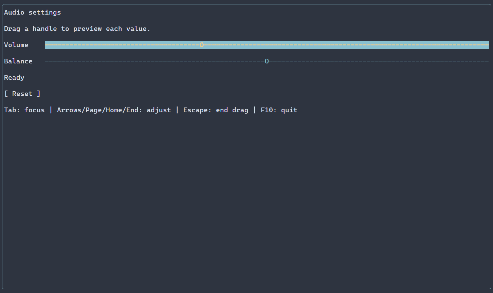
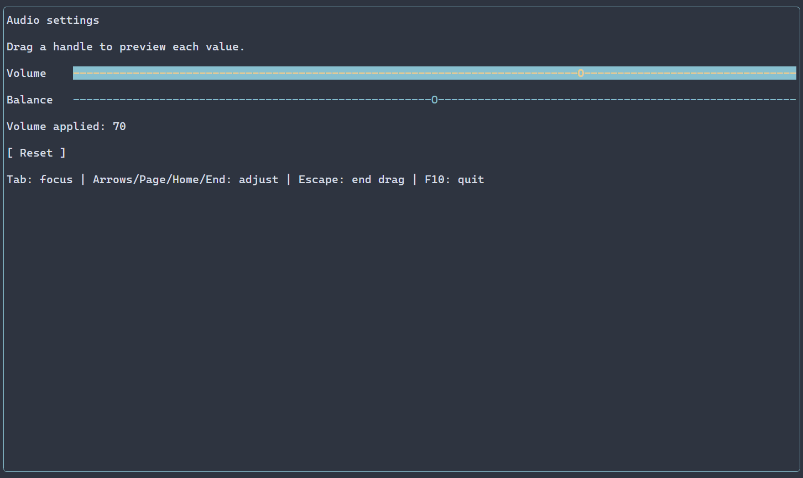

# Числовые слайдеры {#sliders-ru}

[English version](../sliders.md) · [Контролы](controls.md) · [Привязки](bindings-guide.md)

Слайдер позволяет пользователю менять ограниченное значение, например громкость; [Gauge](gauge.md) отображает значение или прогресс и не принимает такой ввод. Слайдер подходит, когда важно положение в диапазоне; для непосредственного ввода числа используйте [SpinBox](spin-boxes.md). Настройки и проверяемые операции описаны в [API Slider](../../include/portals/slider.hpp). Запись ниже показывает полную форму настроек, а не только короткий пример руководства.

С помощью `ui::slider()` можно изменять конечное числовое значение мышью или
клавиатурой. По умолчанию горизонтальный слайдер начинает с нуля в диапазоне
0..100 включительно, с пользовательским шагом 1 и естественной шириной 20 клеток.

## Полное приложение

Пример изменяет одно число из источника сцены и обновляет подпись после каждого
изменяющего пользовательского commit. F10 завершает приложение.

\include guide_slider.cpp

В checkout пример собирается командой `cmake --build <build> --target portals_docs_slider`.
Для установленного SDK можно собрать тот же исходник по разделу
[Подключение пакета](package.md). `ui::runApp()` управляет native-сессией и
возвращает результат после восстановления терминала и освобождения сцены.

Для громкости и баланса, live preview, Reset и завершения жеста соберите
`portals_slider_example` с `PORTALS_BUILD_EXAMPLES=ON` и запустите
[полное приложение настроек](../../examples/slider/main.cpp).

Полоса использует ASCII-символы `-` и `O`. К ней применяются обычная тема,
селектор `Slider`, классы, состояния фокуса и отключения, рамки и ограничения
размера. Естественная ширина относится к измерению содержимого; `.flex(1)`
позволяет строке выделить больше места. Оба одноклеточных символа проверяются
с одной политикой ширины текста.





Запись сделана с native-бэкендом консоли Windows. Во время перетаскивания
`onPreview` сообщает меняющееся значение; отпускание завершает один жест.
## Настройка источника

Независимый рецепт позволяет задать окончательные границы и шаг:

```cpp
auto gain = ui::slider(0.5).range(0, 1).step(0.1);
```

`ManagedScene::numericState(initial, NumericRange)` создаёт числовой источник,
которым владеет сцена. `NumericState` слабо наблюдает этот источник. Снимок
`NumericValue` владеет значением, границами и шагом; изменяемые поля, через которые
можно нарушить инвариант, наружу не выдаются. Публикация и восстановление используют
существующий Property. Отдельный scheduler или история Undo не создаются.

Начальное значение и границы должны быть конечными. Нижняя граница строго меньше
верхней, положительная разность границ представима, шаг положителен. Если шаг
меньше диапазона, он должен изменять double у обеих границ. Шаг не меньше всего
диапазона разрешён. Явное значение вне границ отклоняется. Только неуказанное
начальное значение допускает запасной ноль, ограниченный окончательным диапазоном.

Программное значение может находиться между пользовательскими отметками.
Инициализация, `NumericState::set(double)` и `slider.value() = value` не округляют
его. `NumericState::configure(initial, range)` атомарно заменяет весь набор;
новое значение задаётся явно и проверяется, прежнее значение не ограничивается
молча. Если числовой источник уже передан, дополнительные value/range/step —
ошибка `INITIAL_CONFLICT`, даже при совпадении значений. Источник сохраняется.

## Ввод и обработчики

| Ввод | Результат |
|---|---|
| Left/Down, Right/Up | Уменьшить/увеличить текущее значение на шаг с остановкой у границы |
| PageDown/PageUp | Применить `.pageSteps(count)` шагов; по умолчанию 10 |
| Home/End | Выбрать точную нижнюю/верхнюю границу |
| Левый щелчок или перетаскивание | Выбрать ближайшую отметку от minimum либо maximum; при равенстве расстояний выбрать большую |
| Escape или потеря capture | Завершить жест, сохранив уже применённые значения |

Для диапазона 0..10 с шагом 3 мышь выбирает 0, 3, 6, 9 и 10. Выбор мышью сравнивает
точные расстояния для заданных чисел binary64, затем один раз округляет выбранную
отметку к ближайшему double, при середине — к чётному. Клавиатурный шаг
сохраняет смещение внешнего значения между отметками. Расчёты используют точность
double; десятичные дроби не обязаны представляться точно.

`ui::onChange(reference, callback)` получает каждый изменённый пользовательский
commit во время перетаскивания: double либо точную квитанцию
`PropertyUpdate<NumericValue>`. Равное значение, инициализация, внешняя запись
и восстановление представления его не вызывают. readOnly, скрытие и отключение
блокируют пользовательскую запись; программные операции сохраняют обычные проверки.

Одно перетаскивание — одна локальная операция. Оно может создать несколько
revision и несколько live-вызовов `onChange`. `ui::onEditingFinished` сообщает
о завершении или прерывании через `SliderOperationEvent`, который владеет
начальным снимком и необязательной последней пользовательской квитанцией.
Удаление node или закрытие сцены подавляет последующую доставку. Paint и layout
не вызывают пользовательские обработчики.

Внешняя изменённая revision прерывает активное перетаскивание как `CONFLICT`.
Новое значение источника сохраняется: поздний release не возвращает сохранённое
начало. Равная внешняя запись не создаёт revision и не считается конфликтом.

## Чтение и ошибки

`reference.value().get()` возвращает проверенный double. Присваивание возвращает
владеющее наблюдение `NumericProperty`; `.result()` сохраняет точную квитанцию
этой операции или `ManagedError`. У нового наблюдения ещё нет присваивания,
поэтому результат — `INVALID_ARGUMENT`. Изменение возвращает новое наблюдение;
proxy, через который выполнена операция, сохраняет свой прежний результат.
Точную квитанцию или уже сообщённую ошибку операции читайте из возвращённого
наблюдения. Присваивание между свойствами один раз
читает источник и копирует число; привязка и границы получателя не заменяются.
Подпись задаётся отдельным Label. Текстовый доступ через базовый или erased Ref
слайдера возвращает `INVALID_ARGUMENT`, в том числе при чтении visible-text source.

Ref-присваивание также передаёт ошибку существующему collector. Прямые операции
NumericState возвращают проверенный результат без автоматического сообщения.
Отказ сохраняет значение и revision. Успешная квитанция может сообщать об
отклонённых observer-уведомлениях: commit уже произошёл, повтор равной записи
не повторяет доставку. См. [Свойства](property.md).

`ManagedError::numeric` сохраняет `NumericError`: `NOT_FINITE`, `INVALID_RANGE`,
`INVALID_STEP`, `UNREPRESENTABLE_STEP`, `OUT_OF_RANGE` или `INITIAL_CONFLICT`.
Ошибки потока, времени жизни, frame, памяти и публикации сохраняют действующие
typed causes. Произвольные reference captures должны жить до конца вызова;
сам Ref не владеет сценой или виджетом.

## Загрузка представления из ресурса {#slider-resource-ru}

Конфигурационный ресурс использует те же свойства и native-привязку:

```text
scene {
  Slider#volume {
    value=35 minimum=0 maximum=100 step=5 pageSteps=10
    preferredWidth=30 readOnly=false
  }
}
```

Выберите `SceneResourceFormat::CONFIGURATION`, как описано в разделе
[Загрузка сцен](scene-loading-guide.md). Зарегистрированная фабрика может связать
NumericState из кода. Если ресурс задаёт для неё value, minimum, maximum или step,
монтирование завершается `INITIAL_CONFLICT`; отсутствующие свойства сохраняют
источник фабрики. Явное `readOnly=false` может заменить её `true`. Стили и обычный
sizing проходят через общий механизм ресурсов.


## Настройка оформления {#sliders-styling-reference-ru}

Естественный селектор — `Slider`. Дорожка и ползунок имеют общий стиль: disabled имеет приоритет над focused, иначе используется normal. Варианты selected, header и caret не рисуются. Символы ASCII `-` и `O` фиксированы; отдельных свойств PSS для частей или символов нет. `SliderOptions::preferredWidth` имеет тип `std::int32_t`, по умолчанию 20 ячеек; собственная высота — одна ячейка. Дополнительные выделенные строки заливаются фоном, символы находятся в первой строке.

Общие свойства отрисовки действуют на соответствующий рисуемый элемент:

| Свойство | Значение |
| --- | --- |
| `foreground` | цвет текста или символа `#RRGGBB` |
| `background` | цвет заливки `#RRGGBB` |
| `bold` | `true` или `false` |
| `italic` | `true` или `false` |
| `underline` | `true` или `false` |

Ручной `ControlStyle` по умолчанию использует цвета терминала, обычный текст, жирный шрифт при фокусе и курсив для недоступного элемента. Тема и PSS переопределяют отдельные поля; неуказанные поля сохраняют значения нижнего слоя, включая явное `false`. Селектор без состояния задаёт все варианты. См. [каскад и селекторы](styling-guide.md) и [стили](styles.md).

Свойства размеров `width` и `height` принимают неотрицательное число ячеек, `auto`, `fit-content` или `flex(положительный вес)`; `min-width`, `max-width`, `min-height`, `max-height` — неотрицательное число ячеек. Селектор не должен содержать состояние или `:read-only`. Эти свойства, кроме `min-width`, доступны только в runtime PSS. При противоречии ограничениям виджета обновление отклоняется с сохранением прежних стиля и геометрии. Ограничения и приоритеты описаны в [компоновке](layout.md). Размер влияет на выделенную область, а не на сами символы.

```pss
Slider { width: 20; foreground: #62b4d7; }
Slider:focused { bold: true; }
```
