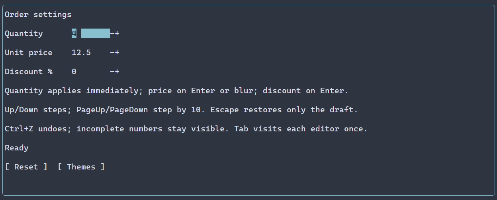

# Числовые редакторы {#spin-boxes-ru}

[English version](../spin-boxes.md) · [LineEdit](line-edit.md) · [Слайдеры](sliders.md)

SpinBox подходит для ограниченного конечного числа, которое можно ввести или изменить по шагам; [Slider](sliders.md) подчёркивает положение в диапазоне. Проверяемые значения и ограничения диапазона описаны в [API SpinBox](../../include/portals/spin_box.hpp) и [числовом источнике](../../include/portals/numeric.hpp). Изображение ниже показывает полную числовую форму.

`ui::spinBox()` позволяет вводить конечное число текстом или изменять его кнопками
шага. По умолчанию значение равно нулю, включительный диапазон — 0..100, шаг —
единица, режим публикации — `EditMode::IMMEDIATE`.

## Полное приложение

\include guide_spin_box.cpp

Соберите программу командой `cmake --build <build> --target portals_docs_spin_box`.
Для установленного SDK используйте тот же исходник с [настройкой пакета](package.md).
[Пример числовой формы](../../examples/numeric_form/main.cpp) показывает три поля,
отложенное подтверждение, сброс и выбор тем Nord и Latte. Шаговые кнопки используют
стандартное оформление выбранной темы. Цель сборки программы —
`portals_numeric_form`. В обеих программах `ui::runApp()` восстанавливает терминал
и закрывает сцену.



Статичные кадры: [тёмная тема Nord](../images/spin-boxes-dark.png) · [светлая тема Latte](../images/spin-boxes-light.png).

## Черновик и числовой источник

SpinBox содержит один обычный LineEdit и две кнопки `-`/`+` без рамки. Tab посещает
только редактор. Выделение, ограничения Unicode, буфер обмена и
[история Undo/Redo](editor-history.md) принадлежат существующему LineEdit.
Предпочтительная ширина редактора — восемь ячеек, каждой кнопки — одна.
Обычные размеры и рамки применяются к содержащей их строке.

`ManagedScene::remove` отклоняет удаление редактора или отдельной шаговой кнопки
привязанного SpinBox с `INVALID_ARGUMENT`; удаляйте SpinBox целиком. Удаление
отдельного структурного ребёнка напрямую через `WidgetTree` при действующей
привязке обходит этот контракт управляемого владения.

Грамматика чисел не зависит от локали: десятичная точка и необязательная экспонента.
Весь черновик должен задавать конечное число в настроенном диапазоне.
Пустая строка, знак, незаконченная экспонента, ошибочный текст и число за границами
остаются видимыми без публикации. Успешное подтверждение сохраняет написание
`01` или `1e0` до настоящего внешнего изменения. Настраиваемые локаль и точность
форматирования не поддерживаются.

| Режим | Публикация |
|---|---|
| `IMMEDIATE` | При каждом допустимом изменении |
| `ON_COMPLETION` | По Enter или при потере фокуса |
| `EXPLICIT` | По Enter; потеря фокуса сохраняет черновик |

Escape принимает последний источник и новую исходную базу. Собственное
подтверждение сохраняет историю. Внешнее изменение обновляет чистое поле;
редактируемое поле сохраняет черновик и сообщает конфликт ревизии при подтверждении.
Смена границ или шага тоже меняет ревизию, даже при прежнем числовом значении.

`amount.text()` и `amount.lineEdit().text()` обращаются к одному видимому черновику.
Присваивание `amount.value() = 3.5` следует выбранному режиму редактирования.
`amount.value().get()` читает допустимое число из видимого черновика. Незаконченная
грамматика даёт `NumericError::INVALID_TEXT`, неконечное число — `NOT_FINITE`,
выход за границы — `OUT_OF_RANGE`. Чтение не уничтожает текст и не регистрирует
ошибку автоматически.

Присваивание возвращает независимое наблюдение:

```cpp
// amount is a mounted ui::Ref<SpinBox> in EXPLICIT mode.
auto assignment = amount.value() = 3.5;
auto observed = assignment.result();
// On success, observed->editing describes draft acceptance.
// observed->commit is present only when a numeric publication actually occurred.
```

## Общая модель и события

Создайте `ManagedScene::numericState(initial, NumericRange)` в фабрике сцены
и передайте в `ui::spinBox(reference, model)`. Тот же NumericState работает со
[Slider](sliders.md). Его `snapshot()` читает подтверждённое значение, даже когда
редактор показывает другой черновик. `set(double)` пишет непосредственно в источник;
`configure(initial, range)` атомарно меняет значение и полный диапазон.
Явные настройки значения, границ или шага вместе с внешней моделью дают
`INITIAL_CONFLICT`, включая равные настройки. Ошибочная конфигурация сохраняет
исходный NumericError и прежний источник.

`ui::onChange(amount, callback)` получает `double` либо точный
`PropertyUpdate<NumericValue>` изменившей модель пользовательской публикации.
Внешние и fluent-записи, а также равные публикации его не вызывают. Текстовые
и завершающие события доступны через ссылку LineEdit. Результаты владеют исходными
снимками, даже если callback снова меняет модель или удаляет контрол.

## Ввод, ресурсы и оформление

Up/Down и обе кнопки используют `.step(value)`. PageUp/PageDown выполняют
`.pageSteps(count)` шагов, по умолчанию десять. Допустимый черновик служит исходным
значением; ошибочный сохраняется. Чистое поле шагает от полного значения источника,
включая дробь между делениями. Шаги насыщаются на границах и следуют режиму
редактирования. Каждый шаг — отдельная операция штатной истории.

`.readOnly()` запрещает пользовательский ввод, изменение истории и шаги.
Программные изменения текста, числового черновика и внешней модели разрешены.
Отключённый предок также запрещает пользовательское изменение.

Зарегистрированный ресурс `SpinBox` принимает числовые `value`, `minimum`,
`maximum`, `step`, `pageSteps`, `readOnly`, `editMode`, обычные свойства текста,
истории, ограничений, размеров и рамок. Отсутствующие свойства сохраняют настройки
фабрики; явный false остаётся переопределением. Числовая ошибка сохраняет положение
причинного свойства. Естественный стилевой тип корня — `SpinBox`. Реальные дети
имеют типы `LineEdit` и `Button` и классы `spin-box-editor`, `spin-box-decrease`,
`spin-box-increase`; к ним применяются обычные темы, классы и ID.


## Настройка оформления {#spin-boxes-styling-reference-ru}

`SpinBox` — корень компоновки, а не рисуемый редактор. Дочерние элементы — `LineEdit` и две кнопки `Button`. Используйте подтверждённые классы `.spin-box-editor`, `.spin-box-decrease`, `.spin-box-increase`; кнопки показывают фиксированные подписи `-` и `+`, свойства PSS для их замены нет. Редактор рисует normal/focused/disabled, selected и caret, как описано в [LineEdit](line-edit.md#line-edit-styling-reference-ru); кнопки — normal/focused/disabled. Ручные значения редактора берутся из `LineEditOptions`, кнопок — из `ControlStyle{}`. Стилизуйте дочерние элементы отдельно: объявление корня на них не распространяется.

Общие свойства отрисовки действуют на соответствующий рисуемый элемент:

| Свойство | Значение |
| --- | --- |
| `foreground` | цвет текста или символа `#RRGGBB` |
| `background` | цвет заливки `#RRGGBB` |
| `bold` | `true` или `false` |
| `italic` | `true` или `false` |
| `underline` | `true` или `false` |

Ручной `ControlStyle` по умолчанию использует цвета терминала, обычный текст, жирный шрифт при фокусе и курсив для недоступного элемента. Тема и PSS переопределяют отдельные поля; неуказанные поля сохраняют значения нижнего слоя, включая явное `false`. Селектор без состояния задаёт все варианты. См. [каскад и селекторы](styling-guide.md) и [стили](styles.md).

Свойства размеров `width` и `height` принимают неотрицательное число ячеек, `auto`, `fit-content` или `flex(положительный вес)`; `min-width`, `max-width`, `min-height`, `max-height` — неотрицательное число ячеек. Селектор не должен содержать состояние или `:read-only`. Эти свойства, кроме `min-width`, доступны только в runtime PSS. При противоречии ограничениям виджета обновление отклоняется с сохранением прежних стиля и геометрии. Ограничения и приоритеты описаны в [компоновке](layout.md). Размер влияет на выделенную область, а не на сами символы.

```pss
.spin-box-editor { min-width: 8; }
.spin-box-editor:focused { background: #245070; }
.spin-box-decrease { foreground: #62b4d7; }
.spin-box-increase { foreground: #62b4d7; }
```
